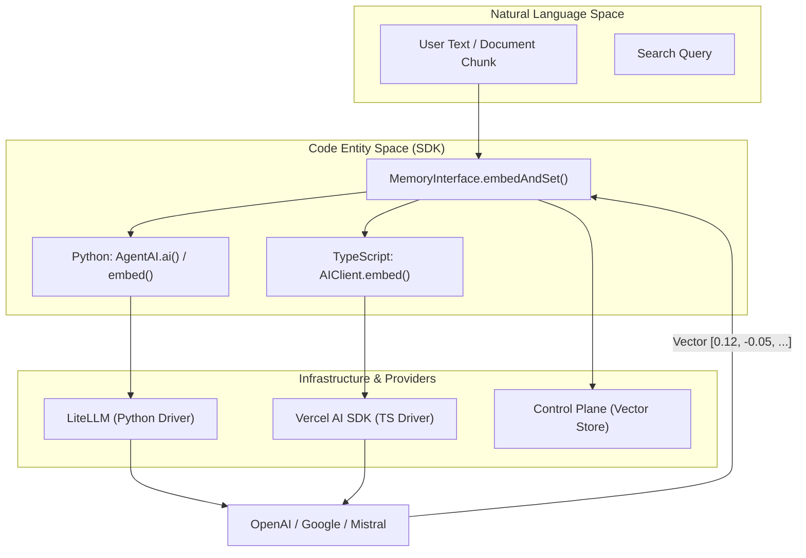
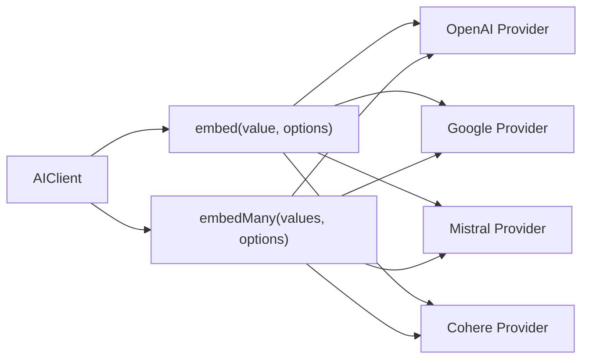
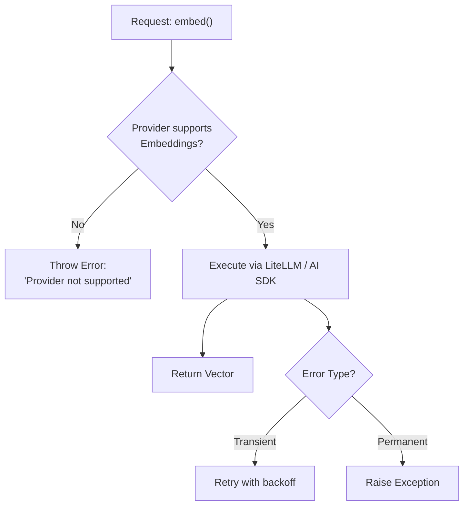
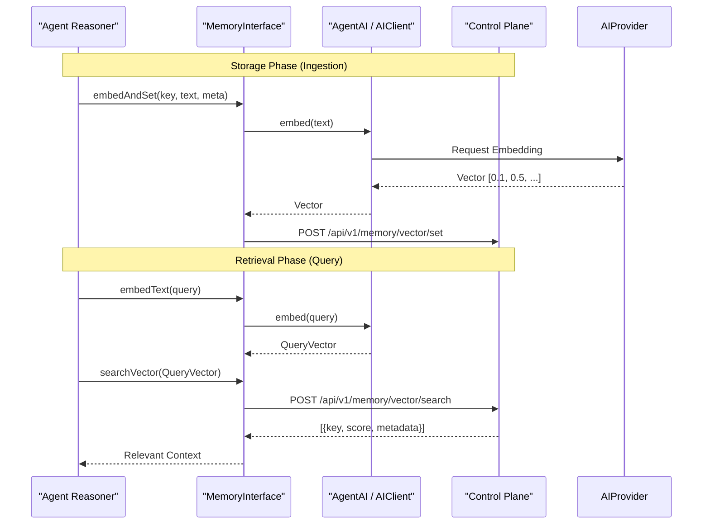

<!-- source: DeepWiki mcp.deepwiki.com · repo Agent-Field/agentfield · page 10.4 Embeddings · fetched 2026-10-26 -->

# Embeddings

Relevant source files

The following files were used as context for generating this wiki page:

- [sdk/go/ai/README.md](sdk/go/ai/README.md)
- [sdk/go/ai/client.go](sdk/go/ai/client.go)
- [sdk/go/ai/client_test.go](sdk/go/ai/client_test.go)
- [sdk/go/ai/config.go](sdk/go/ai/config.go)
- [sdk/go/ai/model_params.go](sdk/go/ai/model_params.go)
- [sdk/go/ai/model_params_test.go](sdk/go/ai/model_params_test.go)
- [sdk/go/ai/multimodal.go](sdk/go/ai/multimodal.go)
- [sdk/go/ai/multimodal_test.go](sdk/go/ai/multimodal_test.go)
- [sdk/go/ai/request.go](sdk/go/ai/request.go)
- [sdk/go/ai/request_test.go](sdk/go/ai/request_test.go)
- [sdk/go/ai/response.go](sdk/go/ai/response.go)
- [sdk/go/ai/response_test.go](sdk/go/ai/response_test.go)
- [sdk/python/agentfield/agent_ai.py](sdk/python/agentfield/agent_ai.py)
- [sdk/python/agentfield/agent_utils.py](sdk/python/agentfield/agent_utils.py)
- [sdk/python/agentfield/media_router.py](sdk/python/agentfield/media_router.py)
- [sdk/python/agentfield/multimodal.py](sdk/python/agentfield/multimodal.py)
- [sdk/python/agentfield/vision.py](sdk/python/agentfield/vision.py)
- [sdk/python/tests/test_agent_ai.py](sdk/python/tests/test_agent_ai.py)
- [sdk/python/tests/test_image_config.py](sdk/python/tests/test_image_config.py)
- [sdk/python/tests/test_media_router.py](sdk/python/tests/test_media_router.py)
- [sdk/python/tests/test_strict_openai_schema.py](sdk/python/tests/test_strict_openai_schema.py)
- [sdk/python/tests/test_types.py](sdk/python/tests/test_types.py)
- [sdk/python/uv.lock](sdk/python/uv.lock)

## Purpose and Scope

This document describes how to generate text embeddings in AgentField and integrate them with the vector storage system for semantic search and retrieval-augmented generation (RAG) applications. Embeddings are numerical vector representations of text that enable similarity-based operations in memory scopes.

The AgentField system abstracts embedding generation through the `AIClient` (TypeScript) and `AgentAI` (Python) components, providing a unified interface across multiple providers like OpenAI, Google, and Mistral.

---

## Embedding Generation Architecture

Embedding generation flows from the high-level Agent SDKs through provider-specific drivers. In the Python SDK, `AgentAI` handles the coordination of AI tasks, while in TypeScript, `AIClient` manages the direct interaction with LLM providers.

### AI Space to Code Entity Space: Embedding Flow

The following diagram maps the conceptual "Natural Language Space" (where text resides) to the "Code Entity Space" (where vectors are computed and stored).

**Sources:** [sdk/python/agentfield/agent_ai.py:10-18](), [sdk/python/agentfield/agent_ai.py:131-150](), [sdk/python/uv.lock:15-22]()

---

## TypeScript SDK Embedding Methods

The TypeScript SDK's `AIClient` class provides two primary methods for generating embeddings, abstracting the underlying provider logic.

### AIClient Embedding Methods

#### Single Text Embedding
The `embed()` method generates an embedding vector for a single text string. It returns a numeric array representing the embedding vector.

#### Batch Embeddings
The `embedMany()` method generates embeddings for multiple texts in a single request. Batch processing is significantly more efficient for large document collections or ingestion pipelines.

---

## Provider Support and Detection

AgentField supports a wide range of embedding providers. Support is validated at runtime to ensure the selected model and provider are capable of embedding tasks.

### Supported Providers Table

| Provider | Embedding Support | Method Used |
|----------|------------------|-------------|
| OpenAI | ✅ Yes | `embedding()` |
| Google | ✅ Yes | `textEmbeddingModel()` |
| Mistral | ✅ Yes | `textEmbeddingModel()` |
| Cohere | ✅ Yes | `textEmbeddingModel()` |
| OpenRouter | ✅ Yes | OpenAI-compatible `embedding()` |
| Ollama | ✅ Yes | OpenAI-compatible `embedding()` |
| Anthropic | ❌ No | N/A (Text Generation Only) |
| DeepSeek | ❌ No | N/A (Text Generation Only) |

### Provider Error Handling

The system performs defensive checks before calling provider APIs. For example, in the Python SDK, `_is_transient_llm_error` is used to distinguish between temporary network glitches and permanent configuration errors (like using a non-embedding model for embedding tasks).

**Sources:** [sdk/python/agentfield/agent_ai.py:185-212](), [sdk/python/agentfield/agent_ai.py:214-230]()

---

## Vector Storage Integration

Embeddings are rarely used in isolation; they are typically stored in the system's memory for later retrieval. The `MemoryInterface` provides high-level methods that combine embedding generation with vector storage operations.

### MemoryInterface Operations

1.  **`embedText(text, options)`**: Generates an embedding for a single text string using the configured `AIClient`.
2.  **`embedTexts(texts, options)`**: Generates embeddings for multiple texts.
3.  **`embedAndSet(key, text, metadata, scope, scopeId)`**: A convenience method that generates an embedding and immediately persists it to the Control Plane's vector store.

### Storing and Searching Embeddings

The following sequence diagram illustrates the interaction between the Agent, the AI Provider, and the Control Plane during a RAG ingestion and retrieval flow.

**Sources:** [sdk/python/agentfield/agent_ai.py:131-150](), [sdk/python/agentfield/agent_ai.py:106-111]()

---

## Configuration and Reliability

### Model Selection
Embedding models are configured via the `AIConfig` object. While text generation might use `gpt-4o`, embeddings typically use specialized models like `text-embedding-3-small` or `text-embedding-3-large`.

### Rate Limiting and Retries
Embedding generation is subject to provider rate limits. AgentField uses a `StatelessRateLimiter` to handle `429 Too Many Requests` errors with exponential backoff and jitter.

*   **`rate_limit_max_retries`**: Number of times to retry a failed embedding call.
*   **`rate_limit_base_delay`**: Initial delay between retries.
*   **`rate_limit_circuit_breaker_threshold`**: Number of consecutive failures before tripping the circuit breaker to prevent cascading failures.

**Sources:** [sdk/python/agentfield/agent_ai.py:16-17](), [sdk/python/agentfield/agent_ai.py:97-111](), [sdk/python/agentfield/agent_ai.py:169-182]()

### Timeout Management
To prevent hanging execution, embedding calls have a safety-net timeout. If a call stalls, the `_reset_litellm_http_clients` function is triggered to clear cached connection pools and force a fresh connection on the next attempt.

**Sources:** [sdk/python/agentfield/agent_ai.py:103-164]()

---

