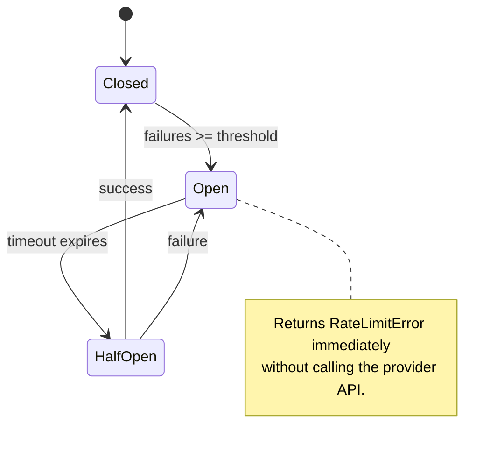

<!-- source: DeepWiki mcp.deepwiki.com · repo Agent-Field/agentfield · page 10.5 Rate Limiting & Retries · fetched 2026-10-26 -->

# Rate Limiting & Retries

<details>
<summary>Relevant source files</summary>

The following files were used as context for generating this wiki page:

- [sdk/python/agentfield/agent_ai.py](sdk/python/agentfield/agent_ai.py)
- [sdk/python/agentfield/media_router.py](sdk/python/agentfield/media_router.py)
- [sdk/python/agentfield/rate_limiter.py](sdk/python/agentfield/rate_limiter.py)
- [sdk/python/agentfield/vision.py](sdk/python/agentfield/vision.py)
- [sdk/python/tests/test_agent_ai.py](sdk/python/tests/test_agent_ai.py)
- [sdk/python/tests/test_ai_config.py](sdk/python/tests/test_ai_config.py)
- [sdk/python/tests/test_image_config.py](sdk/python/tests/test_image_config.py)
- [sdk/python/tests/test_media_router.py](sdk/python/tests/test_media_router.py)
- [sdk/python/tests/test_strict_openai_schema.py](sdk/python/tests/test_strict_openai_schema.py)
- [sdk/python/tests/test_types.py](sdk/python/tests/test_types.py)
- [sdk/python/uv.lock](sdk/python/uv.lock)
- [sdk/typescript/src/ai/RateLimiter.ts](sdk/typescript/src/ai/RateLimiter.ts)
- [sdk/typescript/src/ai/ToolCalling.ts](sdk/typescript/src/ai/ToolCalling.ts)

</details>


## Purpose & Scope

This document covers the automatic rate limiting and retry mechanisms built into AgentField's AI integration layer. When AI provider APIs return rate limit errors (typically HTTP 429 status codes), the SDK automatically retries requests using exponential backoff with jitter and circuit breaker patterns. This functionality is implemented via the `StatelessRateLimiter` class and applies to text generation, structured outputs, and embeddings across both Python and TypeScript SDKs.

For information about configuring AI providers and models, see [AI Configuration](#10.2). For details on text generation and embedding operations, see [Text Generation](#10.3) and [Embeddings](#10.4).

---

## Architecture Overview

### Rate Limiting Flow

```mermaid
graph TB
    subgraph "Agent Logic"
        Reasoner["Reasoner/Skill Code"]
    end

    subgraph "SDK Core (agentfield)"
        AgentAI["AgentAI (Python) / AIClient (TS)"]
        RateLimiter["StatelessRateLimiter"]
    end

    subgraph "External"
        LiteLLM["LiteLLM / Provider Client"]
        Provider["AI Provider API<br/>(OpenAI, Anthropic, etc)"]
    end
    
    Reasoner -->|"ai() / generate()"| AgentAI
    AgentAI -->|"execute_with_retry()"| RateLimiter
    RateLimiter -->|"acompletion()"| LiteLLM
    LiteLLM -->|"HTTP Request"| Provider
    Provider -->|"429 Rate Limit"| LiteLLM
    LiteLLM --X|"Exception"| RateLimiter
    RateLimiter -->|"Exponential Backoff<br/>+ Jitter"| LiteLLM
    LiteLLM -->|"200 Success"| RateLimiter
    RateLimiter -->|"Response"| AgentAI
    AgentAI -->|"Result"| Reasoner
```

**Sources:** [sdk/python/agentfield/agent_ai.py:330-360](), [sdk/python/agentfield/rate_limiter.py:18-48](), [sdk/typescript/src/ai/RateLimiter.ts:51-72]()

### Code Entity Mapping

| System Name | Python Entity | TypeScript Entity | Role |
| :--- | :--- | :--- | :--- |
| **Rate Limiter** | `StatelessRateLimiter` | `StatelessRateLimiter` | Handles backoff, jitter, and circuit breaking. |
| **Retry Wrapper** | `execute_with_retry` | `executeWithRetry` | Orchestrates the try/catch loop for API calls. |
| **Error Detection** | `_is_rate_limit_error` | `_isRateLimitError` | Identifies 429/503 status codes and specific error strings. |
| **Delay Logic** | `_calculate_backoff_delay` | `_calculateBackoffDelay` | Implements exponential growth with container-seeded jitter. |

**Sources:** [sdk/python/agentfield/rate_limiter.py:18-212](), [sdk/typescript/src/ai/RateLimiter.ts:51-231]()

---

## Configuration Options

Rate limiting behavior is configured through the `AIConfig` object. In Python, these defaults are established in `AIConfig` and used to initialize the `StatelessRateLimiter` within `AgentAI`.

### Configuration Parameters

| Parameter | Type | Default | Description |
|-----------|------|---------|-------------|
| `enable_rate_limit_retry` | `bool` | `True` | Master switch to enable/disable automatic retries. |
| `rate_limit_max_retries` | `int` | `5` | Maximum number of retry attempts before failing. |
| `rate_limit_base_delay` | `float` | `0.5` | Initial delay in seconds for first retry. |
| `rate_limit_max_delay` | `float` | `30.0` | Maximum delay in seconds (capped). |
| `rate_limit_jitter_factor` | `float` | `0.25` | Random variance factor (±25%) to prevent thundering herd. |
| `rate_limit_circuit_breaker_threshold` | `int` | `5` | Failures before opening circuit. |
| `rate_limit_circuit_breaker_timeout` | `int` | `30` | Seconds to keep circuit open. |

**Sources:** [sdk/python/agentfield/types.py:30-45](), [sdk/python/tests/test_ai_config.py:18-24]()

---

## Exponential Backoff & Jitter

### Delay Calculation

The delay increases exponentially but is modified by a **container-specific seed**. This ensures that while a single container retries consistently, different containers (even on the same host) will naturally distribute their load over time.

```python
# Delay logic in Python
base_delay = min(self.base_delay * (2**attempt), self.max_delay)
random.seed(self._container_seed + attempt)
jitter = random.uniform(-jitter_range, jitter_range)
delay = max(0.1, base_delay + jitter)
```

**Sources:** [sdk/python/agentfield/rate_limiter.py:142-161](), [sdk/typescript/src/ai/RateLimiter.ts:180-194]()

### Container-Specific Jitter

To prevent the "thundering herd" problem where multiple agents retry at the exact same millisecond, AgentField generates a seed based on the environment:
- **Python**: Uses `HOSTNAME` and `os.getpid()`. [sdk/python/agentfield/rate_limiter.py:49-53]()
- **TypeScript**: Uses `os.hostname()` and `process.pid`. [sdk/typescript/src/ai/RateLimiter.ts:74-78]()

---

## Circuit Breaker Pattern

The circuit breaker prevents cascading failures. If an AI provider is consistently returning 429s, the SDK "opens" the circuit to fail fast, saving compute resources and avoiding further provider penalties.



**Sources:** [sdk/python/agentfield/rate_limiter.py:163-212](), [sdk/typescript/src/ai/RateLimiter.ts:196-221]()

---

## Specialized Retry Logic

### LLM Timeout & Client Resets
In `agent_ai.py`, AgentField implements a defensive reset for `litellm`'s HTTP clients. If a call hangs and hits a wall-clock timeout, the SDK cancels the task and clears `litellm`'s internal connection pool to prevent deadlocks on half-closed sockets.

- **Timeout Retries**: Defaults to 2 retries for wall-clock timeouts. [sdk/python/agentfield/agent_ai.py:169-182]()
- **Client Purge**: The function `_reset_litellm_http_clients` clears module-level caches in `litellm`. [sdk/python/agentfield/agent_ai.py:103-165]()

### Transient vs. Permanent Errors
The SDK distinguishes between errors that should be retried and those that should fail immediately:

| Error Type | Logic | Markers |
| :--- | :--- | :--- |
| **Transient** | Retry via RateLimiter | `overloaded`, `service unavailable`, `bad gateway`, `connection`, `econnreset` |
| **Permanent** | Fail Immediately | `invalid_request_error`, `authentication`, `no such model`, `context_length` |

**Sources:** [sdk/python/agentfield/agent_ai.py:185-212]()

### OpenRouter "No Endpoints" Retry
Specific logic exists for OpenRouter's transient "No endpoints found" 404 error. The SDK performs up to 3 attempts with inter-sleeps before optionally stripping the `image_config` to maximize compatibility.

**Sources:** [sdk/python/agentfield/vision.py:18-25](), [sdk/python/agentfield/vision.py:187-200]()

---

## Implementation Example (Python)

```python
# The AgentAI class uses the limiter to wrap provider calls
async def _execute_with_retry(self, func, **kwargs):
    if not self.agent.ai_config.enable_rate_limit_retry:
        return await func()
    
    limiter = self._get_rate_limiter()
    return await limiter.execute_with_retry(func)
```

**Sources:** [sdk/python/agentfield/agent_ai.py:330-340](), [sdk/python/tests/test_agent_ai.py:194-212]()

---

## Best Practices

1. **Keep Defaults for Production**: The default theoretical max wait is under 3 minutes, which is optimal for balancing resilience and responsiveness. [sdk/python/tests/test_ai_config.py:27-31]()
2. **Use Structured Outputs with Caution**: If a model provides `reasoning_content` but an empty structured result, the SDK raises `_EmptyReasoningStructuredOutput` to trigger a retry, as this is often a model glitch. [sdk/python/agentfield/agent_ai.py:92-101]()
3. **Monitor Circuit States**: If your agent logs "Circuit breaker opened", it indicates your provider tier is insufficient for the current load. [sdk/python/agentfield/rate_limiter.py:200-207]()

**Sources:** [sdk/python/agentfield/agent_ai.py:1-400](), [sdk/python/agentfield/rate_limiter.py:1-212](), [sdk/typescript/src/ai/RateLimiter.ts:1-250]()

---

