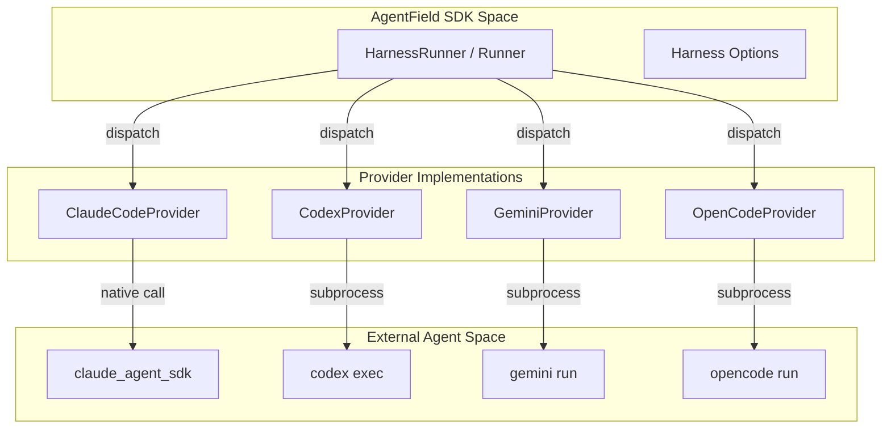
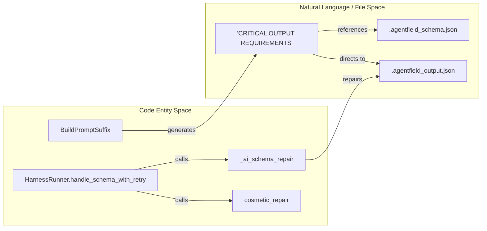

<!-- source: DeepWiki mcp.deepwiki.com · repo Agent-Field/agentfield · page 11 Harness Orchestration · fetched 2026-10-26 -->

# Harness Orchestration

Relevant source files

The following files were used as context for generating this wiki page:

- [sdk/go/agent/agent.go](sdk/go/agent/agent.go)
- [sdk/go/agent/agent_lifecycle.go](sdk/go/agent/agent_lifecycle.go)
- [sdk/go/agent/pause.go](sdk/go/agent/pause.go)
- [sdk/go/agent/pause_test.go](sdk/go/agent/pause_test.go)
- [sdk/go/harness/claudecode.go](sdk/go/harness/claudecode.go)
- [sdk/go/harness/coverage_branches_test.go](sdk/go/harness/coverage_branches_test.go)
- [sdk/go/harness/coverage_helpers_test.go](sdk/go/harness/coverage_helpers_test.go)
- [sdk/go/harness/parity_test.go](sdk/go/harness/parity_test.go)
- [sdk/go/harness/provider.go](sdk/go/harness/provider.go)
- [sdk/go/harness/result.go](sdk/go/harness/result.go)
- [sdk/go/harness/runner.go](sdk/go/harness/runner.go)
- [sdk/go/harness/runner_test.go](sdk/go/harness/runner_test.go)
- [sdk/go/harness/schema.go](sdk/go/harness/schema.go)
- [sdk/python/agentfield/harness/_runner.py](sdk/python/agentfield/harness/_runner.py)
- [sdk/python/agentfield/harness/_schema.py](sdk/python/agentfield/harness/_schema.py)
- [sdk/python/agentfield/harness/providers/claude.py](sdk/python/agentfield/harness/providers/claude.py)
- [sdk/python/agentfield/harness/providers/codex.py](sdk/python/agentfield/harness/providers/codex.py)
- [sdk/python/agentfield/harness/providers/gemini.py](sdk/python/agentfield/harness/providers/gemini.py)
- [sdk/python/agentfield/harness/providers/opencode.py](sdk/python/agentfield/harness/providers/opencode.py)
- [sdk/python/agentfield/types.py](sdk/python/agentfield/types.py)
- [sdk/python/tests/test_harness_ai_schema_repair.py](sdk/python/tests/test_harness_ai_schema_repair.py)
- [sdk/python/tests/test_harness_provider_claude.py](sdk/python/tests/test_harness_provider_claude.py)
- [sdk/python/tests/test_harness_provider_codex.py](sdk/python/tests/test_harness_provider_codex.py)
- [sdk/python/tests/test_harness_provider_gemini.py](sdk/python/tests/test_harness_provider_gemini.py)
- [sdk/python/tests/test_harness_provider_opencode.py](sdk/python/tests/test_harness_provider_opencode.py)
- [sdk/python/tests/test_harness_runner.py](sdk/python/tests/test_harness_runner.py)
- [sdk/python/tests/test_harness_schema.py](sdk/python/tests/test_harness_schema.py)

The **Harness** system provides a standardized interface for delegating complex, autonomous tasks to specialized coding agents. Unlike standard LLM interactions (e.g., `app.ai()`), the Harness orchestrates "agentic" workflows where the model has access to a file system, shell, and multi-turn reasoning loops to solve engineering problems.

The primary entry point for this system is the `HarnessRunner` (Python) or `Runner` (Go), which manages the lifecycle of these external agents, handles environment preparation, and ensures structured output via schema enforcement.

### Key Capabilities
*   **Provider Abstraction**: A unified API for interacting with `Claude Code`, `Codex`, `Gemini`, and `OpenCode`.
*   **Autonomous Execution**: Agents can read/write files and execute shell commands within a sandboxed or local environment.
*   **Structured Delegation**: Request complex objects (e.g., security audits, code refactors) and receive validated JSON via automated retry loops.
*   **State Management**: Support for resuming sessions and tracking multi-turn execution metrics.

---

## Harness Concepts & Architecture
The Harness operates as a wrapper around specialized CLI tools and SDKs. It translates a high-level `prompt` and `schema` into the specific command-line arguments and file-system protocols required by each provider.

### The Harness Lifecycle
1.  **Preparation**: The `Runner` merges global defaults with per-call `Options`.
2.  **Schema Injection**: If a schema is provided, the `Runner` appends a "Critical Output Requirement" suffix to the prompt, instructing the agent to write its final answer to a deterministic file path (typically `.agentfield_output.json`).
3.  **Execution**: The `Runner` invokes the provider (e.g., via `subprocess` or native SDK).
4.  **Extraction & Validation**: Once the agent finishes, the `Runner` attempts to read the output file, validate it against the schema, and perform repairs if necessary.

For details on the architecture and when to use the Harness vs. standard AI calls, see [Harness Concepts & Architecture](#11.1).

**Sources:**
*   `HarnessRunner` definition: [sdk/python/agentfield/harness/_runner.py:209-211]()
*   Go `Runner` and `Run` logic: [sdk/go/harness/runner.go:21-53]()
*   Prompt suffix injection: [sdk/go/harness/runner.go:121-131]()

---

## Harness Providers
Providers are the bridge between AgentField and the underlying coding agents. Each provider implements a standard `Execute` interface to handle the nuances of different platforms.

| Provider | Backend Entity | Description |
| :--- | :--- | :--- |
| `ClaudeCodeProvider` | `claude_agent_sdk` | Native Python SDK integration for Anthropic's Claude Code. |
| `CodexProvider` | `codex` CLI | High-performance engineering agent with native schema support. |
| `GeminiProvider` | `gemini` CLI | Google's autonomous agent, often used for large-context tasks. |
| `OpenCodeProvider` | `opencode` CLI | Open-source compatible engineering agent. |

### Provider Orchestration Diagram

For detailed configuration and platform differences, see [Harness Providers](#11.2).

**Sources:**
*   `OpenCodeProvider` implementation: [sdk/python/agentfield/harness/providers/opencode.py:125-147]()
*   `ClaudeCodeProvider` implementation: [sdk/python/agentfield/harness/providers/claude.py:35-47]()
*   Go `Provider` interface: [sdk/go/harness/runner.go:160-166]()

---

## Schema Extraction & Repair
A core strength of the Harness is ensuring that autonomous agents return structured data. Because agents may fail to format JSON correctly during long-running tasks, the system employs several layers of recovery.

### Extraction Strategies
*   **File Protocol**: Most providers are instructed to use their `Write` tool to save JSON to `.agentfield_output.json`.
*   **Native Schema**: `Codex` supports native structured output via `--output-schema`, which AgentField leverages for higher reliability.
*   **Incremental Mode**: For large schemas, the Harness can instruct the agent to build the object field-by-field.

### Repair Loop
If validation fails, the `HarnessRunner` executes a tiered repair strategy:
1.  **Cosmetic Repair**: Regex-based cleaning of markdown fences and trailing commas.
2.  **AI-Based Repair**: A fast, tool-less LLM call (via `litellm`) to reformat the malformed text into the target schema.
3.  **Retry Loop**: Re-running the agent with a "follow-up" prompt highlighting the specific validation errors.

### Schema Entity Mapping

For details on the repair logic and incremental builds, see [Schema Extraction & Repair](#11.3).

**Sources:**
*   AI Schema Repair logic: [sdk/python/agentfield/harness/_runner.py:66-88]()
*   Cosmetic Repair function: [sdk/go/harness/schema.go:207-212]()
*   Go Retry/Validation loop: [sdk/go/harness/runner.go:140-144]()
*   Output file constants: [sdk/go/harness/schema.go:17-21]()

---

