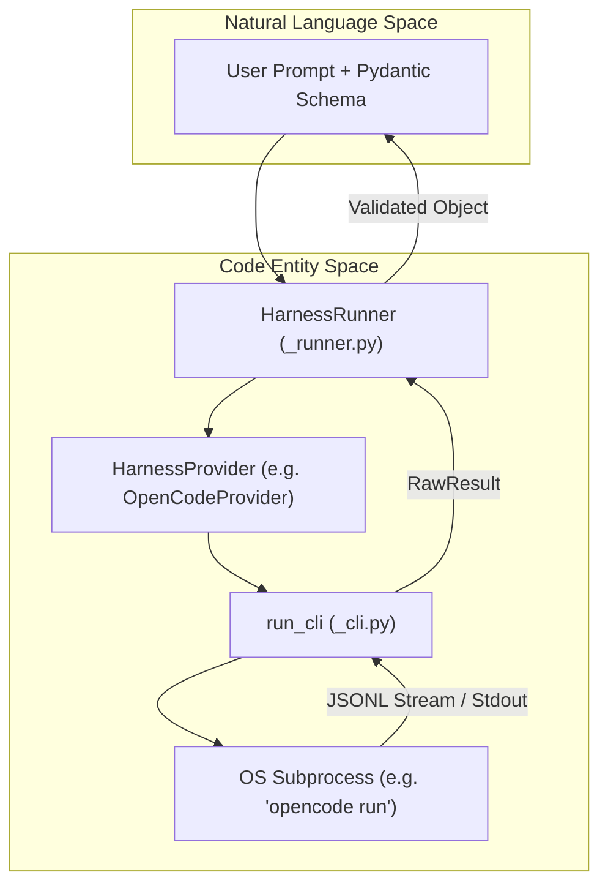
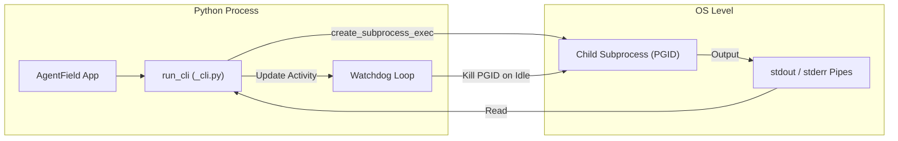

<!-- source: DeepWiki mcp.deepwiki.com · repo Agent-Field/agentfield · page 11.1 Harness Concepts & Architecture · fetched 2026-10-26 -->

# Harness Concepts & Architecture

Relevant source files

The following files were used as context for generating this wiki page:

- [sdk/go/harness/cli.go](sdk/go/harness/cli.go)
- [sdk/go/harness/cli_unix.go](sdk/go/harness/cli_unix.go)
- [sdk/go/harness/cli_windows.go](sdk/go/harness/cli_windows.go)
- [sdk/go/harness/opencode.go](sdk/go/harness/opencode.go)
- [sdk/go/harness/opencode_json_test.go](sdk/go/harness/opencode_json_test.go)
- [sdk/go/harness/opencode_test.go](sdk/go/harness/opencode_test.go)
- [sdk/python/agentfield/harness/_cli.py](sdk/python/agentfield/harness/_cli.py)
- [sdk/python/agentfield/harness/_runner.py](sdk/python/agentfield/harness/_runner.py)
- [sdk/python/agentfield/harness/_schema.py](sdk/python/agentfield/harness/_schema.py)
- [sdk/python/agentfield/harness/providers/claude.py](sdk/python/agentfield/harness/providers/claude.py)
- [sdk/python/agentfield/harness/providers/codex.py](sdk/python/agentfield/harness/providers/codex.py)
- [sdk/python/agentfield/harness/providers/gemini.py](sdk/python/agentfield/harness/providers/gemini.py)
- [sdk/python/agentfield/harness/providers/opencode.py](sdk/python/agentfield/harness/providers/opencode.py)
- [sdk/python/agentfield/types.py](sdk/python/agentfield/types.py)
- [sdk/python/tests/test_agent_ai_deadlock_recovery.py](sdk/python/tests/test_agent_ai_deadlock_recovery.py)
- [sdk/python/tests/test_agent_server.py](sdk/python/tests/test_agent_server.py)
- [sdk/python/tests/test_harness_ai_schema_repair.py](sdk/python/tests/test_harness_ai_schema_repair.py)
- [sdk/python/tests/test_harness_cli.py](sdk/python/tests/test_harness_cli.py)
- [sdk/python/tests/test_harness_provider_claude.py](sdk/python/tests/test_harness_provider_claude.py)
- [sdk/python/tests/test_harness_provider_codex.py](sdk/python/tests/test_harness_provider_codex.py)
- [sdk/python/tests/test_harness_provider_gemini.py](sdk/python/tests/test_harness_provider_gemini.py)
- [sdk/python/tests/test_harness_provider_opencode.py](sdk/python/tests/test_harness_provider_opencode.py)
- [sdk/python/tests/test_harness_runner.py](sdk/python/tests/test_harness_runner.py)
- [sdk/python/tests/test_harness_schema.py](sdk/python/tests/test_harness_schema.py)
- [sdk/python/tests/test_run_cli_env.py](sdk/python/tests/test_run_cli_env.py)
- [sdk/typescript/src/harness/cli.ts](sdk/typescript/src/harness/cli.ts)
- [sdk/typescript/tests/harness_cli.test.ts](sdk/typescript/tests/harness_cli.test.ts)

The **Harness** is a specialized orchestration layer within AgentField designed to delegate complex, autonomous tasks to external coding agents and specialized LLM runtimes (e.g., Claude Code, OpenCode, Codex). Unlike the standard `app.ai()` interface, which performs single-turn or simple tool-calling completions, the Harness manages long-running, multi-turn "trajectories" where an external agent may browse a repository, run tests, and perform multi-step reasoning before returning a final structured result.

## Core Architecture

The Harness architecture follows a "Provider" pattern, abstracting the differences between various autonomous agent CLIs and SDKs.

### The HarnessRunner Lifecycle
The `HarnessRunner` is the central orchestrator responsible for managing the execution lifecycle of a harness task [sdk/python/agentfield/harness/_runner.py:209-211]().

1.  **Option Resolution**: Merges global configuration with call-specific overrides for providers, models, and budgets [sdk/python/agentfield/harness/_runner.py:154-187]().
2.  **Provider Selection**: Instantiates the requested `HarnessProvider` (e.g., `OpenCodeProvider`, `ClaudeCodeProvider`) [sdk/python/agentfield/harness/providers/_factory.py]().
3.  **Execution Loop**: Invokes the provider's `execute` method. This often involves spawning a subprocess or calling a native SDK [sdk/python/agentfield/harness/providers/opencode.py:155-164]().
4.  **Watchdog Monitoring**: A no-progress watchdog monitors `stdout`/`stderr`. If the subprocess remains silent for a defined window (default 300s), it is terminated to prevent silent hangs [sdk/python/agentfield/harness/_cli.py:24-25](), [sdk/go/harness/cli.go:26-27]().
5.  **Schema Extraction & Repair**: If a structured output (Pydantic model) is expected, the runner attempts to extract JSON from the agent's prose and applies AI-based repair if the JSON is malformed [sdk/python/agentfield/harness/_runner.py:66-152]().

### Data Flow Diagram
The following diagram illustrates the flow from a high-level `app.harness()` call down to the OS-level subprocess.

**Harness Execution Flow**

Sources: [sdk/python/agentfield/harness/_runner.py:209-211](), [sdk/python/agentfield/harness/_cli.py:147-155](), [sdk/python/agentfield/harness/providers/opencode.py:125-126]()

## Provider Abstraction

The Harness supports multiple providers through a unified interface. Providers are responsible for translating AgentField options into the specific CLI flags or SDK calls required by the target agent.

### CLI-Based Providers
Providers like `OpenCode`, `Codex`, and `Gemini` typically wrap a CLI binary.
*   **OpenCode**: Uses `opencode run --format json`. It supports project directory isolation via `--dir` and handles model selection via `-m` [sdk/python/agentfield/harness/providers/opencode.py:168-183]().
*   **Codex**: Invokes `codex exec --json` with sandbox permissions [sdk/python/tests/test_harness_provider_codex.py:166-176]().
*   **Concurrency Control**: CLI providers often use a global semaphore to limit the number of simultaneous subprocesses, preventing local resource exhaustion or LLM rate-limiting [sdk/python/agentfield/harness/providers/opencode.py:136-139](), [sdk/go/harness/opencode.go:42-53]().

### Native SDK Providers
*   **Claude Code**: Uses the `claude_agent_sdk` directly rather than a CLI subprocess. It maps AgentField's `permission_mode` to Claude's `bypassPermissions` or `plan` modes [sdk/python/agentfield/harness/providers/claude.py:35-69]().

**Provider Mapping**
| Feature | OpenCode | Claude Code | Codex |
| :--- | :--- | :--- | :--- |
| **Communication** | Subprocess (JSONL) | Native Python SDK | Subprocess (JSON) |
| **Project Root** | `--dir` | `cwd` | `-C` |
| **Binary Name** | `opencode` | `claude_agent_sdk` | `codex` |

Sources: [sdk/python/agentfield/harness/providers/opencode.py:125-183](), [sdk/python/agentfield/harness/providers/claude.py:35-72](), [sdk/python/agentfield/harness/providers/codex.py]()

## Implementation Details

### Subprocess Management (`run_cli`)
The `run_cli` function provides a robust wrapper for `asyncio.create_subprocess_exec`. Key features include:
*   **Environment Inheritance**: Propagates parent process environment variables so that tools like `EXA_API_KEY` reach the agent [sdk/python/agentfield/harness/_cli.py:169-172]().
*   **Idle Watchdog**: Uses a `StreamReader` to record the timestamp of the last activity on `stdout` or `stderr`. If `stalledFor >= idleSeconds`, the process group is killed [sdk/python/agentfield/harness/_cli.py:68-81](), [sdk/go/harness/cli.go:193-217]().
*   **Windows Compatibility**: Resolves `.cmd` shims on Windows using `shutil.which` and handles prompt delivery via `stdin` to bypass the ~8k character command-line limit [sdk/python/agentfield/harness/_cli.py:31-46](), [sdk/go/harness/opencode.go:16-26]().

### Silent Deadlock Recovery
To prevent `litellm` from wedging the system due to half-closed sockets, the AI integration includes a safety net. If an AI call times out, the system forcefully clears the internal `litellm` HTTP client caches to ensure the next call starts with a fresh connection pool [sdk/python/tests/test_agent_ai_deadlock_recovery.py:1-27](), [sdk/python/agentfield/agent_ai.py:41]().

**Subprocess Architecture**

Sources: [sdk/python/agentfield/harness/_cli.py:147-187](), [sdk/go/harness/cli.go:124-136]()

## When to use Harness vs app.ai()

| Criteria | `app.ai()` | `app.harness()` |
| :--- | :--- | :--- |
| **Interaction** | Single-turn / Tool-calling | Multi-turn Autonomous Trajectory |
| **Scope** | Stateless or Session Memory | Full Repository / Local Filesystem |
| **Duration** | Seconds | Minutes |
| **Cost** | Low (Single completion) | High (Multiple turns + tool runs) |
| **Output** | Text or Structured Data | Validated Schema + Trajectory Logs |

Use **Harness** when you need an agent to perform "work" (coding, searching, debugging) that requires multiple steps and autonomous decision-making. Use **app.ai()** for immediate reasoning, classification, or simple data extraction within a larger workflow.

Sources: [sdk/python/agentfield/harness/_runner.py:209-211](), [sdk/python/agentfield/agent_ai.py]()

---

