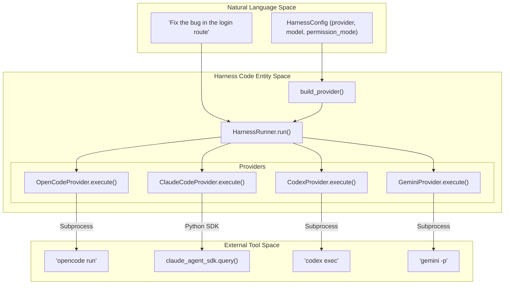
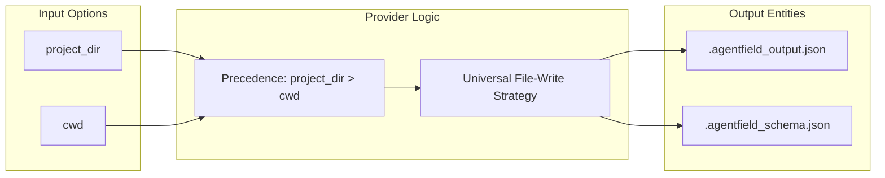

<!-- source: DeepWiki mcp.deepwiki.com · repo Agent-Field/agentfield · page 11.2 Harness Providers · fetched 2026-10-26 -->

# Harness Providers

Relevant source files

The following files were used as context for generating this wiki page:

- [sdk/python/agentfield/harness/_result.py](sdk/python/agentfield/harness/_result.py)
- [sdk/python/agentfield/harness/_runner.py](sdk/python/agentfield/harness/_runner.py)
- [sdk/python/agentfield/harness/_schema.py](sdk/python/agentfield/harness/_schema.py)
- [sdk/python/agentfield/harness/providers/_factory.py](sdk/python/agentfield/harness/providers/_factory.py)
- [sdk/python/agentfield/harness/providers/claude.py](sdk/python/agentfield/harness/providers/claude.py)
- [sdk/python/agentfield/harness/providers/codex.py](sdk/python/agentfield/harness/providers/codex.py)
- [sdk/python/agentfield/harness/providers/gemini.py](sdk/python/agentfield/harness/providers/gemini.py)
- [sdk/python/agentfield/harness/providers/opencode.py](sdk/python/agentfield/harness/providers/opencode.py)
- [sdk/python/agentfield/types.py](sdk/python/agentfield/types.py)
- [sdk/python/tests/test_harness_ai_schema_repair.py](sdk/python/tests/test_harness_ai_schema_repair.py)
- [sdk/python/tests/test_harness_provider_claude.py](sdk/python/tests/test_harness_provider_claude.py)
- [sdk/python/tests/test_harness_provider_codex.py](sdk/python/tests/test_harness_provider_codex.py)
- [sdk/python/tests/test_harness_provider_gemini.py](sdk/python/tests/test_harness_provider_gemini.py)
- [sdk/python/tests/test_harness_provider_opencode.py](sdk/python/tests/test_harness_provider_opencode.py)
- [sdk/python/tests/test_harness_runner.py](sdk/python/tests/test_harness_runner.py)
- [sdk/python/tests/test_harness_schema.py](sdk/python/tests/test_harness_schema.py)
- [sdk/typescript/src/harness/providers/opencode.ts](sdk/typescript/src/harness/providers/opencode.ts)
- [sdk/typescript/tests/harness_provider_opencode.test.ts](sdk/typescript/tests/harness_provider_opencode.test.ts)

Harness Providers are specialized execution drivers that interface between the `HarnessRunner` [sdk/python/agentfield/harness/_runner.py:209-211]() and various autonomous coding agent platforms. Unlike standard LLM interactions via `app.ai()`, Harness Providers manage full-lifecycle agent execution, including tool use, file system operations, and multi-turn reasoning loops within a repository context.

## Provider Architecture

All providers implement a common interface (or pattern) centered around the `execute` method. This method accepts a natural language prompt and an `options` dictionary, returning a `RawResult` containing the execution output, metrics, and session identifiers.

### Data Flow: Natural Language to Code Entity Space

The following diagram illustrates how a natural language request is transformed into a specific CLI or SDK command targeting a provider's code entity.

**Provider Execution Mapping**

**Sources:** [sdk/python/agentfield/harness/_runner.py:209-211](), [sdk/python/agentfield/harness/providers/_factory.py](), [sdk/python/agentfield/harness/providers/opencode.py:125-126](), [sdk/python/agentfield/harness/providers/claude.py:35-36]()

---

## Supported Providers

### 1. OpenCodeProvider
The `OpenCodeProvider` invokes the `opencode` CLI (v1.4+). It is designed for high-concurrency environments and includes specialized logic for parsing JSONL event streams from the CLI's stdout.

*   **Implementation:** Uses `asyncio.create_subprocess_exec` via the internal `run_cli` helper [sdk/python/agentfield/harness/providers/opencode.py:168-170]().
*   **Concurrency Control:** Implements a global `asyncio.Semaphore` (defaulting to 10) to prevent overwhelming the underlying LLM provider during parallel tasks [sdk/python/agentfield/harness/providers/opencode.py:136-139]().
*   **Data Handling:**
    *   **Project Root:** Uses the `--dir` flag to set the agent's workspace. `project_dir` takes precedence over `cwd` [sdk/python/agentfield/harness/providers/opencode.py:177-179]().
    *   **Platform Differences:** On Windows, the prompt is passed via `stdin` to avoid the 8k character limit of `cmd.exe` [sdk/python/agentfield/harness/providers/opencode.py:39-48]().
    *   **Error Detection:** Scans `stderr` for specific patterns like "Model not found" or "AuthenticationError" even if the process exits with code 0 [sdk/python/agentfield/harness/providers/opencode.py:30-36]().

**Sources:** [sdk/python/agentfield/harness/providers/opencode.py:1-180](), [sdk/python/tests/test_harness_provider_opencode.py:62-70]()

### 2. ClaudeCodeProvider
The `ClaudeCodeProvider` utilizes the native `claude_agent_sdk` Python library. Unlike other providers, it does not rely on a CLI subprocess.

*   **Lazy Loading:** The SDK is an optional dependency, loaded only when the provider is instantiated via `_get_claude_sdk()` [sdk/python/agentfield/harness/providers/claude.py:16-26]().
*   **Permission Modes:** Maps Harness permission modes to SDK-specific strings: `auto` becomes `bypassPermissions` and `plan` remains `plan` [sdk/python/agentfield/harness/providers/claude.py:29-32]().
*   **Execution:** Iterates over an async generator returned by `sdk.query()`, accumulating messages and extracting `total_cost_usd` and `num_turns` from the final `result` or `success` events [sdk/python/agentfield/harness/providers/claude.py:102-130]().

**Sources:** [sdk/python/agentfield/harness/providers/claude.py:35-159](), [sdk/python/tests/test_harness_provider_claude.py:22-87]()

### 3. CodexProvider
The `CodexProvider` interfaces with the `codex` CLI using the `exec --json` command.

*   **Sandbox Configuration:** Maps `permission_mode` to Codex sandbox policies. `auto` enables `workspace-write`, while `plan` restricts the agent to `read-only` [sdk/python/agentfield/harness/providers/codex.py:41-45]().
*   **Resilience:** Automatically includes the `--skip-git-repo-check` flag to allow execution in temporary directories or non-git projects [sdk/python/agentfield/harness/providers/codex.py:30]().
*   **Working Directory:** Uses the `-C` flag to specify the agent root [sdk/python/agentfield/harness/providers/codex.py:36]().

**Sources:** [sdk/python/agentfield/harness/providers/codex.py:19-48](), [sdk/python/tests/test_harness_provider_codex.py:166-176]()

### 4. GeminiProvider
The `GeminiProvider` wraps the `gemini` CLI. It features unique argument handling compared to other providers.

*   **Permission Modes:** Uses the `--yolo` flag for `auto` mode (auto-approving actions) and `--approval-mode plan` for `plan` mode [sdk/python/agentfield/harness/providers/gemini.py:27-31]().
*   **Platform Constraints:** Gemini rejects unknown arguments; notably, it does not support a `-C` or `--cd` flag. The provider instead sets the process working directory directly via the `cwd` parameter in `run_cli` [sdk/python/agentfield/harness/providers/gemini.py:46-53]().

**Sources:** [sdk/python/agentfield/harness/providers/gemini.py:13-54](), [sdk/python/tests/test_harness_provider_gemini.py:47-57]()

---

## Configuration and Permission Modes

The behavior of providers is governed by the `HarnessConfig` [sdk/python/agentfield/types.py:328-348]() and the options passed during execution.

### Permission Matrix

| Mode | OpenCode | Claude Code | Codex | Gemini |
| :--- | :--- | :--- | :--- | :--- |
| `auto` | `--dangerously-skip-permissions` | `bypassPermissions` | `--sandbox workspace-write` | `--yolo` |
| `plan` | (Default behavior) | `plan` | `--sandbox read-only` | `--approval-mode plan` |

### Platform and Root Directory Handling

A critical aspect of Harness Providers is managing where the agent is allowed to read and write files.

**Root Directory Resolution Logic**

1.  **Precedence:** For all providers, `project_dir` is the canonical agent root. If unset, the system falls back to `cwd` [sdk/python/agentfield/harness/providers/opencode.py:177-179](), [sdk/python/agentfield/harness/providers/claude.py:56-58]().
2.  **Schema Output:** The `HarnessRunner` calculates the output path relative to this resolved root using `get_output_path(cwd)` [sdk/python/agentfield/harness/_schema.py:29-31](). This ensures that even if an agent is executing a task in a nested subdirectory, it writes its structured result to a location within its permitted "project" boundary [sdk/python/tests/test_harness_runner.py:75-108]().

**Sources:** [sdk/python/agentfield/harness/_runner.py:154-187](), [sdk/python/agentfield/harness/_schema.py:1-12](), [sdk/python/agentfield/types.py:328-348]()

---

