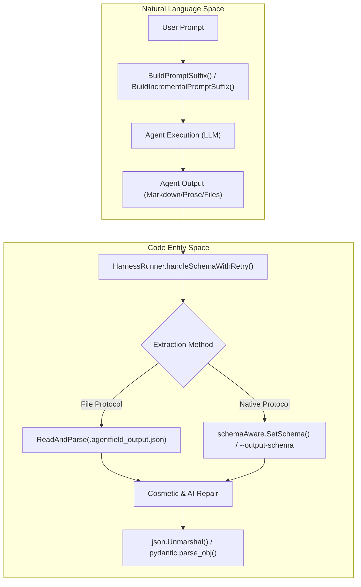
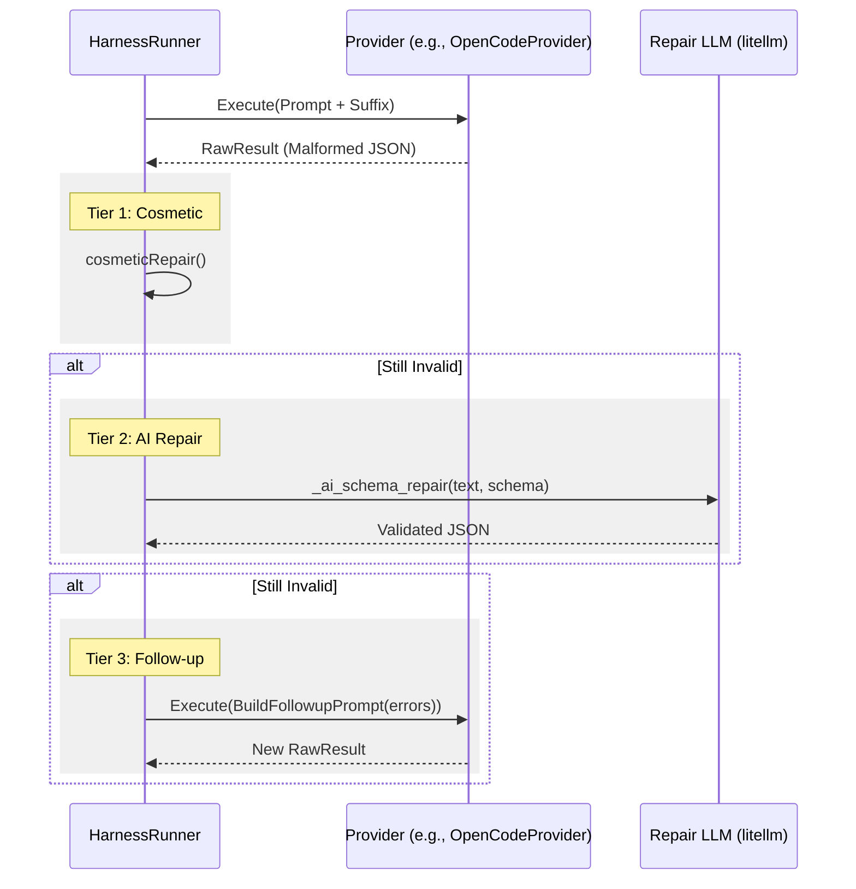

<!-- source: DeepWiki mcp.deepwiki.com · repo Agent-Field/agentfield · page 11.3 Schema Extraction & Repair · fetched 2026-10-26 -->

# Schema Extraction & Repair

<details>
<summary>Relevant source files</summary>

The following files were used as context for generating this wiki page:

- [sdk/go/agent/agent.go](sdk/go/agent/agent.go)
- [sdk/go/agent/agent_lifecycle.go](sdk/go/agent/agent_lifecycle.go)
- [sdk/go/agent/pause.go](sdk/go/agent/pause.go)
- [sdk/go/agent/pause_test.go](sdk/go/agent/pause_test.go)
- [sdk/go/harness/claudecode.go](sdk/go/harness/claudecode.go)
- [sdk/go/harness/coverage_branches_test.go](sdk/go/harness/coverage_branches_test.go)
- [sdk/go/harness/coverage_helpers_test.go](sdk/go/harness/coverage_helpers_test.go)
- [sdk/go/harness/parity_test.go](sdk/go/harness/parity_test.go)
- [sdk/go/harness/provider.go](sdk/go/harness/provider.go)
- [sdk/go/harness/result.go](sdk/go/harness/result.go)
- [sdk/go/harness/runner.go](sdk/go/harness/runner.go)
- [sdk/go/harness/runner_test.go](sdk/go/harness/runner_test.go)
- [sdk/go/harness/schema.go](sdk/go/harness/schema.go)
- [sdk/python/agentfield/harness/_runner.py](sdk/python/agentfield/harness/_runner.py)
- [sdk/python/agentfield/harness/_schema.py](sdk/python/agentfield/harness/_schema.py)
- [sdk/python/agentfield/harness/providers/claude.py](sdk/python/agentfield/harness/providers/claude.py)
- [sdk/python/agentfield/harness/providers/codex.py](sdk/python/agentfield/harness/providers/codex.py)
- [sdk/python/agentfield/harness/providers/gemini.py](sdk/python/agentfield/harness/providers/gemini.py)
- [sdk/python/agentfield/harness/providers/opencode.py](sdk/python/agentfield/harness/providers/opencode.py)
- [sdk/python/agentfield/types.py](sdk/python/agentfield/types.py)
- [sdk/python/tests/test_harness_ai_schema_repair.py](sdk/python/tests/test_harness_ai_schema_repair.py)
- [sdk/python/tests/test_harness_provider_claude.py](sdk/python/tests/test_harness_provider_claude.py)
- [sdk/python/tests/test_harness_provider_codex.py](sdk/python/tests/test_harness_provider_codex.py)
- [sdk/python/tests/test_harness_provider_gemini.py](sdk/python/tests/test_harness_provider_gemini.py)
- [sdk/python/tests/test_harness_provider_opencode.py](sdk/python/tests/test_harness_provider_opencode.py)
- [sdk/python/tests/test_harness_runner.py](sdk/python/tests/test_harness_runner.py)
- [sdk/python/tests/test_harness_schema.py](sdk/python/tests/test_harness_schema.py)

</details>


The `HarnessRunner` orchestrates the execution of autonomous coding agents and ensures that their natural language reasoning results in structured, machine-readable JSON data. This process involves a sophisticated pipeline of schema-driven prompting, multi-modal extraction (file-based vs. native), and a multi-tiered repair strategy that handles everything from minor syntax errors to complete structural failures.

## Overview of Extraction Strategies

The `HarnessRunner` supports two primary modes for requesting structured output from an agent: **Single-Shot** and **Incremental**.

| Mode | Implementation | Best Use Case |
| :--- | :--- | :--- |
| **Single-Shot** | Asks the agent to write the entire JSON object to a file in one operation [sdk/go/harness/runner.go:83-83](). | Small to medium schemas; lowest token cost. |
| **Incremental** | Asks the agent to build the object top-level field by top-level field [sdk/go/harness/runner.go:84-85](). | Large or deep schemas where agents often "lose the thread" mid-generation. |
| **Auto** | Switches to incremental mode if the schema exceeds a token threshold (default: 4000) [sdk/go/harness/schema.go:20-20](). | General purpose balanced performance. |

### Data Flow: Natural Language to Structured Entity

The following diagram illustrates how the `HarnessRunner` bridges the gap between the LLM's text space and the SDK's typed objects.

**Extraction Pipeline Flow**

**Sources:** [sdk/go/harness/runner.go:53-158](), [sdk/go/harness/schema.go:137-175](), [sdk/python/agentfield/harness/_runner.py:210-250]()

## The Extraction Protocols

The system employs different protocols based on the provider's capabilities.

### 1. The File-Write Protocol (Claude/OpenCode)
For providers like `ClaudeCodeProvider` or `OpenCodeProvider`, the runner appends a `CRITICAL OUTPUT REQUIREMENTS` suffix to the prompt [sdk/go/harness/schema.go:166-174](). This instructs the agent to use its `Write` tool to create a deterministic file named `.agentfield_output.json` [sdk/go/harness/schema.go:18-18]().

### 2. The Native Schema Protocol (Codex)
Providers implementing the `schemaAware` interface [sdk/go/harness/runner.go:43-45]() (like `CodexProvider`) bypass the file-write instructions. Instead:
- The runner generates a "Strict" JSON schema (stripping defaults, making all fields required) [sdk/go/harness/schema.go:46-50]().
- The schema is passed via CLI flags (e.g., `--output-schema`) [sdk/go/harness/schema.go:126-133]().
- The provider captures the agent's final message and persists it directly [sdk/go/harness/runner.go:125-130]().

## Repair & Retry Loops

When extraction fails (e.g., the file is missing, contains invalid JSON, or fails schema validation), the `HarnessRunner` enters a repair loop.

### Multi-Tiered Repair Logic

1.  **Cosmetic Repair**: A deterministic pass that strips markdown fences (```json ... ```) and attempts to balance trailing braces/brackets [sdk/go/harness/schema.go:207-215]().
2.  **AI-Based Repair**: If cosmetic repair fails, the Python SDK attempts `_ai_schema_repair`. This makes a single, cheap LLM call (no tools) specifically to reformat the existing malformed text into valid JSON matching the schema [sdk/python/agentfield/harness/_runner.py:66-88]().
3.  **Follow-up Retry**: If the output is still invalid, the runner performs a full retry by sending a follow-up prompt to the same agent session, describing the specific validation errors (via `diagnose_output_failure`) [sdk/python/agentfield/harness/_schema.py:21-21]().

**Repair Sequence Diagram**

**Sources:** [sdk/python/agentfield/harness/_runner.py:66-152](), [sdk/go/harness/runner.go:141-143](), [sdk/go/harness/schema.go:207-220]()

## Key Implementation Details

### Incremental Build Mode
For complex schemas, the runner uses `BuildIncrementalPromptSuffix` [sdk/go/harness/runner.go:127-127](). This instructs the agent to:
1. Initialize the JSON file with an empty object.
2. For each top-level field in the schema, perform the necessary reasoning and use a `Patch` or `Write` operation to update that specific field [sdk/go/harness/runner.go:84-85]().

### Error Diagnosis
The `diagnose_field_failures` and `diagnose_output_failure` functions [sdk/python/agentfield/harness/_schema.py:20-21]() are used to generate human-readable (and agent-readable) descriptions of why the JSON failed validation. This is critical for the "Follow-up" tier of repair, as it allows the agent to see exactly which field was missing or had the wrong type.

### Token Estimation
The runner uses a simple heuristic of 4 characters per token to decide when a schema is "large" [sdk/go/harness/schema.go:33-36](). If the schema exceeds `largeSchemaTokenThreshold` (4000 tokens), the runner writes the schema to a temporary file `.agentfield_schema.json` and tells the agent to read it from disk rather than including the full text in the prompt [sdk/go/harness/schema.go:151-163]().

**Sources:**
- `sdk/go/harness/runner.go`: Core orchestration logic.
- `sdk/go/harness/schema.go`: Suffix building and cosmetic repair.
- `sdk/python/agentfield/harness/_runner.py`: AI-based repair implementation.
- `sdk/python/agentfield/harness/_schema.py`: Validation and diagnosis utilities.

---

