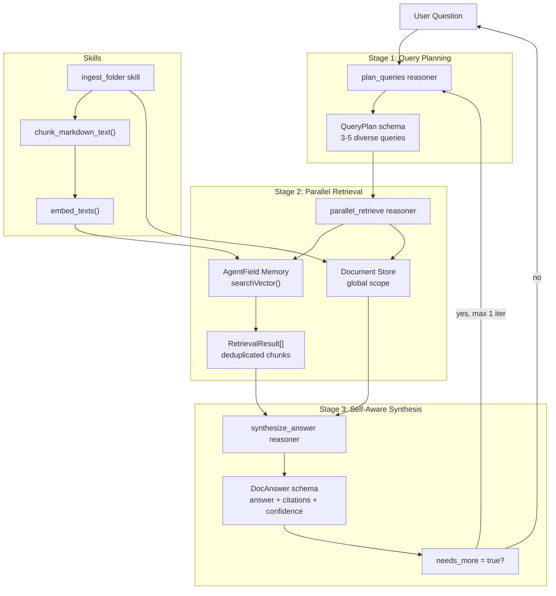
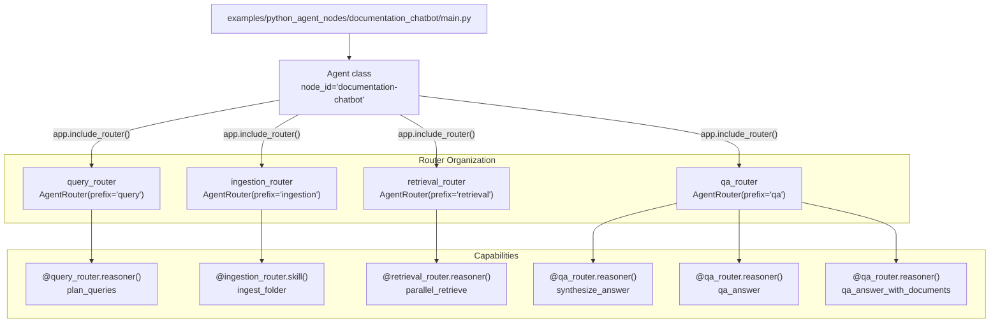
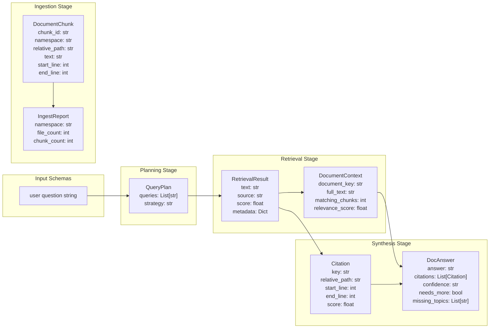

<!-- source: DeepWiki mcp.deepwiki.com · repo Agent-Field/agentfield · page 12 Examples · fetched 2026-10-26 -->

# Examples

Relevant source files

The following files were used as context for generating this wiki page:

- [examples/python_agent_nodes/deep_research/README.md](examples/python_agent_nodes/deep_research/README.md)
- [examples/python_agent_nodes/deep_research/__init__.py](examples/python_agent_nodes/deep_research/__init__.py)
- [examples/python_agent_nodes/deep_research/main.py](examples/python_agent_nodes/deep_research/main.py)
- [examples/python_agent_nodes/deep_research/requirements.txt](examples/python_agent_nodes/deep_research/requirements.txt)
- [examples/python_agent_nodes/deep_research/routers/__init__.py](examples/python_agent_nodes/deep_research/routers/__init__.py)
- [examples/python_agent_nodes/deep_research/routers/planning.py](examples/python_agent_nodes/deep_research/routers/planning.py)
- [examples/python_agent_nodes/deep_research/routers/research.py](examples/python_agent_nodes/deep_research/routers/research.py)
- [examples/python_agent_nodes/deep_research/schemas.py](examples/python_agent_nodes/deep_research/schemas.py)
- [examples/python_agent_nodes/documentation_chatbot/README.md](examples/python_agent_nodes/documentation_chatbot/README.md)
- [examples/python_agent_nodes/documentation_chatbot/__init__.py](examples/python_agent_nodes/documentation_chatbot/__init__.py)
- [examples/python_agent_nodes/documentation_chatbot/chunking.py](examples/python_agent_nodes/documentation_chatbot/chunking.py)
- [examples/python_agent_nodes/documentation_chatbot/embedding.py](examples/python_agent_nodes/documentation_chatbot/embedding.py)
- [examples/python_agent_nodes/documentation_chatbot/main.py](examples/python_agent_nodes/documentation_chatbot/main.py)
- [examples/python_agent_nodes/documentation_chatbot/schemas.py](examples/python_agent_nodes/documentation_chatbot/schemas.py)
- [sdk/python/tests/test_skill_pydantic_models.py](sdk/python/tests/test_skill_pydantic_models.py)

This section provides real-world example applications demonstrating AgentField patterns and architectures. Examples showcase practical implementations of multi-agent systems, RAG (Retrieval-Augmented Generation) pipelines, and distributed agent coordination.

For general concepts about agents, reasoners, and skills, see [Core Concepts](#1.1). For SDK-specific implementation details, see [Python SDK](#3), [TypeScript SDK](#4), or [Go SDK](#5).

## Available Examples

### Documentation Chatbot (RAG System)

The primary example is a production-ready RAG system implementing a three-agent parallel architecture for answering questions about private documentation. This example demonstrates:

- **Parallel execution patterns** — Multiple reasoners coordinating via the control plane.
- **Vector storage integration** — Using AgentField's memory system for embeddings.
- **Self-aware synthesis** — Confidence assessment and automatic refinement.
- **Two-tier storage strategy** — Document-level and chunk-level storage optimization.
- **Pydantic model validation** — Type-safe inputs and outputs across agent boundaries.

**Example Location**: [examples/python_agent_nodes/documentation_chatbot/]()

**Key Components**:
- Agent node with 4 routers organizing 7 capabilities [examples/python_agent_nodes/documentation_chatbot/main.py:34-40]().
- Skills for document ingestion [examples/python_agent_nodes/documentation_chatbot/README.md:144-146]().
- Reasoners for query planning, parallel retrieval, and answer synthesis [examples/python_agent_nodes/documentation_chatbot/README.md:148-168]().
- FastEmbed integration for local embedding generation [examples/python_agent_nodes/documentation_chatbot/embedding.py:1-30]().

For detailed documentation of this example, see:
- [Documentation Chatbot](#12.1) — Overview and architecture
- [Chatbot: Ingestion Pipeline](#12.2) — Document chunking and embedding
- [Chatbot: Query Planning](#12.3) — Multi-query generation
- [Chatbot: Parallel Retrieval](#12.4) — Concurrent search and deduplication
- [Chatbot: Self-Aware Synthesis](#12.5) — Answer generation with confidence assessment

Sources: [examples/python_agent_nodes/documentation_chatbot/README.md:1-229](), [examples/python_agent_nodes/documentation_chatbot/main.py:1-73]()

### Deep Research Agent (Recursive Planning)

The Deep Research Agent demonstrates complex task decomposition and topological execution. It uses recursive planning to break down broad research questions into a graph of atomic subtasks.

- **Recursive Planning** — Decomposes questions into hierarchical task graphs [examples/python_agent_nodes/deep_research/routers/planning.py:101-112]().
- **Topological Execution** — Executes leaf tasks in parallel and synthesizes parent tasks [examples/python_agent_nodes/deep_research/routers/planning.py:25-32]().
- **Web Search Integration** — Uses Tavily for real-time information retrieval [examples/python_agent_nodes/deep_research/routers/research.py:62-64]().

**Example Location**: [examples/python_agent_nodes/deep_research/]()

Sources: [examples/python_agent_nodes/deep_research/README.md:1-11]()

## Example Architecture Overview

The documentation chatbot demonstrates a three-stage RAG pipeline with parallel execution:

**Architecture Pattern**: Three independent reasoners orchestrated by the control plane. Each reasoner can be called directly or as part of the orchestrated `qa_answer` or `qa_answer_with_documents` flows.

Sources: [examples/python_agent_nodes/documentation_chatbot/README.md:15-46](), [examples/python_agent_nodes/documentation_chatbot/main.py:25-73]()

## Code Entity Mapping

### Agent Registration and Routers

This diagram maps high-level concepts to the specific code entities in the Documentation Chatbot.

Sources: [examples/python_agent_nodes/documentation_chatbot/main.py:25-41](), [examples/python_agent_nodes/documentation_chatbot/routers.py:1-40]()

### Data Flow Through Pydantic Schemas

Sources: [examples/python_agent_nodes/documentation_chatbot/schemas.py:1-115]()

## Storage Architecture

The documentation chatbot demonstrates AgentField's memory system capabilities with a two-tier storage pattern:

| Storage Tier | Scope | Purpose | Key Pattern | Data Format |
|--------------|-------|---------|-------------|-------------|
| Document Store | `global` | Store full document text once | `{namespace}:doc:{relative_path}` | Plain text |
| Vector Store | `global` | Store chunk embeddings and metadata | Managed by `setVector()` | Embedding + metadata JSON |

**Storage Optimization**: Full document text is stored once in regular memory. Each chunk's metadata contains a `document_key` reference pointing to the document store, avoiding 70% text duplication [examples/python_agent_nodes/documentation_chatbot/README.md:171-175]().

Sources: [examples/python_agent_nodes/documentation_chatbot/README.md:171-175]()

## Key Implementation Patterns

### Reasoner Chaining via Control Plane

The example demonstrates orchestrated reasoner execution where one reasoner's output becomes another's input. The control plane handles routing and context propagation:

1. User calls `qa_answer` or `qa_answer_with_documents` reasoner.
2. Reasoner internally calls `app.call("documentation-chatbot.plan_queries", ...)` [examples/python_agent_nodes/documentation_chatbot/README.md:17-33]().
3. Control plane routes request to `plan_queries` reasoner.
4. Result flows back to calling reasoner.

Sources: [examples/python_agent_nodes/documentation_chatbot/README.md:17-33]()

### Pydantic Model Validation

All reasoners and skills use Pydantic models for input/output validation, demonstrating type-safe agent boundaries:

- **Skills Support Pydantic Models**: Both reasoners and skills can accept Pydantic models as parameters [sdk/python/tests/test_skill_pydantic_models.py:34-40](). The SDK automatically converts JSON dictionaries to model instances [sdk/python/tests/test_skill_pydantic_models.py:50-68]().
- **Validation Points**: Input validation occurs before function execution; output validation occurs on return values.

Sources: [examples/python_agent_nodes/documentation_chatbot/schemas.py:1-115](), [sdk/python/tests/test_skill_pydantic_models.py:87-103]()

### Namespace Isolation

The example uses namespaces to isolate different documentation sets [examples/python_agent_nodes/documentation_chatbot/README.md:176-181](). All vector storage operations include namespace in metadata filtering. Memory keys use namespace prefix: `{namespace}:doc:{path}`.

Sources: [examples/python_agent_nodes/documentation_chatbot/README.md:176-181]()

### Embedding Generation with FastEmbed

The example uses FastEmbed for local, dependency-light embedding generation:

- **Key Functions**: `embed_texts()` for batch embedding and `embed_query()` for single-query embedding [examples/python_agent_nodes/documentation_chatbot/embedding.py:1-30]().
- **Warmup Pattern**: `_warmup_embeddings()` is called on agent startup to avoid cold-start latency [examples/python_agent_nodes/documentation_chatbot/main.py:43-49]().

Sources: [examples/python_agent_nodes/documentation_chatbot/embedding.py:1-30](), [examples/python_agent_nodes/documentation_chatbot/main.py:43-49]()

## Performance Characteristics

| Metric | Value | Notes |
|--------|-------|-------|
| Parallel speedup | 3x | 3 concurrent queries vs sequential [examples/python_agent_nodes/documentation_chatbot/README.md:63]() |
| Storage reduction | 70% | Two-tier storage vs full text duplication [examples/python_agent_nodes/documentation_chatbot/README.md:174]() |
| Max refinement iterations | 1 | Prevents infinite loops [examples/python_agent_nodes/documentation_chatbot/README.md:65]() |
| Default chunk size | 1200 chars | Markdown-aware [examples/python_agent_nodes/documentation_chatbot/chunking.py:92]() |

Sources: [examples/python_agent_nodes/documentation_chatbot/README.md:63-174](), [examples/python_agent_nodes/documentation_chatbot/chunking.py:92]()

---

