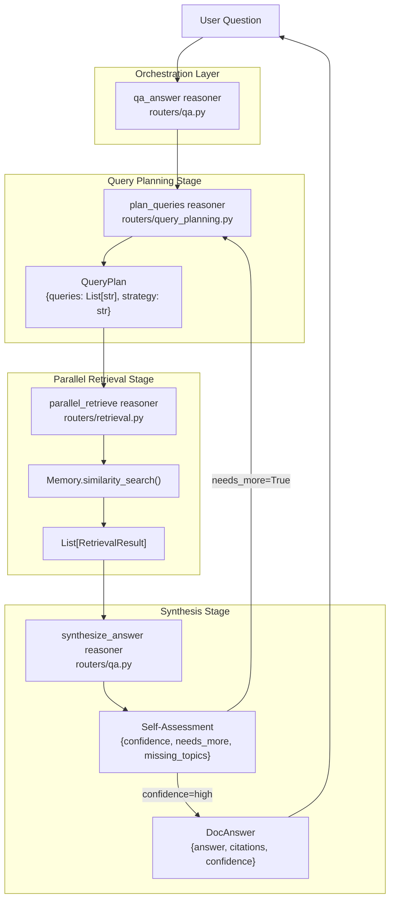
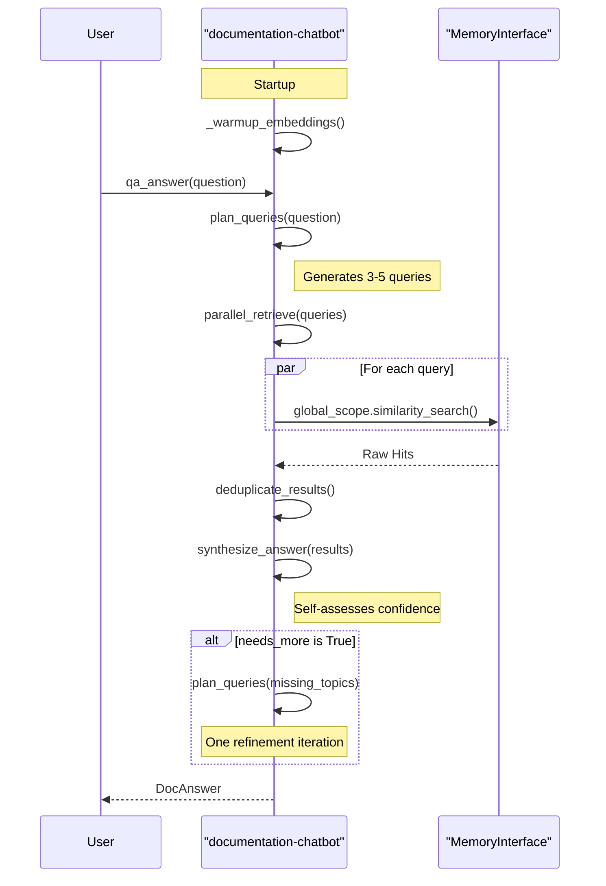
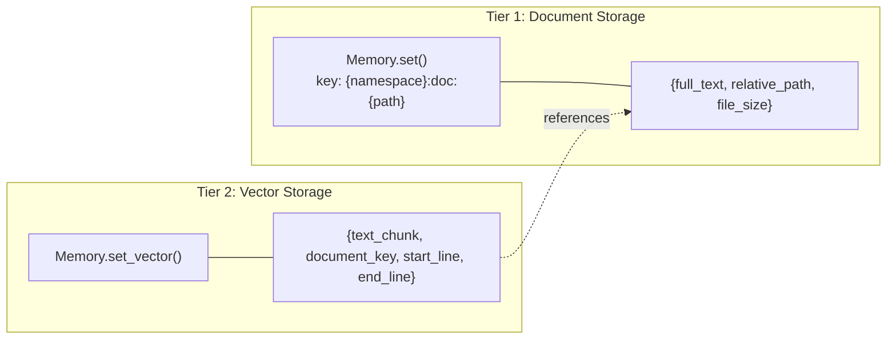
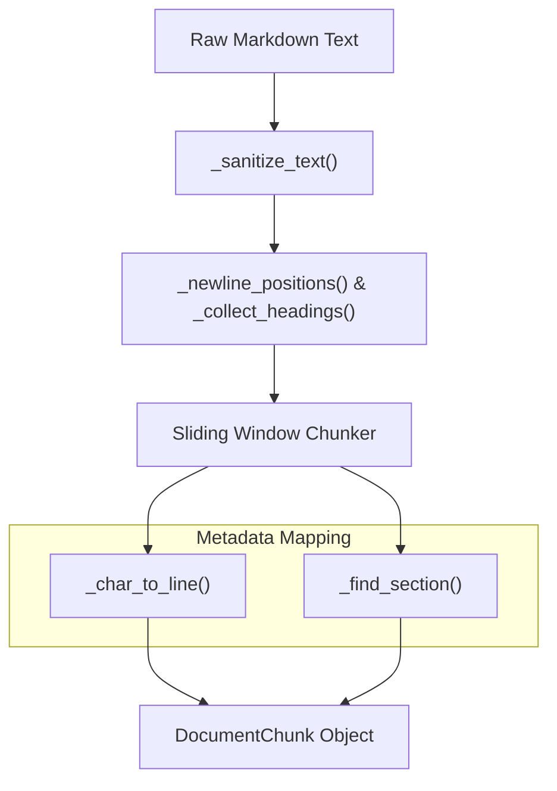

<!-- source: DeepWiki mcp.deepwiki.com · repo Agent-Field/agentfield · page 12.1 Documentation Chatbot · fetched 2026-10-26 -->

# Documentation Chatbot

<details>
<summary>Relevant source files</summary>

The following files were used as context for generating this wiki page:

- [examples/python_agent_nodes/agentic_rag/main.py](examples/python_agent_nodes/agentic_rag/main.py)
- [examples/python_agent_nodes/agentic_rag/skills.py](examples/python_agent_nodes/agentic_rag/skills.py)
- [examples/python_agent_nodes/documentation_chatbot/README.md](examples/python_agent_nodes/documentation_chatbot/README.md)
- [examples/python_agent_nodes/documentation_chatbot/__init__.py](examples/python_agent_nodes/documentation_chatbot/__init__.py)
- [examples/python_agent_nodes/documentation_chatbot/chunking.py](examples/python_agent_nodes/documentation_chatbot/chunking.py)
- [examples/python_agent_nodes/documentation_chatbot/embedding.py](examples/python_agent_nodes/documentation_chatbot/embedding.py)
- [examples/python_agent_nodes/documentation_chatbot/main.py](examples/python_agent_nodes/documentation_chatbot/main.py)
- [examples/python_agent_nodes/documentation_chatbot/pipeline_utils.py](examples/python_agent_nodes/documentation_chatbot/pipeline_utils.py)
- [examples/python_agent_nodes/documentation_chatbot/product_context.py](examples/python_agent_nodes/documentation_chatbot/product_context.py)
- [examples/python_agent_nodes/documentation_chatbot/routers/__init__.py](examples/python_agent_nodes/documentation_chatbot/routers/__init__.py)
- [examples/python_agent_nodes/documentation_chatbot/routers/ingestion.py](examples/python_agent_nodes/documentation_chatbot/routers/ingestion.py)
- [examples/python_agent_nodes/documentation_chatbot/routers/qa.py](examples/python_agent_nodes/documentation_chatbot/routers/qa.py)
- [examples/python_agent_nodes/documentation_chatbot/routers/query_planning.py](examples/python_agent_nodes/documentation_chatbot/routers/query_planning.py)
- [examples/python_agent_nodes/documentation_chatbot/routers/retrieval.py](examples/python_agent_nodes/documentation_chatbot/routers/retrieval.py)
- [examples/python_agent_nodes/documentation_chatbot/schemas.py](examples/python_agent_nodes/documentation_chatbot/schemas.py)
- [examples/python_agent_nodes/hello_world_rag/main.py](examples/python_agent_nodes/hello_world_rag/main.py)
- [examples/python_agent_nodes/hello_world_rag/test_pydantic_skill.py](examples/python_agent_nodes/hello_world_rag/test_pydantic_skill.py)
- [sdk/python/tests/test_skill_pydantic_models.py](sdk/python/tests/test_skill_pydantic_models.py)

</details>


## Purpose and Scope

The Documentation Chatbot is a production-ready Retrieval-Augmented Generation (RAG) system implemented as an AgentField node. It answers complex questions about documentation folders without hallucinations by utilizing a 3-agent parallel architecture. The system ingests local documentation, creates high-quality embeddings with precise line-level metadata, and produces answers with inline citations (e.g., `[A]`).

Key features include:
- **3-Reasoner Parallel Architecture**: Decoupled query planning, retrieval, and synthesis.
- **Self-Aware Synthesis**: Automatic confidence assessment and single-iteration refinement.
- **Two-Tier Storage**: Efficient memory management storing full documents once and referencing them via chunk vectors.
- **Document-Level Retrieval**: Aggregates chunks into full document context for superior comprehension.

**Sources:** [examples/python_agent_nodes/documentation_chatbot/README.md:1-14](), [examples/python_agent_nodes/documentation_chatbot/main.py:58-67]()

## System Architecture

The chatbot implements a multi-stage pipeline where reasoners and skills coordinate through the AgentField control plane.

### 3-Reasoner Parallel Design



**Sources:** [examples/python_agent_nodes/documentation_chatbot/README.md:17-34](), [examples/python_agent_nodes/documentation_chatbot/routers/qa.py:164-210]()

### Component Interaction Flow



**Sources:** [examples/python_agent_nodes/documentation_chatbot/main.py:43-50](), [examples/python_agent_nodes/documentation_chatbot/routers/qa.py:176-200](), [examples/python_agent_nodes/documentation_chatbot/routers/retrieval.py:60-89]()

## Storage Architecture

### Two-Tier Storage Strategy

To optimize storage, the agent avoids duplicating text within vector metadata by using a cross-reference pattern.

1.  **Tier 1 (Full Documents)**: Stored in regular key-value memory using the key `{namespace}:doc:{relative_path}`.
2.  **Tier 2 (Chunk Vectors)**: Stored in vector memory with metadata containing a `document_key` pointer to Tier 1.



**Sources:** [examples/python_agent_nodes/documentation_chatbot/routers/ingestion.py:94-134](), [examples/python_agent_nodes/documentation_chatbot/README.md:171-175]()

## Ingestion Pipeline

The ingestion pipeline handles document discovery, sanitization, chunking, and indexing.

### Document Processing Logic

| Function | File:Lines | Purpose |
| :--- | :--- | :--- |
| `ingest_folder` | [routers/ingestion.py:54-146]() | Main orchestration of the ingestion process. |
| `chunk_markdown_text` | [chunking.py:87-133]() | Chunks text while tracking headings and line numbers. |
| `_collect_headings` | [chunking.py:54-63]() | Extracts markdown headers for section-aware metadata. |
| `_sanitize_text` | [chunking.py:26-34]() | Strips null bytes (`\x00`) for database compatibility. |
| `embed_texts` | [embedding.py:18-23]() | Batch generates embeddings using `fastembed`. |
| `clear_namespace` | [routers/ingestion.py:45-51]() | Skill to wipe a namespace via control plane API. |

### Chunking and Metadata

The `chunk_markdown_text` function uses a sliding window with overlap. It utilizes `bisect` to efficiently map character offsets to line numbers and section headers.



**Sources:** [examples/python_agent_nodes/documentation_chatbot/chunking.py:87-133](), [examples/python_agent_nodes/documentation_chatbot/chunking.py:70-84]()

## Query Planning and Retrieval

### Query Planning (`plan_queries`)
This reasoner uses `PRODUCT_CONTEXT` to understand domain-specific terms (e.g., mapping "identity" to "DIDs/VCs") and generates 3-5 diverse queries using strategies like `broad`, `specific`, or `mixed`.

**Sources:** [examples/python_agent_nodes/documentation_chatbot/routers/query_planning.py:14-48](), [examples/python_agent_nodes/documentation_chatbot/product_context.py:3-146]()

### Parallel Retrieval (`parallel_retrieve`)
Executes `MemoryInterface.similarity_search` concurrently for all planned queries using `asyncio.gather`. Results are then deduplicated based on their source (file path and line range).

**Sources:** [examples/python_agent_nodes/documentation_chatbot/routers/retrieval.py:60-89](), [examples/python_agent_nodes/documentation_chatbot/pipeline_utils.py:47-57]()

## Synthesis and Self-Assessment

### Synthesis Reasoner (`synthesize_answer`)
The synthesizer generates a markdown response. It is strictly instructed to use inline citations like `[A]` and leave the `citations` array empty for automatic injection by the system.

**Sources:** [examples/python_agent_nodes/documentation_chatbot/routers/qa.py:26-160]()

### Self-Assessment Logic
The `DocAnswer` schema requires the LLM to evaluate its own output:
- **Confidence**: `high`, `partial`, or `insufficient`.
- **needs_more**: Boolean flag triggering refinement.
- **missing_topics**: Specific information gaps to target in the next retrieval step.

**Sources:** [examples/python_agent_nodes/documentation_chatbot/schemas.py:96-115](), [examples/python_agent_nodes/documentation_chatbot/routers/qa.py:114-128]()

## Document-Aware Retrieval

The system supports an advanced mode, `qa_answer_with_documents`, which aggregates individual chunks back into full document contexts before synthesis.

| Component | File:Lines | Purpose |
| :--- | :--- | :--- |
| `aggregate_chunks_to_documents` | [pipeline_utils.py:113-176]() | Groups chunks by `document_key` and fetches full text. |
| `calculate_document_score` | [pipeline_utils.py:102-110]() | Scores documents based on average chunk score + coverage boost. |
| `format_documents_for_synthesis` | [pipeline_utils.py:179-190]() | Prepares full document text for the LLM prompt. |

**Sources:** [examples/python_agent_nodes/documentation_chatbot/README.md:42-47](), [examples/python_agent_nodes/documentation_chatbot/pipeline_utils.py:102-176]()

## Data Models

### Key Schemas

| Schema | Purpose | Key Fields |
| :--- | :--- | :--- |
| `DocumentChunk` | Ingestion unit | `chunk_id`, `text`, `start_line`, `end_line`, `section` |
| `QueryPlan` | Retrieval plan | `queries`, `strategy` |
| `RetrievalResult` | Search hit | `text`, `source`, `score`, `metadata` |
| `DocAnswer` | Final response | `answer`, `citations`, `confidence`, `needs_more` |
| `Citation` | Source metadata | `key`, `relative_path`, `preview`, `score` |

**Sources:** [examples/python_agent_nodes/documentation_chatbot/schemas.py:13-115]()

## Agent Configuration

The agent is composed using `AgentRouter` modules for clean separation of concerns.

```python
app = Agent(
    node_id="documentation-chatbot",
    agentfield_server=f"{os.getenv('AGENTFIELD_SERVER')}",
    api_key=os.getenv("AGENTFIELD_API_KEY"),
    ai_config=AIConfig(
        model=os.getenv("AI_MODEL", "openrouter/openai/gpt-4o-mini"),
    ),
)

app.include_router(query_router)
app.include_router(ingestion_router)
app.include_router(retrieval_router)
app.include_router(qa_router)
```

**Sources:** [examples/python_agent_nodes/documentation_chatbot/main.py:25-40]()

---

