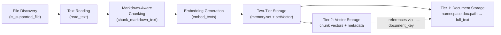
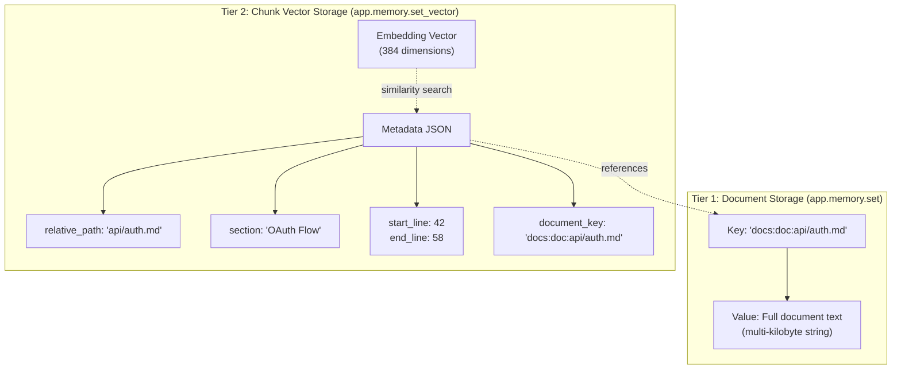
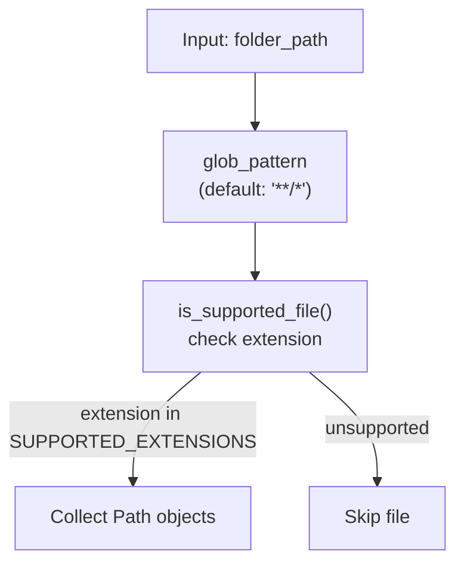
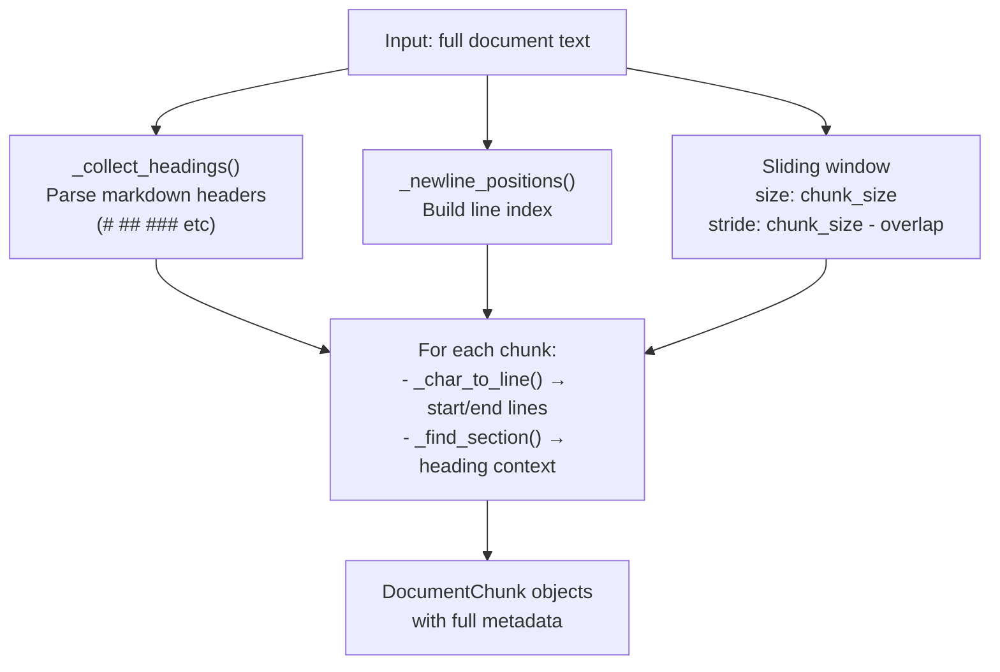
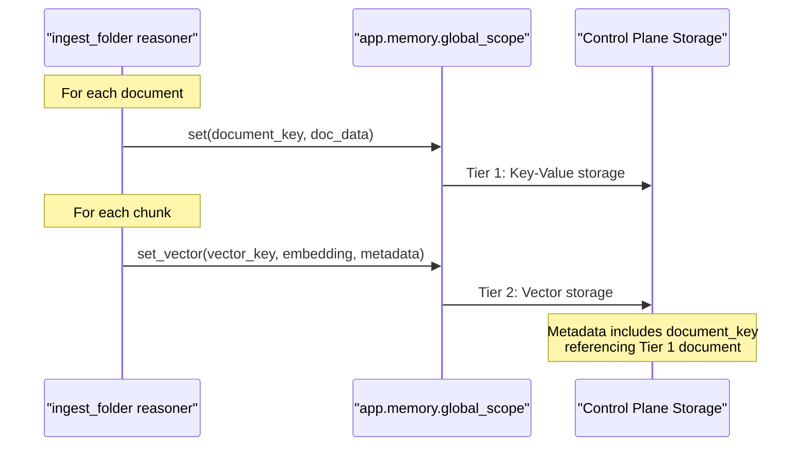

<!-- source: DeepWiki mcp.deepwiki.com · repo Agent-Field/agentfield · page 12.2 Chatbot: Ingestion Pipeline · fetched 2026-10-26 -->

# Chatbot: Ingestion Pipeline

<details>
<summary>Relevant source files</summary>

The following files were used as context for generating this wiki page:

- [examples/python_agent_nodes/agentic_rag/main.py](examples/python_agent_nodes/agentic_rag/main.py)
- [examples/python_agent_nodes/agentic_rag/skills.py](examples/python_agent_nodes/agentic_rag/skills.py)
- [examples/python_agent_nodes/documentation_chatbot/README.md](examples/python_agent_nodes/documentation_chatbot/README.md)
- [examples/python_agent_nodes/documentation_chatbot/__init__.py](examples/python_agent_nodes/documentation_chatbot/__init__.py)
- [examples/python_agent_nodes/documentation_chatbot/chunking.py](examples/python_agent_nodes/documentation_chatbot/chunking.py)
- [examples/python_agent_nodes/documentation_chatbot/embedding.py](examples/python_agent_nodes/documentation_chatbot/embedding.py)
- [examples/python_agent_nodes/documentation_chatbot/main.py](examples/python_agent_nodes/documentation_chatbot/main.py)
- [examples/python_agent_nodes/documentation_chatbot/pipeline_utils.py](examples/python_agent_nodes/documentation_chatbot/pipeline_utils.py)
- [examples/python_agent_nodes/documentation_chatbot/product_context.py](examples/python_agent_nodes/documentation_chatbot/product_context.py)
- [examples/python_agent_nodes/documentation_chatbot/routers/__init__.py](examples/python_agent_nodes/documentation_chatbot/routers/__init__.py)
- [examples/python_agent_nodes/documentation_chatbot/routers/ingestion.py](examples/python_agent_nodes/documentation_chatbot/routers/ingestion.py)
- [examples/python_agent_nodes/documentation_chatbot/routers/qa.py](examples/python_agent_nodes/documentation_chatbot/routers/qa.py)
- [examples/python_agent_nodes/documentation_chatbot/routers/query_planning.py](examples/python_agent_nodes/documentation_chatbot/routers/query_planning.py)
- [examples/python_agent_nodes/documentation_chatbot/routers/retrieval.py](examples/python_agent_nodes/documentation_chatbot/routers/retrieval.py)
- [examples/python_agent_nodes/documentation_chatbot/schemas.py](examples/python_agent_nodes/documentation_chatbot/schemas.py)
- [examples/python_agent_nodes/hello_world_rag/main.py](examples/python_agent_nodes/hello_world_rag/main.py)
- [examples/python_agent_nodes/hello_world_rag/test_pydantic_skill.py](examples/python_agent_nodes/hello_world_rag/test_pydantic_skill.py)
- [sdk/python/tests/test_skill_pydantic_models.py](sdk/python/tests/test_skill_pydantic_models.py)

</details>


## Purpose and Scope

This document describes the ingestion pipeline for the Documentation Chatbot example, which transforms raw documentation files into searchable, citation-ready chunks stored in AgentField's memory system. The pipeline implements a two-tier storage strategy that eliminates text duplication while preserving precise source attribution through line numbers and section headings.

The ingestion process is handled primarily by the `ingestion_router` [examples/python_agent_nodes/documentation_chatbot/routers/ingestion.py:20](), which coordinates file discovery, chunking, embedding, and storage.

---

## Architecture Overview

The ingestion pipeline consists of five sequential stages that transform documentation files into vector-searchable chunks with full provenance metadata:



**Sources:** [examples/python_agent_nodes/documentation_chatbot/README.md:169-174](), [examples/python_agent_nodes/documentation_chatbot/routers/ingestion.py:54-146]()

The pipeline is exposed as a reasoner `ingest_folder` [examples/python_agent_nodes/documentation_chatbot/routers/ingestion.py:55]() on the documentation chatbot agent and is invoked via the control plane's execute API.

---

## Two-Tier Storage Strategy

The ingestion pipeline implements a storage architecture that stores full documents once in regular memory while chunk vectors reference them via keys. This achieves approximately 70% storage savings compared to duplicating full text in every chunk's metadata [examples/python_agent_nodes/documentation_chatbot/README.md:171-174]().

### Storage Tiers

| Tier | Storage Type | Key Format | Content | Purpose |
|------|--------------|------------|---------|---------|
| **Tier 1** | Regular Memory | `{namespace}:doc:{relative_path}` | Complete document text | Single source of truth for document content |
| **Tier 2** | Vector Memory | Embedding vectors | Chunk metadata + `document_key` reference | Semantic search with provenance |

### Storage Operations



**Sources:** [examples/python_agent_nodes/documentation_chatbot/README.md:171-174](), [examples/python_agent_nodes/documentation_chatbot/routers/ingestion.py:94-134]()

When a query matches chunks, the system:
1. Retrieves chunk metadata via vector search.
2. Uses `document_key` to fetch the full document from Tier 1 [examples/python_agent_nodes/documentation_chatbot/pipeline_utils.py:137-142]().
3. Aggregates chunks to provide complete document context for synthesis [examples/python_agent_nodes/documentation_chatbot/pipeline_utils.py:113-117]().

---

## File Discovery and Filtering

The pipeline discovers documentation files by recursively scanning a folder and filtering based on file extensions.

### Supported File Types

The `is_supported_file()` function filters files based on extension:

```python
SUPPORTED_EXTENSIONS = {".md", ".mdx", ".rst", ".txt"}
```

**Sources:** [examples/python_agent_nodes/documentation_chatbot/chunking.py:16-23]()

### Discovery Process



**Sources:** [examples/python_agent_nodes/documentation_chatbot/chunking.py:20-23](), [examples/python_agent_nodes/documentation_chatbot/routers/ingestion.py:70-76]()

The discovery logic skips directories, symlinks, and unsupported file types. Skipped files are tracked in the `IngestReport.skipped_files` list [examples/python_agent_nodes/documentation_chatbot/routers/ingestion.py:76]().

---

## Text Processing and Sanitization

### UTF-8 Reading with Fallback

The `read_text()` function implements a two-stage encoding strategy to handle edge cases:

1. **Primary:** Attempt UTF-8 decoding.
2. **Fallback:** Use `latin-1` encoding if UTF-8 fails [examples/python_agent_nodes/documentation_chatbot/chunking.py:40-43]().

**Sources:** [examples/python_agent_nodes/documentation_chatbot/chunking.py:37-45]()

### Null Byte Sanitization

The `_sanitize_text()` function removes null bytes (`\x00`) that PostgreSQL's JSONB columns cannot store:

```python
def _sanitize_text(text: str) -> str:
    return text.replace("\x00", "")
```

**Sources:** [examples/python_agent_nodes/documentation_chatbot/chunking.py:26-34]()

---

## Markdown-Aware Chunking

The `chunk_markdown_text()` function implements a sliding window chunker that preserves document structure and tracks precise source locations.

### Chunking Algorithm



**Sources:** [examples/python_agent_nodes/documentation_chatbot/chunking.py:87-133]()

### Metadata Extraction

The chunking process extracts metadata used for citation and ranking:

| Metadata Type | Extraction Function | Purpose |
|--------------|-------------------|---------|
| **Line numbers** | `_char_to_line()` | Precise source attribution for citations [examples/python_agent_nodes/documentation_chatbot/chunking.py:70-74]() |
| **Section headings** | `_find_section()` | Contextual information for relevance [examples/python_agent_nodes/documentation_chatbot/chunking.py:77-84]() |
| **Character positions** | `_newline_positions()` | Internal mapping for line calculation [examples/python_agent_nodes/documentation_chatbot/chunking.py:66-67]() |

#### Line Number Calculation

The `_char_to_line()` function uses binary search (`bisect.bisect_right()`) on a pre-computed newline index for O(log n) line lookup [examples/python_agent_nodes/documentation_chatbot/chunking.py:73-74]().

#### Section Detection

The `_find_section()` function finds the most recent heading before a chunk's start position using the `_HEADING_PATTERN` regex [examples/python_agent_nodes/documentation_chatbot/chunking.py:17-18]().

### Chunk ID Generation

Each chunk receives a stable identifier combining the file path and sequential index:

```python
chunk_id = f"{relative_path}#chunk-{index}"
```

**Sources:** [examples/python_agent_nodes/documentation_chatbot/chunking.py:118]()

---

## Embedding Generation

The pipeline uses `fastembed` for local embedding generation without external API dependencies [examples/python_agent_nodes/documentation_chatbot/README.md:13]().

### Model Configuration

The embedding model is typically configured via environment variables and loaded through `embedding.py` [examples/python_agent_nodes/documentation_chatbot/embedding.py:12-29]().

### Warmup Strategy

The agent warms up the embedding model on startup to avoid cold-start latency:

```python
def _warmup_embeddings() -> None:
    """Warm up the embedding model on startup."""
    try:
        embed_texts(["doc-chatbot warmup"])
        log_info("FastEmbed model warmed up for documentation chatbot")
```

**Sources:** [examples/python_agent_nodes/documentation_chatbot/main.py:43-49]()

---

## Storage Operations and Memory Scopes

### Memory Scope Selection

The pipeline stores all data in the **global memory scope** to ensure chunks are accessible across all workflows and agents [examples/python_agent_nodes/documentation_chatbot/routers/ingestion.py:83]().

### Storage Flow



**Sources:** [examples/python_agent_nodes/documentation_chatbot/routers/ingestion.py:94-134]()

### DocumentChunk Schema

The `DocumentChunk` Pydantic model defines the metadata structure:

| Field | Type | Description |
|-------|------|-------------|
| `chunk_id` | `str` | Unique identifier [examples/python_agent_nodes/documentation_chatbot/schemas.py:16]() |
| `namespace` | `str` | Logical corpus for isolation [examples/python_agent_nodes/documentation_chatbot/schemas.py:17]() |
| `relative_path` | `str` | File path relative to ingestion root [examples/python_agent_nodes/documentation_chatbot/schemas.py:18]() |
| `section` | `Optional[str]` | Markdown heading context [examples/python_agent_nodes/documentation_chatbot/schemas.py:19]() |
| `text` | `str` | Chunk content [examples/python_agent_nodes/documentation_chatbot/schemas.py:20]() |
| `start_line` | `int` | Starting line number [examples/python_agent_nodes/documentation_chatbot/schemas.py:21]() |
| `end_line` | `int` | Ending line number [examples/python_agent_nodes/documentation_chatbot/schemas.py:22]() |

---

## Ingestion Reasoner Interface

The `ingest_folder` reasoner coordinates the entire pipeline.

### Request Parameters

| Parameter | Type | Default | Purpose |
|-----------|------|---------|---------|
| `folder_path` | `str` | - | Path to documentation folder |
| `namespace` | `str` | `"website-docs"` | Logical corpus identifier |
| `glob_pattern`| `str` | `"**/*"` | File discovery pattern |
| `chunk_size`  | `int` | `1200` | Max characters per chunk |
| `chunk_overlap`| `int` | `250` | Overlap between chunks |

**Sources:** [examples/python_agent_nodes/documentation_chatbot/routers/ingestion.py:55-61]()

### Response Schema

The `IngestReport` model summarizes the operation:

| Field | Type | Description |
|-------|------|-------------|
| `namespace` | `str` | Corpus identifier |
| `file_count` | `int` | Number of files processed |
| `chunk_count` | `int` | Total chunks created |
| `skipped_files`| `List[str]` | Files skipped (unsupported types) |

**Sources:** [examples/python_agent_nodes/documentation_chatbot/schemas.py:25-31]()

### Namespace Management

Before re-indexing, the `clear_namespace` skill can be used to wipe existing vectors via the control plane's `/api/v1/memory/vector/namespace` endpoint [examples/python_agent_nodes/documentation_chatbot/routers/ingestion.py:38-51]().

---

