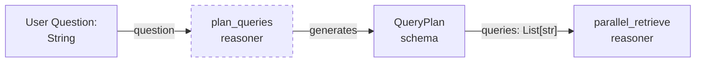
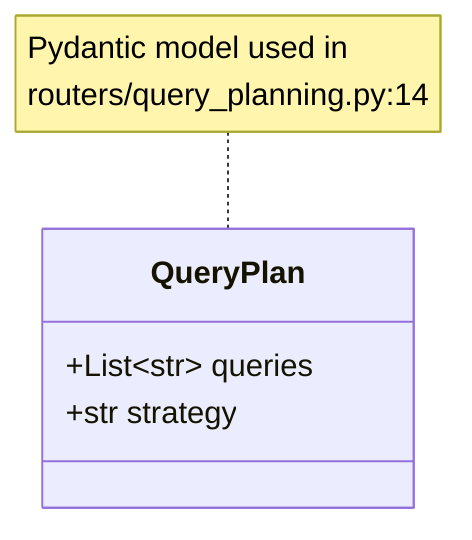
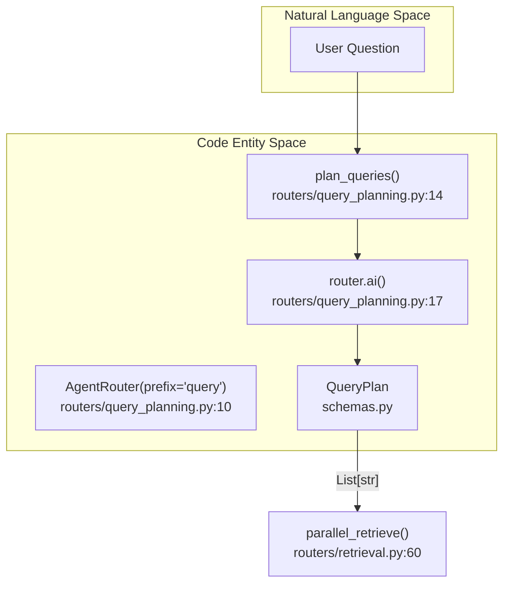
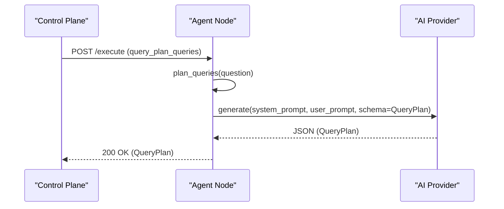

<!-- source: DeepWiki mcp.deepwiki.com · repo Agent-Field/agentfield · page 12.3 Chatbot: Query Planning · fetched 2026-10-26 -->

# Chatbot: Query Planning

Relevant source files

The following files were used as context for generating this wiki page:

- [examples/python_agent_nodes/agentic_rag/main.py](examples/python_agent_nodes/agentic_rag/main.py)
- [examples/python_agent_nodes/agentic_rag/skills.py](examples/python_agent_nodes/agentic_rag/skills.py)
- [examples/python_agent_nodes/documentation_chatbot/pipeline_utils.py](examples/python_agent_nodes/documentation_chatbot/pipeline_utils.py)
- [examples/python_agent_nodes/documentation_chatbot/product_context.py](examples/python_agent_nodes/documentation_chatbot/product_context.py)
- [examples/python_agent_nodes/documentation_chatbot/routers/__init__.py](examples/python_agent_nodes/documentation_chatbot/routers/__init__.py)
- [examples/python_agent_nodes/documentation_chatbot/routers/ingestion.py](examples/python_agent_nodes/documentation_chatbot/routers/ingestion.py)
- [examples/python_agent_nodes/documentation_chatbot/routers/qa.py](examples/python_agent_nodes/documentation_chatbot/routers/qa.py)
- [examples/python_agent_nodes/documentation_chatbot/routers/query_planning.py](examples/python_agent_nodes/documentation_chatbot/routers/query_planning.py)
- [examples/python_agent_nodes/documentation_chatbot/routers/retrieval.py](examples/python_agent_nodes/documentation_chatbot/routers/retrieval.py)
- [examples/python_agent_nodes/hello_world_rag/main.py](examples/python_agent_nodes/hello_world_rag/main.py)
- [examples/python_agent_nodes/hello_world_rag/test_pydantic_skill.py](examples/python_agent_nodes/hello_world_rag/test_pydantic_skill.py)

## Purpose and Scope

This page documents the **query planning** component of the documentation chatbot example. This component transforms a single user question into multiple diverse search queries to maximize retrieval coverage across the documentation corpus. It is the first stage in the 3-reasoner parallel RAG architecture used by the AgentField documentation assistant.

For the complete system architecture, see [Documentation Chatbot](). For subsequent pipeline stages, see [Parallel Retrieval]() and [Self-Aware Synthesis]().

**Sources:** [examples/python_agent_nodes/documentation_chatbot/routers/query_planning.py:1-49](), [examples/python_agent_nodes/documentation_chatbot/routers/qa.py:174-179]()

---

## Overview

Query planning solves a fundamental problem in retrieval-augmented generation: **a single user question often requires multiple search perspectives to find all relevant documentation**. Instead of executing one vector search, the query planner generates 3-5 semantically diverse queries that explore different terminology, aspects, and angles of the user's intent.

### Why Query Planning Matters

Consider the user question: *"How does identity work?"*

A naive single-query approach might miss documents that:
- Use alternative terminology ("DIDs", "Verifiable Credentials", "authentication") [examples/python_agent_nodes/documentation_chatbot/product_context.py:135-135]()
- Cover specific implementation details ("W3C standards", "cryptographic signatures") [examples/python_agent_nodes/documentation_chatbot/product_context.py:45-51]()
- Discuss related concepts ("audit trails", "trust models") [examples/python_agent_nodes/documentation_chatbot/product_context.py:50-51]()

The query planner systematically generates these variations using product-specific context.

**Sources:** [examples/python_agent_nodes/documentation_chatbot/routers/query_planning.py:19-38](), [examples/python_agent_nodes/documentation_chatbot/product_context.py:132-146]()

---

## Architecture Position

The query planner is implemented as a **reasoner** (not a skill) because it requires LLM intelligence to analyze the question and generate diverse reformulations. It is organized within an `AgentRouter` with the prefix `"query"`.

### Query Planning in the RAG Flow

**Query Planning Position**
The `plan_queries` reasoner receives the raw user question and outputs a structured `QueryPlan` containing 3-5 diverse search queries. In the main QA orchestrator, this result is then passed to `parallel_retrieve`.

**Sources:** [examples/python_agent_nodes/documentation_chatbot/routers/query_planning.py:10-15](), [examples/python_agent_nodes/documentation_chatbot/routers/qa.py:176-186]()

---

## The QueryPlan Schema

The query planner outputs a structured Pydantic model that encapsulates both the generated queries and the diversity strategy used.

### Schema Definition

**QueryPlan Data Model**

| Field | Type | Description |
|-------|------|-------------|
| `queries` | `List[str]` | 3-5 semantically diverse search queries covering different angles. |
| `strategy` | `str` | Query diversity approach used: `'broad'`, `'specific'`, or `'mixed'`. |

**Sources:** [examples/python_agent_nodes/documentation_chatbot/schemas.py:1-21](), [examples/python_agent_nodes/documentation_chatbot/routers/query_planning.py:6-15]()

---

## Query Generation Strategies

The `strategy` field documents the approach used to generate diverse queries, enabling the system to track how the search space was explored.

### Strategy Types

**1. Broad Strategy**
- **Purpose:** General exploration to maximize coverage across the documentation corpus. [examples/python_agent_nodes/documentation_chatbot/routers/query_planning.py:44-45]()
- **Characteristics:** Wide semantic variation, different terminology domains.

**2. Specific Strategy**
- **Purpose:** Targeted search for precise technical details. [examples/python_agent_nodes/documentation_chatbot/routers/query_planning.py:44-45]()
- **Characteristics:** Narrow semantic range, implementation-focused (e.g., specific API methods or configuration keys).

**3. Mixed Strategy**
- **Purpose:** Balance between broad coverage and specific details. [examples/python_agent_nodes/documentation_chatbot/routers/query_planning.py:45-46]()
- **Characteristics:** Combination of high-level architectural queries and low-level implementation queries.

**Sources:** [examples/python_agent_nodes/documentation_chatbot/routers/query_planning.py:43-46]()

---

## Reasoner Implementation

The `plan_queries` reasoner is registered on the `query_router`. It uses the `app.ai()` method (via the router) to perform a structured LLM call.

### Prompt Engineering and Context

The reasoner is provided with the `PRODUCT_CONTEXT`, which includes a "Search Term Relationships" section. This allows the AI to map colloquial terms to technical system names:
- "Identity" → DIDs, Verifiable Credentials. [examples/python_agent_nodes/documentation_chatbot/product_context.py:135-135]()
- "Functions" → Reasoners, Skills. [examples/python_agent_nodes/documentation_chatbot/product_context.py:141-141]()
- "State" → Memory, Scopes. [examples/python_agent_nodes/documentation_chatbot/product_context.py:136-136]()

### Diversity Guidelines

The system prompt enforces five core diversity strategies:
1. **Terminology:** Use different synonyms and product-specific terms. [examples/python_agent_nodes/documentation_chatbot/routers/query_planning.py:27-27]()
2. **Aspects:** Cover setup, usage, troubleshooting, and configuration. [examples/python_agent_nodes/documentation_chatbot/routers/query_planning.py:28-28]()
3. **Range:** Move from broad concepts to specific terms. [examples/python_agent_nodes/documentation_chatbot/routers/query_planning.py:29-29]()
4. **Relationships:** Include related concepts using the search term mapping. [examples/python_agent_nodes/documentation_chatbot/routers/query_planning.py:30-30]()
5. **Non-redundancy:** Each query must target a unique angle. [examples/python_agent_nodes/documentation_chatbot/routers/query_planning.py:31-31]()

**Sources:** [examples/python_agent_nodes/documentation_chatbot/routers/query_planning.py:14-48](), [examples/python_agent_nodes/documentation_chatbot/product_context.py:132-146]()

---

## Code Entity Mapping

The following diagram maps the logical Query Planning process to the specific code entities in the `documentation_chatbot` example.

**Sources:** [examples/python_agent_nodes/documentation_chatbot/routers/query_planning.py:10-17](), [examples/python_agent_nodes/documentation_chatbot/routers/retrieval.py:60-65]()

---

## Integration with Agent Router

The query planner is exposed as part of the agent's API via the `query_router`. Because the router uses `prefix="query"`, the internal function `plan_queries` is exposed to the Control Plane as `query_plan_queries`.

### Execution Flow

**Sources:** [examples/python_agent_nodes/documentation_chatbot/routers/query_planning.py:10-14](), [examples/python_agent_nodes/documentation_chatbot/product_context.py:59-62]()

---

## Query Diversity Techniques

The reasoner is instructed to generate queries across multiple "Query Types" to ensure a multi-faceted search:

| Query Type | Purpose | Example |
|-----------|---------|---------|
| **How-to** | Procedural steps | "how to install AgentField" |
| **Concept** | Architectural understanding | "AgentField architecture" |
| **Troubleshooting** | Error resolution | "DID registration error" |
| **Configuration** | Settings and environment | "configure PostgreSQL storage" |
| **API/Reference** | Technical specifications | "app.ai method parameters" |
| **Comparison** | Trade-offs | "reasoners vs skills" |

**Sources:** [examples/python_agent_nodes/documentation_chatbot/routers/query_planning.py:33-38]()

---

## Summary

The query planning reasoner acts as the "intelligence gate" for the RAG pipeline. By expanding a single user question into a `QueryPlan` of 3-5 diverse queries, it mitigates the risk of retrieval failure due to terminology mismatch or narrow semantic focus. It leverages the `PRODUCT_CONTEXT` to ensure that generated queries use the precise technical language expected by the vector database.

**Sources:** [examples/python_agent_nodes/documentation_chatbot/routers/query_planning.py:1-49](), [examples/python_agent_nodes/documentation_chatbot/routers/qa.py:174-180]()

---

