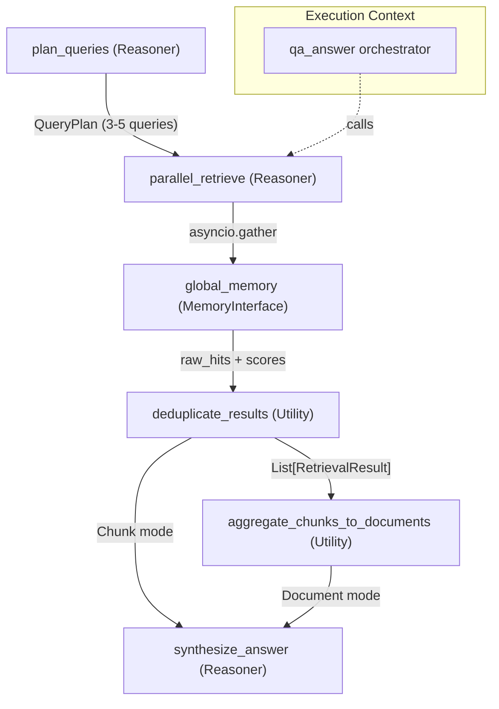
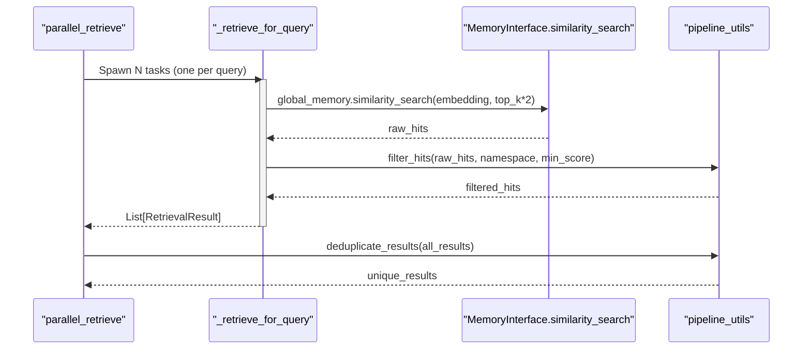
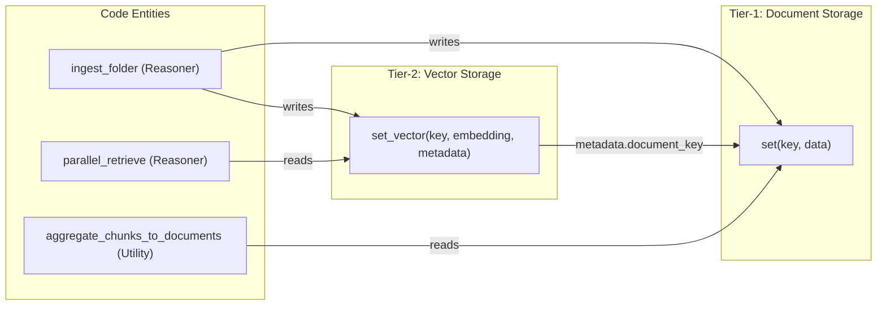

<!-- source: DeepWiki mcp.deepwiki.com · repo Agent-Field/agentfield · page 12.4 Chatbot: Parallel Retrieval · fetched 2026-10-26 -->

# Chatbot: Parallel Retrieval

Relevant source files

The following files were used as context for generating this wiki page:

- [examples/python_agent_nodes/agentic_rag/main.py](examples/python_agent_nodes/agentic_rag/main.py)
- [examples/python_agent_nodes/agentic_rag/skills.py](examples/python_agent_nodes/agentic_rag/skills.py)
- [examples/python_agent_nodes/documentation_chatbot/pipeline_utils.py](examples/python_agent_nodes/documentation_chatbot/pipeline_utils.py)
- [examples/python_agent_nodes/documentation_chatbot/product_context.py](examples/python_agent_nodes/documentation_chatbot/product_context.py)
- [examples/python_agent_nodes/documentation_chatbot/routers/__init__.py](examples/python_agent_nodes/documentation_chatbot/routers/__init__.py)
- [examples/python_agent_nodes/documentation_chatbot/routers/ingestion.py](examples/python_agent_nodes/documentation_chatbot/routers/ingestion.py)
- [examples/python_agent_nodes/documentation_chatbot/routers/qa.py](examples/python_agent_nodes/documentation_chatbot/routers/qa.py)
- [examples/python_agent_nodes/documentation_chatbot/routers/query_planning.py](examples/python_agent_nodes/documentation_chatbot/routers/query_planning.py)
- [examples/python_agent_nodes/documentation_chatbot/routers/retrieval.py](examples/python_agent_nodes/documentation_chatbot/routers/retrieval.py)
- [examples/python_agent_nodes/hello_world_rag/main.py](examples/python_agent_nodes/hello_world_rag/main.py)
- [examples/python_agent_nodes/hello_world_rag/test_pydantic_skill.py](examples/python_agent_nodes/hello_world_rag/test_pydantic_skill.py)

## Purpose and Scope

This page documents the parallel retrieval component of the documentation chatbot example, specifically the `parallel_retrieve` reasoner and its implementation within the multi-agent RAG pipeline. This component is responsible for executing multiple search queries concurrently against the vector store, deduplicating results, and optionally aggregating chunks into full document contexts.

By utilizing `asyncio.gather`, the system achieves significant latency reduction compared to sequential retrieval, enabling the use of diverse query sets to improve recall without a linear increase in response time.

**Sources:** [examples/python_agent_nodes/documentation_chatbot/routers/retrieval.py:1-15](), [examples/python_agent_nodes/documentation_chatbot/routers/qa.py:163-186]()

## System Architecture

The parallel retrieval system operates as the second stage in the 3-reasoner pipeline, accepting diverse queries from the query planner and returning ranked results to the synthesizer.

### Retrieval Flow Diagram

**Sources:** [examples/python_agent_nodes/documentation_chatbot/routers/retrieval.py:59-89](), [examples/python_agent_nodes/documentation_chatbot/routers/qa.py:163-188](), [examples/python_agent_nodes/documentation_chatbot/pipeline_utils.py:113-117]()

## Retrieval Data Structures

The parallel retrieval system uses two primary schemas defined in `schemas.py` to represent retrieved information.

### RetrievalResult Schema

The `RetrievalResult` class represents a single retrieved chunk with minimal metadata for efficient processing.

| Field | Type | Description |
|-------|------|-------------|
| `text` | `str` | Chunk content extracted from documentation [examples/python_agent_nodes/documentation_chatbot/routers/retrieval.py:38-38]() |
| `source` | `str` | Formatted string `path:start-end` [examples/python_agent_nodes/documentation_chatbot/routers/retrieval.py:45-45]() |
| `score` | `float` | Similarity score from vector search [examples/python_agent_nodes/documentation_chatbot/routers/retrieval.py:51-51]() |
| `metadata` | `Dict[str, Any]` | Raw metadata from the vector store [examples/python_agent_nodes/documentation_chatbot/routers/retrieval.py:37-37]() |

### DocumentContext Schema

The `DocumentContext` class represents a full documentation page aggregated from matching chunks, used in document-aware retrieval mode.

| Field | Type | Description |
|-------|------|-------------|
| `document_key` | `str` | Key referencing the Tier-1 full document [examples/python_agent_nodes/documentation_chatbot/pipeline_utils.py:158-158]() |
| `full_text` | `str` | Complete document text retrieved from global memory [examples/python_agent_nodes/documentation_chatbot/pipeline_utils.py:159-159]() |
| `relevance_score` | `float` | Calculated score based on chunk frequency and coverage [examples/python_agent_nodes/documentation_chatbot/pipeline_utils.py:162-162]() |

**Sources:** [examples/python_agent_nodes/documentation_chatbot/routers/retrieval.py:35-56](), [examples/python_agent_nodes/documentation_chatbot/pipeline_utils.py:135-165]()

## Implementation Detail: `parallel_retrieve`

The core logic resides in `parallel_retrieve`, which wraps the `_retrieve_for_query` helper.

### Chunk Retrieval Process

**Key Implementation Points:**
1. **Concurrency:** Uses `asyncio.gather(*tasks)` to execute embedding and search operations for all queries in parallel [examples/python_agent_nodes/documentation_chatbot/routers/retrieval.py:71-75]().
2. **Filtering:** Hits are filtered by `namespace` and a `min_score` threshold (default `0.35`) using `filter_hits` [examples/python_agent_nodes/documentation_chatbot/routers/retrieval.py:33-33]().
3. **Deduplication:** The `deduplicate_results` utility ensures that if multiple queries find the same chunk, only the version with the highest score is retained [examples/python_agent_nodes/documentation_chatbot/pipeline_utils.py:47-57]().

**Sources:** [examples/python_agent_nodes/documentation_chatbot/routers/retrieval.py:18-89](), [examples/python_agent_nodes/documentation_chatbot/pipeline_utils.py:29-57]()

## Document Aggregation Strategy

The system supports a "Tiered Retrieval" strategy where small chunks are used for initial search, but full documents are retrieved for synthesis if necessary.

### Document Aggregation Logic
The function `aggregate_chunks_to_documents` performs the following steps:
1. **Grouping:** Groups deduplicated chunks by their `document_key` metadata [examples/python_agent_nodes/documentation_chatbot/pipeline_utils.py:121-125]().
2. **Fetching:** For each unique key, it performs a `global_memory.get(key=doc_key)` to retrieve the full Tier-1 document text [examples/python_agent_nodes/documentation_chatbot/pipeline_utils.py:137-137]().
3. **Scoring:** Calculates a `relevance_score` using `calculate_document_score`, which applies a "coverage boost" (0.05 per chunk, up to 5 chunks) to documents that matched multiple queries [examples/python_agent_nodes/documentation_chatbot/pipeline_utils.py:102-110]().

**Sources:** [examples/python_agent_nodes/documentation_chatbot/pipeline_utils.py:102-176]()

## Two-Tier Storage Integration

Parallel retrieval relies on the ingestion pattern established in `ingestion.py`.

### Storage Tier Architecture

**Implementation Details:**
- **Tier 1:** Full document text is stored at `{namespace}:doc:{relative_path}` [examples/python_agent_nodes/documentation_chatbot/routers/ingestion.py:95-104]().
- **Tier 2:** Chunks are stored with an embedding and metadata containing the `document_key` [examples/python_agent_nodes/documentation_chatbot/routers/ingestion.py:121-134]().

**Sources:** [examples/python_agent_nodes/documentation_chatbot/routers/ingestion.py:94-135](), [examples/python_agent_nodes/documentation_chatbot/pipeline_utils.py:121-140]()

## Retrieval Parameters

The `parallel_retrieve` function exposes several knobs for tuning retrieval behavior:

| Parameter | Type | Default | Description |
|-----------|------|---------|-------------|
| `queries` | `List[str]` | Required | The list of generated search strings [examples/python_agent_nodes/documentation_chatbot/routers/retrieval.py:61-61]() |
| `namespace` | `str` | `"website-docs"` | The logical partition in the vector store [examples/python_agent_nodes/documentation_chatbot/routers/retrieval.py:62-62]() |
| `top_k` | `int` | `6` | Number of chunks to retrieve *per query* [examples/python_agent_nodes/documentation_chatbot/routers/retrieval.py:63-63]() |
| `min_score` | `float` | `0.35` | Minimum similarity threshold [examples/python_agent_nodes/documentation_chatbot/routers/retrieval.py:64-64]() |

**Sources:** [examples/python_agent_nodes/documentation_chatbot/routers/retrieval.py:59-65]()

## Error Handling and Edge Cases

1. **Empty Results:** If no chunks match the `min_score` or `namespace`, `parallel_retrieve` returns an empty list [examples/python_agent_nodes/documentation_chatbot/routers/retrieval.py:89-89](). The `synthesize_answer` reasoner checks for this and returns a "No documentation found" response [examples/python_agent_nodes/documentation_chatbot/routers/qa.py:34-41]().
2. **Missing Documents:** In document aggregation mode, if a `document_key` is found in a chunk but the corresponding Tier-1 document is missing from KV memory, the system logs the issue and skips that document [examples/python_agent_nodes/documentation_chatbot/pipeline_utils.py:138-140]().
3. **Empty Chunks:** Metadata-only hits with no text are discarded during the retrieval loop [examples/python_agent_nodes/documentation_chatbot/routers/retrieval.py:38-40]().

**Sources:** [examples/python_agent_nodes/documentation_chatbot/routers/retrieval.py:38-40](), [examples/python_agent_nodes/documentation_chatbot/routers/qa.py:34-41](), [examples/python_agent_nodes/documentation_chatbot/pipeline_utils.py:138-140]()

---

