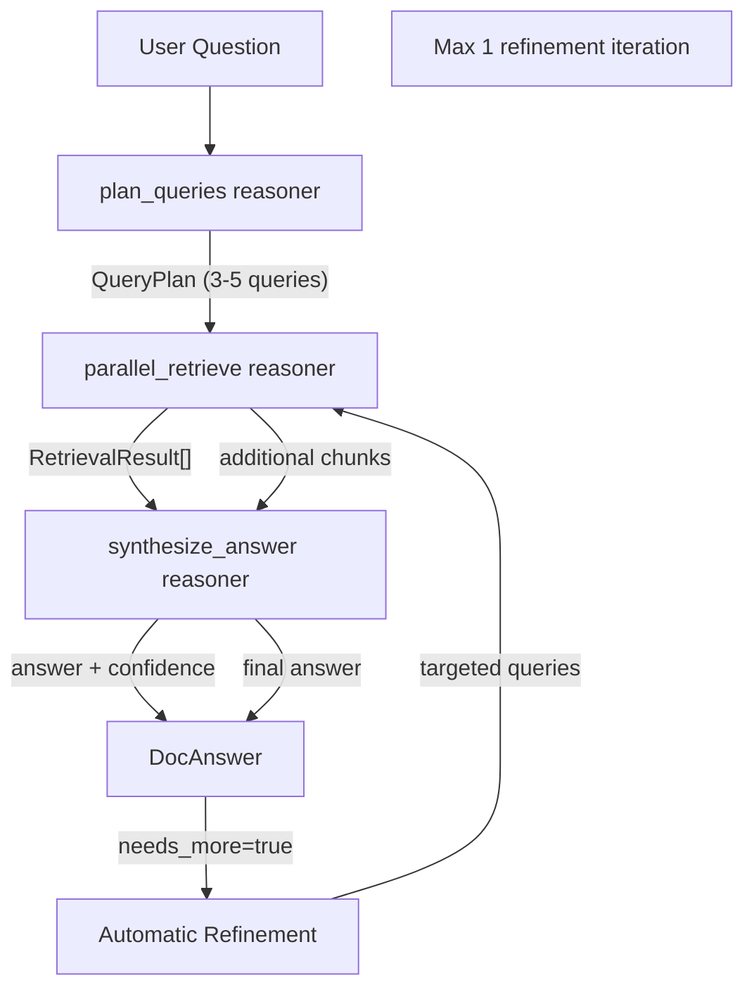
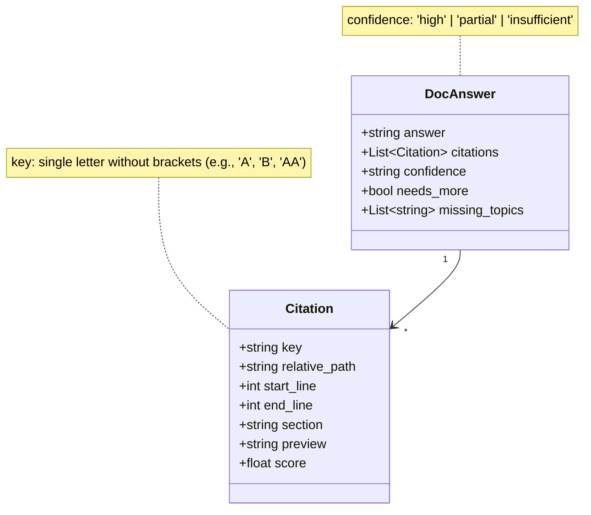
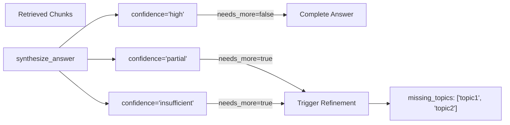
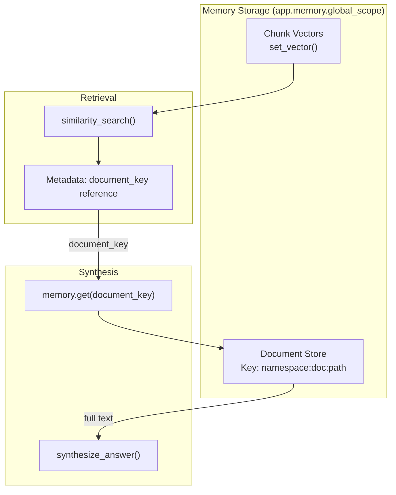

<!-- source: DeepWiki mcp.deepwiki.com · repo Agent-Field/agentfield · page 12.5 Chatbot: Self-Aware Synthesis · fetched 2026-10-26 -->

# Chatbot: Self-Aware Synthesis

<details>
<summary>Relevant source files</summary>

The following files were used as context for generating this wiki page:

- [examples/python_agent_nodes/agentic_rag/main.py](examples/python_agent_nodes/agentic_rag/main.py)
- [examples/python_agent_nodes/agentic_rag/skills.py](examples/python_agent_nodes/agentic_rag/skills.py)
- [examples/python_agent_nodes/documentation_chatbot/pipeline_utils.py](examples/python_agent_nodes/documentation_chatbot/pipeline_utils.py)
- [examples/python_agent_nodes/documentation_chatbot/product_context.py](examples/python_agent_nodes/documentation_chatbot/product_context.py)
- [examples/python_agent_nodes/documentation_chatbot/routers/__init__.py](examples/python_agent_nodes/documentation_chatbot/routers/__init__.py)
- [examples/python_agent_nodes/documentation_chatbot/routers/ingestion.py](examples/python_agent_nodes/documentation_chatbot/routers/ingestion.py)
- [examples/python_agent_nodes/documentation_chatbot/routers/qa.py](examples/python_agent_nodes/documentation_chatbot/routers/qa.py)
- [examples/python_agent_nodes/documentation_chatbot/routers/query_planning.py](examples/python_agent_nodes/documentation_chatbot/routers/query_planning.py)
- [examples/python_agent_nodes/documentation_chatbot/routers/retrieval.py](examples/python_agent_nodes/documentation_chatbot/routers/retrieval.py)
- [examples/python_agent_nodes/hello_world_rag/main.py](examples/python_agent_nodes/hello_world_rag/main.py)
- [examples/python_agent_nodes/hello_world_rag/test_pydantic_skill.py](examples/python_agent_nodes/hello_world_rag/test_pydantic_skill.py)

</details>


This document describes the self-aware synthesis component of the Documentation Chatbot example, which generates natural language answers with inline citations and automatically assesses answer completeness. This component represents the final stage in the 3-reasoner RAG pipeline.

For information about the overall chatbot architecture, see [Documentation Chatbot](#12.1). For query planning, see [Chatbot: Query Planning](#12.3). For parallel retrieval, see [Chatbot: Parallel Retrieval](#12.4).

---

## Overview

The self-aware synthesis system is a reasoner-based component that performs three critical functions:

1. **Answer Generation**: Produces markdown-formatted answers with inline citations referencing retrieved documentation chunks [examples/python_agent_nodes/documentation_chatbot/routers/qa.py:52-109]().
2. **Confidence Assessment**: Evaluates its own response completeness without requiring a separate review agent [examples/python_agent_nodes/documentation_chatbot/routers/qa.py:110-128]().
3. **Automatic Refinement**: Triggers targeted re-retrieval for missing information (limited to 1 iteration to prevent loops) [examples/python_agent_nodes/documentation_chatbot/routers/qa.py:194-210]().

This architecture eliminates the need for a separate "critic" or "reviewer" agent by embedding self-assessment directly into the synthesis reasoner, reducing latency and system complexity.

**Sources**: [examples/python_agent_nodes/documentation_chatbot/routers/qa.py:26-129](), [examples/python_agent_nodes/documentation_chatbot/routers/qa.py:164-216]()

---

## Synthesis Architecture

The synthesizer operates as the third stage in a three-reasoner pipeline:



**Diagram: Three-Reasoner Pipeline with Self-Aware Synthesis**

The synthesizer receives `RetrievalResult[]` from the parallel retriever and produces a `DocAnswer` containing the generated text, citations, and self-assessment metadata [examples/python_agent_nodes/documentation_chatbot/routers/qa.py:27-31]().

**Sources**: [examples/python_agent_nodes/documentation_chatbot/routers/qa.py:164-216](), [examples/python_agent_nodes/documentation_chatbot/routers/qa.py:26-41]()

---

## The `DocAnswer` Schema

The `DocAnswer` Pydantic model defines the output contract for the synthesis reasoner. It combines the natural language response with meta-cognitive evaluation fields.



**Diagram: Answer and Citation Schema Structure**

| Field | Type | Description |
|-------|------|-------------|
| `answer` | `str` | Markdown-formatted answer with inline citation keys like `[A][B]` [examples/python_agent_nodes/documentation_chatbot/routers/qa.py:143-145](). |
| `citations` | `List[Citation]` | Array of citation objects mapping keys to source locations [examples/python_agent_nodes/documentation_chatbot/pipeline_utils.py:60-81](). |
| `confidence` | `str` | Answer quality: `"high"`, `"partial"`, or `"insufficient"` [examples/python_agent_nodes/documentation_chatbot/routers/qa.py:114-128](). |
| `needs_more` | `bool` | `True` if additional retrieval is required for completeness [examples/python_agent_nodes/documentation_chatbot/routers/qa.py:114-128](). |
| `missing_topics` | `List[str]` | Specific information gaps if `needs_more=True` [examples/python_agent_nodes/documentation_chatbot/routers/qa.py:119-128](). |

**Sources**: [examples/python_agent_nodes/documentation_chatbot/routers/qa.py:31-41](), [examples/python_agent_nodes/documentation_chatbot/pipeline_utils.py:60-81]()

---

## Citation System

The citation system uses a key-based reference mechanism that ensures all factual claims are traceable to source documents.

### Citation Key Generation

The synthesizer uses short alphabetic keys (`A`, `B`, `C`, ..., `AA`, `AB`, ...) to reference chunks in the answer text [examples/python_agent_nodes/documentation_chatbot/pipeline_utils.py:13-26](). The LLM receives a simplified mapping structure in the prompt:

```text
## Available Sources (use these keys for citations)
  A: syncing/architecture.md:42-58
  B: syncing/implementation.md:15-30
```

The LLM is instructed to generate answer text like:
> "Agentfield uses DIDs for identity [A]. The control plane manages orchestration [B]." [examples/python_agent_nodes/documentation_chatbot/routers/qa.py:69-70]().

### The `Citation` Object

Each citation contains full provenance metadata generated by `build_citations` [examples/python_agent_nodes/documentation_chatbot/pipeline_utils.py:60-81]():

| Field | Type | Description |
|-------|------|-------------|
| `key` | `str` | Single-letter reference (without brackets) |
| `relative_path` | `str` | File path relative to ingestion root |
| `start_line` | `int` | Starting line number in source file |
| `end_line` | `int` | Ending line number in source file |
| `section` | `str` | Markdown heading under which chunk appears |
| `preview` | `str` | Short text excerpt from the chunk |
| `score` | `float` | Similarity score from vector search |

**Sources**: [examples/python_agent_nodes/documentation_chatbot/pipeline_utils.py:60-81](), [examples/python_agent_nodes/documentation_chatbot/routers/qa.py:44-50]()

---

## Self-Assessment Logic

The synthesizer performs internal confidence assessment. This meta-cognitive step allows the agent to recognize when the retrieved context is insufficient to satisfy the user's request.

### Confidence Levels



**Diagram: Confidence Assessment Flow**

| Confidence | Criteria | Action |
|------------|----------|--------|
| `high` | Specific, detailed information found that fully answers the question [examples/python_agent_nodes/documentation_chatbot/routers/qa.py:114-117](). | No refinement needed |
| `partial` | Relevant information found but key details are missing [examples/python_agent_nodes/documentation_chatbot/routers/qa.py:119-122](). | Trigger refinement with `missing_topics` |
| `insufficient` | Requested information is not present in documentation [examples/python_agent_nodes/documentation_chatbot/routers/qa.py:124-127](). | Trigger refinement or return failure |

**Sources**: [examples/python_agent_nodes/documentation_chatbot/routers/qa.py:110-129]()

---

## Automatic Refinement

When `needs_more=True`, the orchestrator `qa_answer` triggers one refinement iteration [examples/python_agent_nodes/documentation_chatbot/routers/qa.py:194-210]().

### Refinement Strategy

1. **Targeted Query Generation**: The `plan_queries` reasoner is called again using the `missing_topics` as input [examples/python_agent_nodes/documentation_chatbot/routers/qa.py:196]().
2. **Result Combination**: New chunks from `parallel_retrieve` are merged with original results and deduplicated [examples/python_agent_nodes/documentation_chatbot/routers/qa.py:198-204]().
3. **Refinement Flag**: The `is_refinement=True` parameter is passed to `synthesize_answer` to signal it should provide the best possible answer even if incomplete [examples/python_agent_nodes/documentation_chatbot/routers/qa.py:129]().
4. **Single Iteration Limit**: The orchestrator only performs this loop once to prevent infinite execution [examples/python_agent_nodes/documentation_chatbot/routers/qa.py:194]().

**Sources**: [examples/python_agent_nodes/documentation_chatbot/routers/qa.py:188-216]()

---

## Two QA Modes

The chatbot supports two synthesis modes with different context strategies:

### Chunk-Based QA (`qa_answer`)

The `qa_answer` reasoner orchestrates synthesis using isolated text chunks retrieved via vector search [examples/python_agent_nodes/documentation_chatbot/routers/qa.py:164-216]().

### Document-Aware QA (`qa_answer_with_documents`)

This mode aggregates chunks into full document contexts using `aggregate_chunks_to_documents` [examples/python_agent_nodes/documentation_chatbot/pipeline_utils.py:113-177]().

**Document Aggregation Logic**:
1. Groups retrieved chunks by their `document_key` [examples/python_agent_nodes/documentation_chatbot/pipeline_utils.py:121-125]().
2. Fetches the full document text from the `global_scope` memory [examples/python_agent_nodes/documentation_chatbot/pipeline_utils.py:137]().
3. Calculates a `relevance_score` based on chunk scores and coverage [examples/python_agent_nodes/documentation_chatbot/pipeline_utils.py:142]().
4. Ranks and returns the top `N` full documents for synthesis [examples/python_agent_nodes/documentation_chatbot/pipeline_utils.py:167-176]().

**Sources**: [examples/python_agent_nodes/documentation_chatbot/pipeline_utils.py:113-177](), [examples/python_agent_nodes/documentation_chatbot/routers/qa.py:181-186]()

---

## Integration with Memory System

The synthesis component leverages the two-tier storage strategy implemented during ingestion.



**Diagram: Two-Tier Storage Integration in Synthesis**

### Storage Keys
- **Full Documents**: Stored under `{namespace}:doc:{relative_path}` [examples/python_agent_nodes/documentation_chatbot/routers/ingestion.py:95-96]().
- **Chunk Vectors**: Stored with metadata including a `document_key` pointer back to the full text [examples/python_agent_nodes/documentation_chatbot/routers/ingestion.py:120-132]().

**Sources**: [examples/python_agent_nodes/documentation_chatbot/routers/ingestion.py:94-135](), [examples/python_agent_nodes/documentation_chatbot/pipeline_utils.py:136-140]()

---

## Performance Characteristics

| Metric | Value | Notes |
|--------|-------|-------|
| Max refinement iterations | 1 | Hardcoded in `qa_answer` [examples/python_agent_nodes/documentation_chatbot/routers/qa.py:194](). |
| Default `top_k` | 6 | Number of chunks retrieved per query [examples/python_agent_nodes/documentation_chatbot/routers/qa.py:167](). |
| Min Similarity Score | 0.35 | Threshold for relevance filtering [examples/python_agent_nodes/documentation_chatbot/routers/qa.py:168](). |
| Token Usage | High | Refinement and full-document context increase prompt size. |

**Sources**: [examples/python_agent_nodes/documentation_chatbot/routers/qa.py:164-168](), [examples/python_agent_nodes/documentation_chatbot/pipeline_utils.py:179-190]()

---

