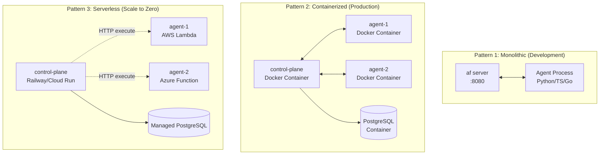
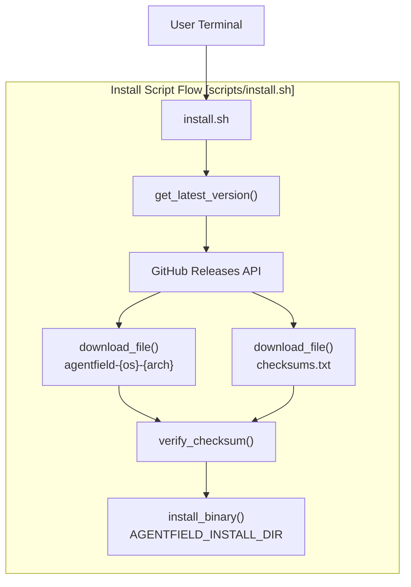
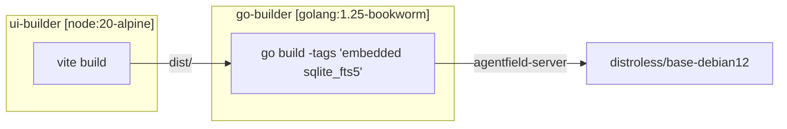
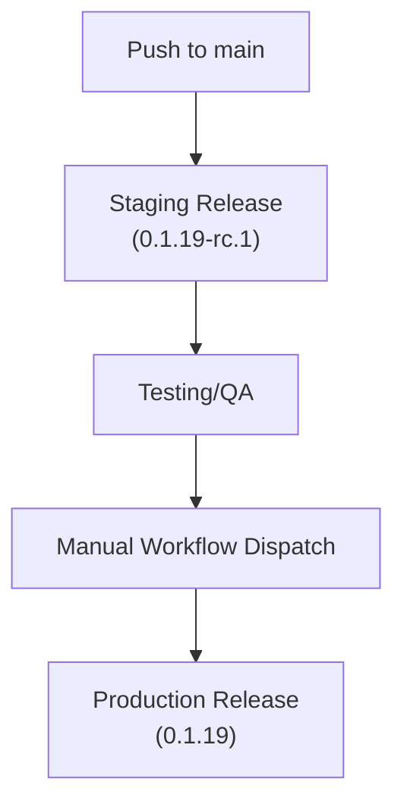

<!-- source: DeepWiki mcp.deepwiki.com · repo Agent-Field/agentfield · page 13 Deployment · fetched 2026-10-26 -->

# Deployment

Relevant source files

The following files were used as context for generating this wiki page:

- [.dockerignore](.dockerignore)
- [.github/workflows/release.yml](.github/workflows/release.yml)
- [.goreleaser.yml](.goreleaser.yml)
- [control-plane/go.mod](control-plane/go.mod)
- [control-plane/go.sum](control-plane/go.sum)
- [control-plane/internal/templates/docker/docker-compose.yml.tmpl](control-plane/internal/templates/docker/docker-compose.yml.tmpl)
- [deployments/docker/Dockerfile.control-plane](deployments/docker/Dockerfile.control-plane)
- [deployments/docker/Dockerfile.demo-go-agent](deployments/docker/Dockerfile.demo-go-agent)
- [deployments/docker/Dockerfile.go-agent](deployments/docker/Dockerfile.go-agent)
- [deployments/helm/agentfield/values.yaml](deployments/helm/agentfield/values.yaml)
- [deployments/kubernetes/base/control-plane-deployment.yaml](deployments/kubernetes/base/control-plane-deployment.yaml)
- [docs/RELEASE.md](docs/RELEASE.md)
- [examples/python_agent_nodes/rag_evaluation/docker-compose.yml](examples/python_agent_nodes/rag_evaluation/docker-compose.yml)
- [examples/triggers-demo/docker-compose.yml](examples/triggers-demo/docker-compose.yml)
- [scripts/bump_version.py](scripts/bump_version.py)
- [scripts/install.ps1](scripts/install.ps1)
- [scripts/install.sh](scripts/install.sh)
- [scripts/tests/__init__.py](scripts/tests/__init__.py)
- [scripts/tests/test_bump_version.py](scripts/tests/test_bump_version.py)
- [sdk/go/ai/openrouter_attribution.go](sdk/go/ai/openrouter_attribution.go)

This document covers deploying AgentField agents and the control plane to production environments. It includes Docker containerization, platform-specific deployment guides (Railway, serverless providers), environment configuration, and production readiness considerations.

For information about building and releasing AgentField itself, see the [Release Process documentation](docs/RELEASE.md). For local development setup, see [Getting Started](#2). For testing infrastructure, see [Testing & Development](#16).

---

## Overview

AgentField supports multiple deployment patterns:

| Deployment Type | Control Plane | Agent Nodes | Use Case |
|----------------|---------------|-------------|----------|
| **Local** | `af server` | Same machine | Development, testing |
| **Docker** | Container | Container(s) | Self-hosted production |
| **Railway** | Managed service | Managed service | Quick cloud deployment |
| **Serverless** | Separate deployment | AWS Lambda, Azure Functions, Google Cloud Functions | Scalable, event-driven |
| **Kubernetes** | Pod | Pod(s) | Enterprise orchestration |

### Architecture Patterns

**Sources:** [.github/workflows/release.yml:1-51]()

---

## Binary Installation

### Install Script Architecture

The AgentField CLI is distributed as pre-compiled binaries via install scripts for Unix/Linux/macOS (`install.sh`) and Windows (`install.ps1`).

**Supported Platforms:**

| OS | Architecture | Binary Name |
|----|--------------|-------------|
| macOS | Intel (amd64) | `agentfield-darwin-amd64` |
| macOS | Apple Silicon (arm64) | `agentfield-darwin-arm64` |
| Linux | x86_64 (amd64) | `agentfield-linux-amd64` |
| Linux | ARM64 | `agentfield-linux-arm64` |
| Windows | x86_64 (amd64) | `agentfield-windows-amd64.exe` |

**Sources:** [scripts/install.sh:11-53](), [scripts/install.ps1:67-83](), [.goreleaser.yml:198-203]()

---

## Docker Deployment

### Control Plane Docker Image

The control plane is published as a multi-architecture Docker image. The build process uses a multi-stage `Dockerfile.control-plane` to compile the Go binary and build the Vite-based Web UI.

**Dockerfile Architecture:**

**Sources:** [deployments/docker/Dockerfile.control-plane:1-48](), [.github/workflows/release.yml:48-51]()

---

## Railway Deployment

Railway deployment is optimized for Python agents using `nixpacks.toml` and a custom `install.sh` script to manage dependency synchronization with PyPI.

### Configuration

For details, see [Railway Deployment](#13.2).

- **nixpacks.toml**: Defines the build phases. [examples/python_agent_nodes/documentation_chatbot/nixpacks.toml:1-5]()
- **install.sh**: Implements a retry loop to wait for `agentfield` SDK availability on PyPI during a release. [examples/python_agent_nodes/documentation_chatbot/install.sh:25-47]()

**Sources:** [examples/python_agent_nodes/documentation_chatbot/railway.json:1-10]()

---

## Serverless Deployment

Agents can be deployed to AWS Lambda, Azure Functions, or Google Cloud Functions.

### Entry Points
- **Python**: Use `handle_serverless()` to wrap the agent application.
- **TypeScript**: Use `agent.handler()` to create a serverless-compatible entry point.

For details, see [Serverless Deployment](#13.3).

---

## Environment Configuration

Both the control plane and agent nodes are configured via environment variables.

### Key Variables
| Variable | Scope | Purpose |
|----------|-------|---------|
| `AGENTFIELD_STORAGE_MODE` | Server | `local` (SQLite) or `postgres` |
| `AGENTFIELD_SERVER` | Agent | URL of the control plane |
| `AGENT_CALLBACK_URL` | Agent | Public URL where the control plane can reach the agent |
| `OPENROUTER_API_KEY` | Both | API key for LLM access |

For details, see [Environment Configuration](#13.4).

**Sources:** [examples/python_agent_nodes/rag_evaluation/docker-compose.yml:2-32]()

---

## Production Considerations

When moving to production, the following components should be tuned:
- **PostgreSQL**: Use `pgvector` for vector storage and configure connection pooling.
- **DIDs & VCs**: Ensure `AGENTFIELD_NO_VC_EXECUTION` is `false` to maintain a cryptographic audit trail.
- **Storage**: Migrate from `LocalStorage` to `PostgresProvider` for durability.

For details, see [Production Considerations](#13.5).

**Sources:** [control-plane/go.mod:35-37](), [docs/RELEASE.md:9-12]()

---

## Release Pipeline

AgentField uses a **two-tier release system** managed by GitHub Actions and `scripts/bump_version.py`.

- **Staging**: Automatic on push to `main`. [docs/RELEASE.md:63-80]()
- **Production**: Manual trigger via `release.yml`. [docs/RELEASE.md:116-141]()
- **Version Bumping**: Handled by `SemVer` class in Python. [scripts/bump_version.py:36-86]()

**Sources:** [.github/workflows/release.yml:3-23](), [docs/RELEASE.md:1-37]()

---

