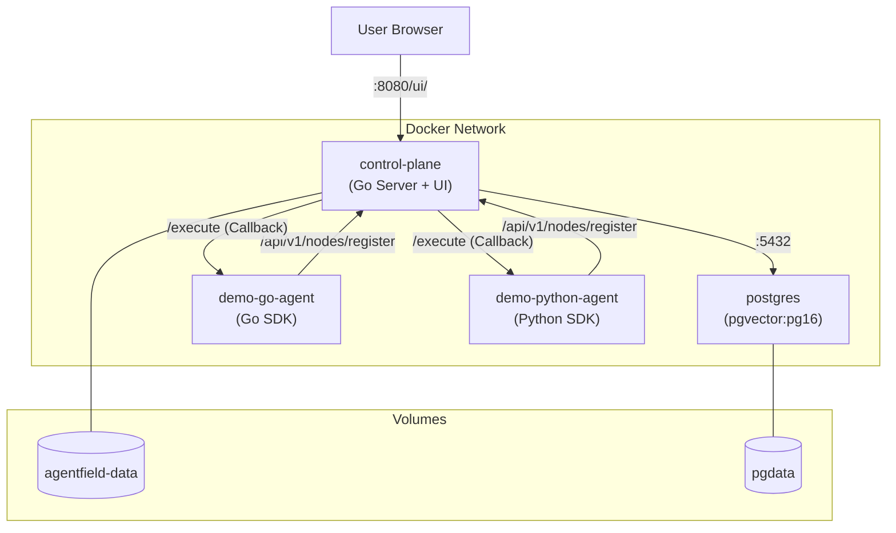
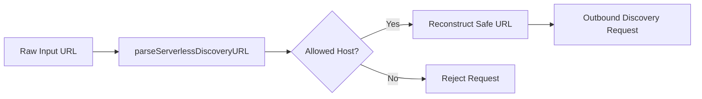

<!-- source: DeepWiki mcp.deepwiki.com · repo Agent-Field/agentfield · page 13.1 Docker Deployment · fetched 2026-10-26 -->

# Docker Deployment

Relevant source files

The following files were used as context for generating this wiki page:

- [.dockerignore](.dockerignore)
- [control-plane/go.mod](control-plane/go.mod)
- [control-plane/go.sum](control-plane/go.sum)
- [control-plane/internal/handlers/nodes_register.go](control-plane/internal/handlers/nodes_register.go)
- [control-plane/internal/handlers/nodes_serverless_ssrf_test.go](control-plane/internal/handlers/nodes_serverless_ssrf_test.go)
- [control-plane/internal/observability/telemetry.go](control-plane/internal/observability/telemetry.go)
- [control-plane/internal/observability/telemetry_test.go](control-plane/internal/observability/telemetry_test.go)
- [deployments/docker/Dockerfile.control-plane](deployments/docker/Dockerfile.control-plane)
- [deployments/docker/Dockerfile.demo-go-agent](deployments/docker/Dockerfile.demo-go-agent)
- [deployments/docker/Dockerfile.go-agent](deployments/docker/Dockerfile.go-agent)
- [deployments/docker/README.md](deployments/docker/README.md)
- [deployments/docker/docker-compose.yml](deployments/docker/docker-compose.yml)

## Purpose and Scope

This document covers deploying AgentField components using Docker and Docker Compose. It explains how to run the control plane in containers, containerize agent nodes, and orchestrate multi-container deployments.

---

## Control Plane Deployment

### Official Dockerfile Analysis
The control plane image is built using a multi-stage Dockerfile that compiles the Web UI and the Go backend into a single distroless container.

1.  **UI Builder**: Uses `node:20-alpine` to build the React frontend located in `control-plane/web/client/` [deployments/docker/Dockerfile.control-plane:1-13]().
2.  **Go Builder**: Uses `golang:1.25-bookworm` with `CGO_ENABLED=1` to compile the `agentfield-server` binary [deployments/docker/Dockerfile.control-plane:15-37](). It includes `embedded` and `sqlite_fts5` tags to bundle the UI and enable full-text search [deployments/docker/Dockerfile.control-plane:37]().
3.  **Final Image**: A minimal `gcr.io/distroless/base-debian12` image running as a `nonroot` user [deployments/docker/Dockerfile.control-plane:43-48]().

### Environment Variables
Key environment variables for the control plane container:

| Variable | Description | Default |
|----------|-------------|---------|
| `AGENTFIELD_STORAGE_MODE` | Storage backend (`sqlite` or `postgres`) | `sqlite` |
| `AGENTFIELD_HTTP_ADDR` | HTTP server address and port | `0.0.0.0:8080` |
| `AGENTFIELD_HOME` | Data directory for SQLite and keys | `/data` |
| `AGENTFIELD_POSTGRES_URL` | PostgreSQL connection string | - |
| `AGENTFIELD_TELEMETRY_ENABLED` | Enable anonymous usage telemetry | `true` |

**Sources:** [deployments/docker/docker-compose.yml:21-30](), [deployments/docker/Dockerfile.control-plane:41-46]()

---

## Docker Compose Orchestration

AgentField provides a standard `docker-compose.yml` for local evaluation and production-like setups.

### System Architecture (Docker Space)

**Sources:** [deployments/docker/docker-compose.yml:1-71](), [deployments/docker/README.md:1-18]()

### PostgreSQL with pgvector
The stack uses `pgvector/pgvector:pg16` to support vector storage for agent memory [deployments/docker/docker-compose.yml:3](). The control plane waits for the database to be healthy via a `pg_isready` check before starting [deployments/docker/docker-compose.yml:11-15,34-36]().

---

## Agent Containerization

### Go Agent Node
Go agents are compiled into static binaries and placed in a `distroless` container for a minimal footprint.
*   **Source**: `sdk/go` and agent logic [deployments/docker/Dockerfile.demo-go-agent:4-5]().
*   **Build**: Uses `CGO_ENABLED=0` for portability [deployments/docker/Dockerfile.demo-go-agent:9]().

### Python Agent Node
Python agents use a `python:3.11-slim` or similar base.
*   **Registration**: Agents must be configured with `AGENTFIELD_URL` to find the control plane and an `AGENT_CALLBACK_URL` so the control plane can route execution requests back to the container [deployments/docker/docker-compose.yml:62-65]().

### Networking and Discovery
In a Docker network, containers resolve each other by service name.
*   **Agent to Control Plane**: `AGENTFIELD_URL=http://control-plane:8080` [deployments/docker/docker-compose.yml:46]().
*   **Control Plane to Agent**: The agent registers its internal Docker DNS name, e.g., `http://demo-python-agent:8001` [deployments/docker/docker-compose.yml:65]().

The control plane contains logic in `gatherCallbackCandidates` and `resolveCallbackCandidates` to handle cases where agents are running on the host vs. inside Docker [control-plane/internal/handlers/nodes_register.go:91-214]().

---

## Security and SSRF Hardening

When deploying in Docker or Serverless environments, the control plane implements SSRF (Server-Side Request Forgery) protections when discovering or calling agents.

### Discovery Normalization
The `normalizeServerlessDiscoveryURL` function ensures that invocation URLs:
1.  Use only `http` or `https` schemes [control-plane/internal/handlers/nodes_register.go:248-256]().
2.  Do not include user-info, queries, or fragments [control-plane/internal/handlers/nodes_register.go:258-268]().
3.  Have paths cleaned of traversal segments (e.g., `/../`) [control-plane/internal/handlers/nodes_register.go:224-229]().

**Sources:** [control-plane/internal/handlers/nodes_register.go:223-270](), [control-plane/internal/handlers/nodes_serverless_ssrf_test.go:24-37]()

---

## Anonymous Telemetry

By default, the Docker deployment enables anonymous usage telemetry [deployments/docker/docker-compose.yml:29]().
*   **Implementation**: `TelemetryService` [control-plane/internal/observability/telemetry.go:47-60]().
*   **Data Collected**: Startup events, agent registration (SDK language/version), and execution success/failure buckets [control-plane/internal/observability/telemetry_test.go:61-132]().
*   **Anonymization**: Uses a hashed `install_id` stored in the data volume to identify unique installations without tracking users [control-plane/internal/observability/telemetry.go:100-143]().

To disable, set `AGENTFIELD_TELEMETRY_ENABLED=false` in the environment [deployments/docker/README.md:57-62]().

**Sources:** [control-plane/internal/observability/telemetry.go:1-190](), [deployments/docker/README.md:53-62]()

---

