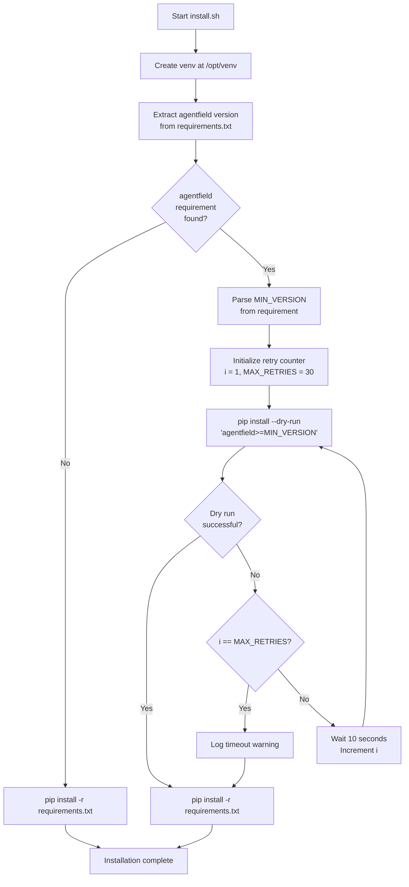
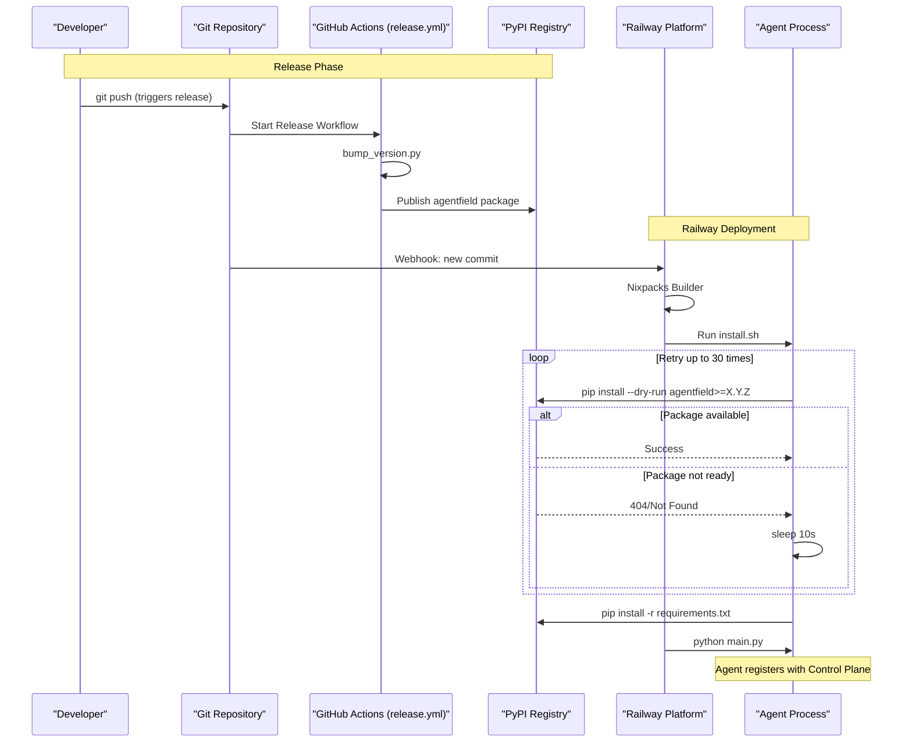
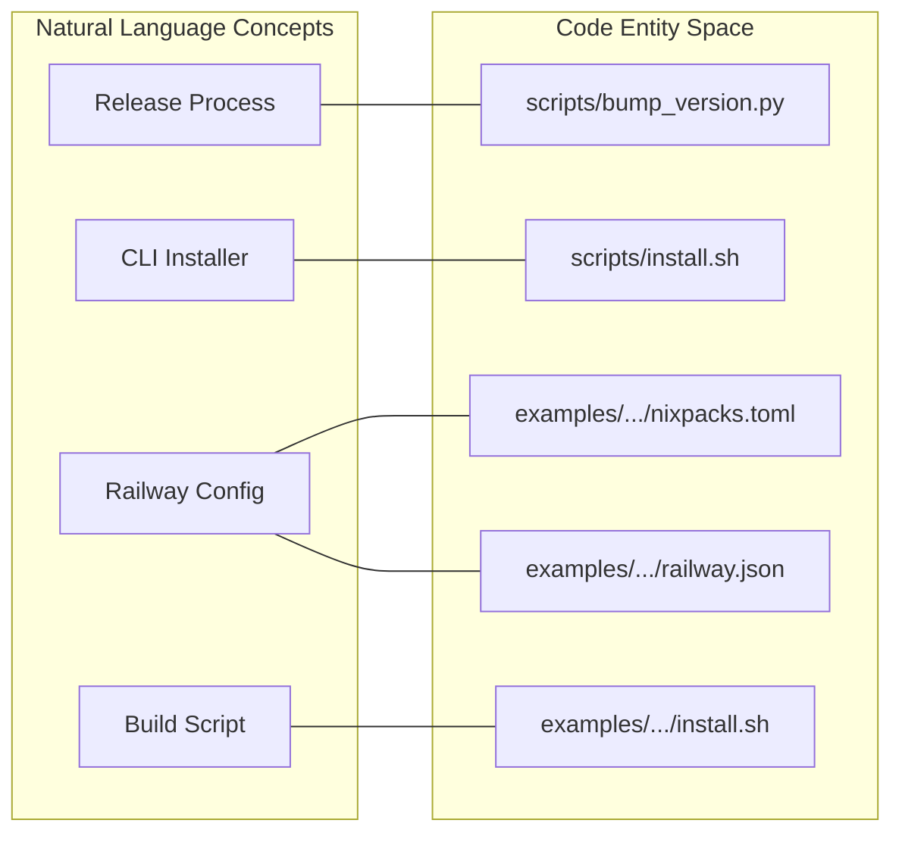

<!-- source: DeepWiki mcp.deepwiki.com · repo Agent-Field/agentfield · page 13.2 Railway Deployment · fetched 2026-10-26 -->

# Railway Deployment

<details>
<summary>Relevant source files</summary>

The following files were used as context for generating this wiki page:

- [.github/workflows/release.yml](.github/workflows/release.yml)
- [.goreleaser.yml](.goreleaser.yml)
- [control-plane/internal/templates/docker/docker-compose.yml.tmpl](control-plane/internal/templates/docker/docker-compose.yml.tmpl)
- [deployments/helm/agentfield/values.yaml](deployments/helm/agentfield/values.yaml)
- [deployments/kubernetes/base/control-plane-deployment.yaml](deployments/kubernetes/base/control-plane-deployment.yaml)
- [docs/RELEASE.md](docs/RELEASE.md)
- [examples/python_agent_nodes/documentation_chatbot/install.sh](examples/python_agent_nodes/documentation_chatbot/install.sh)
- [examples/python_agent_nodes/documentation_chatbot/nixpacks.toml](examples/python_agent_nodes/documentation_chatbot/nixpacks.toml)
- [examples/python_agent_nodes/documentation_chatbot/railway.json](examples/python_agent_nodes/documentation_chatbot/railway.json)
- [examples/python_agent_nodes/rag_evaluation/docker-compose.yml](examples/python_agent_nodes/rag_evaluation/docker-compose.yml)
- [examples/triggers-demo/docker-compose.yml](examples/triggers-demo/docker-compose.yml)
- [scripts/bump_version.py](scripts/bump_version.py)
- [scripts/install.ps1](scripts/install.ps1)
- [scripts/install.sh](scripts/install.sh)
- [scripts/tests/__init__.py](scripts/tests/__init__.py)
- [scripts/tests/test_bump_version.py](scripts/tests/test_bump_version.py)
- [sdk/go/ai/openrouter_attribution.go](sdk/go/ai/openrouter_attribution.go)

</details>


## Purpose and Scope

This document describes how to deploy AgentField agents to [Railway](https://railway.app), a platform-as-a-service (PaaS) that simplifies containerized deployments. Railway uses Nixpacks as its default builder, which automatically detects Python projects and configures them appropriately.

This page covers:
- Configuration files required for Railway deployment (`nixpacks.toml`, `railway.json`, `install.sh`)
- The PyPI synchronization mechanism that handles version availability
- Environment variable configuration for connecting to a control plane
- Deployment workflow and runtime architecture

For containerized deployments using Docker directly, see [Docker Deployment](#13.1). For serverless platforms like AWS Lambda, see [Serverless Deployment](#13.3). For general environment configuration, see [Environment Configuration](#13.4).

---

## Railway Platform Overview

Railway provides automated deployments triggered by git pushes. When deploying AgentField agents to Railway:

1. Railway detects a Python project via `requirements.txt`.
2. Nixpacks builder creates a containerized environment.
3. Custom configuration in `nixpacks.toml` and `railway.json` controls build and start behavior.
4. The agent process starts and registers with a remote control plane.

Railway handles:
- Automatic HTTPS endpoints for each service.
- Environment variable management.
- Log aggregation.
- Automatic restarts on crashes.

**Key Constraint**: Railway deployments typically occur immediately after a release (often triggered by the same CI/CD pipeline), which can create a race condition where Railway tries to install a PyPI package version before it has fully propagated to all PyPI mirrors.

---

## Configuration Files

### nixpacks.toml Structure

The `nixpacks.toml` file customizes the Nixpacks build process. AgentField agents use a minimal configuration that delegates installation to a custom script to handle dependency timing issues.

```toml
[phases.install]
cmds = ["./install.sh"]

[start]
cmd = "python main.py"
```

**Key Elements**:

| Configuration | Purpose |
|--------------|---------|
| `phases.install.cmds` | Replaces default pip installation with custom `install.sh` script |
| `start.cmd` | Specifies the command to run when the container starts |

Sources: [examples/python_agent_nodes/documentation_chatbot/nixpacks.toml:1-6]()

---

### railway.json Structure

The `railway.json` file provides Railway-specific service configuration, ensuring the correct builder and configuration paths are utilized.

```json
{
  "$schema": "https://railway.com/railway.schema.json",
  "build": {
    "builder": "NIXPACKS",
    "nixpacksConfigPath": "nixpacks.toml"
  },
  "deploy": {
    "startCommand": "python main.py"
  }
}
```

**Configuration Parameters**:

| Field | Value | Purpose |
|-------|-------|---------|
| `build.builder` | `"NIXPACKS"` | Explicitly specifies Nixpacks as the build system |
| `build.nixpacksConfigPath` | `"nixpacks.toml"` | Points to custom Nixpacks configuration |
| `deploy.startCommand` | `"python main.py"` | Start command for the deployed service |

Sources: [examples/python_agent_nodes/documentation_chatbot/railway.json:1-11]()

---

## PyPI Synchronization Mechanism

### The Race Condition Problem

When AgentField releases a new version (triggered by `scripts/bump_version.py` and the GitHub Release workflow):

1. CI/CD pipeline builds and publishes to PyPI.
2. Railway webhook triggers deployment simultaneously.
3. Railway may start deployment before PyPI mirrors propagate the new version.
4. `pip install` fails with "version not found".

### install.sh Retry Logic

The `install.sh` script implements a polling mechanism to wait for PyPI availability.

#### Diagram: PyPI Polling Flow (install.sh)



Sources: [examples/python_agent_nodes/documentation_chatbot/install.sh:1-47]()

#### Key Implementation Details

**Virtual Environment Setup**:
The script creates a clean virtual environment at `/opt/venv` to isolate agent dependencies from the Nixpacks base environment [examples/python_agent_nodes/documentation_chatbot/install.sh:8-9]().

**Version Extraction**:
The script uses `grep` and `sed` to identify the required `agentfield` version from `requirements.txt` [examples/python_agent_nodes/documentation_chatbot/install.sh:12-21]().

**Retry Configuration**:
- `MAX_RETRIES`: 30 [examples/python_agent_nodes/documentation_chatbot/install.sh:25]()
- `RETRY_INTERVAL`: 10 seconds [examples/python_agent_nodes/documentation_chatbot/install.sh:26]()
- Total timeout: 5 minutes.

**Dry Run Check**:
The script uses `pip install --dry-run` to verify package existence on the registry without performing a full installation until availability is confirmed [examples/python_agent_nodes/documentation_chatbot/install.sh:30-33]().

Sources: [examples/python_agent_nodes/documentation_chatbot/install.sh:1-47]()

---

## Environment Variables Configuration

### Required Variables

Railway services require environment variables to connect agents to a control plane. Configure these in the Railway dashboard under the service's Variables tab:

| Variable | Example Value | Purpose |
|----------|--------------|---------|
| `AGENTFIELD_SERVER` | `https://control-plane.up.railway.app` | URL of the control plane to register with |
| `AGENTFIELD_API_KEY` | `af_prod_abc123...` | Authentication key for control plane communication |
| `PORT` | `8001` | Port the agent listens on (Railway auto-assigns) |

### AI Provider Variables

To enable LLM capabilities in reasoners, provide keys for the supported providers (OpenAI, Anthropic, Google, Mistral, Groq, xAI, DeepSeek, Cohere, OpenRouter, Ollama).

Sources: [examples/python_agent_nodes/rag_evaluation/docker-compose.yml:4-11]()

---

## Deployment Workflow

### Diagram: Railway Deployment Pipeline



Sources: [.github/workflows/release.yml:1-52](), [examples/python_agent_nodes/documentation_chatbot/install.sh:1-47](), [examples/python_agent_nodes/documentation_chatbot/nixpacks.toml:1-6]()

---

## Multi-Agent Deployment

In a Railway environment, you typically deploy the Control Plane and Agent Nodes as separate services within the same project.

### Diagram: System Entities to Code Mapping

This diagram bridges the conceptual deployment entities to their implementation files.



Sources: [scripts/bump_version.py:1-20](), [scripts/install.sh:1-40](), [examples/python_agent_nodes/documentation_chatbot/nixpacks.toml:1-6](), [examples/python_agent_nodes/documentation_chatbot/railway.json:1-11](), [examples/python_agent_nodes/documentation_chatbot/install.sh:1-47]()

### Service Topology

| Service | Type | Code Base | Config |
|---------|------|-----------|--------|
| **Control Plane** | Go Binary | `control-plane/cmd/af` | `AGENTFIELD_STORAGE_MODE=local` |
| **Agent Node** | Python/TS | `sdk/python` | `AGENTFIELD_SERVER=...` |

Sources: [.goreleaser.yml:11-30](), [examples/python_agent_nodes/rag_evaluation/docker-compose.yml:1-15]()

---

## Troubleshooting

### Installation Failures
If `install.sh` fails despite retries, verify that the `VERSION` file in the root matches the requirement in `requirements.txt`. The release workflow [release.yml]() uses `scripts/bump_version.py` to keep these in sync, but manual changes to `requirements.txt` may bypass this.

### Architecture Mismatches
Railway typically uses `linux-amd64`. Ensure your deployment is not accidentally targeting `linux-arm64` if using binary-specific skills or the `af` CLI directly. The `af` CLI installer [scripts/install.sh]() automatically detects architecture but requires `curl` and `bash` to be present in the Nixpacks environment.

Sources: [.github/workflows/release.yml:58-62](), [scripts/install.sh:137-145](), [scripts/bump_version.py:16-27]()

---

