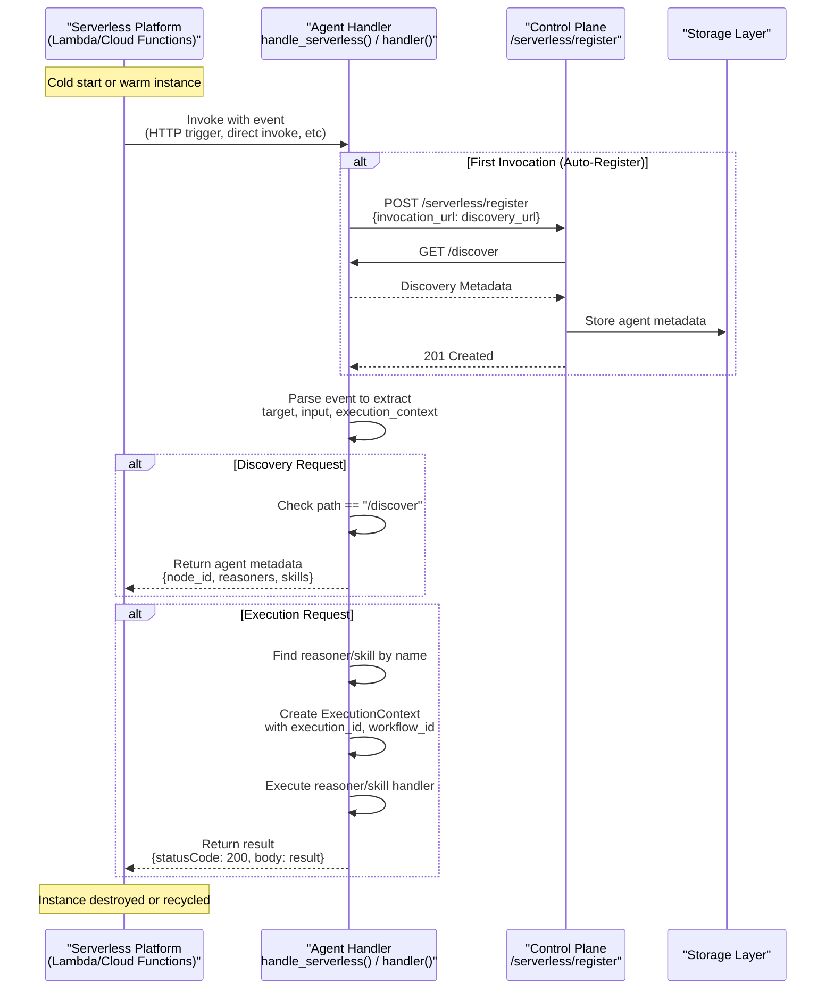
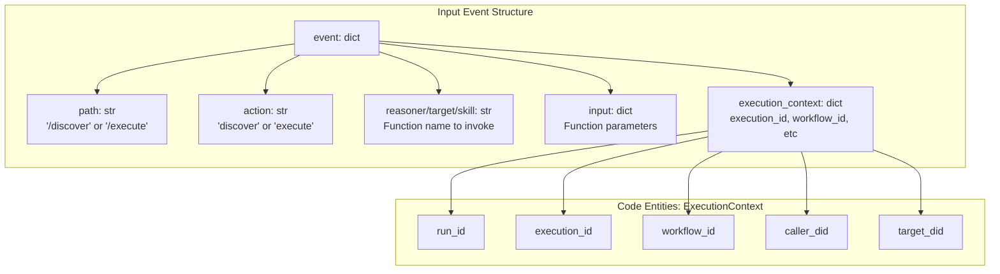
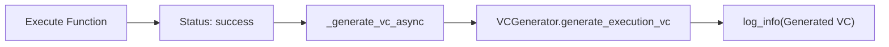

<!-- source: DeepWiki mcp.deepwiki.com · repo Agent-Field/agentfield · page 13.3 Serverless Deployment · fetched 2026-10-26 -->

# Serverless Deployment

<details>
<summary>Relevant source files</summary>

The following files were used as context for generating this wiki page:

- [control-plane/internal/handlers/nodes_serverless_revocation_test.go](control-plane/internal/handlers/nodes_serverless_revocation_test.go)
- [control-plane/internal/services/health_monitor_additional_test.go](control-plane/internal/services/health_monitor_additional_test.go)
- [control-plane/internal/services/ui_service_additional_test.go](control-plane/internal/services/ui_service_additional_test.go)
- [control-plane/web/client/src/types.ts](control-plane/web/client/src/types.ts)
- [control-plane/web/client/src/types/agentfield.ts](control-plane/web/client/src/types/agentfield.ts)
- [examples/go_agent_nodes/cmd/lambda/main.go](examples/go_agent_nodes/cmd/lambda/main.go)
- [sdk/python/agentfield/agent_discovery.py](sdk/python/agentfield/agent_discovery.py)
- [sdk/python/agentfield/agent_pause.py](sdk/python/agentfield/agent_pause.py)
- [sdk/python/agentfield/agent_schema.py](sdk/python/agentfield/agent_schema.py)
- [sdk/python/agentfield/agent_serverless.py](sdk/python/agentfield/agent_serverless.py)
- [sdk/python/agentfield/agent_vc.py](sdk/python/agentfield/agent_vc.py)

</details>


This page covers deploying AgentField agents to serverless platforms such as AWS Lambda, Azure Functions, Google Cloud Functions, Cloud Run, and Kubernetes Jobs. Serverless agents execute on-demand without maintaining long-running server processes, enabling cost-effective scaling and reduced operational overhead.

For deploying agents as long-running services with the control plane, see [Docker Deployment](#13.1) and [Railway Deployment](#13.2). For production configuration of the control plane itself, see [Production Considerations](#13.5).

---

## Serverless Execution Model

Serverless agents in AgentField differ from long-running agents in several key aspects:

| Aspect | Long-Running Agent | Serverless Agent |
|--------|-------------------|------------------|
| **Lifecycle** | Starts on boot, runs continuously | Created per invocation, destroyed after completion |
| **Registration** | Registers on startup | Auto-registers on first invocation or via `/discover` |
| **Heartbeat** | Periodic heartbeats every 30s | No heartbeat (ephemeral) |
| **Connection** | Maintains WebSocket for events | Uses HTTP for stateless operations |
| **Deployment Type** | `long_running` | `serverless` |
| **Health Monitoring** | Tracked by active health registry | Excluded from active health recovery |

Sources: [sdk/python/agentfield/agent_discovery.py:19-19](), [control-plane/web/client/src/types/agentfield.ts:10-10](), [control-plane/internal/services/health_monitor_additional_test.go:71-105]()

### Execution Flow



**Sources:** [sdk/python/agentfield/agent_serverless.py:7-47](), [control-plane/internal/handlers/nodes_serverless_revocation_test.go:41-43](), [sdk/python/agentfield/agent_discovery.py:6-38]()

---

## Python SDK: `handle_serverless()`

The Python SDK provides the `handle_serverless()` method as the universal entry point for serverless platforms.

### Basic Setup

```python
from agentfield import Agent

# Create agent with auto_register=False to defer registration
app = Agent(
    node_id="serverless_agent",
    agentfield_server="https://agentfield.company.com",
    auto_register=True  # Enables auto-registration on first invocation
)

@app.reasoner()
async def analyze(text: str) -> dict:
    return {"analysis": text.upper()}

# AWS Lambda handler
def lambda_handler(event, context):
    return app.handle_serverless(event)
```

**Sources:** [sdk/python/agentfield/agent_serverless.py:32-46]()

### Method Signature

The `handle_serverless()` method accepts:
- **event** (`dict`): Serverless event containing request metadata.
- **adapter** (`Optional[Callable]`): Optional function to normalize platform-specific events.

Returns a `dict` with `statusCode` and `body` fields compatible with API Gateway and similar services.

**Sources:** [sdk/python/agentfield/agent_serverless.py:7-9]()

### Event Format Mapping

The handler extracts execution metadata from the event dictionary to populate the `ExecutionContext`.



**Sources:** [sdk/python/agentfield/agent_serverless.py:85-139](), [sdk/python/agentfield/execution_context.py:3-3]()

---

## Go SDK: Serverless Deployment

Go agents can be deployed to AWS Lambda using the standard SDK combined with the `aws-lambda-go` adapter.

### Lambda Implementation

```go
func main() {
    cfg := agent.Config{
        NodeID:               "go-lambda-hello",
        DeploymentType:       "serverless",
        DisableLeaseLoop:     true,
    }

    srv, _ := agent.New(cfg)
    
    srv.RegisterReasoner("hello", func(ctx context.Context, input map[string]any) (any, error) {
        exec := agent.ExecutionContextFrom(ctx)
        return map[string]any{"greeting": "Hello", "exec_id": exec.ExecutionID}, nil
    })

    adapter := httpadapter.NewV2(srv.Handler())
    lambda.Start(adapter.ProxyWithContext)
}
```

**Sources:** [examples/go_agent_nodes/cmd/lambda/main.go:20-90]()

---

## Control Plane: Serverless Management

The control plane includes specialized logic for managing the lifecycle of serverless nodes, including registration and security.

### Serverless Registration and Approval

Serverless agents are registered via the `RegisterServerlessAgentHandler`. This handler performs several critical checks:
1. **Revocation Check**: Blocks re-registration if an agent is in `AgentStatusPendingApproval`.
2. **Tag Preservation**: When a serverless agent re-registers, the control plane preserves only the `ApprovedTags` for its reasoners and skills.
3. **Auth Requirement**: Captures whether the serverless origin requires authentication (`origin_auth_required`).

**Sources:** [control-plane/internal/handlers/nodes_serverless_revocation_test.go:16-61](), [control-plane/internal/handlers/nodes_serverless_revocation_test.go:63-119](), [control-plane/web/client/src/types/agentfield.ts:12-12]()

### Health Monitoring

Serverless nodes are handled differently by the `HealthMonitor`. They are explicitly skipped during database recovery to prevent unnecessary polling of ephemeral instances.

**Sources:** [control-plane/internal/services/health_monitor_additional_test.go:71-105]()

---

## Implementation Details

### Runtime Schema Validation

To optimize serverless cold starts, the Python SDK uses a lightweight `_validate_handler_input` method instead of heavy Pydantic models for every invocation. This saves approximately 1.5-2 KB per handler.

**Sources:** [sdk/python/agentfield/agent_schema.py:67-85]()

### Identity and VCs

Serverless agents still participate in the cryptographic identity system. The `_AgentVCMixin` handles asynchronous VC generation to ensure that signing execution proofs does not block the serverless response.



**Sources:** [sdk/python/agentfield/agent_vc.py:118-155]()

### Pause and Approval Flow

If a serverless reasoner calls `Agent.pause()` to wait for external approval, the `_PauseManager` registers an `asyncio.Future`. When the control plane sends a webhook callback to the agent's endpoint, the manager resolves the future to resume execution.

**Sources:** [sdk/python/agentfield/agent_pause.py:49-76](), [sdk/python/agentfield/agent_pause.py:78-94]()

---

## Platform Considerations

### Deployment Limitations

- **Async Execution**: Serverless handlers automatically disable async execution polling (`enable_async_execution = False`) because the process terminates after the response.
- **Lease Loop**: Go and Python agents should disable the lease loop (`DisableLeaseLoop: true`) as there is no long-running process to maintain the lease.
- **Authentication**: It is highly recommended to set `AGENTFIELD_AUTHORIZATION_INTERNAL_TOKEN` to ensure the `/execute` endpoint on the serverless function is protected from unauthorized direct calls.

**Sources:** [sdk/python/agentfield/agent_serverless.py:81-82](), [examples/go_agent_nodes/cmd/lambda/main.go:33-33](), [examples/go_agent_nodes/cmd/lambda/main.go:36-41]()

---

