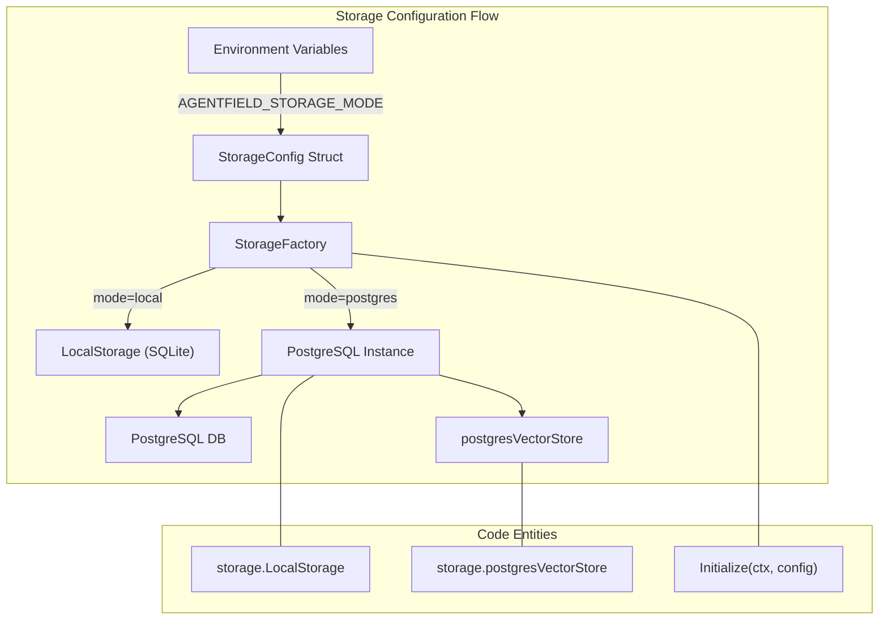
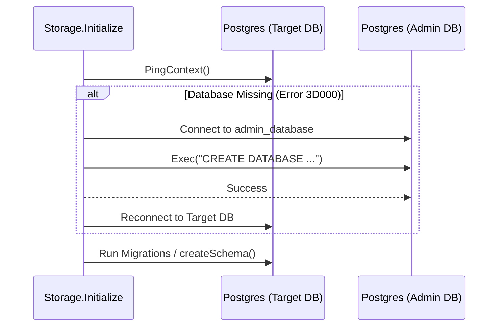
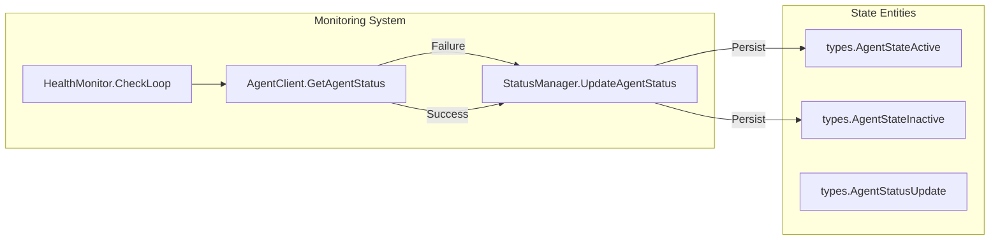

<!-- source: DeepWiki mcp.deepwiki.com · repo Agent-Field/agentfield · page 13.5 Production Considerations · fetched 2026-10-26 -->

# Production Considerations

Relevant source files

The following files were used as context for generating this wiki page:

- [control-plane/internal/encryption/encryption.go](control-plane/internal/encryption/encryption.go)
- [control-plane/internal/encryption/encryption_test.go](control-plane/internal/encryption/encryption_test.go)
- [control-plane/internal/events/node_events.go](control-plane/internal/events/node_events.go)
- [control-plane/internal/handlers/memory.go](control-plane/internal/handlers/memory.go)
- [control-plane/internal/handlers/memory_handler_test.go](control-plane/internal/handlers/memory_handler_test.go)
- [control-plane/internal/handlers/nodes_discovery_test.go](control-plane/internal/handlers/nodes_discovery_test.go)
- [control-plane/internal/handlers/nodes_test.go](control-plane/internal/handlers/nodes_test.go)
- [control-plane/internal/handlers/vector_memory.go](control-plane/internal/handlers/vector_memory.go)
- [control-plane/internal/handlers/vector_memory_test.go](control-plane/internal/handlers/vector_memory_test.go)
- [control-plane/internal/server/server_routes_test.go](control-plane/internal/server/server_routes_test.go)
- [control-plane/internal/services/health_monitor.go](control-plane/internal/services/health_monitor.go)
- [control-plane/internal/services/health_monitor_test.go](control-plane/internal/services/health_monitor_test.go)
- [control-plane/internal/services/status_manager.go](control-plane/internal/services/status_manager.go)
- [control-plane/internal/services/status_manager_test.go](control-plane/internal/services/status_manager_test.go)
- [control-plane/internal/services/webhook_dispatcher_test.go](control-plane/internal/services/webhook_dispatcher_test.go)
- [control-plane/internal/storage/local.go](control-plane/internal/storage/local.go)
- [control-plane/internal/storage/local_query_test.go](control-plane/internal/storage/local_query_test.go)
- [control-plane/internal/storage/storage.go](control-plane/internal/storage/storage.go)
- [control-plane/internal/storage/vector_store.go](control-plane/internal/storage/vector_store.go)
- [control-plane/internal/storage/vector_store_postgres.go](control-plane/internal/storage/vector_store_postgres.go)
- [control-plane/internal/storage/vector_store_sqlite.go](control-plane/internal/storage/vector_store_sqlite.go)
- [control-plane/pkg/types/execution_payload.go](control-plane/pkg/types/execution_payload.go)
- [control-plane/pkg/types/execution_payload_test.go](control-plane/pkg/types/execution_payload_test.go)
- [control-plane/pkg/types/webhook.go](control-plane/pkg/types/webhook.go)

This page covers production deployment considerations for AgentField, focusing on database configuration, connection pooling, vector storage, and system monitoring. AgentField's control plane is designed to transition from local development to high-availability production environments by switching from SQLite to PostgreSQL.

## Storage Backend Selection

AgentField supports two primary storage modes: `local` (SQLite + BoltDB) for development and `postgres` for production workloads. The `StorageProvider` interface abstracts these backends, allowing the system to scale without code changes [control-plane/internal/storage/storage.go:44-142]().

### Mode Comparison

| Aspect | Local Mode (SQLite) | Postgres Mode |
|--------|-------------------|---------------|
| **Best For** | Development, single-instance | Production, distributed scaling |
| **Concurrency** | WAL mode: concurrent reads, single writer | Full concurrent read/write support |
| **Vector Search** | `sqlite-vss` or in-memory | `pgvector` extension |
| **Scalability** | Single server | Horizontal scaling via read replicas |
| **Data Flow** | Direct file I/O | Networked TCP connections |

**Sources:** [control-plane/internal/storage/local.go:478-502](), [control-plane/internal/storage/storage.go:44-142]()

### Configuration Architecture

The `StorageConfig` struct manages the initialization parameters for the selected backend. When `AGENTFIELD_STORAGE_MODE` is set to `postgres`, the system initializes a `postgresVectorStore` and a SQL-based primary store [control-plane/internal/storage/storage.go:207-255]().

**Sources:** [control-plane/internal/storage/storage.go:207-255](), [control-plane/internal/storage/local.go:1-30](), [control-plane/internal/storage/vector_store_postgres.go:15-25]()

## PostgreSQL Configuration

### Connection Pooling

In production, managing database connections is critical for performance. AgentField uses `sql.DB` connection pooling, configured via `PostgresStorageConfig` [control-plane/internal/storage/local.go:706-728]().

| Setting | Default | Purpose |
|---------|---------|---------|
| `MaxOpenConns` | 25 | Maximum concurrent connections to PostgreSQL |
| `MaxIdleConns` | 5 | Idle connections kept in the pool |
| `ConnMaxLifetime` | 30m | Maximum time a connection can be reused |

**Sources:** [control-plane/internal/storage/local.go:706-728]()

### Database Auto-Initialization

AgentField attempts to create the target database if it is missing during startup. It uses an `admin_database` (defaulting to `postgres`) to execute the `CREATE DATABASE` command if a `3D000` (database does not exist) error is caught [control-plane/internal/storage/local.go:668-703]().

**Sources:** [control-plane/internal/storage/local.go:668-703](), [control-plane/internal/storage/local.go:730-800]()

## Vector Storage and RAG

For production RAG (Retrieval-Augmented Generation), AgentField utilizes the `pgvector` extension in PostgreSQL. The `postgresVectorStore` handles embedding storage and similarity searches [control-plane/internal/storage/vector_store_postgres.go:1-18]().

### Vector Operations

The `SimilaritySearch` function performs vector lookups using configurable distance metrics (Cosine, L2, or Dot Product) [control-plane/internal/storage/vector_store_postgres.go:153-228]().

| Function | Implementation Detail |
|----------|-----------------------|
| `Set()` | Uses `INSERT ... ON CONFLICT` for upserts [control-plane/internal/storage/vector_store_postgres.go:27-66]() |
| `Search()` | Employs `CROSS JOIN` with a query vector CTE [control-plane/internal/storage/vector_store_postgres.go:153-170]() |
| `DeleteByPrefix()` | Supports hierarchical memory cleanup using `LIKE` [control-plane/internal/storage/vector_store_postgres.go:132-151]() |

**Sources:** [control-plane/internal/storage/vector_store_postgres.go:27-228]()

## Monitoring and Agent Health

Production environments rely on the `StatusManager` and `HealthMonitor` to track the state of distributed agent nodes [control-plane/internal/services/status_manager.go:26-45]().

### Health Monitoring Flow

The `HealthMonitor` performs periodic HTTP probes against agent `/status` endpoints. If an agent fails consecutive checks, its `HealthScore` is reduced to 0 and its state is marked as `Inactive` [control-plane/internal/services/health_monitor.go:16-24]().

**Sources:** [control-plane/internal/services/health_monitor.go:47-90](), [control-plane/internal/services/status_manager.go:124-201](), [control-plane/internal/services/health_monitor_test.go:147-168]()

### Webhook Reliability

In production, workflow completions often trigger external webhooks. The `WebhookDispatcher` handles retries with exponential backoff and manages "in-flight" states to prevent duplicate deliveries in multi-instance control plane setups [control-plane/internal/services/webhook_dispatcher_test.go:113-130]().

- **Worker Count:** Configurable concurrency for webhook processing [control-plane/internal/services/webhook_dispatcher_test.go:113-125]().
- **Retry Logic:** Uses `TryMarkExecutionWebhookInFlight` to ensure atomicity across control plane instances [control-plane/internal/services/webhook_dispatcher_test.go:49-60]().

**Sources:** [control-plane/internal/services/webhook_dispatcher_test.go:49-130]()

## Performance Optimization

### Indexing and FTS

AgentField creates several indexes to maintain query performance as the database grows, including GIN indexes for Full-Text Search (FTS) on workflow names and tags [control-plane/internal/storage/local.go:1031-1089]().

### Memory Scoping

The `MemoryStorage` handlers resolve scopes (workflow, session, actor, global) dynamically from HTTP headers (`X-Workflow-ID`, `X-Session-ID`). In production, these should be populated by the SDK or a gateway to ensure proper data isolation [control-plane/internal/handlers/memory.go:172-192]().

**Sources:** [control-plane/internal/handlers/memory.go:172-218](), [control-plane/internal/handlers/memory_handler_test.go:119-155]()

---

