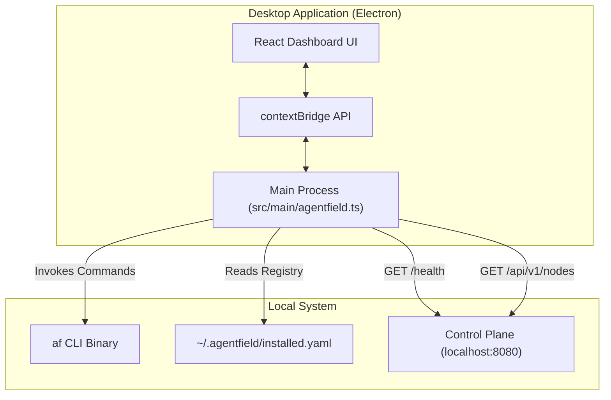

<!-- source: DeepWiki mcp.deepwiki.com · repo Agent-Field/agentfield · page 14 Desktop Application · fetched 2026-10-26 -->

# Desktop Application

Relevant source files

The following files were used as context for generating this wiki page:

- [CHANGELOG.md](CHANGELOG.md)
- [VERSION](VERSION)
- [control-plane/internal/encryption/encryption.go](control-plane/internal/encryption/encryption.go)
- [control-plane/internal/encryption/encryption_test.go](control-plane/internal/encryption/encryption_test.go)
- [control-plane/internal/events/node_events.go](control-plane/internal/events/node_events.go)
- [control-plane/internal/handlers/nodes_discovery_test.go](control-plane/internal/handlers/nodes_discovery_test.go)
- [control-plane/internal/handlers/nodes_test.go](control-plane/internal/handlers/nodes_test.go)
- [control-plane/internal/services/health_monitor.go](control-plane/internal/services/health_monitor.go)
- [control-plane/internal/services/health_monitor_test.go](control-plane/internal/services/health_monitor_test.go)
- [control-plane/internal/services/status_manager.go](control-plane/internal/services/status_manager.go)
- [control-plane/internal/services/status_manager_test.go](control-plane/internal/services/status_manager_test.go)
- [control-plane/internal/services/webhook_dispatcher_test.go](control-plane/internal/services/webhook_dispatcher_test.go)
- [control-plane/internal/storage/local_query_test.go](control-plane/internal/storage/local_query_test.go)
- [control-plane/internal/templates/go/go.mod.tmpl](control-plane/internal/templates/go/go.mod.tmpl)
- [control-plane/pkg/types/execution_payload.go](control-plane/pkg/types/execution_payload.go)
- [control-plane/pkg/types/execution_payload_test.go](control-plane/pkg/types/execution_payload_test.go)
- [control-plane/pkg/types/webhook.go](control-plane/pkg/types/webhook.go)
- [examples/python_agent_nodes/agentic_rag/requirements.txt](examples/python_agent_nodes/agentic_rag/requirements.txt)
- [examples/python_agent_nodes/documentation_chatbot/requirements.txt](examples/python_agent_nodes/documentation_chatbot/requirements.txt)
- [examples/python_agent_nodes/hello_world_rag/requirements.txt](examples/python_agent_nodes/hello_world_rag/requirements.txt)
- [sdk/python/CHANGELOG.md](sdk/python/CHANGELOG.md)
- [sdk/python/agentfield/__init__.py](sdk/python/agentfield/__init__.py)
- [sdk/python/pyproject.toml](sdk/python/pyproject.toml)
- [sdk/python/tests/test_execution_logger.py](sdk/python/tests/test_execution_logger.py)
- [sdk/typescript/package.json](sdk/typescript/package.json)

The AgentField Desktop application is a cross-platform companion dashboard designed to simplify the management of the local control plane, agent nodes, and installed agents. Modeled after developer tools like Docker Desktop, it provides a graphical interface for non-technical users and developers to monitor system health, manage agent lifecycles, and configure environment secrets without deep CLI knowledge.

## High-Level Architecture

The desktop application is built using **Electron**, **React**, and **TypeScript**. It adheres to a strict security model to protect local system resources while providing deep integration with the AgentField ecosystem.

### Security and Isolation
The app employs a sandboxed renderer with `contextIsolation` enabled and `nodeIntegration` disabled [CHANGELOG.md:24-26](). Communication between the UI and the underlying system occurs through a secure `contextBridge` API, ensuring that the frontend cannot execute arbitrary system commands.

### Core Components
*   **Electron Main Process**: Manages system-level operations, including process management for the local control plane and the `af-tray` companion.
*   **React Renderer**: Provides the "Docker-Desktop-style" dashboard [CHANGELOG.md:18-18]().
*   **AgentField Service Layer**: A dedicated module (`src/main/agentfield.ts`) that handles data fetching, registry parsing, and health mapping [CHANGELOG.md:26-29]().

### Component Interaction Diagram

This diagram illustrates how the Desktop Application (Code Entity Space) interacts with the local environment (Natural Language Space).

Sources: [CHANGELOG.md:16-30]()

## Key Features & Views

The application provides several high-level views to manage the agent lifecycle:

*   **Dashboard**: A unified view showing the global health of the control plane (via `GET /health`) and a summary of active nodes [CHANGELOG.md:18-20]().
*   **Agents View**: Lists locally installed agents from `~/.agentfield/installed.yaml`. It cross-references these against the running control plane to display status badges (Running, Stopped, or Unknown) [CHANGELOG.md:19-21]().
*   **Activity**: Visualizes recent logs and execution events.
*   **Settings**: Configuration for the local control plane, including port management and storage paths.

For details on the UI implementation and IPC security, see [Desktop Overview & Views](#14.1).

## CLI and Provisioning

The desktop app acts as a manager for the `af` CLI. It handles the resolution of the binary across three tiers:
1.  **Managed**: Binaries downloaded and managed by the app.
2.  **PATH**: Existing installations found on the user's system.
3.  **Bundled**: A fallback version included with the desktop installer [CHANGELOG.md:14-14]().

On macOS, the app also manages the `af-tray` companion, which provides quick access to system status from the menu bar.

For details on how the app manages local binaries and environment paths, see [CLI Resolution & Auto-provisioning](#14.2).

## Secret Management

The desktop app provides a secure UI for managing `user_environment` declarations. It allows users to input sensitive API keys (e.g., for OpenAI or Anthropic) which are then stored using **AES-256-GCM** encryption. 

The app integrates with the CLI's secret store by securely piping data to `af secrets set` via `stdin`, ensuring that sensitive values never appear in process logs or shell history.

For details on the encryption model and secret UI, see [Agent Keys & Secrets UI](#14.3).

## Platform Support

The application is designed for multi-platform compatibility, with specific logic to handle the differences between Unix-like systems and Windows.

| Feature | macOS / Linux | Windows |
| :--- | :--- | :--- |
| **Process Control** | SIGINT / Signal-0 [CHANGELOG.md:53-54]() | `taskkill` / `tasklist` [CHANGELOG.md:57-58]() |
| **Log Tailing** | `tail -f` [CHANGELOG.md:68-69]() | `Get-Content -Wait` [CHANGELOG.md:70-71]() |
| **Python Probe** | `python3` [CHANGELOG.md:149-150]() | `py` launcher / Store stubs [CHANGELOG.md:140-144]() |
| **Binary Suffix** | None | `.exe` [CHANGELOG.md:78-80]() |

Sources: [CHANGELOG.md:51-100](), [CHANGELOG.md:131-152]()

---

