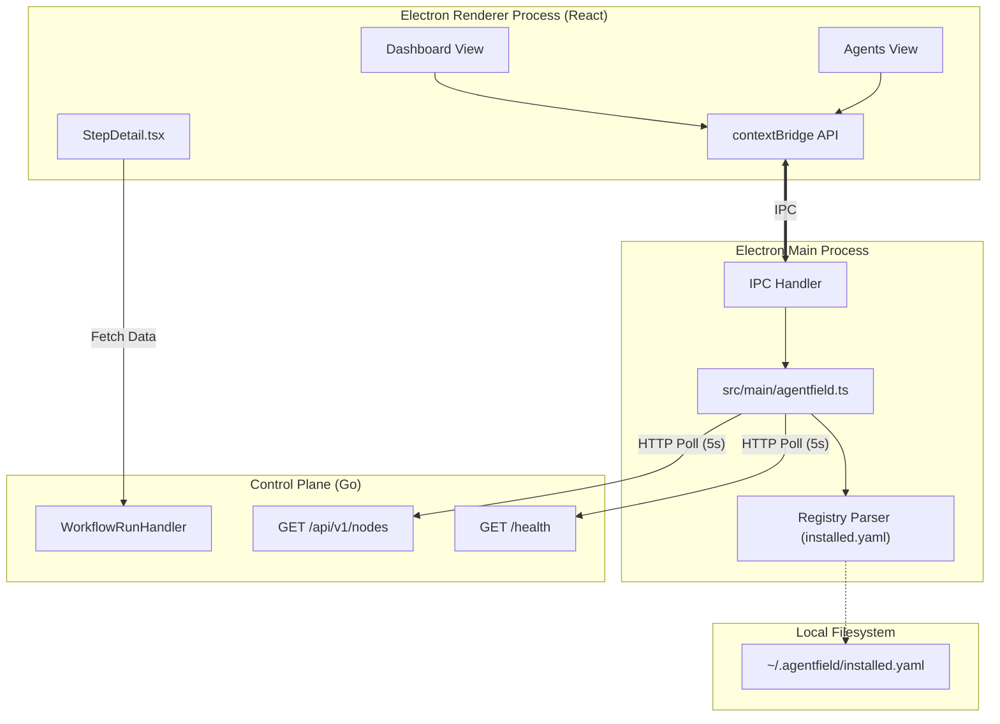
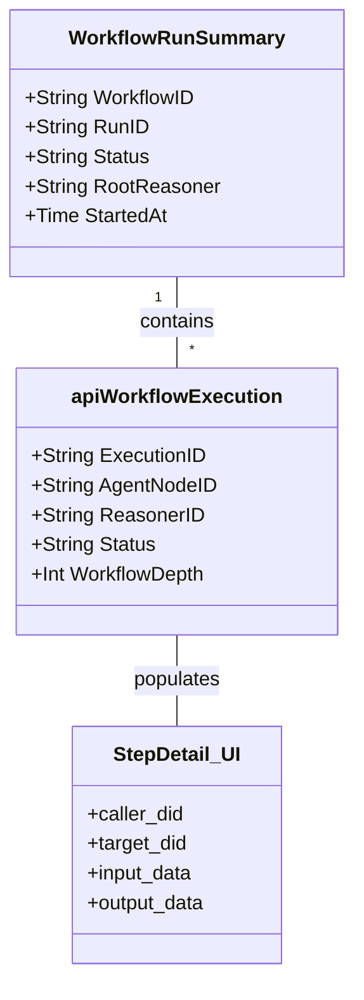

<!-- source: DeepWiki mcp.deepwiki.com · repo Agent-Field/agentfield · page 14.1 Desktop Overview & Views · fetched 2026-10-26 -->

# Desktop Overview & Views

Relevant source files

The following files were used as context for generating this wiki page:

- [CHANGELOG.md](CHANGELOG.md)
- [VERSION](VERSION)
- [control-plane/internal/handlers/ui/workflow_runs.go](control-plane/internal/handlers/ui/workflow_runs.go)
- [control-plane/internal/handlers/ui/workflow_runs_helpers_test.go](control-plane/internal/handlers/ui/workflow_runs_helpers_test.go)
- [control-plane/internal/storage/execution_records_test.go](control-plane/internal/storage/execution_records_test.go)
- [control-plane/internal/templates/go/go.mod.tmpl](control-plane/internal/templates/go/go.mod.tmpl)
- [control-plane/web/client/src/App.tsx](control-plane/web/client/src/App.tsx)
- [control-plane/web/client/src/components/StepDetail.tsx](control-plane/web/client/src/components/StepDetail.tsx)
- [control-plane/web/client/src/config/navigation.ts](control-plane/web/client/src/config/navigation.ts)
- [control-plane/web/client/src/pages/NewSettingsPage.tsx](control-plane/web/client/src/pages/NewSettingsPage.tsx)
- [control-plane/web/client/src/pages/RunsPage.tsx](control-plane/web/client/src/pages/RunsPage.tsx)
- [control-plane/web/client/src/services/executionsApi.ts](control-plane/web/client/src/services/executionsApi.ts)
- [control-plane/web/client/src/services/workflowsApi.ts](control-plane/web/client/src/services/workflowsApi.ts)
- [control-plane/web/client/src/test/components/StepDetail.test.tsx](control-plane/web/client/src/test/components/StepDetail.test.tsx)
- [control-plane/web/client/src/test/pages/RunsPage.test.tsx](control-plane/web/client/src/test/pages/RunsPage.test.tsx)
- [control-plane/web/client/src/types/workflows.ts](control-plane/web/client/src/types/workflows.ts)
- [control-plane/web/client/src/utils/executionErrorCategory.test.ts](control-plane/web/client/src/utils/executionErrorCategory.test.ts)
- [control-plane/web/client/src/utils/executionErrorCategory.ts](control-plane/web/client/src/utils/executionErrorCategory.ts)
- [examples/python_agent_nodes/agentic_rag/requirements.txt](examples/python_agent_nodes/agentic_rag/requirements.txt)
- [examples/python_agent_nodes/documentation_chatbot/requirements.txt](examples/python_agent_nodes/documentation_chatbot/requirements.txt)
- [examples/python_agent_nodes/hello_world_rag/requirements.txt](examples/python_agent_nodes/hello_world_rag/requirements.txt)
- [sdk/python/CHANGELOG.md](sdk/python/CHANGELOG.md)
- [sdk/python/agentfield/__init__.py](sdk/python/agentfield/__init__.py)
- [sdk/python/pyproject.toml](sdk/python/pyproject.toml)
- [sdk/python/tests/test_execution_logger.py](sdk/python/tests/test_execution_logger.py)
- [sdk/typescript/package.json](sdk/typescript/package.json)

The AgentField Desktop application is a "Docker Desktop-style" companion for managing the local control plane and agent nodes. It provides a graphical interface for non-technical users to monitor system health, manage installed agents, and view activity logs across the AgentField ecosystem.

## Core Architecture

The desktop application is built using Electron with a React-based frontend. It follows a strict security model to isolate the renderer process from sensitive system operations.

### Electron Security Model
The application implements the following security constraints:
*   **`contextIsolation`**: Enabled to ensure the renderer and main processes run in separate contexts [CHANGELOG.md:24-25]().
*   **`nodeIntegration`**: Disabled in the renderer to prevent direct access to Node.js APIs [CHANGELOG.md:25]().
*   **`contextBridge`**: A single, unified API bridge is used for all communication between the renderer and the main process [CHANGELOG.md:26]().
*   **Sandboxing**: The renderer process is sandboxed to limit its access to the host operating system [CHANGELOG.md:25]().

### IPC and Data Flow
Data access is centralized in `src/main/agentfield.ts`. This module serves as the primary seam for interacting with the local system, including reading the agent registry and polling the control plane [CHANGELOG.md:26-28]().

| Component | Responsibility |
| :--- | :--- |
| **Main Process** | Manages the lifecycle of the Electron app, handles system-level calls (FS, Process), and manages the tray icon [CHANGELOG.md:14,26-28](). |
| **Renderer Process** | React-based UI that displays the Dashboard, Agents, and Activity views [CHANGELOG.md:24](). |
| **Agent Registry** | Located at `~/.agentfield/installed.yaml`, it tracks locally installed agent nodes [CHANGELOG.md:19-20](). |
| **Control Plane API** | The UI polls `GET /health` and `GET /api/v1/nodes` to synchronize the state of local agents [CHANGELOG.md:18-21](). |

**Sources:** [CHANGELOG.md:14-35]()

## System Views

The application is organized into several primary views, each focused on a specific aspect of the AgentField lifecycle.

### 1. Dashboard View
The Dashboard provides a high-level overview of the Control Plane health. It utilizes the `GET /health` endpoint to display a "Running" or "Stopped" status for the local server [CHANGELOG.md:18-19]().

### 2. Agents View
This view manages the lifecycle of Agent Nodes. It cross-references the local registry (`~/.agentfield/installed.yaml`) with the active nodes reported by the control plane [CHANGELOG.md:19-21]().
*   **Status Badges**: Each agent is assigned a badge: `Running`, `Stopped`, or `Unknown` [CHANGELOG.md:21]().
*   **Polling**: The view polls the control plane every 5 seconds to ensure the UI remains synchronized with the backend [CHANGELOG.md:21-22]().

### 3. Activity View
The Activity view provides visibility into the execution of workflows and reasoners. It visualizes the data returned by the `WorkflowRunHandler` in the control plane [control-plane/internal/handlers/ui/workflow_runs.go:21-27]().

#### Execution Details
When a specific execution is selected, the `StepDetail` component displays:
*   **Provenance**: Displays `caller_did` and `target_did` to show the cryptographic identity chain [control-plane/web/client/src/components/StepDetail.tsx:126-134]().
*   **Input/Output**: Formatted JSON blocks showing the data passed to and from reasoners or skills [control-plane/web/client/src/components/StepDetail.tsx:170-171]().
*   **Status & Errors**: Detailed error categories and messages for failed steps [control-plane/web/client/src/components/StepDetail.tsx:192, control-plane/web/client/src/utils/executionErrorCategory.ts:1-10]().

### 4. Settings View
The Settings view allows users to configure the application and manage environment variables. It handles the resolution of the `af` CLI tool, allowing users to switch between a bundled version or a system-wide PATH version [CHANGELOG.md:14]().

**Sources:** [CHANGELOG.md:14-23](), [control-plane/internal/handlers/ui/workflow_runs.go:21-65](), [control-plane/web/client/src/components/StepDetail.tsx:158-195]()

## Technical Implementation Diagrams

### Desktop Process Architecture
The following diagram illustrates the relationship between the Electron processes and the AgentField Control Plane.

**Sources:** [CHANGELOG.md:16-31](), [control-plane/internal/handlers/ui/workflow_runs.go:146-160]()

### Workflow Run Data Mapping
This diagram maps the UI entities in the Activity view to the Go structs defined in the Control Plane backend.

**Sources:** [control-plane/internal/handlers/ui/workflow_runs.go:29-65](), [control-plane/internal/handlers/ui/workflow_runs.go:125-144](), [control-plane/web/client/src/components/StepDetail.tsx:158-195]()

## UI Components and Interaction

### StepDetail Component
The `StepDetail` component is the primary interface for inspecting individual execution units. It is highly interactive and provides the following features:

*   **cURL Generation**: Users can copy a cURL snippet to reproduce the execution locally [control-plane/web/client/src/components/StepDetail.tsx:45-53]().
*   **Workflow Lineage**: Displays the relationship between parent and child executions using `WorkflowID` and `ExecutionID` [control-plane/web/client/src/components/StepDetail.tsx:102-136]().
*   **Webhook Retries**: Provides a UI to trigger retries for failed webhooks associated with an execution [control-plane/web/client/src/components/StepDetail.tsx:36,201-202]().

### Status Mapping
The UI maps internal Go status strings to visual badges. The `WorkflowRunSummary` aggregates statuses from child executions to provide a top-level run state [control-plane/internal/handlers/ui/workflow_runs.go:38-41]().

| Backend Status | UI Badge |
| :--- | :--- |
| `running` | Active/Spinning |
| `completed` | Success (Green) |
| `failed` | Error (Red) |
| `pending` | Waiting |

**Sources:** [control-plane/web/client/src/components/StepDetail.tsx:1-180](), [control-plane/internal/handlers/ui/workflow_runs.go:29-65]()

---

