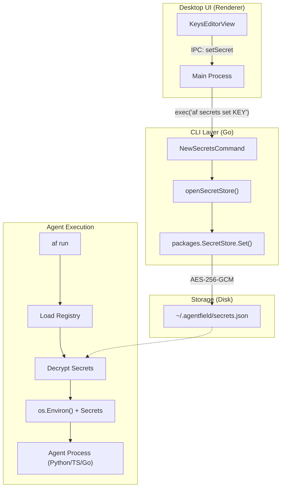
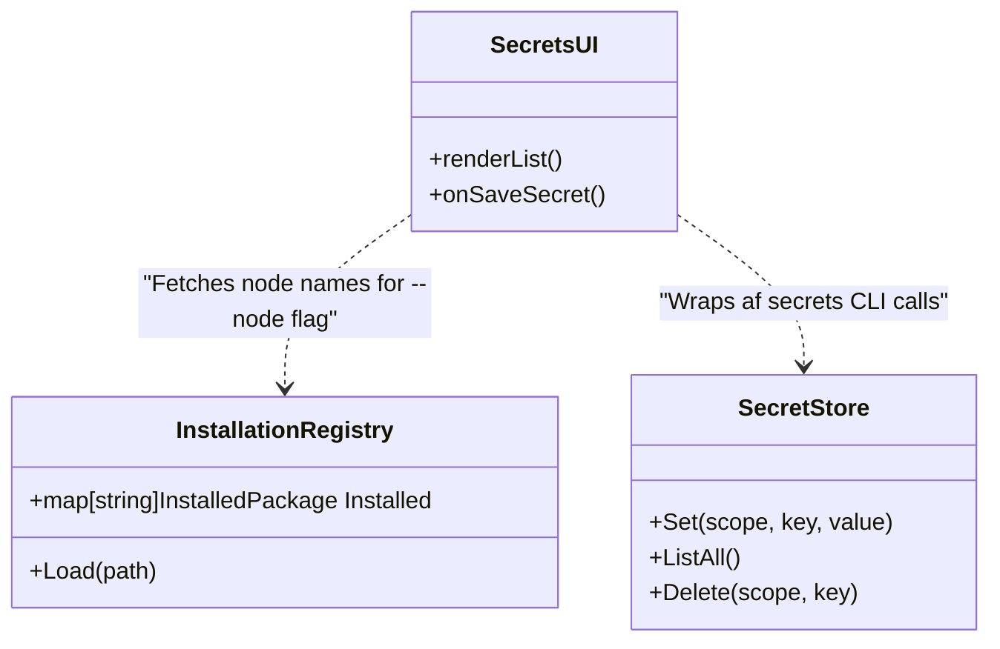

<!-- source: DeepWiki mcp.deepwiki.com · repo Agent-Field/agentfield · page 14.3 Agent Keys & Secrets UI · fetched 2026-10-26 -->

# Agent Keys & Secrets UI

Relevant source files

The following files were used as context for generating this wiki page:

- [CHANGELOG.md](CHANGELOG.md)
- [VERSION](VERSION)
- [control-plane/internal/cli/list.go](control-plane/internal/cli/list.go)
- [control-plane/internal/cli/secrets.go](control-plane/internal/cli/secrets.go)
- [control-plane/internal/packages/git.go](control-plane/internal/packages/git.go)
- [control-plane/internal/packages/git_summary_test.go](control-plane/internal/packages/git_summary_test.go)
- [control-plane/internal/packages/pyinterp.go](control-plane/internal/packages/pyinterp.go)
- [control-plane/internal/packages/pyinterp_test.go](control-plane/internal/packages/pyinterp_test.go)
- [control-plane/internal/packages/spinner_test.go](control-plane/internal/packages/spinner_test.go)
- [control-plane/internal/templates/go/go.mod.tmpl](control-plane/internal/templates/go/go.mod.tmpl)
- [control-plane/internal/ui/ui.go](control-plane/internal/ui/ui.go)
- [control-plane/internal/ui/ui_test.go](control-plane/internal/ui/ui_test.go)
- [examples/python_agent_nodes/agentic_rag/requirements.txt](examples/python_agent_nodes/agentic_rag/requirements.txt)
- [examples/python_agent_nodes/documentation_chatbot/requirements.txt](examples/python_agent_nodes/documentation_chatbot/requirements.txt)
- [examples/python_agent_nodes/hello_world_rag/requirements.txt](examples/python_agent_nodes/hello_world_rag/requirements.txt)
- [sdk/python/CHANGELOG.md](sdk/python/CHANGELOG.md)
- [sdk/python/agentfield/__init__.py](sdk/python/agentfield/__init__.py)
- [sdk/python/pyproject.toml](sdk/python/pyproject.toml)
- [sdk/python/tests/test_execution_logger.py](sdk/python/tests/test_execution_logger.py)
- [sdk/typescript/package.json](sdk/typescript/package.json)

The AgentField Desktop application provides a graphical interface for managing sensitive configuration and environment variables required by AI agents. It serves as a visual frontend for the underlying `af secrets` CLI infrastructure, allowing users to securely store API keys and environment-specific credentials using AES-256-GCM encryption.

## Secret Management Architecture

The Desktop app integrates with the `af` CLI's secret store, which is located in the user's home directory. Secrets are managed at two levels: **Global** (shared across all agents) and **Node-scoped** (specific to a single agent node).

### Encryption and Storage
Secrets are stored at rest in `~/.agentfield/secrets.json` (or a similar path derived from the home directory) [control-plane/internal/cli/secrets.go:21-26](). The implementation uses **AES-256-GCM** to ensure confidentiality and integrity. Secrets are only decrypted into an agent's process environment at the moment of execution (`af run`) [control-plane/internal/cli/secrets.go:73-74]().

### Data Flow: Desktop to CLI
The Desktop UI interacts with secrets by invoking the `af secrets` command tree through a secure IPC bridge. This ensures that the Desktop app does not need to reimplement the cryptographic logic.

| Command | Desktop Action | CLI Implementation |
| :--- | :--- | :--- |
| `af secrets set` | User saves a new key/value pair in the Keys Editor. | `newSecretsSetCommand` [control-plane/internal/cli/secrets.go:39-83]() |
| `af secrets ls` | Desktop populates the "Keys" view list. | `newSecretsListCommand` [control-plane/internal/cli/secrets.go:85-118]() |
| `af secrets rm` | User clicks the "Delete" icon on a secret row. | `newSecretsRemoveCommand` [control-plane/internal/cli/secrets.go:120-145]() |

**Sources:**
- `control-plane/internal/cli/secrets.go`
- `CHANGELOG.md`

## User Environment Declarations

Agents can declare required environment variables in their manifest files. The Desktop app surfaces these declarations to guide the user in providing necessary keys (e.g., `OPENAI_API_KEY`, `ANTHROPIC_API_KEY`).

### Environment Injection Logic
When a node is started via the Desktop app (which triggers `af run`), the control plane performs a hierarchical lookup to populate the process environment:
1. **Node-scoped Secrets**: Overrides any global values for that specific agent [control-plane/internal/cli/secrets.go:24-26]().
2. **Global Secrets**: Shared keys available to all agents.
3. **Local Shell Environment**: Variables already present in the user's shell.

### Secure Stdin Integration
To prevent sensitive keys from appearing in shell history, the Desktop app utilizes the `af secrets set` stdin-based input. When the value is omitted from the command arguments, the CLI uses `readHiddenValue` to capture the secret via a secure pipe [control-plane/internal/cli/secrets.go:51-56]().

**Sources:**
- `control-plane/internal/cli/secrets.go`
- `CHANGELOG.md`

## Code Entity Map: Secret Lifecycle

The following diagram traces how a secret moves from the UI to the encrypted store and eventually into an Agent's execution environment.

**Secret Persistence and Injection Flow**

**Sources:**
- `control-plane/internal/cli/secrets.go:17-37]()` (Command definition)
- `control-plane/internal/cli/secrets.go:61-72]()` (Storage logic)
- `CHANGELOG.md:16-34]()` (Desktop IPC architecture)

## The Keys Editor UI

The Desktop application features a dedicated "Keys" view. This view serves as a centralized management console for the `SecretStore`.

### Key Components
1. **Secret List**: Displays keys and their scopes (Global vs Node). Values are masked using `ui.Muted("••••••••")` [control-plane/internal/cli/secrets.go:107]().
2. **Scope Selector**: Allows users to target a specific agent node or the global scope [control-plane/internal/cli/secrets.go:81]().
3. **Status Feedback**: When a node-scoped secret is updated, the UI informs the user that the change applies only on the next restart of the agent [control-plane/internal/cli/secrets.go:75-77]().

### Technical Implementation: `SecretStore` Interaction
The UI relies on the `InstallationRegistry` to identify which nodes are available for scoping [control-plane/internal/cli/list.go:38-40]().

**Entity Relationship: UI to CLI Data**

**Sources:**
- `control-plane/internal/cli/list.go:34-50]()`
- `control-plane/internal/cli/secrets.go:35-37]()`
- `control-plane/internal/cli/secrets.go:120-145]()`

---

