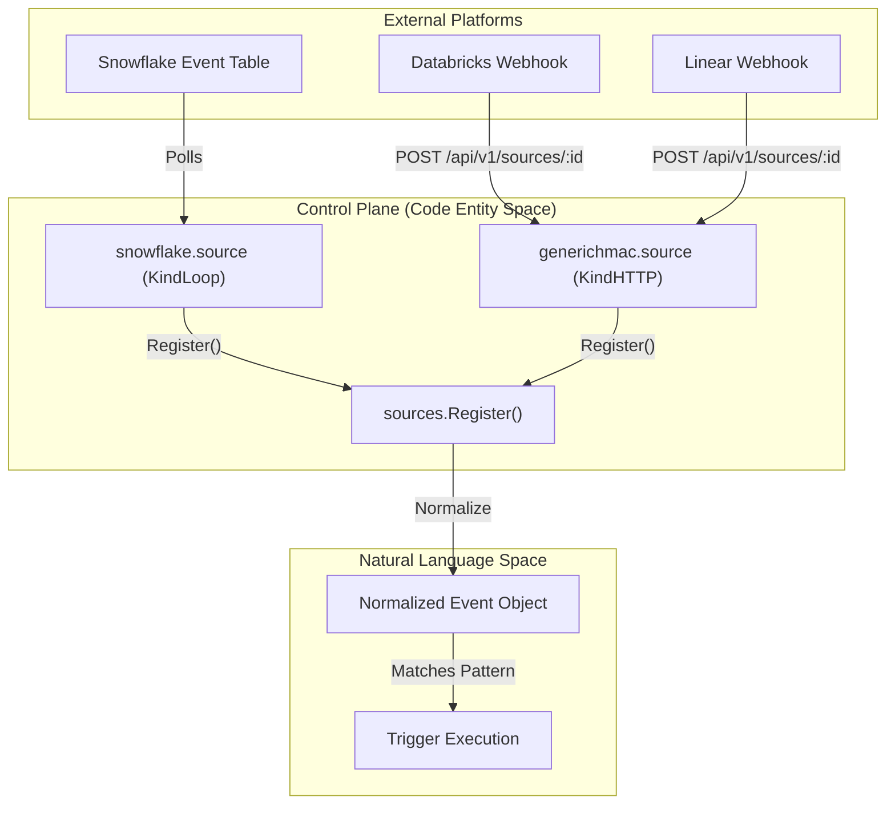
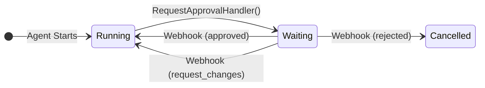

<!-- source: DeepWiki mcp.deepwiki.com · repo Agent-Field/agentfield · page 15 Integrations · fetched 2026-10-26 -->

# Integrations

Relevant source files

The following files were used as context for generating this wiki page:

- [control-plane/internal/handlers/execute_approval.go](control-plane/internal/handlers/execute_approval.go)
- [control-plane/internal/handlers/webhook_approval.go](control-plane/internal/handlers/webhook_approval.go)
- [control-plane/internal/handlers/webhook_approval_test.go](control-plane/internal/handlers/webhook_approval_test.go)
- [control-plane/internal/server/apicatalog/catalog.go](control-plane/internal/server/apicatalog/catalog.go)
- [control-plane/internal/server/apicatalog/catalog_entries.go](control-plane/internal/server/apicatalog/catalog_entries.go)
- [control-plane/internal/server/apicatalog/catalog_test.go](control-plane/internal/server/apicatalog/catalog_test.go)
- [control-plane/internal/server/knowledgebase/content.go](control-plane/internal/server/knowledgebase/content.go)
- [control-plane/internal/server/routes_middleware_additional_test.go](control-plane/internal/server/routes_middleware_additional_test.go)
- [control-plane/internal/sources/generichmac/hmac.go](control-plane/internal/sources/generichmac/hmac.go)
- [control-plane/internal/sources/generichmac/hmac_test.go](control-plane/internal/sources/generichmac/hmac_test.go)
- [control-plane/internal/sources/snowflake/snowflake.go](control-plane/internal/sources/snowflake/snowflake.go)
- [control-plane/internal/sources/snowflake/snowflake_test.go](control-plane/internal/sources/snowflake/snowflake_test.go)
- [docs/ARCHITECTURE.md](docs/ARCHITECTURE.md)
- [docs/DEVELOPMENT.md](docs/DEVELOPMENT.md)
- [docs/integrations/snowflake.md](docs/integrations/snowflake.md)
- [integrations/snowflake/README.md](integrations/snowflake/README.md)
- [integrations/snowflake/agentfield-package.yaml](integrations/snowflake/agentfield-package.yaml)
- [tests/functional/tests/test_waiting_state.py](tests/functional/tests/test_waiting_state.py)

Integrations in AgentField provide first-party connectivity between the Control Plane and external platforms. These integration packs extend the system through two primary mechanisms: **Trigger Sources**, which allow external events to initiate agent workflows, and **Capability Nodes**, which provide agents with specialized tools to interact with third-party data and services.

This page provides a high-level overview of the available first-party integrations. For implementation details and configuration schemas, refer to the specific child pages.

## Integration Architecture

Integrations are implemented as `Sources` within the Control Plane. They are categorized into two execution patterns:
1.  **Loop Sources (`KindLoop`)**: Poll external systems (e.g., Snowflake) at a configured interval to detect new events [control-plane/internal/sources/snowflake/snowflake.go:23-46]().
2.  **HTTP Sources (`KindHTTP`)**: Receive inbound webhooks from external platforms (e.g., Databricks, Linear) and normalize them into AgentField events [control-plane/internal/sources/generichmac/hmac.go:31-32]().

### Data Flow & Normalization
The following diagram illustrates how external signals are converted into AgentField `Event` entities and routed to agents.

**External to Internal Event Flow**

Sources: [control-plane/internal/sources/snowflake/snowflake.go:22-46](), [control-plane/internal/sources/generichmac/hmac.go:27-33](), [control-plane/internal/handlers/webhook_approval.go:39-43]()

## Available Integrations

### Snowflake Integration
The Snowflake integration enables bidirectional communication with the Snowflake Data Cloud. It supports polling Snowflake Event Tables or executing custom SQL queries to trigger agent workflows [control-plane/internal/sources/snowflake/snowflake.go:49-72](). Agents can also utilize Snowflake capability nodes to perform SQL operations, Cortex Search, and Cortex Analyst queries.

For details, see [Snowflake Integration](#15.1).

### Databricks Integration
The Databricks integration connects AgentField to the Databricks Lakehouse. It utilizes notification destination webhooks as a trigger source and provides capability nodes for executing SQL, interacting with AI Functions, and Model Serving endpoints.

For details, see [Databricks Integration](#15.2).

### Linear & Sentry Integrations
These integrations focus on operational and engineering workflows:
*   **Linear**: Supports webhook triggers for issue updates and a capability node for Issue CRUD operations and comment management.
*   **Sentry**: Handles error event triggers, allowing agents to automatically triage or investigate software exceptions reported by Sentry.

For details, see [Linear & Sentry Integrations](#15.3).

## Common Integration Patterns

### Webhook Security
Most HTTP-based integrations utilize the `generic_hmac` source, which enforces HMAC-SHA256 signature verification. This ensures that inbound events are authentic and haven't been tampered with [control-plane/internal/sources/generichmac/hmac.go:102-119](). It also supports replay protection via timestamp tolerance windows [control-plane/internal/sources/generichmac/hmac.go:122-137]().

### Approval Webhooks
A specialized integration exists for human-in-the-loop workflows. The `ApprovalWebhookHandler` processes responses from external approval services (like the `hax-sdk`). It maps various external decision formats (e.g., "approve", "confirm", "reject") into canonical AgentField execution statuses like `approved` or `rejected` [control-plane/internal/handlers/webhook_approval.go:103-116]().

**Approval State Machine**

Sources: [control-plane/internal/handlers/execute_approval.go:125-133](), [control-plane/internal/handlers/webhook_approval.go:185-193](), [control-plane/internal/handlers/webhook_approval_test.go:156-195]()

| Component | Role | Code Entity |
| :--- | :--- | :--- |
| **Trigger Source** | Ingests external events | `sources.Source` [control-plane/internal/sources/snowflake/snowflake.go:37]() |
| **HMAC Verifier** | Validates webhook signatures | `generichmac.source` [control-plane/internal/sources/generichmac/hmac.go:23]() |
| **Approval Controller** | Manages human-in-the-loop state | `approvalController` [control-plane/internal/handlers/execute_approval.go:19]() |
| **API Catalog** | Discovers available capabilities | `apicatalog.Catalog` [control-plane/internal/server/apicatalog/catalog.go:44]() |

Sources: [control-plane/internal/sources/snowflake/snowflake.go:37-46](), [control-plane/internal/sources/generichmac/hmac.go:23-33](), [control-plane/internal/handlers/execute_approval.go:19-21](), [control-plane/internal/server/apicatalog/catalog.go:44-49]()

---

