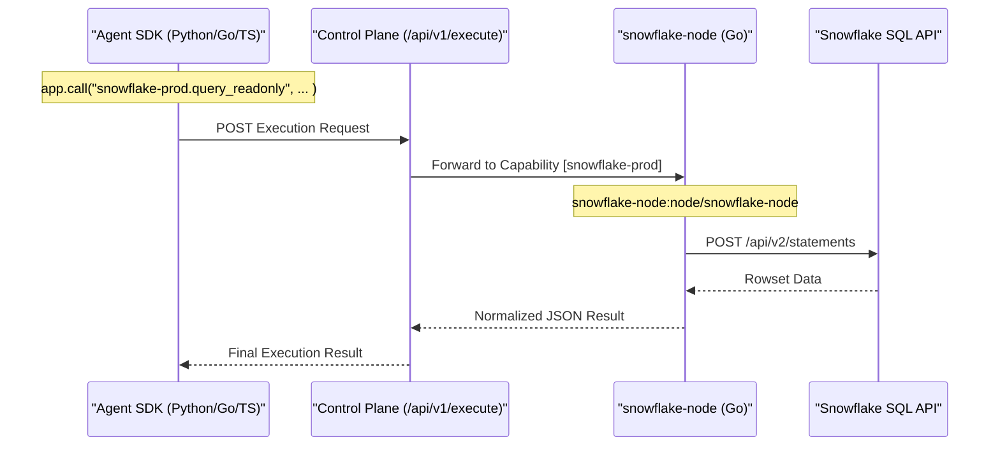

<!-- source: DeepWiki mcp.deepwiki.com · repo Agent-Field/agentfield · page 15.1 Snowflake Integration · fetched 2026-10-26 -->

# Snowflake Integration

<details>
<summary>Relevant source files</summary>

The following files were used as context for generating this wiki page:

- [control-plane/internal/sources/snowflake/snowflake.go](control-plane/internal/sources/snowflake/snowflake.go)
- [control-plane/internal/sources/snowflake/snowflake_test.go](control-plane/internal/sources/snowflake/snowflake_test.go)
- [docs/ARCHITECTURE.md](docs/ARCHITECTURE.md)
- [docs/DEVELOPMENT.md](docs/DEVELOPMENT.md)
- [docs/integrations/snowflake.md](docs/integrations/snowflake.md)
- [integrations/snowflake/README.md](integrations/snowflake/README.md)
- [integrations/snowflake/agentfield-package.yaml](integrations/snowflake/agentfield-package.yaml)

</details>


The Snowflake integration provides a dual-surface connection between AgentField and the Snowflake Data Cloud. It enables agents to both react to data changes within Snowflake and actively query or analyze Snowflake data using SQL and Cortex AI services.

The integration is architected into two distinct components:
1.  **Snowflake Trigger Source**: A built-in control plane service that polls Snowflake for events and dispatches them to agents [integrations/snowflake/README.md:6-7]().
2.  **Snowflake Capability Node**: An optional, standalone agent node that exposes SQL, metadata, and Cortex AI capabilities to the entire agent mesh [integrations/snowflake/README.md:8-10]().

## System Architecture

The following diagram illustrates the data flow between Snowflake, the AgentField Control Plane, and the Agent Mesh.

### Snowflake Integration Data Flow
```mermaid
graph TD
    subgraph "Snowflake Perimeter"
        "SF_TABLE[Event Table / Alerts]"
        "SF_CORTEX[Cortex AI / Search]"
        "SF_SQL[SQL Engine]"
    end

    subgraph "AgentField Control Plane"
        "SF_SOURCE[snowflake.go:source]"
        "SQL_API_CLIENT[snowflake.go:sqlAPIClient]"
    end

    subgraph "Agent Mesh"
        "SF_NODE[Snowflake Capability Node]"
        "USER_AGENT[User Agent]"
    end

    "SF_TABLE" -- "Poll (SQL API)" --> "SQL_API_CLIENT"
    "SQL_API_CLIENT" -- "Normalize" --> "SF_SOURCE"
    "SF_SOURCE" -- "Dispatch Event" --> "USER_AGENT"
    "USER_AGENT" -- "app.call()" --> "SF_NODE"
    "SF_NODE" -- "SQL / Cortex" --> "SF_SQL"
    "SF_NODE" -- "Inference" --> "SF_CORTEX"
```
Sources: [integrations/snowflake/README.md:18-26](), [control-plane/internal/sources/snowflake/snowflake.go:1-33]()

## Snowflake Trigger Source

The Snowflake trigger source is implemented as a `KindLoop` source within the control plane [control-plane/internal/sources/snowflake/snowflake.go:46](). It periodically polls Snowflake using the Snowflake SQL API to ingest events.

### Configuration Modes
The source supports two operational modes defined in `control-plane/internal/sources/snowflake/snowflake.go`:
*   **`event_table_poll`**: Monitors a specific table for new rows based on a watermark column (e.g., `OCCURRED_AT`) [control-plane/internal/sources/snowflake/snowflake.go:23, 32]().
*   **`custom_query_poll`**: Executes a user-defined read-only SQL statement (starting with `SELECT` or `WITH`) to fetch event data [control-plane/internal/sources/snowflake/snowflake.go:24, 186-191]().

### Configuration Schema
The source requires an `account_url` and a secret (typically a Programmatic Access Token/PAT) [control-plane/internal/sources/snowflake/snowflake.go:47, 69]().

| Property | Type | Default | Description |
| :--- | :--- | :--- | :--- |
| `mode` | string | `event_table_poll` | Polling strategy |
| `account_url` | string | - | e.g., `https://abc123.snowflakecomputing.com` |
| `database` | string | - | Target Snowflake database |
| `schema` | string | - | Target Snowflake schema |
| `table` | string | - | Target table (for `event_table_poll`) |
| `interval_seconds`| integer| 30 | Polling frequency (min 5s) |
| `max_batch_size` | integer| 100 | Max events per poll (max 500) |

Sources: [control-plane/internal/sources/snowflake/snowflake.go:50-72](), [control-plane/internal/sources/snowflake/snowflake.go:139-147]()

### Implementation Details
The polling logic is handled by the `source` struct which utilizes a `sqlAPIClient` [control-plane/internal/sources/snowflake/snowflake.go:37-39](). This client manages the HTTP communication with the Snowflake SQL API, including host rewriting and path validation [control-plane/internal/sources/snowflake/snowflake.go:201-215]().

## Snowflake Capability Node

The capability node is a Go-based agent node that registers with the control plane to provide specialized skills and reasoners to other agents [integrations/snowflake/agentfield-package.yaml:1-5]().

### Registered Capabilities
The node exposes the following capabilities under a specific `node_id` (default: `snowflake-prod`) [integrations/snowflake/agentfield-package.yaml:9, 16]():

| Category | Name | Description |
| :--- | :--- | :--- |
| **Reasoner** | `semantic_ask` | NL questions via Cortex Analyst [integrations/snowflake/agentfield-package.yaml:18-19]() |
| **Reasoner** | `explain_result` | Explains query results with citations [integrations/snowflake/agentfield-package.yaml:20-21]() |
| **Skill** | `query_readonly` | Executes read-only SQL with guardrails [integrations/snowflake/agentfield-package.yaml:25-26]() |
| **Skill** | `describe_table` | Returns table/column metadata [integrations/snowflake/agentfield-package.yaml:27-28]() |
| **Skill** | `cortex_search_query`| Queries Cortex Search services [integrations/snowflake/agentfield-package.yaml:33-34]() |

### Prompt Management
For `.ai` based reasoners like `investigate_metric_change`, the node avoids hardcoded prompts. Instead, it loads templates from a YAML file specified by the `SNOWFLAKE_PROMPTS_FILE` environment variable, falling back to packaged defaults [integrations/snowflake/agentfield-package.yaml:70-73](), [docs/integrations/snowflake.md:33-42]().

## Cross-Agent Execution

Agents interact with Snowflake by calling the capability node via the `app.call()` (Python) or `a.Call()` (Go) interface. This maintains a clean separation between the agent logic and the Snowflake connection parameters.

### Code-to-Entity Mapping
The following diagram maps SDK call patterns to the internal integration components.


Sources: [integrations/snowflake/README.md:92-102](), [docs/ARCHITECTURE.md:47-52](), [integrations/snowflake/agentfield-package.yaml:5-9]()

### Environment Configuration
The Snowflake node requires specific environment variables for its identity and connection:
*   `AGENTFIELD_NODE_ID`: Identity in the mesh (e.g., `snowflake-prod`) [integrations/snowflake/agentfield-package.yaml:44]().
*   `SNOWFLAKE_ACCOUNT_URL`: Validated HTTPS Snowflake URL [integrations/snowflake/agentfield-package.yaml:50-53]().
*   `SNOWFLAKE_PAT`: Secret token for authentication [integrations/snowflake/agentfield-package.yaml:54-56]().
*   `SNOWFLAKE_ROLE`: The Snowflake role used for execution [integrations/snowflake/agentfield-package.yaml:57-59]().

Sources: [integrations/snowflake/agentfield-package.yaml:43-77]()

---

