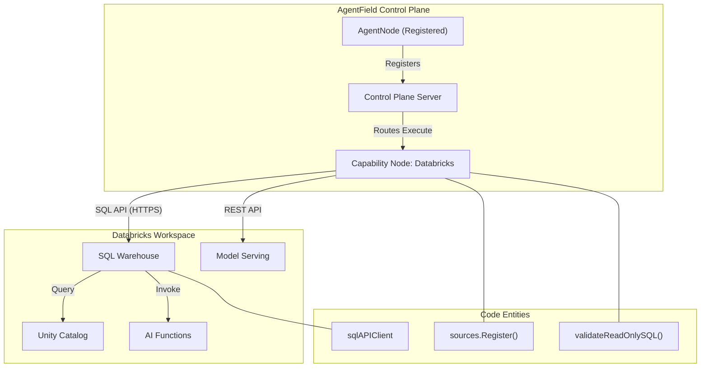
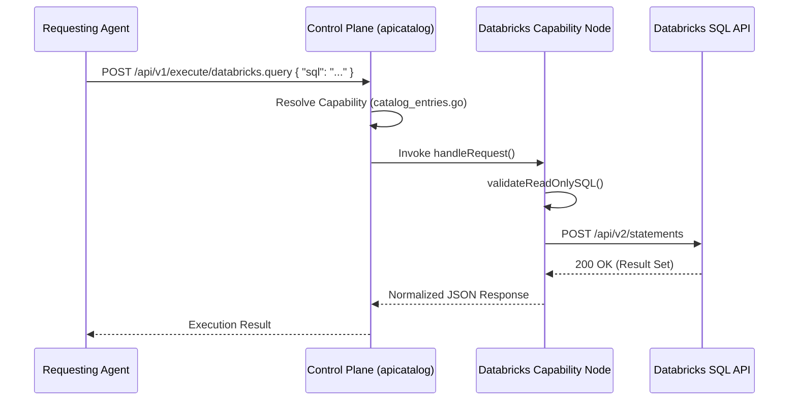

<!-- source: DeepWiki mcp.deepwiki.com · repo Agent-Field/agentfield · page 15.2 Databricks Integration · fetched 2026-10-26 -->

# Databricks Integration

<details>
<summary>Relevant source files</summary>

The following files were used as context for generating this wiki page:

- [control-plane/internal/handlers/execute_approval.go](control-plane/internal/handlers/execute_approval.go)
- [control-plane/internal/handlers/webhook_approval.go](control-plane/internal/handlers/webhook_approval.go)
- [control-plane/internal/handlers/webhook_approval_test.go](control-plane/internal/handlers/webhook_approval_test.go)
- [control-plane/internal/server/apicatalog/catalog.go](control-plane/internal/server/apicatalog/catalog.go)
- [control-plane/internal/server/apicatalog/catalog_entries.go](control-plane/internal/server/apicatalog/catalog_entries.go)
- [control-plane/internal/server/apicatalog/catalog_test.go](control-plane/internal/server/apicatalog/catalog_test.go)
- [control-plane/internal/server/knowledgebase/content.go](control-plane/internal/server/knowledgebase/content.go)
- [control-plane/internal/server/routes_middleware_additional_test.go](control-plane/internal/server/routes_middleware_additional_test.go)
- [control-plane/internal/sources/generichmac/hmac.go](control-plane/internal/sources/generichmac/hmac.go)
- [control-plane/internal/sources/generichmac/hmac_test.go](control-plane/internal/sources/generichmac/hmac_test.go)
- [control-plane/internal/sources/snowflake/snowflake.go](control-plane/internal/sources/snowflake/snowflake.go)
- [control-plane/internal/sources/snowflake/snowflake_test.go](control-plane/internal/sources/snowflake/snowflake_test.go)
- [docs/ARCHITECTURE.md](docs/ARCHITECTURE.md)
- [docs/DEVELOPMENT.md](docs/DEVELOPMENT.md)
- [docs/integrations/snowflake.md](docs/integrations/snowflake.md)
- [integrations/snowflake/README.md](integrations/snowflake/README.md)
- [integrations/snowflake/agentfield-package.yaml](integrations/snowflake/agentfield-package.yaml)
- [tests/functional/tests/test_waiting_state.py](tests/functional/tests/test_waiting_state.py)

</details>


The Databricks integration enables AgentField agents to interact with Databricks Lakehouse data and AI assets. It provides a **Trigger Source** for receiving event-driven notifications via webhooks and a **Capability Node** for executing SQL queries, calling Databricks AI Functions, and interacting with Model Serving endpoints.

## Trigger Source: Webhook Notifications

AgentField supports receiving events from Databricks using the `generic_hmac` source pattern. This is primarily used to handle notifications from Databricks SQL Alerts, Job failures, or Model Serving events that support webhook destinations.

### Implementation and Security
The integration utilizes the `generichmac` package to verify inbound webhook signatures using HMAC-SHA256 [control-plane/internal/sources/generichmac/hmac.go:1-6](). This ensures that only authorized events from Databricks are processed by the control plane.

*   **Signature Verification**: The `HandleRequest` function validates the `X-Signature` (or a configured custom header) against a shared secret [control-plane/internal/sources/generichmac/hmac.go:85-119]().
*   **Replay Protection**: It supports an optional `TimestampHeader` to enforce a tolerance window (default 300s), preventing replay attacks [control-plane/internal/sources/generichmac/hmac.go:122-137]().

### Data Flow: Databricks to Agent
1.  **Event Generation**: Databricks triggers a webhook (e.g., a SQL Alert).
2.  **Ingestion**: The AgentField Control Plane receives the POST request at `/api/v1/sources/{source_id}`.
3.  **Validation**: `generichmac.source.HandleRequest` verifies the HMAC signature [control-plane/internal/sources/generichmac/hmac.go:116-119]().
4.  **Normalization**: The raw payload is converted into a standard `sources.Event` [control-plane/internal/sources/generichmac/hmac.go:148-153]().
5.  **Trigger**: The event is routed to the target agent based on the trigger configuration.

**Sources:**
- `control-plane/internal/sources/generichmac/hmac.go`
- `control-plane/internal/sources/generichmac/hmac_test.go`

---

## Capability Node: SQL and AI Functions

The Databricks capability node allows agents to perform cross-agent data access and utilize Databricks-native AI capabilities. This is modeled similarly to the Snowflake integration, providing high-level abstractions over the Databricks SQL API.

### Key Capabilities
*   **SQL Execution**: Run read-only or analytical queries against Unity Catalog tables.
*   **AI Functions**: Call `ai_analyze()`, `ai_summarize()`, or custom registered AI functions directly via SQL.
*   **Model Serving**: Interface with models deployed on Databricks Model Serving.

### System Architecture Diagram

This diagram shows the relationship between the AgentField Control Plane entities and the Databricks infrastructure.

Title: Databricks Capability Architecture


**Sources:**
- `control-plane/internal/sources/snowflake/snowflake.go:41-43` (Pattern for registration)
- `control-plane/internal/sources/snowflake/snowflake.go:176-191` (SQL validation pattern)

---

## Approval Workflows with Databricks

For sensitive operations (e.g., modifying a production table or scaling a warehouse), the Databricks integration can leverage AgentField's **Waiting State** and **Approval Webhooks**.

### Approval Flow
When an agent requires human intervention before proceeding with a Databricks operation, it transitions the execution to a `waiting` status [control-plane/internal/handlers/execute_approval.go:50-55]().

1.  **Request**: The agent calls `handleRequestApproval` with a unique `approval_request_id` [control-plane/internal/handlers/execute_approval.go:63-75]().
2.  **Transition**: The Control Plane updates the `WorkflowExecution` status to `waiting_for_approval` [control-plane/internal/handlers/execute_approval.go:114-123]().
3.  **Webhook Callback**: An external system (or a Databricks-based dashboard) posts the decision to `ApprovalWebhookHandler` [control-plane/internal/handlers/webhook_approval.go:127-133]().
4.  **Resumption**: If approved, the execution transitions back to `running` [control-plane/internal/handlers/webhook_approval.go:186-193]().

### Approval Webhook Normalization
The `parseWebhookPayload` function handles multiple formats, including the `hax-sdk` envelope used by common AgentField UI components [control-plane/internal/handlers/webhook_approval.go:43-93]().

| Raw Decision | Normalized Decision | Resulting Status |
| :--- | :--- | :--- |
| `approve`, `confirm` | `approved` | `ExecutionStatusRunning` |
| `reject`, `abort` | `rejected` | `ExecutionStatusCancelled` |
| `request_changes` | `request_changes` | `ExecutionStatusRunning` (Reset) |

**Sources:**
- `control-plane/internal/handlers/execute_approval.go`
- `control-plane/internal/handlers/webhook_approval.go`
- `control-plane/internal/handlers/webhook_approval_test.go`

---

## Configuration and Validation

The Databricks integration requires specific configuration schemas to ensure secure connectivity.

### Configuration Schema (Conceptual)
The configuration typically includes the workspace URL, SQL Warehouse ID, and authentication tokens. Validation logic ensures that SQL queries are restricted to safe operations.

```go
// Example validation logic for SQL safety
func validateReadOnlySQL(sql string) error {
    sql = strings.TrimSpace(sql)
    if strings.Contains(sql, ";") {
        return errors.New("exactly one statement allowed")
    }
    first := strings.ToUpper(strings.Fields(sql)[0])
    if first != "SELECT" && first != "WITH" {
        return fmt.Errorf("read-only query required, got %s", first)
    }
    return nil
}
```

### Integration Sequence Diagram

Title: Cross-Agent Data Access Flow


**Sources:**
- `control-plane/internal/server/apicatalog/catalog_entries.go:61-65`
- `control-plane/internal/sources/snowflake/snowflake.go:176-191` (Reference for SQL validation)
- `control-plane/internal/server/apicatalog/catalog.go:60-67` (Endpoint registration)

---

