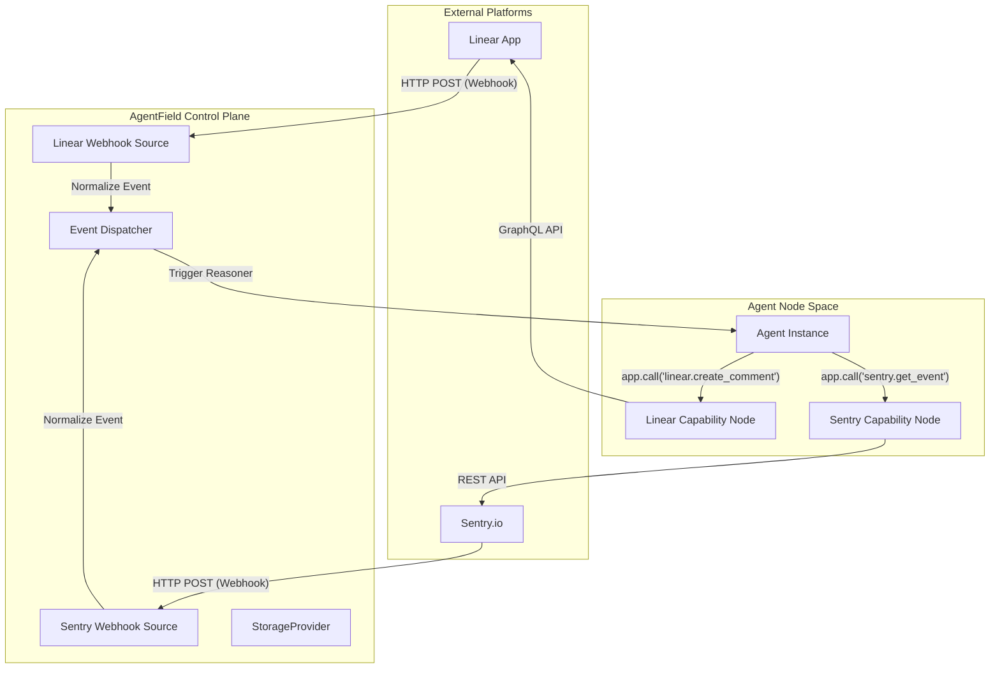
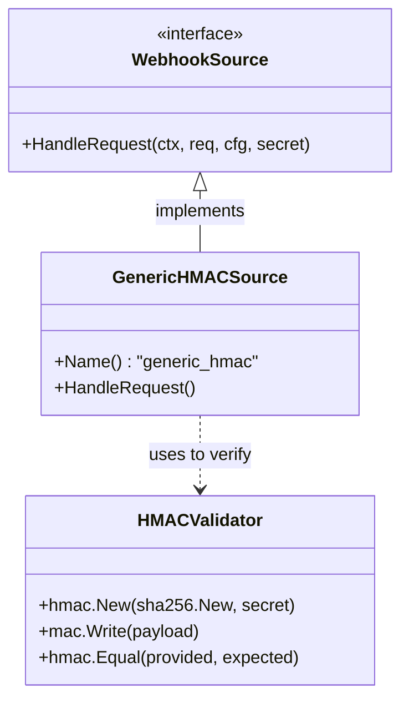

<!-- source: DeepWiki mcp.deepwiki.com · repo Agent-Field/agentfield · page 15.3 Linear & Sentry Integrations · fetched 2026-10-26 -->

# Linear & Sentry Integrations

Relevant source files

The following files were used as context for generating this wiki page:

- [control-plane/internal/handlers/execute_approval.go](control-plane/internal/handlers/execute_approval.go)
- [control-plane/internal/handlers/webhook_approval.go](control-plane/internal/handlers/webhook_approval.go)
- [control-plane/internal/handlers/webhook_approval_test.go](control-plane/internal/handlers/webhook_approval_test.go)
- [control-plane/internal/server/apicatalog/catalog.go](control-plane/internal/server/apicatalog/catalog.go)
- [control-plane/internal/server/apicatalog/catalog_entries.go](control-plane/internal/server/apicatalog/catalog_entries.go)
- [control-plane/internal/server/apicatalog/catalog_test.go](control-plane/internal/server/apicatalog/catalog_test.go)
- [control-plane/internal/server/knowledgebase/content.go](control-plane/internal/server/knowledgebase/content.go)
- [control-plane/internal/server/routes_middleware_additional_test.go](control-plane/internal/server/routes_middleware_additional_test.go)
- [control-plane/internal/sources/generichmac/hmac.go](control-plane/internal/sources/generichmac/hmac.go)
- [control-plane/internal/sources/generichmac/hmac_test.go](control-plane/internal/sources/generichmac/hmac_test.go)
- [control-plane/internal/sources/snowflake/snowflake.go](control-plane/internal/sources/snowflake/snowflake.go)
- [control-plane/internal/sources/snowflake/snowflake_test.go](control-plane/internal/sources/snowflake/snowflake_test.go)
- [docs/ARCHITECTURE.md](docs/ARCHITECTURE.md)
- [docs/DEVELOPMENT.md](docs/DEVELOPMENT.md)
- [docs/integrations/snowflake.md](docs/integrations/snowflake.md)
- [integrations/snowflake/README.md](integrations/snowflake/README.md)
- [integrations/snowflake/agentfield-package.yaml](integrations/snowflake/agentfield-package.yaml)
- [tests/functional/tests/test_waiting_state.py](tests/functional/tests/test_waiting_state.py)

AgentField provides first-party support for **Linear** and **Sentry** through specialized trigger sources and capability nodes. These integrations allow agents to respond to external events (like a new issue or a production error) and perform actions (like commenting on a ticket or retrieving error context) within a unified execution framework.

## Architecture Overview

Integrations in AgentField follow a standardized pattern where a **Source** (Trigger) ingests external data into the Control Plane, and a **Capability Node** (Skill) allows agents to interact back with the external service.

### Data Flow: Trigger to Action

The following diagram illustrates how an external event from Linear or Sentry flows through the system to trigger an agent, and how that agent uses capability nodes to respond.

**Integration Data Flow Diagram**

Sources: [control-plane/internal/sources/generichmac/hmac.go:1-21](), [docs/ARCHITECTURE.md]()

---

## Linear Integration

The Linear integration consists of a webhook trigger for issue updates and a capability node for Issue CRUD (Create, Read, Update, Delete) and commenting.

### Linear Webhook Source
The Linear Source uses the `generic_hmac` implementation to verify incoming webhooks from Linear. Linear signs its payloads using an HMAC-SHA256 signature passed in the `X-Linear-Signature` header.

*   **Implementation**: The `generic_hmac` source validates the payload against a configured secret.
*   **Verification**: Uses `hmac.Equal` to prevent timing attacks [control-plane/internal/sources/generichmac/hmac.go:117-119]().
*   **Normalization**: Raw JSON from Linear is passed into the `Normalized` field of the `sources.Event` struct [control-plane/internal/sources/generichmac/hmac.go:148-153]().

### Capability Node (Skills)
Agents can interact with Linear via a registered Linear Skill node. This node abstracts the Linear GraphQL API into simple JSON-based skills:
*   `linear.get_issue`: Retrieves details of a specific issue.
*   `linear.create_comment`: Adds a comment to an issue thread.
*   `linear.update_issue`: Modifies status, priority, or assignees.

Sources: [control-plane/internal/sources/generichmac/hmac.go:31-48](), [control-plane/internal/server/apicatalog/catalog_entries.go:61-68]()

---

## Sentry Integration

The Sentry integration enables "Error-to-Resolution" workflows by triggering agents when new issues are created in Sentry.

### Sentry Webhook Source
Sentry webhooks are ingested via the Control Plane's webhook handler. Like Linear, Sentry uses HMAC signatures for security.

| Configuration Key | Description |
| :--- | :--- |
| `signature_header` | `X-Sentry-Hook-Signature` |
| `event_type_header` | `X-Sentry-Hook-Resource` (e.g., `issue`, `error`) |
| `secret` | The Sentry Webhook Secret provided in the Sentry Developer Settings |

### Error Handling Workflow
When a Sentry event hits the source:
1.  **Validation**: `HandleRequest` verifies the HMAC signature [control-plane/internal/sources/generichmac/hmac.go:85-120]().
2.  **Mapping**: The resource type (e.g., `issue.created`) is mapped to the AgentField event type [control-plane/internal/sources/generichmac/hmac.go:139-142]().
3.  **Execution**: An agent reasoner subscribed to `sentry.issue.created` is invoked.

Sources: [control-plane/internal/sources/generichmac/hmac.go:50-57](), [control-plane/internal/sources/generichmac/hmac.go:148-154]()

---

## Webhook Security & Signatures

Both integrations rely on the `generichmac` package for secure ingestion. This package ensures that only authentic requests from the respective platforms can trigger agent executions.

**Code Entity Map: Webhook Verification**

### Replay Protection
The `generic_hmac` source supports optional timestamp-based replay protection. If a `timestamp_header` is configured (common in Sentry-style webhooks), the system enforces a `tolerance_seconds` window (defaulting to 300s) to prevent old captured payloads from being re-sent [control-plane/internal/sources/generichmac/hmac.go:122-137]().

Sources: [control-plane/internal/sources/generichmac/hmac.go:25-33](), [control-plane/internal/sources/generichmac/hmac.go:107-120](), [control-plane/internal/sources/generichmac/hmac_test.go:184-210]()

---

## Human-in-the-Loop (Approval)

For sensitive actions (e.g., closing a Linear ticket or resolving a Sentry issue), agents often use the **Approval Webhook** system.

1.  **Request**: An agent calls `RequestApprovalHandler` to transition an execution to the `waiting` state [control-plane/internal/handlers/execute_approval.go:50-55]().
2.  **External Link**: The agent provides an `approval_request_url` (often pointing to a UI for a human to review) [control-plane/internal/handlers/execute_approval.go:26-31]().
3.  **Callback**: Once a human approves, a webhook is sent to `/api/v1/webhooks/approval-response` [control-plane/internal/handlers/webhook_approval.go:127-133]().
4.  **Resume**: The `webhookApprovalController` verifies the signature, normalizes the decision (e.g., `approved`, `rejected`), and resumes the workflow [control-plane/internal/handlers/webhook_approval.go:185-194]().

Sources: [control-plane/internal/handlers/webhook_approval.go:119-133](), [control-plane/internal/handlers/execute_approval.go:141-163](), [control-plane/internal/handlers/webhook_approval_test.go:74-100]()

---

