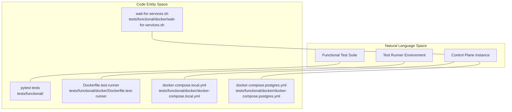
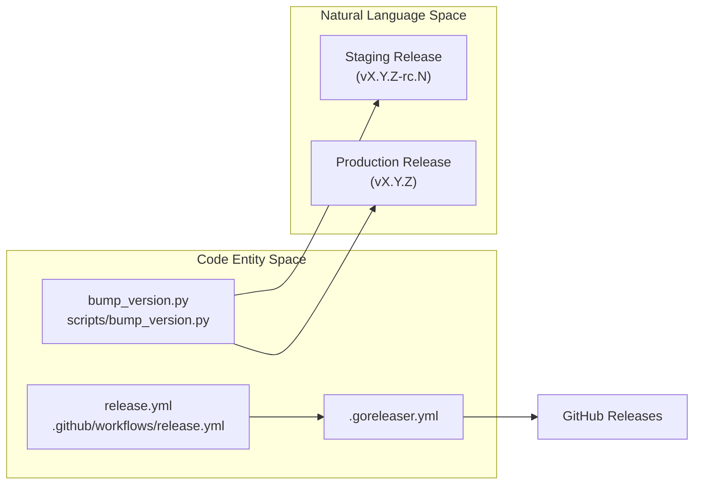

<!-- source: DeepWiki mcp.deepwiki.com · repo Agent-Field/agentfield · page 16 Testing & Development · fetched 2026-10-26 -->

# Testing & Development

<details>
<summary>Relevant source files</summary>

The following files were used as context for generating this wiki page:

- [.github/workflows/control-plane.yml](.github/workflows/control-plane.yml)
- [.github/workflows/docker.yml](.github/workflows/docker.yml)
- [.github/workflows/functional-tests.yml](.github/workflows/functional-tests.yml)
- [.github/workflows/sdk-go.yml](.github/workflows/sdk-go.yml)
- [.github/workflows/sdk-python.yml](.github/workflows/sdk-python.yml)
- [Makefile](Makefile)
- [scripts/coverage-aggregate.py](scripts/coverage-aggregate.py)
- [scripts/coverage-summary.sh](scripts/coverage-summary.sh)
- [scripts/coverage-surface.sh](scripts/coverage-surface.sh)
- [sdk/python/tests/test_memory_events.py](sdk/python/tests/test_memory_events.py)
- [tests/functional/README.md](tests/functional/README.md)
- [tests/functional/conftest.py](tests/functional/conftest.py)
- [tests/functional/docker/Dockerfile.test-runner](tests/functional/docker/Dockerfile.test-runner)
- [tests/functional/docker/docker-compose.local.yml](tests/functional/docker/docker-compose.local.yml)
- [tests/functional/docker/docker-compose.postgres.yml](tests/functional/docker/docker-compose.postgres.yml)
- [tests/functional/docker/wait-for-services.sh](tests/functional/docker/wait-for-services.sh)
- [tests/functional/requirements.txt](tests/functional/requirements.txt)

</details>


This page documents the testing infrastructure, build system, release process, and contribution guidelines for AgentField. It covers how to run tests locally, understand the CI/CD pipeline, and contribute to the project.

For information about deploying AgentField to production environments, see [Deployment](#13).

---

## Overview

AgentField uses a multi-layer testing strategy including unit tests, integration tests, and functional tests. The build system is orchestrated through a `Makefile`, and releases follow a two-tier model separating staging (prerelease) from production releases. All of this is automated through GitHub Actions workflows.

**Testing Layers:**
- **Unit Tests**: Fast, isolated tests for individual components (Python, TypeScript, Go).
- **Functional Tests**: Docker-based integration tests against real control plane instances and real LLM providers.
- **CI/CD**: Automated testing and release workflows triggered by Git events.

**Release Model:**
- **Staging**: Automatic prerelease on every push to `main` (`X.Y.Z-rc.N`).
- **Production**: Manual stable release via workflow dispatch (`X.Y.Z`).

---

## Functional Test Architecture

AgentField's functional tests run inside Docker containers to ensure consistency across local development and CI environments. Tests verify the system works correctly with both SQLite (`local` mode) and PostgreSQL (`postgres` mode) storage backends.

### System-to-Code Mapping: Functional Infrastructure


**Sources:** [tests/functional/docker/docker-compose.local.yml:1-57](), [tests/functional/docker/docker-compose.postgres.yml:1-84](), [tests/functional/docker/Dockerfile.test-runner:1-110](), [tests/functional/docker/wait-for-services.sh:1-30]()

### Running Functional Tests Locally

Functional tests require an `OPENROUTER_API_KEY` for LLM-dependent tests, though 92% of tests (24/26) can run without it.

```bash
# Run all functional tests (both local and postgres modes)
export OPENROUTER_API_KEY="your-key-here"
make test-functional

# Run only SQLite mode tests
make test-functional-local

# Run only PostgreSQL mode tests  
make test-functional-postgres
```

**Sources:** [Makefile:61-109](), [tests/functional/README.md:39-55]()

### Test Environment Components

| Component | Purpose | Configuration |
|-----------|---------|---------------|
| `control-plane` | AgentField server under test | [tests/functional/docker/agentfield-test.yaml:1-108]() |
| `test-runner` | Pytest execution environment | [tests/functional/docker/Dockerfile.test-runner:1-110]() |
| `postgres` | PostgreSQL database with vector support | `pgvector/pgvector:pg16` |
| `wait-for-services.sh` | Health check script for orchestration | [tests/functional/docker/wait-for-services.sh:1-30]() |

**Sources:** [tests/functional/docker/docker-compose.postgres.yml:2-20](), [tests/functional/docker/docker-compose.local.yml:24-59]()

---

## Unit Tests

Each SDK and the control plane has its own unit test suite using language-appropriate testing frameworks.

| Component | Framework | Location | Command |
|-----------|-----------|----------|---------|
| **Python SDK** | `pytest` | `sdk/python/tests/` | `pytest` |
| **TypeScript SDK** | `vitest` | `sdk/typescript/tests/` | `npm test` |
| **Go SDK** | `go test` | `sdk/go/` | `go test ./...` |
| **Control Plane** | `go test` | `control-plane/` | `go test ./...` |

**Sources:** [.github/workflows/sdk-python.yml:51-53](), [.github/workflows/sdk-go.yml:48-50](), [.github/workflows/control-plane.yml:57-61]()

---

## Build System

The build system is orchestrated through a `Makefile` with targets for building, testing, and maintaining the codebase.

### Makefile Targets

| Target | Description | Key Operations |
|--------|-------------|----------------|
| `make build` | Build all components | Builds `control-plane`, `sdk-go`, `sdk-python` |
| `make test` | Run unit tests | Executes `./scripts/test-all.sh` |
| `make lint` | Run linters | `golangci-lint` (Go), `ruff` (Python) |
| `make fmt` | Format code | `gofmt` (Go), `ruff format` (Python) |
| `make clean` | Remove artifacts | Deletes `bin/`, `dist/`, `__pycache__` |

**Sources:** [Makefile:20-56]()

---

## Release Process

AgentField uses a **two-tier release system** that separates staging (prerelease) from production releases.



**Staging Releases**: Automatic on every push to `main`. Artifacts are published to PyPI (as `--pre`), npm (as `@next`), and GHCR (as `staging-*`).
**Production Releases**: Manually triggered via `workflow_dispatch`. Artifacts are published as stable versions.

**Sources:** [.github/workflows/release.yml:1-512](), [scripts/bump_version.py:1-254]()

---

## CI/CD Pipeline

The CI/CD pipeline is managed via GitHub Actions, ensuring that every pull request and merge to `main` is validated.

### Key Workflows

- **`functional-tests.yml`**: Runs the Docker-based integration suite across SQLite and PostgreSQL modes.
- **`control-plane.yml`**: Validates Go builds and UI compilation across Linux, Darwin, and Windows.
- **`sdk-python.yml`**: Runs unit tests across Python 3.10, 3.11, and 3.12, including websocket compatibility checks.
- **`sdk-go.yml`**: Ensures the Go SDK builds and passes basic tests.

**Sources:** [.github/workflows/functional-tests.yml:1-183](), [.github/workflows/control-plane.yml:1-158](), [.github/workflows/sdk-python.yml:1-102](), [.github/workflows/sdk-go.yml:1-66]()

---

## Contributing

Guidelines for contributing to the AgentField ecosystem.

### Development Workflow
1. **Setup**: Use `make install` to install development dependencies.
2. **Coding**: Follow language-specific style guides enforced by `make lint`.
3. **Testing**: Ensure new features include unit tests and, if applicable, functional tests.
4. **PRs**: Open pull requests against the `main` branch. Conventional commits are preferred.

**Sources:** [Makefile:22-24](), [tests/functional/README.md:162-180]()

---

## Child Pages

- [Functional Tests](#16.1) — Running functional tests with docker-compose: local and PostgreSQL modes, test infrastructure
- [Unit Tests](#16.2) — SDK unit tests with pytest (Python), vitest (TypeScript), and go test
- [Build System](#16.3) — Understanding the Makefile: build, test, lint, fmt, clean targets
- [Release Process](#16.4) — Two-tier release system: staging vs production, version bumping, changelog generation
- [CI/CD Pipeline](#16.5) — GitHub Actions workflows: release.yml, functional-tests.yml, build matrix, artifact publishing
- [Contributing](#16.6) — Guidelines for contributing: code style, testing requirements, pull request process

---

