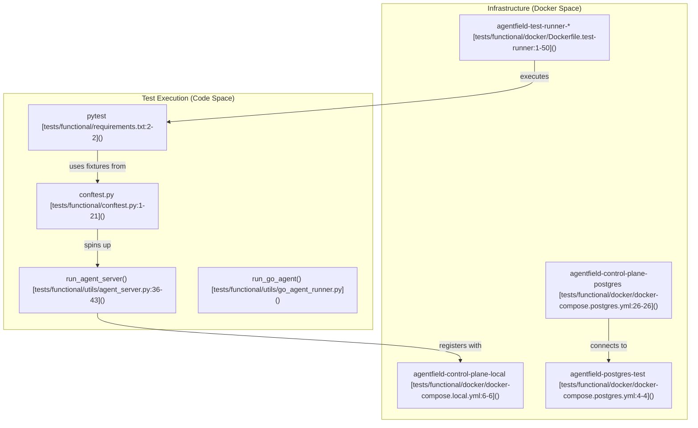
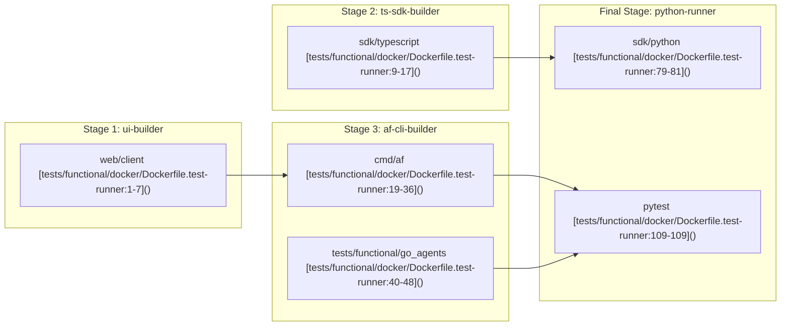

<!-- source: DeepWiki mcp.deepwiki.com · repo Agent-Field/agentfield · page 16.1 Functional Tests · fetched 2026-10-26 -->

# Functional Tests

<details>
<summary>Relevant source files</summary>

The following files were used as context for generating this wiki page:

- [.github/workflows/functional-tests.yml](.github/workflows/functional-tests.yml)
- [Makefile](Makefile)
- [tests/functional/README.md](tests/functional/README.md)
- [tests/functional/agents/__init__.py](tests/functional/agents/__init__.py)
- [tests/functional/agents/docs_quick_start_agent.py](tests/functional/agents/docs_quick_start_agent.py)
- [tests/functional/agents/quick_start_agent.py](tests/functional/agents/quick_start_agent.py)
- [tests/functional/conftest.py](tests/functional/conftest.py)
- [tests/functional/docker/Dockerfile.test-runner](tests/functional/docker/Dockerfile.test-runner)
- [tests/functional/docker/docker-compose.local.yml](tests/functional/docker/docker-compose.local.yml)
- [tests/functional/docker/docker-compose.postgres.yml](tests/functional/docker/docker-compose.postgres.yml)
- [tests/functional/docker/wait-for-services.sh](tests/functional/docker/wait-for-services.sh)
- [tests/functional/requirements.txt](tests/functional/requirements.txt)
- [tests/functional/tests/__init__.py](tests/functional/tests/__init__.py)
- [tests/functional/tests/test_hello_world.py](tests/functional/tests/test_hello_world.py)
- [tests/functional/tests/test_quick_start.py](tests/functional/tests/test_quick_start.py)
- [tests/functional/utils/__init__.py](tests/functional/utils/__init__.py)
- [tests/functional/utils/agent_server.py](tests/functional/utils/agent_server.py)
- [tests/functional/utils/logging.py](tests/functional/utils/logging.py)
- [tests/functional/utils/naming.py](tests/functional/utils/naming.py)

</details>


## Purpose and Scope

This page documents AgentField's functional testing infrastructure, which validates the complete system through end-to-end integration tests. Functional tests use Docker Compose to orchestrate a full AgentField environment (control plane, test agents, and storage backends) and execute `pytest`-based test scenarios against it.

The suite ensures that:
*   The AgentField control plane (Go) starts correctly and manages state.
*   Python, Go, and TypeScript agents can register and communicate with the control plane [tests/functional/README.md:28-36]().
*   Reasoners execute successfully with and without real LLM integration [tests/functional/README.md:39-54]().
*   Execution metadata, such as workflow IDs and timing, is properly tracked [tests/functional/README.md:33-33]().
*   Both storage modes (SQLite and PostgreSQL) are verified for compatibility [tests/functional/README.md:35-35]().

## Test Architecture

Functional tests verify the entire AgentField stack by deploying real components in isolated Docker containers.

### System Component Mapping

The following diagram maps natural language test concepts to the specific code entities and containers defined in the test infrastructure.

**Natural Language to Code Entity Space**

**Sources:** [tests/functional/docker/docker-compose.local.yml:1-60](), [tests/functional/docker/docker-compose.postgres.yml:1-86](), [tests/functional/conftest.py:1-21](), [tests/functional/utils/agent_server.py:36-43]()

## Docker Compose Infrastructure

Functional tests use two separate Docker Compose configurations to test different storage backends.

### Local Storage Mode
The local mode uses SQLite and BoltDB. The control plane is configured with `AGENTFIELD_STORAGE_MODE: local` [tests/functional/docker/docker-compose.local.yml:8-8]().

| Component | Container Name | Purpose |
|-----------|----------------|---------|
| `control-plane` | `agentfield-control-plane-local` | Control plane using local filesystem storage [tests/functional/docker/docker-compose.local.yml:6-6]() |
| `test-runner` | `agentfield-test-runner-local` | Executes the pytest suite [tests/functional/docker/docker-compose.local.yml:28-28]() |

**Sources:** [tests/functional/docker/docker-compose.local.yml:1-60]()

### PostgreSQL Storage Mode
The PostgreSQL mode tests production-like environments with `pgvector`. It sets `AGENTFIELD_STORAGE_MODE: postgres` [tests/functional/docker/docker-compose.postgres.yml:28-28]().

| Component | Container Name | Purpose |
|-----------|----------------|---------|
| `postgres` | `agentfield-postgres-test` | PostgreSQL 16 with `pgvector` [tests/functional/docker/docker-compose.postgres.yml:3-4]() |
| `control-plane` | `agentfield-control-plane-postgres` | Control plane linked to Postgres [tests/functional/docker/docker-compose.postgres.yml:26-26]() |

**Sources:** [tests/functional/docker/docker-compose.postgres.yml:1-86]()

## Test Runner Implementation

The `test-runner` container is built using a multi-stage `Dockerfile` that compiles the Go control plane, Go test agents, and the TypeScript SDK before installing the Python SDK [tests/functional/docker/Dockerfile.test-runner:1-110]().

**Build Stages to Code Entities**

**Sources:** [tests/functional/docker/Dockerfile.test-runner:1-110]()

### Service Readiness
The runner uses `wait-for-services.sh` to poll the control plane's `/api/v1/health` endpoint [tests/functional/docker/wait-for-services.sh:7-19](). It attempts up to 30 times (default) before failing the test run [tests/functional/docker/wait-for-services.sh:9-29]().

## Pytest Fixtures and Utilities

The `conftest.py` file defines the lifecycle and environment for the functional tests.

### Key Fixtures
*   **`verify_control_plane`**: An `autouse` session fixture that ensures the control plane is reachable before any tests start [tests/functional/conftest.py:135-156]().
*   **`async_http_client`**: Provides an `InstrumentedAsyncClient` that logs all HTTP traffic between the test and the control plane [tests/functional/conftest.py:186-206]().
*   **`openrouter_config`**: Supplies `AIConfig` objects to tests, ensuring consistent model selection via the `OPENROUTER_MODEL` environment variable [tests/functional/conftest.py:101-110]().

### Agent Runner Utility
The `run_agent_server` async context manager in `utils/agent_server.py` handles the lifecycle of an agent during a test [tests/functional/utils/agent_server.py:36-43]():
1.  Allocates a free port [tests/functional/utils/agent_server.py:47-49]().
2.  Starts the agent using `uvicorn` in a background thread [tests/functional/utils/agent_server.py:53-69]().
3.  Registers the agent with the control plane [tests/functional/utils/agent_server.py:74-74]().
4.  Yields a `RunningAgent` object for the test to interact with [tests/functional/utils/agent_server.py:88-88]().
5.  Shuts down the server upon exit [tests/functional/utils/agent_server.py:90-93]().

**Sources:** [tests/functional/conftest.py:1-206](), [tests/functional/utils/agent_server.py:1-94]()

## Running Functional Tests

Tests are orchestrated via the root `Makefile`.

### Local Execution
To run tests locally, the `OPENROUTER_API_KEY` must be set [Makefile:66-71]().

```bash
# Run SQLite mode tests
make test-functional-local

# Run PostgreSQL mode tests
make test-functional-postgres

# Run both modes
make test-functional
```

### CI Execution
The GitHub Actions workflow `functional-tests.yml` runs these tests on every push to `main` and for pull requests [ .github/workflows/functional-tests.yml:3-10](). It uses a matrix strategy to execute `local` and `postgres` modes in parallel [ .github/workflows/functional-tests.yml:37-42]().

For external pull requests (forks), tests requiring OpenRouter are automatically skipped using the `-m "not openrouter"` marker to protect secrets [ .github/workflows/functional-tests.yml:48-50]().

**Sources:** [Makefile:60-120](), [.github/workflows/functional-tests.yml:1-183]()

---

