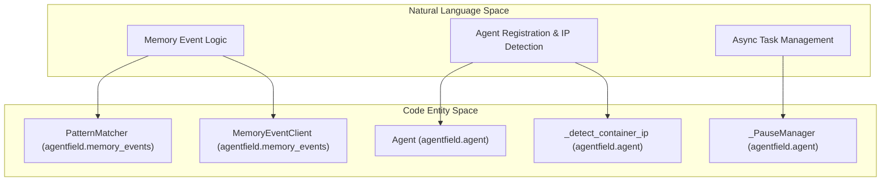
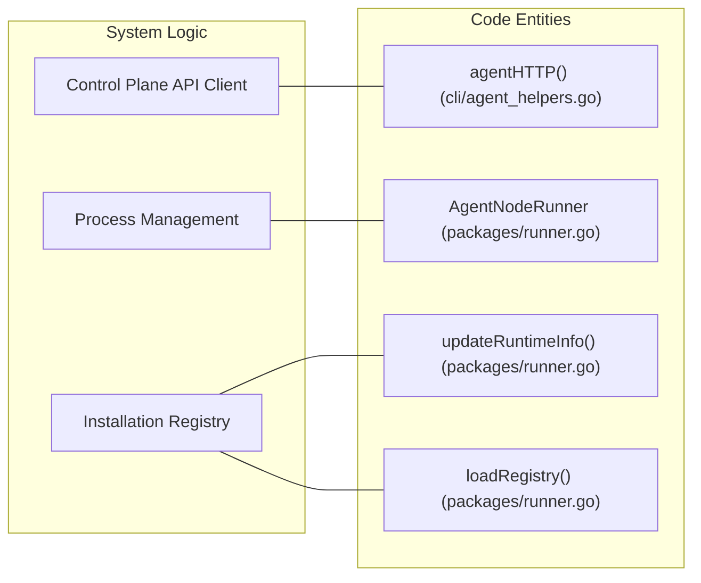

<!-- source: DeepWiki mcp.deepwiki.com · repo Agent-Field/agentfield · page 16.2 Unit Tests · fetched 2026-10-26 -->

# Unit Tests

Relevant source files

The following files were used as context for generating this wiki page:

- [.github/workflows/control-plane.yml](.github/workflows/control-plane.yml)
- [.github/workflows/coverage-badge.yml](.github/workflows/coverage-badge.yml)
- [.github/workflows/coverage-report.yml](.github/workflows/coverage-report.yml)
- [.github/workflows/coverage.yml](.github/workflows/coverage.yml)
- [.github/workflows/docker.yml](.github/workflows/docker.yml)
- [.github/workflows/sdk-go.yml](.github/workflows/sdk-go.yml)
- [.github/workflows/sdk-python.yml](.github/workflows/sdk-python.yml)
- [control-plane/internal/cli/agent_helpers_test.go](control-plane/internal/cli/agent_helpers_test.go)
- [control-plane/internal/cli/command_helpers_additional_test.go](control-plane/internal/cli/command_helpers_additional_test.go)
- [control-plane/internal/packages/runner_test.go](control-plane/internal/packages/runner_test.go)
- [scripts/coverage-aggregate.py](scripts/coverage-aggregate.py)
- [scripts/coverage-summary.sh](scripts/coverage-summary.sh)
- [scripts/coverage-surface.sh](scripts/coverage-surface.sh)
- [sdk/python/tests/test_agent_bigfiles_final90.py](sdk/python/tests/test_agent_bigfiles_final90.py)
- [sdk/python/tests/test_memory_events.py](sdk/python/tests/test_memory_events.py)

This page documents the unit testing infrastructure for the AgentField SDKs and the Control Plane. Unit tests validate individual modules and classes in isolation using mocked dependencies and fixtures. They are fast, deterministic tests that do not require external services.

For end-to-end testing with live services, see [16.1 Functional Tests](). For the overall build system that orchestrates test execution, see [16.3 Build System]().

---

## Overview

AgentField maintains separate unit test suites for each surface area. The CI/CD pipeline uses a dedicated coverage workflow to aggregate results and enforce quality gates.

| Surface | Test Framework | Test Runner | Primary Command |
| :--- | :--- | :--- | :--- |
| **Control Plane** | Go `testing` | `go test` | `go test ./...` |
| **Python SDK** | `pytest` | `pytest` | `./scripts/run_pytest.sh` |
| **TypeScript SDK** | `vitest` | `vitest` | `npm test` |
| **Go SDK** | Go `testing` | `go test` | `go test ./...` |

### Coverage Pipeline
The system uses a multi-stage coverage pipeline defined in `.github/workflows/coverage.yml` [1-125](). It runs per-surface jobs in parallel, uploads artifacts, and then aggregates them to produce a final report [60-125]().

Sources: [.github/workflows/coverage.yml:60-74](), [.github/workflows/sdk-python.yml:51-54](), [.github/workflows/sdk-go.yml:44-47]()

---

## Python SDK Unit Tests

The Python SDK uses `pytest` with extensive configuration for async operations and network mocking.

### Environment & Compatibility
A critical part of the Python test suite is verifying compatibility with different `websockets` versions, as version 14 introduced breaking changes (renaming `extra_headers` to `additional_headers`) [.github/workflows/sdk-python.yml:55-60](). The SDK dynamically detects the version and uses the appropriate keyword argument [sdk/python/tests/test_memory_events.py:137-148]().

### Key Test Entities (Python)

**Implementation Details**:
- **IP Detection**: Tests mock the `requests` module and `socket` to simulate container environments (AWS metadata, ipify) and local network configurations [sdk/python/tests/test_agent_bigfiles_final90.py:64-107]().
- **Memory Events**: `MemoryEventClient` tests use `monkeypatch` to simulate WebSocket connections and verify that subscriptions correctly filter events based on scope and keys [sdk/python/tests/test_memory_events.py:40-57]().
- **Pause Management**: `_PauseManager` is tested for its ability to register, resolve, and cancel pending agent executions (e.g., waiting for human approval) [sdk/python/tests/test_agent_bigfiles_final90.py:134-152]().

Sources: [sdk/python/tests/test_memory_events.py:17-39](), [sdk/python/tests/test_agent_bigfiles_final90.py:12-22](), [.github/workflows/sdk-python.yml:77-82]()

---

## Control Plane & CLI Unit Tests

The Control Plane and CLI are tested using Go's standard library `testing` package and the `testify` library for assertions.

### CLI Helper Testing
The `af` CLI helpers are tested for robust handling of HTTP communication, JSON formatting (pretty vs. compact), and path escaping [control-plane/internal/cli/agent_helpers_test.go:22-45]().

### Registry & Runner Testing
The `AgentNodeRunner` tests validate the lifecycle of managed agent processes:
- **Port Management**: Ensuring the runner can find free ports and detect collisions [control-plane/internal/packages/runner_test.go:31-51]().
- **Process Spawning**: Verifying that environment variables (like `PYTHONUTF8=1`) are correctly injected into child processes [control-plane/internal/packages/runner_test.go:82-97]().
- **Health Checks**: Testing the `waitForAgentNode` logic which polls the agent's `/health` endpoint until it is ready [control-plane/internal/packages/runner_test.go:129-134]().

### Code-to-System Mapping (CLI/CP)

Sources: [control-plane/internal/cli/agent_helpers_test.go:47-70](), [control-plane/internal/packages/runner_test.go:31-33](), [control-plane/internal/cli/command_helpers_additional_test.go:18-30]()

---

## TypeScript SDK Unit Tests

The TypeScript SDK utilizes `vitest` for modern, fast unit testing with native ESM support.

### Test Execution
Tests are run via `npm test` [sdk/typescript/package.json:15](). The suite focuses on:
- **AIClient**: Validating provider-specific logic (OpenAI, Anthropic, etc.).
- **MemoryInterface**: Testing scoped key-value operations and vector search mocking.
- **Agent Lifecycle**: Ensuring handlers for different platforms (AWS Lambda, Express) correctly normalize events.

Sources: [sdk/typescript/package.json:12-16](), [.github/workflows/coverage.yml:73]()

---

## CI/CD and Coverage Reporting

AgentField implements a strict coverage gate to prevent regressions.

### Coverage Workflow
1. **Path Detection**: The `changes` job determines if relevant code was modified [.github/workflows/coverage.yml:22-47]().
2. **Parallel Execution**: Each surface (sdk-python, control-plane, etc.) runs its tests and generates LCOV or Cobertura reports [.github/workflows/coverage.yml:60-104]().
3. **Aggregation**: The `coverage-summary` job downloads all artifacts and runs `scripts/coverage-aggregate.py` [.github/workflows/coverage.yml:165-180]().
4. **Sticky Comments**: A separate `Coverage Report` workflow posts the results directly to the Pull Request using `sticky-pull-request-comment` [.github/workflows/coverage-report.yml:34-49]().

### Badge Automation
After merging to `main`, the `Coverage Badge` workflow extracts the final coverage percentage and updates a GitHub Gist to refresh the badge in the project README [.github/workflows/coverage-badge.yml:120-144]().

Sources: [.github/workflows/coverage.yml:125-132](), [.github/workflows/coverage-report.yml:1-12](), [.github/workflows/coverage-badge.yml:1-12]()

---

