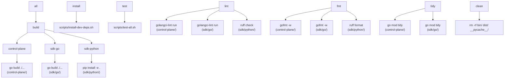
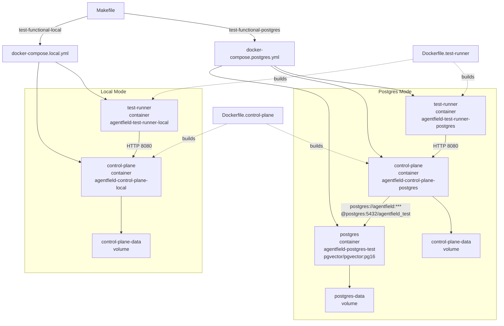
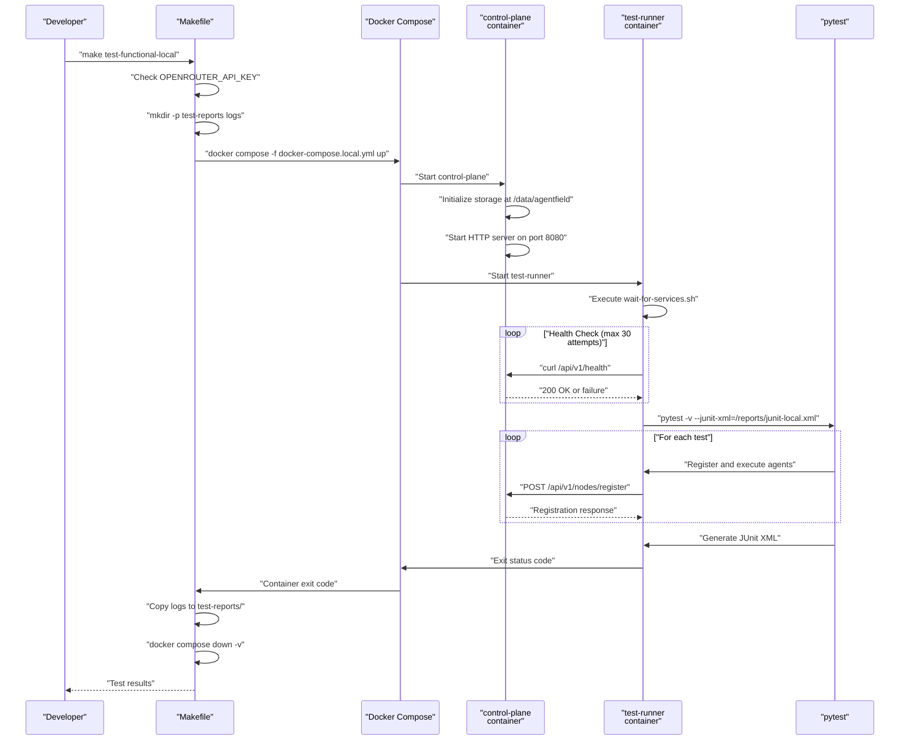

<!-- source: DeepWiki mcp.deepwiki.com · repo Agent-Field/agentfield · page 16.3 Build System · fetched 2026-10-26 -->

# Build System

<details>
<summary>Relevant source files</summary>

The following files were used as context for generating this wiki page:

- [.github/workflows/functional-tests.yml](.github/workflows/functional-tests.yml)
- [Makefile](Makefile)
- [tests/functional/README.md](tests/functional/README.md)
- [tests/functional/conftest.py](tests/functional/conftest.py)
- [tests/functional/docker/Dockerfile.test-runner](tests/functional/docker/Dockerfile.test-runner)
- [tests/functional/docker/docker-compose.local.yml](tests/functional/docker/docker-compose.local.yml)
- [tests/functional/docker/docker-compose.postgres.yml](tests/functional/docker/docker-compose.postgres.yml)
- [tests/functional/docker/wait-for-services.sh](tests/functional/docker/wait-for-services.sh)
- [tests/functional/requirements.txt](tests/functional/requirements.txt)

</details>


## Purpose and Scope

This document describes the build system infrastructure for the AgentField codebase, including the Makefile-based build targets, multi-language SDK compilation, functional test orchestration with Docker Compose, and CI/CD integration. The build system provides a unified interface for building all components (control plane, Go SDK, Python SDK), running tests across multiple storage backends, and ensuring code quality through linting and formatting tools.

For information about the release process and version management, see [Release Process](#16.4). For details about specific test implementations, see [Functional Tests](#16.1) and [Unit Tests](#16.2). For CI/CD workflows and GitHub Actions, see [CI/CD Pipeline](#16.5).

---

## Build Target Overview

The root-level `Makefile` provides the primary interface for building, testing, and maintaining the codebase. All build operations are orchestrated through Make targets that coordinate builds across the control plane and multiple SDK implementations.

### Core Build Targets

| Target | Purpose | Components |
|--------|---------|------------|
| `install` | Install development dependencies | Executes `scripts/install-dev-deps.sh` |
| `build` | Build all components | `control-plane`, `sdk-go`, `sdk-python` |
| `control-plane` | Build Go control plane | `cd control-plane && go build ./...` |
| `sdk-go` | Build Go SDK | `cd sdk/go && go build ./...` |
| `sdk-python` | Install Python SDK in editable mode | `cd sdk/python && pip install -e .` |
| `test` | Run all tests | Executes `scripts/test-all.sh` |
| `lint` | Run linters on all components | `golangci-lint`, `ruff check` |
| `fmt` | Format source code | `gofmt`, `ruff format` |
| `tidy` | Clean up Go module dependencies | `go mod tidy` |
| `clean` | Remove build artifacts | Removes `bin/`, `dist/`, `__pycache__/` |

**Sources:** [Makefile:22-56]()

---

## Makefile Target Dependency Graph



**Sources:** [Makefile:20-56]()

---

## Multi-Component Build Process

### Control Plane Build

The control plane is built as a Go binary. The build process compiles all packages in the `control-plane/` directory.

```
make control-plane
  └─> cd control-plane && go build ./...
```

**Sources:** [Makefile:27-28]()

### Go SDK Build

The Go SDK provides agent implementation templates and client libraries. The build verifies compilation.

```
make sdk-go
  └─> cd sdk/go && go build ./...
```

**Sources:** [Makefile:30-31]()

### Python SDK Build

The Python SDK is installed in editable (development) mode, allowing local changes to be immediately reflected.

```
make sdk-python
  └─> cd sdk/python && pip install -e . >/dev/null
```

**Sources:** [Makefile:33-34]()

---

## Functional Test Infrastructure

The functional test system uses Docker Compose to orchestrate multi-container test environments that validate end-to-end agent behavior against both SQLite and PostgreSQL storage backends.

### Test Environment Architecture



**Sources:** [tests/functional/docker/docker-compose.local.yml:1-67](), [tests/functional/docker/docker-compose.postgres.yml:1-94]()

### Functional Test Make Targets

| Target | Storage Mode | Compose File | Container Names |
|--------|--------------|--------------|-----------------|
| `test-functional` | Both (sequential) | Both files | All containers |
| `test-functional-local` | SQLite | `docker-compose.local.yml` | `agentfield-control-plane-local`, `agentfield-test-runner-local` |
| `test-functional-postgres` | PostgreSQL | `docker-compose.postgres.yml` | `agentfield-postgres-test`, `agentfield-control-plane-postgres`, `agentfield-test-runner-postgres` |
| `test-functional-cleanup` | N/A | Both files | Cleanup for both modes |
| `test-functional-ci` | Both (CI mode) | Both files | CI-optimized execution |

**Sources:** [Makefile:61-120]()

### Test Runner Configuration

The `test-runner` container executes pytest with the following environment:

```bash
# Environment variables from docker-compose files
AGENTFIELD_SERVER=http://control-plane:8080
OPENROUTER_API_KEY=${OPENROUTER_API_KEY}
OPENROUTER_MODEL=${OPENROUTER_MODEL:-openrouter/google/gemini-2.5-flash-lite}
STORAGE_MODE=local|postgres
PYTEST_ARGS=${PYTEST_ARGS:--v}
TEST_TIMEOUT=${TEST_TIMEOUT:-300}
TEST_AGENT_BIND_HOST=${TEST_AGENT_BIND_HOST:-0.0.0.0}
TEST_AGENT_CALLBACK_HOST=${TEST_AGENT_CALLBACK_HOST:-test-runner}
FUNCTIONAL_LOG_FILE=/tests/functional/logs/functional-tests.log
AGENTFIELD_HOME=/tmp/agentfield-cli
```

The test runner waits for the control plane to be healthy before executing tests using the `wait-for-services.sh` script:

```bash
sh -c "
echo 'Waiting for control plane to be fully ready...' &&
wait-for-services.sh &&
pytest -n auto $$PYTEST_ARGS --junit-xml=/reports/junit-local.xml --tb=short;
"
```

**Sources:** [tests/functional/docker/docker-compose.local.yml:24-60](), [tests/functional/docker/docker-compose.postgres.yml:50-85]()

---

## Functional Test Execution Flow



**Sources:** [Makefile:64-81](), [tests/functional/docker/wait-for-services.sh:1-30](), [tests/functional/conftest.py:134-156]()

---

## CI/CD Integration

### GitHub Actions Functional Test Workflow

The `.github/workflows/functional-tests.yml` workflow automates functional testing. It uses a matrix strategy to test both storage modes in parallel.

#### Workflow Triggers

```yaml
on:
  push:
    branches: [testing, main]
  pull_request:
    branches: [main]
  workflow_dispatch:
    inputs:
      storage_mode:
        default: 'both'
        type: choice
        options: [both, local, postgres]
```

**Sources:** [.github/workflows/functional-tests.yml:3-26]()

#### Matrix Strategy

The workflow runs two parallel jobs:

```yaml
strategy:
  fail-fast: false
  matrix:
    storage_mode: [local, postgres]
```

**Sources:** [.github/workflows/functional-tests.yml:37-43]()

---

## Environment Variable Requirements

### Functional Test Environment

| Variable | Required | Default | Purpose |
|----------|----------|---------|---------|
| `OPENROUTER_API_KEY` | Yes | None | OpenRouter API authentication |
| `OPENROUTER_MODEL` | No | `openrouter/google/gemini-2.5-flash-lite` | AI model for tests |
| `AGENTFIELD_SERVER` | No | `http://control-plane:8080` | Control plane URL |
| `STORAGE_MODE` | No | `local` | Storage backend being tested |
| `TEST_TIMEOUT` | No | `300` | Test timeout in seconds |
| `FUNCTIONAL_LOG_FILE` | No | `/tests/functional/logs/functional-tests.log` | Log file path |

**Sources:** [tests/functional/docker/docker-compose.local.yml:29-41](), [tests/functional/conftest.py:23-42]()

### Control Plane Container Configuration

The control plane container uses environment variables to configure storage and behavior:

```yaml
environment:
  AGENTFIELD_STORAGE_MODE: local|postgres
  AGENTFIELD_PORT: 8080
  AGENTFIELD_CONFIG_FILE: /etc/agentfield/agentfield-test.yaml
  AGENTFIELD_HOME: /data/agentfield
```

**Sources:** [tests/functional/docker/docker-compose.local.yml:7-14](), [tests/functional/docker/docker-compose.postgres.yml:27-37]()

---

## Summary

The AgentField build system provides:

1. **Unified Build Interface:** Single `Makefile` orchestrates builds across Go and Python components.
2. **Multi-Storage Testing:** Docker Compose environments test both SQLite and PostgreSQL backends.
3. **CI/CD Integration:** GitHub Actions workflows with matrix strategy and artifact collection.
4. **Developer Tools:** Linting, formatting, and testing targets for rapid development.
5. **Isolated Test Environments:** Containerized functional tests with health checking and automatic cleanup via `wait-for-services.sh`.

**Sources:** [Makefile:1-120](), [.github/workflows/functional-tests.yml:1-183](), [tests/functional/docker/docker-compose.local.yml:1-67](), [tests/functional/docker/docker-compose.postgres.yml:1-94]()

---

