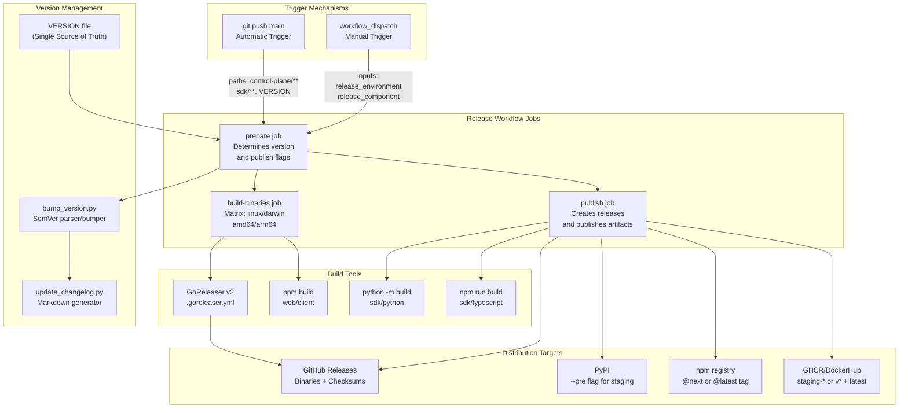
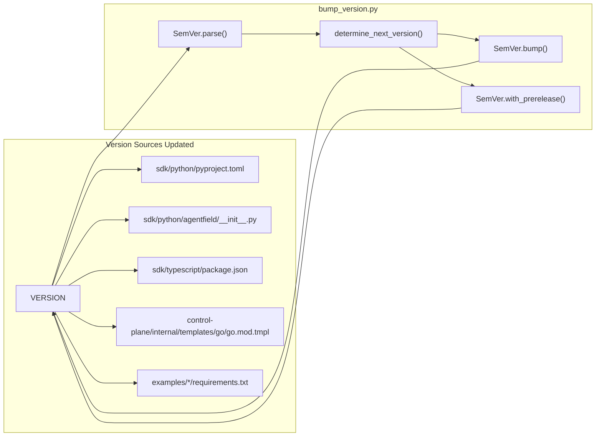
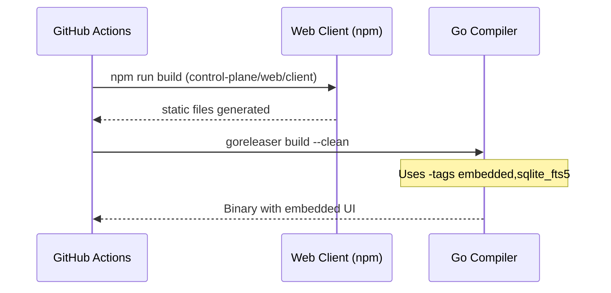

<!-- source: DeepWiki mcp.deepwiki.com · repo Agent-Field/agentfield · page 16.4 Release Process · fetched 2026-10-26 -->

# Release Process

Relevant source files

The following files were used as context for generating this wiki page:

- [.github/workflows/release.yml](.github/workflows/release.yml)
- [.goreleaser.yml](.goreleaser.yml)
- [control-plane/internal/templates/docker/docker-compose.yml.tmpl](control-plane/internal/templates/docker/docker-compose.yml.tmpl)
- [deployments/helm/agentfield/values.yaml](deployments/helm/agentfield/values.yaml)
- [deployments/kubernetes/base/control-plane-deployment.yaml](deployments/kubernetes/base/control-plane-deployment.yaml)
- [docs/RELEASE.md](docs/RELEASE.md)
- [examples/python_agent_nodes/rag_evaluation/docker-compose.yml](examples/python_agent_nodes/rag_evaluation/docker-compose.yml)
- [examples/triggers-demo/docker-compose.yml](examples/triggers-demo/docker-compose.yml)
- [scripts/bump_version.py](scripts/bump_version.py)
- [scripts/install.ps1](scripts/install.ps1)
- [scripts/install.sh](scripts/install.sh)
- [scripts/tests/__init__.py](scripts/tests/__init__.py)
- [scripts/tests/test_bump_version.py](scripts/tests/test_bump_version.py)
- [sdk/go/ai/openrouter_attribution.go](sdk/go/ai/openrouter_attribution.go)

## Purpose

This document describes the technical implementation of AgentField's two-tier release system. It covers the automated build pipeline, version management utilities, artifact distribution mechanisms, and the GitHub Actions workflows that orchestrate the release process.

---

## Release System Architecture

AgentField implements a **two-tier release model** that separates staging (pre-release) from production releases. This system uses a single `VERSION` file as the source of truth and orchestrates releases through GitHub Actions.

**Two-Tier Release System Architecture**

**Sources:** [.github/workflows/release.yml:1-51]() | [.goreleaser.yml:1-180]() | [docs/RELEASE.md:7-13]()

---

## Version Management

### VERSION File and SemVer Class

The `VERSION` file at the repository root is the single source of truth for the current version. All components synchronize to this value through `scripts/bump_version.py`.

**Sources:** [scripts/bump_version.py:16-27]() | [scripts/bump_version.py:37-86]()

### Version Bumping Logic

The `determine_next_version()` function implements the core logic for the two-tier system:

| Input State | Channel | Component | Output |
|------------|---------|-----------|--------|
| `0.1.18` | `stable` | `patch` | `0.1.19` |
| `0.1.18` | `prerelease` | `patch` | `0.1.19-rc.1` |
| `0.1.19-rc.1` | `prerelease` | `patch` | `0.1.19-rc.2` |
| `0.1.19-rc.2` | `stable` | `patch` | `0.1.19` (Finalizes from prerelease) |

The `SemVer` dataclass provides methods to parse, bump, and handle prerelease labels (e.g., `rc`, `beta`). It uses a strict regex pattern to ensure compliance with Semantic Versioning.

**Sources:** [scripts/bump_version.py:30-33]() | [scripts/bump_version.py:89-118]() | [scripts/tests/test_bump_version.py:24-59]()

---

## Build Pipeline Components

### GoReleaser Configuration

The `.goreleaser.yml` defines build targets for the `af` CLI and the `af-tray` macOS companion.

| Build ID | OS | Arch | Features |
|----------|----|------|----------|
| `agentfield-linux-amd64` | Linux | amd64 | CGO, SQLite FTS5, Embedded UI |
| `agentfield-linux-arm64` | Linux | arm64 | Cross-compiled via `aarch64-linux-gnu-gcc` |
| `agentfield-darwin-arm64` | Darwin | arm64 | Native macOS Apple Silicon |
| `agentfield-tray-darwin-arm64` | Darwin | arm64 | Separate binary for macOS menu-bar |

Each build injects version metadata using `ldflags`:
- `main.version`: `{{ .Version }}`
- `main.commit`: `{{ .ShortCommit }}`
- `main.date`: `{{ .Date }}`

**Sources:** [.goreleaser.yml:11-30]() | [.goreleaser.yml:108-123]() | [.goreleaser.yml:130-148]()

### Build Matrix and UI Integration

The release workflow runs a build matrix across `ubuntu-latest` and `macos-14`. A critical step is building the web client before compiling the Go binary, as the Go binary uses build tags to embed the frontend assets.

**Sources:** [.github/workflows/release.yml:191-280]() | [.goreleaser.yml:6-9]()

---

## Release Workflow Execution

### Prepare Job

The `prepare` job determines the release version and sets publish flags based on the trigger type (automatic `push` to main vs. manual `workflow_dispatch`).

**Logic Flow:**
1. **Determine Environment:** `staging` for push events; user-selected for manual events.
2. **Version Bump:** Calls `scripts/bump_version.py` with the appropriate `--channel` (stable or prerelease).
3. **Changelog:** Calls `scripts/update_changelog.py` to generate the release notes.
4. **Git Operations:** Commits version changes, tags the commit, and pushes to origin.

**Sources:** [.github/workflows/release.yml:64-190]() | [docs/RELEASE.md:63-87]()

### Publish Job

The `publish` job distributes artifacts to various registries:

- **PyPI:** Publishes the Python SDK. Prereleases are automatically handled by PEP 440 logic.
- **npm:** Publishes the TypeScript SDK. Staging versions use the `@next` tag, while production uses `@latest`.
- **Docker:** Pushes the `control-plane` image to GHCR and Docker Hub.
- **GitHub Release:** Uploads binaries and generates a `checksums.txt` file for integrity verification.

**Sources:** [.github/workflows/release.yml:281-512]() | [docs/RELEASE.md:168-188]()

---

## Installation and Consumption

The release process feeds the installation scripts, which allow users to select between the stable and staging channels.

| Channel | Install Command | Binary Name | Install Path |
|---------|-----------------|-------------|--------------|
| **Production** | `curl ... | bash` | `af` | `~/.agentfield/bin` |
| **Staging** | `curl ... | bash -s -- --staging` | `af-staging` | `~/.agentfield-staging/bin` |

The `install.sh` script performs the following:
1. Detects OS and Architecture.
2. Queries the GitHub API for the latest version in the selected channel.
3. Downloads the platform-specific binary and `checksums.txt`.
4. Verifies the SHA256 hash before installation.

**Sources:** [scripts/install.sh:137-145]() | [scripts/install.sh:220-259]() | [scripts/install.ps1:136-186]() | [docs/RELEASE.md:191-213]()

---

