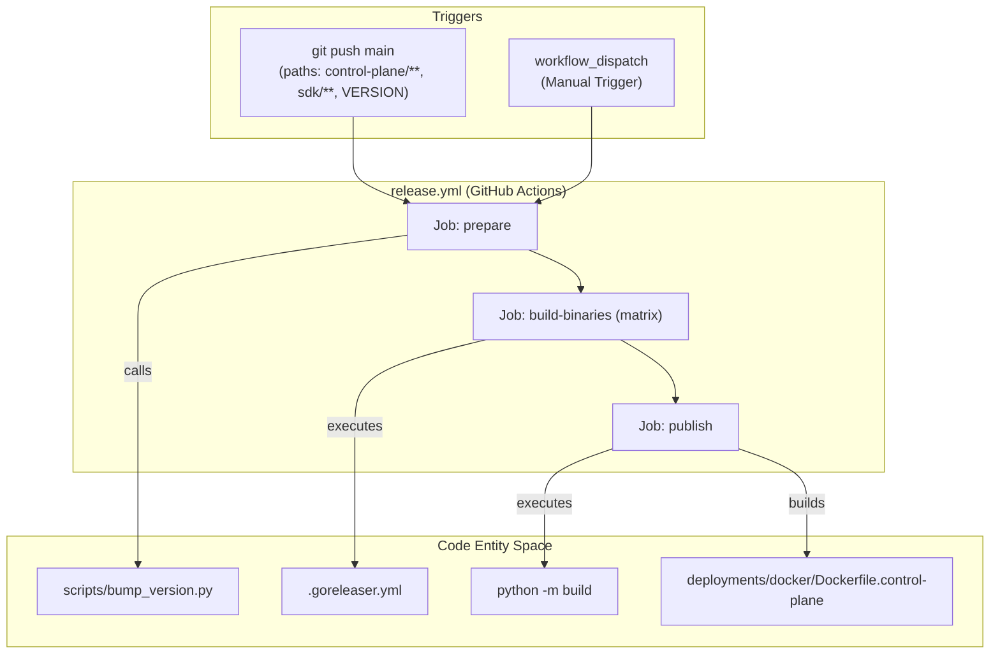
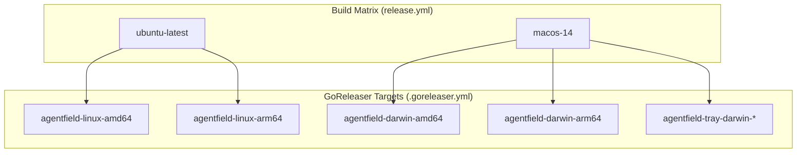

<!-- source: DeepWiki mcp.deepwiki.com · repo Agent-Field/agentfield · page 16.5 CI/CD Pipeline · fetched 2026-10-26 -->

# CI/CD Pipeline

Relevant source files

The following files were used as context for generating this wiki page:

- [.github/workflows/control-plane.yml](.github/workflows/control-plane.yml)
- [.github/workflows/docker.yml](.github/workflows/docker.yml)
- [.github/workflows/release.yml](.github/workflows/release.yml)
- [.github/workflows/sdk-go.yml](.github/workflows/sdk-go.yml)
- [.github/workflows/sdk-python.yml](.github/workflows/sdk-python.yml)
- [.goreleaser.yml](.goreleaser.yml)
- [control-plane/internal/templates/docker/docker-compose.yml.tmpl](control-plane/internal/templates/docker/docker-compose.yml.tmpl)
- [deployments/helm/agentfield/values.yaml](deployments/helm/agentfield/values.yaml)
- [deployments/kubernetes/base/control-plane-deployment.yaml](deployments/kubernetes/base/control-plane-deployment.yaml)
- [docs/RELEASE.md](docs/RELEASE.md)
- [examples/python_agent_nodes/rag_evaluation/docker-compose.yml](examples/python_agent_nodes/rag_evaluation/docker-compose.yml)
- [examples/triggers-demo/docker-compose.yml](examples/triggers-demo/docker-compose.yml)
- [scripts/bump_version.py](scripts/bump_version.py)
- [scripts/coverage-aggregate.py](scripts/coverage-aggregate.py)
- [scripts/coverage-summary.sh](scripts/coverage-summary.sh)
- [scripts/coverage-surface.sh](scripts/coverage-surface.sh)
- [scripts/install.ps1](scripts/install.ps1)
- [scripts/install.sh](scripts/install.sh)
- [scripts/tests/__init__.py](scripts/tests/__init__.py)
- [scripts/tests/test_bump_version.py](scripts/tests/test_bump_version.py)
- [sdk/go/ai/openrouter_attribution.go](sdk/go/ai/openrouter_attribution.go)
- [sdk/python/tests/test_memory_events.py](sdk/python/tests/test_memory_events.py)

## Purpose and Scope

This document describes the continuous integration and continuous deployment (CI/CD) infrastructure for AgentField, including GitHub Actions workflows, build matrices, artifact publishing, and testing infrastructure. For information about the release process and two-tier release system, see [Release Process](#16.4).

The CI/CD pipeline handles:
- Automated staging releases on every push to `main` [docs/RELEASE.md:11-11]()
- Manual production releases via workflow dispatch [.github/workflows/release.yml:14-23]()
- Multi-platform binary builds (Linux/macOS/Windows, amd64/arm64) [.goreleaser.yml:11-149]()
- SDK distribution to PyPI and npm [.github/workflows/release.yml:40-47]()
- Docker image publishing to GitHub Container Registry [.github/workflows/release.yml:48-51]()
- Per-SDK linting and unit testing [.github/workflows/sdk-python.yml:19-53]() [.github/workflows/sdk-go.yml:19-46]()

---

## Workflow Architecture

AgentField uses a set of specialized GitHub Actions workflows to manage the lifecycle of the Control Plane and various SDKs.

### Core Workflows

| Workflow | File | Purpose |
|----------|------|---------|
| **Release** | `.github/workflows/release.yml` | Versioning, multi-platform builds, and publishing. |
| **Control Plane CI** | `.github/workflows/control-plane.yml` | Builds the Go server, builds the React UI, and runs cross-platform compile checks. |
| **Python SDK CI** | `.github/workflows/sdk-python.yml` | Lints with `ruff`, runs `pytest` across Python 3.10-3.12, and verifies `websockets` version compatibility. |
| **Go SDK CI** | `.github/workflows/sdk-go.yml` | Verifies Go SDK builds and tidies modules. |
| **Docker Build** | `.github/workflows/docker.yml` | Smoke tests the Control Plane Docker image. |

### System Data Flow

The following diagram bridges the high-level workflow triggers to the specific scripts and tools used in the pipeline.

Sources: [.github/workflows/release.yml:1-52](), [.github/workflows/control-plane.yml:1-13](), [.github/workflows/sdk-python.yml:1-14]()

---

## Release Workflow Deep Dive

### Job: Prepare (Versioning Logic)

The `prepare` job determines the version to release using `scripts/bump_version.py`. It distinguishes between "staging" (prerelease) and "production" (stable) channels.

- **Automatic Staging**: Triggered by push to `main`. It forces a `patch` bump with an `rc` label [.github/workflows/release.yml:142-148]().
- **Collision Check**: The `_remote_tag_names()` function in `bump_version.py` queries `origin` to ensure the next `-rc.N` counter doesn't conflict with existing tags [scripts/bump_version.py:121-158]().
- **Artifact Sync**: The script updates `VERSION`, `pyproject.toml`, `package.json`, and `go.mod.tmpl` simultaneously to ensure all SDKs match the Control Plane version [scripts/bump_version.py:191-228]().

### Job: Build Binaries (Matrix)

AgentField uses a build matrix to handle CGO dependencies required for SQLite (FTS5 support).

- **Linux ARM64**: Built on `ubuntu-latest` using the `aarch64-linux-gnu-gcc` cross-compiler [.goreleaser.yml:37-37]().
- **macOS Tray**: A separate binary (`af-tray`) is built specifically for Darwin to handle the menu-bar companion, keeping the main `af` binary lean [.goreleaser.yml:92-123]().
- **UI Embedding**: Before Go compilation, the React client is built via `npm run build` and embedded into the binary using Go `embed` (triggered by the `embedded` build tag) [.goreleaser.yml:8-29]().

Sources: [.github/workflows/release.yml:191-280](), [.goreleaser.yml:1-166](), [scripts/bump_version.py:89-118]()

---

## SDK-Specific CI

### Python SDK Verification

The Python CI (`sdk-python.yml`) includes a specialized check for `websockets` compatibility.

- **Websockets Versioning**: The SDK detects the installed `websockets` version. In version 14.0, the library renamed `extra_headers` to `additional_headers` [sdk/python/tests/test_memory_events.py:137-148]().
- **Matrix Testing**: The CI runs a matrix against `websockets==12.0` and `websockets==15.0.1` to ensure the `MemoryEventClient` correctly selects the `_HEADERS_KWARG` [.github/workflows/sdk-python.yml:56-83]().

### Control Plane Cross-Compilation

The `control-plane.yml` workflow validates that the server can compile for `linux`, `darwin`, and `windows` even when CGO is disabled for simple status checks [.github/workflows/control-plane.yml:70-81](). However, official releases always use `CGO_ENABLED=1` to support `sqlite_fts5` [.goreleaser.yml:17-148]().

Sources: [.github/workflows/sdk-python.yml:56-83](), [sdk/python/tests/test_memory_events.py:137-148](), [.github/workflows/control-plane.yml:70-120]()

---

## Artifact Publishing

Once builds are successful, the `publish` job distributes the artifacts:

1. **GitHub Release**: Uploads all platform binaries and `checksums.txt` [.github/workflows/release.yml:335-345]().
2. **PyPI**: Publishes the Python SDK. Staging releases are uploaded as prereleases (e.g., `0.1.19rc1`), which `pip` ignores unless `--pre` is specified [.github/workflows/release.yml:350-367]().
3. **npm**: Publishes the TypeScript SDK. Staging uses the `@next` tag; production uses `@latest` [.github/workflows/release.yml:369-395]().
4. **Docker**: Builds a multi-platform image (`linux/amd64`, `linux/arm64`) using `Dockerfile.control-plane` and pushes to GHCR [.github/workflows/release.yml:410-445]().

Sources: [.github/workflows/release.yml:335-445](), [docs/RELEASE.md:11-12]()

---

## Installation Scripts

The CI/CD pipeline supports two primary installation scripts that consume the published artifacts.

### Shell Installer (`install.sh`)
- **Channel Support**: Supports a `--staging` flag to install the latest release candidate [scripts/install.sh:63-66]().
- **Auto-Provisioning**: On macOS, it can automatically install the `af-tray` and configure `launchd` for auto-start [scripts/install.sh:36-43]().
- **Binary Resolution**: It identifies the system architecture (e.g., `x86_64` vs `arm64`) to fetch the correct binary from GitHub [scripts/install.sh:238-270]().

### PowerShell Installer (`install.ps1`)
- **Windows Support**: Provides equivalent functionality for Windows users, installing `agentfield.exe` and creating an `af.exe` alias [scripts/install.ps1:203-218]().
- **Checksum Verification**: Calculates the SHA256 hash of the downloaded `.exe` and compares it against `checksums.txt` from the release [scripts/install.ps1:136-186]().

Sources: [scripts/install.sh:1-126](), [scripts/install.ps1:1-220]()

---

