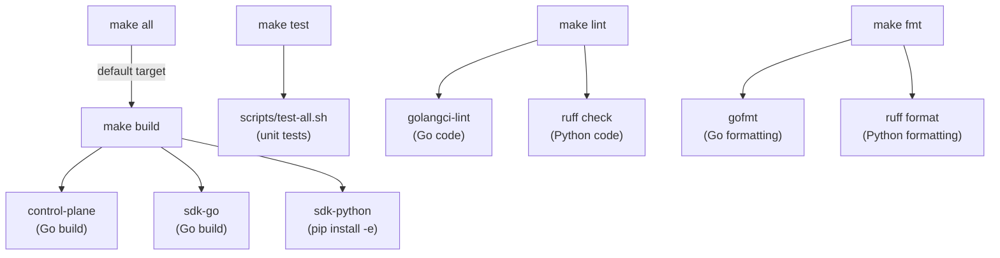
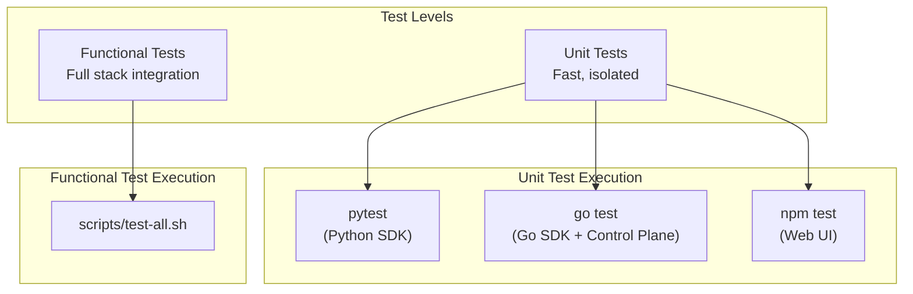
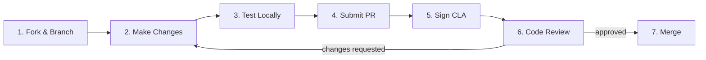

<!-- source: DeepWiki mcp.deepwiki.com · repo Agent-Field/agentfield · page 16.6 Contributing · fetched 2026-10-26 -->

# Contributing

<details>
<summary>Relevant source files</summary>

The following files were used as context for generating this wiki page:

- [.cliff.toml](.cliff.toml)
- [.github/BRANCH_PROTECTION.md](.github/BRANCH_PROTECTION.md)
- [.github/ISSUE_TEMPLATE/task.md](.github/ISSUE_TEMPLATE/task.md)
- [.github/workflows/ai-label.yml](.github/workflows/ai-label.yml)
- [AGENTS.md](AGENTS.md)
- [CLAUDE.md](CLAUDE.md)
- [CODE_OF_CONDUCT.md](CODE_OF_CONDUCT.md)
- [SECURITY.md](SECURITY.md)
- [SUPPORT.md](SUPPORT.md)
- [control-plane/internal/packages/config_version_test.go](control-plane/internal/packages/config_version_test.go)
- [control-plane/internal/skillkit/skill_data/agentfield/references/cli-toolkit.md](control-plane/internal/skillkit/skill_data/agentfield/references/cli-toolkit.md)
- [docs/CONTRIBUTING.md](docs/CONTRIBUTING.md)
- [scripts/update_changelog.py](scripts/update_changelog.py)
- [skills/agentfield/references/cli-toolkit.md](skills/agentfield/references/cli-toolkit.md)

</details>


This page provides guidelines for contributing code, documentation, or bug reports to AgentField. It covers environment setup, coding standards, testing requirements, and the pull request process.

---

## Prerequisites

Development requires the following tools:

| Tool | Version | Purpose |
|------|---------|---------|
| Go | 1.23+ | Control plane and Go SDK [CLAUDE.md:17-17]() |
| Python | 3.8+ | Python SDK and tooling [CLAUDE.md:18-18]() |
| Node.js | 20+ | TypeScript SDK and web UI [CLAUDE.md:19-19]() |
| PostgreSQL | 15+ | Required for cloud mode storage [CLAUDE.md:20-20]() |

---

## Development Environment Setup

### Initial Setup

The repository uses a `Makefile` to orchestrate multi-language dependencies and builds.

```bash
# Clone the repository
git clone https://github.com/Agent-Field/agentfield.git
cd agentfield

# Install all dependencies (Go, Python, Node)
make install

# Build all components
make build
```

The `make install` target executes `scripts/install.sh` to set up the environment [CLAUDE.md:25-28]().

### Build Targets



**Sources:** [CLAUDE.md:68-73](), [docs/CONTRIBUTING.md:16-19]()

---

## Code Style Guidelines

### Go (Control Plane & SDK)

**Formatting:**
- Use `gofmt` for automatic formatting.
- Run `make fmt` before committing [CLAUDE.md:94-94]().

**Linting:**
- Use `golangci-lint` for static analysis.
- Run `golangci-lint run` within the `control-plane` directory [CLAUDE.md:98-98]().

**Sources:** [CLAUDE.md:91-98](), [.github/BRANCH_PROTECTION.md:9-13]()

### Python (SDK)

**Formatting & Linting:**
- The project uses `ruff` for both linting and formatting.
- Run `ruff check` and `ruff format .` in `sdk/python` [CLAUDE.md:99-100]().

**Conventions:**
- Follow PEP 8 naming.
- Use type annotations for all function signatures [CLAUDE.md:169-174]().

**Sources:** [CLAUDE.md:99-101](), [.github/BRANCH_PROTECTION.md:20-23]()

---

## Testing Requirements

### Test Hierarchy



### Unit Tests

All code changes must include unit tests.

- **Go:** `go test ./...` in the relevant package directory [CLAUDE.md:80-81]().
- **Python:** `pytest` in `sdk/python`. Use `--cov=agentfield` for coverage reports [CLAUDE.md:82-85]().
- **Web UI:** `npm run lint` and `npm test` (Vitest) [CLAUDE.md:88-88]().

### AI-Assisted Testing

If using AI (Claude, Copilot, etc.) to generate code, you are responsible for the quality. AI-generated code must meet the same coverage standards as human code [docs/CONTRIBUTING.md:119-121]().

**Test Quality Checklist:**
- [ ] Tests actually fail when code is broken [docs/CONTRIBUTING.md:159-159]().
- [ ] Edge cases (null, empty, boundary) are covered [docs/CONTRIBUTING.md:161-161]().
- [ ] Assertions verify behavior, not just "no error" [docs/CONTRIBUTING.md:160-160]().

**Sources:** [CLAUDE.md:76-89](), [docs/CONTRIBUTING.md:119-165]()

---

## Pull Request Process

### Workflow Overview



### 1. Fork and Branch
Fork the repository and create a feature branch with a descriptive name (e.g., `feat/my-feature` or `fix/issue-id`) [docs/CONTRIBUTING.md:15-23]().

### 2. Commit Guidelines
- Use **Conventional Commits** (`feat:`, `fix:`, `chore:`, `docs:`) [docs/CONTRIBUTING.md:27-27]().
- Reference related issues using `Fixes #<id>` [docs/CONTRIBUTING.md:29-29]().
- If using AI assistance, optionally include `Co-Authored-By: Claude <noreply@anthropic.com>` in the commit footer [docs/CONTRIBUTING.md:107-111]().

### 3. CLA Requirements
AgentField uses `cla-assistant.io`. Human contributors must sign the CLA via the link in the PR [docs/CONTRIBUTING.md:49-53](). Bot accounts (e.g., Dependabot) must be allowlisted by maintainers [docs/CONTRIBUTING.md:54-60]().

### 4. AI Detection
Pull requests are automatically scanned for AI assistance signatures (e.g., "Generated by Claude", "Co-authored-by: Copilot"). Detected PRs are labeled `ai-assisted` for transparency [.github/workflows/ai-label.yml:52-135]().

**Sources:** [docs/CONTRIBUTING.md:1-60](), [.github/workflows/ai-label.yml:1-135]()

---

## CI/CD and Branch Protection

All PRs must pass a suite of automated checks before they can be merged to `main`.

### Required Checks
- **Control Plane:** Go build, Go tests, `golangci-lint`, and cross-compilation (Linux/macOS/Windows) [.github/BRANCH_PROTECTION.md:9-13]().
- **SDKs:** Build verification, unit tests, and `ruff` linting for Python [.github/BRANCH_PROTECTION.md:15-23]().
- **Docker:** Successful build of `Dockerfile.control-plane` and a smoke test (`--help`) [.github/BRANCH_PROTECTION.md:24-26]().

### Troubleshooting Failures
If CI fails, reproduce the issue locally using the following:
- **Go:** `go test ./...` and `golangci-lint run` [.github/BRANCH_PROTECTION.md:39-40]().
- **Python:** `ruff check .` and `pytest` [.github/BRANCH_PROTECTION.md:43-45]().
- **Docker:** `docker build -f deployments/docker/Dockerfile.control-plane ...` [.github/BRANCH_PROTECTION.md:76-77]().

**Sources:** [.github/BRANCH_PROTECTION.md:1-80]()

---

## Introspection Toolkit for Contributors

The `af` CLI provides tools to help contributors debug and inspect the system during development.

| Command | Purpose |
|---------|---------|
| `af doctor --json` | Returns environment truth (AI providers, toolchain availability) [skills/agentfield/references/cli-toolkit.md:11-24]() |
| `af agent status` | One-shot health snapshot of the system [skills/agentfield/references/cli-toolkit.md:27-29]() |
| `af agent query` | Unified JSON resource query for `runs`, `executions`, `agents`, etc. [skills/agentfield/references/cli-toolkit.md:37-41]() |
| `af execution cancel` | Stop a stuck test execution [skills/agentfield/references/cli-toolkit.md:135-135]() |
| `af secrets ls/set` | Manage the local encrypted secret store for agent nodes [skills/agentfield/references/cli-toolkit.md:109-111]() |

**Sources:** [skills/agentfield/references/cli-toolkit.md:1-140]()

---

## Security Contributions
Do **not** open public issues for security vulnerabilities. Report them directly to `contact@agentfield.ai`. Maintainers aim to respond within 48 hours [SECURITY.md:3-9]().

**Sources:** [SECURITY.md:1-28]()

---

