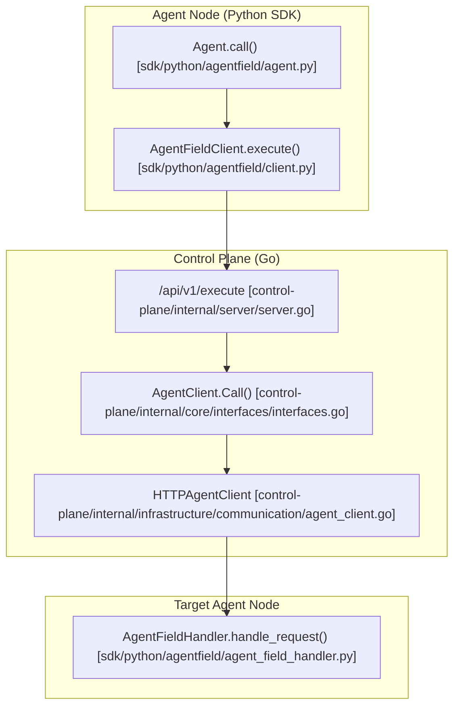
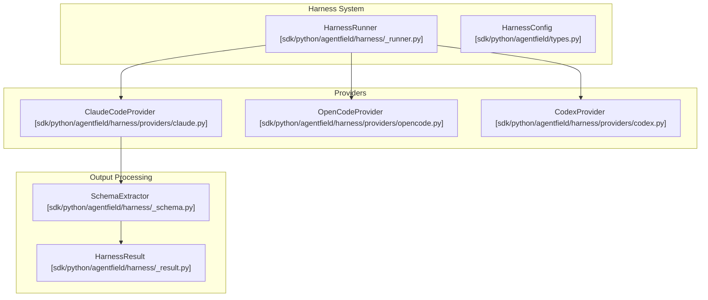

<!-- source: DeepWiki mcp.deepwiki.com · repo Agent-Field/agentfield · page 17 Glossary · fetched 2026-10-26 -->

# Glossary

Relevant source files

The following files were used as context for generating this wiki page:

- [.github/workflows/update-download-stats.yml](.github/workflows/update-download-stats.yml)
- [CHANGELOG.md](CHANGELOG.md)
- [README.md](README.md)
- [VERSION](VERSION)
- [assets/UI.png](assets/UI.png)
- [assets/arch.png](assets/arch.png)
- [assets/examples/ai-security-auditor.png](assets/examples/ai-security-auditor.png)
- [assets/examples/autonomous-engineering-team.png](assets/examples/autonomous-engineering-team.png)
- [assets/examples/deep-research-engine.png](assets/examples/deep-research-engine.png)
- [assets/examples/reactive-database-layer.png](assets/examples/reactive-database-layer.png)
- [assets/features-strip.png](assets/features-strip.png)
- [assets/github hero.png](assets/github hero.png)
- [control-plane/cmd/af/main.go](control-plane/cmd/af/main.go)
- [control-plane/cmd/agentfield-server/main.go](control-plane/cmd/agentfield-server/main.go)
- [control-plane/config/agentfield.yaml](control-plane/config/agentfield.yaml)
- [control-plane/internal/config/config.go](control-plane/internal/config/config.go)
- [control-plane/internal/config/config_additional_test.go](control-plane/internal/config/config_additional_test.go)
- [control-plane/internal/handlers/execute_awaiter_status.go](control-plane/internal/handlers/execute_awaiter_status.go)
- [control-plane/internal/handlers/execute_awaiter_status_test.go](control-plane/internal/handlers/execute_awaiter_status_test.go)
- [control-plane/internal/server/middleware/auth.go](control-plane/internal/server/middleware/auth.go)
- [control-plane/internal/server/middleware/auth_admin_additional_test.go](control-plane/internal/server/middleware/auth_admin_additional_test.go)
- [control-plane/internal/server/middleware/auth_test.go](control-plane/internal/server/middleware/auth_test.go)
- [control-plane/internal/server/routes_admin.go](control-plane/internal/server/routes_admin.go)
- [control-plane/internal/server/routes_middleware.go](control-plane/internal/server/routes_middleware.go)
- [control-plane/internal/server/server.go](control-plane/internal/server/server.go)
- [control-plane/internal/server/server_additional_test.go](control-plane/internal/server/server_additional_test.go)
- [control-plane/internal/server/server_coverage_additional_test.go](control-plane/internal/server/server_coverage_additional_test.go)
- [control-plane/internal/templates/go/go.mod.tmpl](control-plane/internal/templates/go/go.mod.tmpl)
- [deployments/helm/agentfield/templates/control-plane-deployment.yaml](deployments/helm/agentfield/templates/control-plane-deployment.yaml)
- [docs/ENVIRONMENT_VARIABLES.md](docs/ENVIRONMENT_VARIABLES.md)
- [examples/python_agent_nodes/agentic_rag/requirements.txt](examples/python_agent_nodes/agentic_rag/requirements.txt)
- [examples/python_agent_nodes/documentation_chatbot/requirements.txt](examples/python_agent_nodes/documentation_chatbot/requirements.txt)
- [examples/python_agent_nodes/hello_world_rag/requirements.txt](examples/python_agent_nodes/hello_world_rag/requirements.txt)
- [sdk/python/CHANGELOG.md](sdk/python/CHANGELOG.md)
- [sdk/python/agentfield/__init__.py](sdk/python/agentfield/__init__.py)
- [sdk/python/agentfield/agent.py](sdk/python/agentfield/agent.py)
- [sdk/python/agentfield/async_execution_manager.py](sdk/python/agentfield/async_execution_manager.py)
- [sdk/python/agentfield/client.py](sdk/python/agentfield/client.py)
- [sdk/python/agentfield/exceptions.py](sdk/python/agentfield/exceptions.py)
- [sdk/python/agentfield/execution_state.py](sdk/python/agentfield/execution_state.py)
- [sdk/python/agentfield/harness/_runner.py](sdk/python/agentfield/harness/_runner.py)
- [sdk/python/agentfield/harness/_schema.py](sdk/python/agentfield/harness/_schema.py)
- [sdk/python/agentfield/harness/providers/claude.py](sdk/python/agentfield/harness/providers/claude.py)
- [sdk/python/agentfield/harness/providers/codex.py](sdk/python/agentfield/harness/providers/codex.py)
- [sdk/python/agentfield/harness/providers/gemini.py](sdk/python/agentfield/harness/providers/gemini.py)
- [sdk/python/agentfield/harness/providers/opencode.py](sdk/python/agentfield/harness/providers/opencode.py)
- [sdk/python/agentfield/types.py](sdk/python/agentfield/types.py)
- [sdk/python/pyproject.toml](sdk/python/pyproject.toml)
- [sdk/python/tests/test_agent_call.py](sdk/python/tests/test_agent_call.py)
- [sdk/python/tests/test_agent_coverage_additions.py](sdk/python/tests/test_agent_coverage_additions.py)
- [sdk/python/tests/test_async_config.py](sdk/python/tests/test_async_config.py)
- [sdk/python/tests/test_async_execution.py](sdk/python/tests/test_async_execution.py)
- [sdk/python/tests/test_client_laser_push.py](sdk/python/tests/test_client_laser_push.py)
- [sdk/python/tests/test_execution_logger.py](sdk/python/tests/test_execution_logger.py)
- [sdk/python/tests/test_execution_state.py](sdk/python/tests/test_execution_state.py)
- [sdk/python/tests/test_harness_ai_schema_repair.py](sdk/python/tests/test_harness_ai_schema_repair.py)
- [sdk/python/tests/test_harness_provider_claude.py](sdk/python/tests/test_harness_provider_claude.py)
- [sdk/python/tests/test_harness_provider_codex.py](sdk/python/tests/test_harness_provider_codex.py)
- [sdk/python/tests/test_harness_provider_gemini.py](sdk/python/tests/test_harness_provider_gemini.py)
- [sdk/python/tests/test_harness_provider_opencode.py](sdk/python/tests/test_harness_provider_opencode.py)
- [sdk/python/tests/test_harness_runner.py](sdk/python/tests/test_harness_runner.py)
- [sdk/python/tests/test_harness_schema.py](sdk/python/tests/test_harness_schema.py)
- [sdk/typescript/package.json](sdk/typescript/package.json)
- [tests/functional/docker/agentfield-test.yaml](tests/functional/docker/agentfield-test.yaml)

This page provides definitions for codebase-specific terminology, jargon, and domain concepts used throughout the AgentField project. It serves as a technical reference for onboarding engineers to understand the implementation details and data flow associated with these terms.

## Core System Entities

### Control Plane
The central orchestration service (written in Go) that manages agent registration, routing, memory, and verifiable credentials. It acts as the "Kubernetes for AI Agents," handling the lifecycle and communication of distributed agent nodes.
*   **Implementation**: Defined as `AgentFieldServer` in [control-plane/internal/server/server.go:47-104]().
*   **Key Responsibilities**:
    *   Routing execution requests via `AgentClient` [control-plane/internal/server/server.go:145]().
    *   Managing node health via `StatusManager` [control-plane/internal/server/server.go:168]().
    *   Providing a storage-backed KV and Vector memory system [control-plane/internal/server/server.go:49-50]().

### Agent Node
A running instance of an agent, typically using the Python, TypeScript, or Go SDK. Nodes register themselves with the Control Plane to expose their capabilities (Reasoners and Skills) as REST endpoints.
*   **Implementation**: Managed by `AgentService` in the control plane [control-plane/internal/server/server.go:155](). In Python, the `Agent` class handles the node logic [sdk/python/agentfield/agent.py:92]().

### Reasoner
An agent capability that involves non-deterministic logic, typically involving LLM calls. Reasoners can be nested and call other reasoners or skills.
*   **Implementation**: Registered via the `@app.reasoner()` decorator in Python [sdk/python/agentfield/agent.py:72](). Internally represented as a `ReasonerEntry` [sdk/python/agentfield/agent.py:113-132]().

### Skill
A deterministic function or tool that an agent can execute. Skills are intended to be side-effect heavy or computational, often serving as the "hands" of a reasoner.
*   **Implementation**: Represented as a `SkillEntry` in the SDK [sdk/python/agentfield/agent.py:135-144]().

### Diagram: Request Flow from SDK to Control Plane
This diagram bridges the Natural Language concept of "Calling an Agent" to the specific code entities involved in the execution flow.

**Sources**: [sdk/python/agentfield/agent.py:433](), [control-plane/internal/server/server.go:145](), [sdk/python/agentfield/agent_field_handler.py:32]()

---

## Identity & Security Terms

### DID (Decentralized Identifier)
A W3C-standard identifier used to uniquely identify agents and users without a central authority. AgentField uses DIDs for authentication and payload encryption.
*   **Implementation**: Managed by `DIDManager` [sdk/python/agentfield/agent.py:44]() and authenticated via `DIDAuthenticator` [sdk/python/agentfield/did_auth.py:46]().

### VC (Verifiable Credential)
Cryptographically signed statements that prove an execution happened, who triggered it, and what the inputs/outputs were.
*   **Implementation**: Generated by `VCGenerator` [sdk/python/agentfield/agent.py:45]() and verified by the control plane's `vcService` [control-plane/internal/server/server.go:65]().

### Memory Scope
The visibility and persistence level of data stored in the memory system.
*   **Global**: Accessible by all agents.
*   **Actor**: Isolated to a specific DID.
*   **Session**: Isolated to a specific conversation/session ID.
*   **Workflow**: Isolated to a specific execution tree (DAG).
*   **Implementation**: Configured via `MemoryConfig` [sdk/python/agentfield/types.py:61]().

---

## Harness & AI Orchestration

### Harness
A specialized system for delegating tasks to "Coding Agents" (like Claude Code or Codex). It abstracts the complexity of environment setup and multi-turn interaction.
*   **Implementation**: Managed by `HarnessRunner` [sdk/python/agentfield/harness/_runner.py]().
*   **Providers**: Includes `ClaudeCodeProvider`, `CodexProvider`, and `OpenCodeProvider` [sdk/python/agentfield/harness/providers/]() .

### Diagram: Harness Execution Architecture
This diagram shows how the `HarnessRunner` interacts with specific provider implementations to execute coding tasks.

**Sources**: [sdk/python/agentfield/harness/_runner.py](), [sdk/python/agentfield/types.py:60](), [sdk/python/agentfield/harness/providers/claude.py]()

---

## Infrastructure Jargon

### AF CLI
The primary command-line tool for managing AgentField. It handles starting the server, installing agents, and viewing logs.
*   **Implementation**: Main entry point in [control-plane/cmd/af/main.go]().

### AgentField Home (`~/.agentfield`)
The default directory where the control plane stores its configuration, local database (SQLite), and registry of installed agents.
*   **Implementation**: Resolved in [control-plane/internal/server/server.go:109-116]().

### Registry (`installed.json` / `installed.yaml`)
A file-based database that tracks which agent nodes are installed on the local machine and how to start them.
*   **Implementation**: Managed by `LocalRegistryStorage` [control-plane/internal/server/server.go:150]().

### Table of Abbreviations

| Abbreviation | Full Term | Context |
| :--- | :--- | :--- |
| **CP** | Control Plane | The central Go server. |
| **DID** | Decentralized Identifier | Identity management [sdk/python/agentfield/did_auth.py](). |
| **VC** | Verifiable Credential | Audit trails and security [sdk/python/agentfield/vc_generator.py](). |
| **KV** | Key-Value | The basic memory storage pattern. |
| **RAG** | Retrieval-Augmented Generation | Vector memory and search capabilities. |
| **DAG** | Directed Acyclic Graph | The structure of a multi-agent workflow. |

**Sources**: [control-plane/internal/server/server.go:1-104](), [sdk/python/agentfield/agent.py:1-150](), [sdk/python/agentfield/did_auth.py:45-52](), [README.md:1-100]()