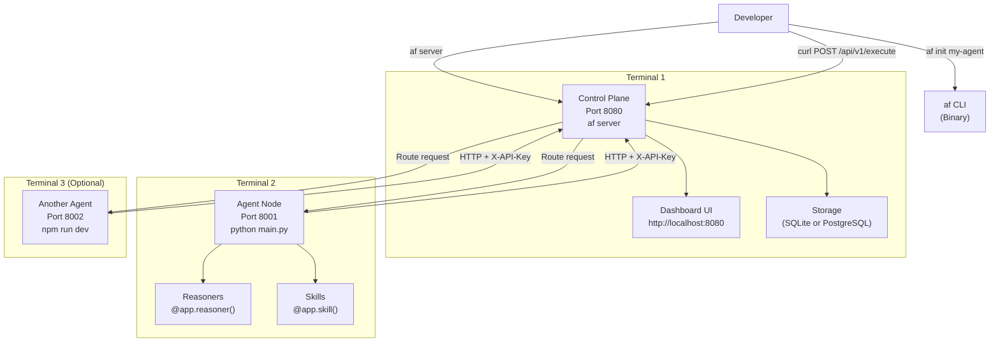
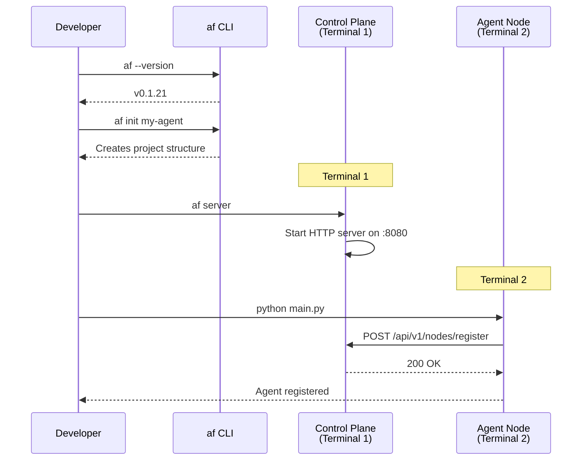

<!-- source: DeepWiki mcp.deepwiki.com · repo Agent-Field/agentfield · page 2 Getting Started · fetched 2026-10-26 -->

# Getting Started

<details>
<summary>Relevant source files</summary>

The following files were used as context for generating this wiki page:

- [.github/workflows/release.yml](.github/workflows/release.yml)
- [.goreleaser.yml](.goreleaser.yml)
- [control-plane/internal/cli/agent_commands.go](control-plane/internal/cli/agent_commands.go)
- [control-plane/internal/cli/root.go](control-plane/internal/cli/root.go)
- [control-plane/internal/cli/root_test.go](control-plane/internal/cli/root_test.go)
- [control-plane/internal/core/services/dev_service.go](control-plane/internal/core/services/dev_service.go)
- [control-plane/internal/core/services/server_url.go](control-plane/internal/core/services/server_url.go)
- [control-plane/internal/packages/server_url.go](control-plane/internal/packages/server_url.go)
- [control-plane/internal/templates/docker/docker-compose.yml.tmpl](control-plane/internal/templates/docker/docker-compose.yml.tmpl)
- [deployments/helm/agentfield/values.yaml](deployments/helm/agentfield/values.yaml)
- [deployments/kubernetes/base/control-plane-deployment.yaml](deployments/kubernetes/base/control-plane-deployment.yaml)
- [docs/RELEASE.md](docs/RELEASE.md)
- [examples/python_agent_nodes/rag_evaluation/docker-compose.yml](examples/python_agent_nodes/rag_evaluation/docker-compose.yml)
- [examples/triggers-demo/docker-compose.yml](examples/triggers-demo/docker-compose.yml)
- [scripts/bump_version.py](scripts/bump_version.py)
- [scripts/install.ps1](scripts/install.ps1)
- [scripts/install.sh](scripts/install.sh)
- [scripts/tests/__init__.py](scripts/tests/__init__.py)
- [scripts/tests/test_bump_version.py](scripts/tests/test_bump_version.py)
- [sdk/go/ai/openrouter_attribution.go](sdk/go/ai/openrouter_attribution.go)

</details>


This page provides a quick start guide for installing AgentField and running your first agent. It covers the essential steps to go from zero to a working multi-agent system in minutes.

**Scope:** This is a practical guide focused on getting AgentField running locally. For detailed installation options, see [Installation](#2.1). For a complete tutorial on building agents, see [Your First Agent](#2.2). For control plane configuration, see [Running the Control Plane](#2.3).

---

## Prerequisites

Before starting, ensure you have:

- **Operating System:** macOS (Intel or Apple Silicon), Linux (x86_64 or ARM64), or Windows [control-plane/internal/cli/root.go:74-74]()
- **For Python agents:** Python 3.9 or later [.github/workflows/release.yml:60-60]()
- **For TypeScript agents:** Node.js 20 or later [.github/workflows/release.yml:61-61]()
- **For Go agents:** Go 1.25 or later [.github/workflows/release.yml:59-59]()
- **Network:** Internet connection for downloading binaries and dependencies

---

## Architecture Overview

AgentField uses a **control plane + agent node** architecture. This is fundamentally different from monolithic agent frameworks:

### Control Plane + Agent Node Model



**Key Points:**
- **Control Plane:** Stateless Go service that routes requests, tracks workflows, and provides observability [control-plane/internal/cli/root.go:39-42]()
- **Agent Nodes:** Independent processes (Python/TypeScript/Go) that register capabilities and handle execution [control-plane/internal/cli/agent_commands.go:41-41]()
- **Discovery:** Agents auto-register with control plane via `POST /api/v1/nodes/register` [control-plane/internal/cli/agent_commands.go:129-129]()

**Sources:** [control-plane/internal/cli/root.go:34-152](), [control-plane/internal/cli/agent_commands.go:37-78]()

---

## Quick Start (5 Minutes)

### Step 1: Install the CLI

```bash
# macOS and Linux
curl -fsSL https://agentfield.ai/install.sh | bash

# Windows (PowerShell)
iwr -useb https://agentfield.ai/install.ps1 | iex
```

This installs the `af` CLI tool to `~/.agentfield/bin` [scripts/install.sh:142-142]().

**Verification:**
```bash
af --version
```

**Sources:** [scripts/install.sh:1-134](), [scripts/install.ps1:1-64](), [control-plane/internal/cli/root.go:67-78]()

### Step 2: Initialize an Agent

```bash
af init my-agent --defaults
cd my-agent
```

The `init` command creates a project structure for your agent [control-plane/internal/cli/root.go:97-97]().

### Step 3: Start the Control Plane (Terminal 1)

```bash
af server
```

**Expected output:**
```
📊 Dashboard: http://localhost:8080
```

The control plane listens on port 8080 by default [control-plane/internal/cli/root.go:86-86](), [control-plane/internal/packages/server_url.go:13-13]().

### Step 4: Start Your Agent (Terminal 2)

```bash
# Python
python main.py
```

The agent will attempt to register with the control plane at `http://localhost:8080` [control-plane/internal/packages/server_url.go:6-14]().

---

## Quick Start Workflow



**Sources:** [control-plane/internal/cli/root.go:143-149](), [control-plane/internal/cli/agent_commands.go:80-88]()

---

## Installation Options Summary

| Method | Description | Use Case |
|--------|-------------|----------|
| **Install Script** | One-line installer | Local development (recommended) [scripts/install.sh:4-6]() |
| **Staging** | Latest prerelease | Testing new features [docs/RELEASE.md:97-114]() |
| **Manual** | Raw binaries | Custom environments [docs/RELEASE.md:194-204]() |

For details, see [Installation](#2.1).

**Sources:** [docs/RELEASE.md:9-12](), [scripts/install.sh:15-43]()

---

## Common Commands Reference

| Command | Description |
|---------|-------------|
| `af --version` | Show CLI version [control-plane/internal/cli/root.go:63-63]() |
| `af init <name>` | Create new agent project [control-plane/internal/cli/root.go:97-97]() |
| `af server` | Start control plane [control-plane/internal/cli/root.go:143-143]() |
| `af server --port 9090` | Start on custom port [control-plane/internal/cli/root.go:86-86]() |
| `af server --backend-only` | Start without UI [control-plane/internal/cli/root.go:85-85]() |
| `af agent help` | Machine-friendly JSON reference [control-plane/internal/cli/root.go:42-42]() |

**Sources:** [control-plane/internal/cli/root.go:34-152]()

---

## Version Management

AgentField uses a two-tier release system:

| Environment | Version Format | Trigger |
|-------------|----------------|---------|
| **Staging** | `X.Y.Z-rc.N` | Push to main [docs/RELEASE.md:11-11]() |
| **Production** | `X.Y.Z` | Manual Dispatch [docs/RELEASE.md:12-12]() |

**Sources:** [docs/RELEASE.md:1-37](), [scripts/bump_version.py:89-118]()

---

## Next Steps

1. **[Installation](#2.1)** — Learn about advanced installation options and environment configuration.
2. **[Your First Agent](#2.2)** — Step-by-step tutorial creating a simple agent with one reasoner and one skill.
3. **[Running the Control Plane](#2.3)** — Understanding server configuration, storage modes, and the dashboard.

**Sources:** [control-plane/internal/cli/root.go:110-140]()

---

