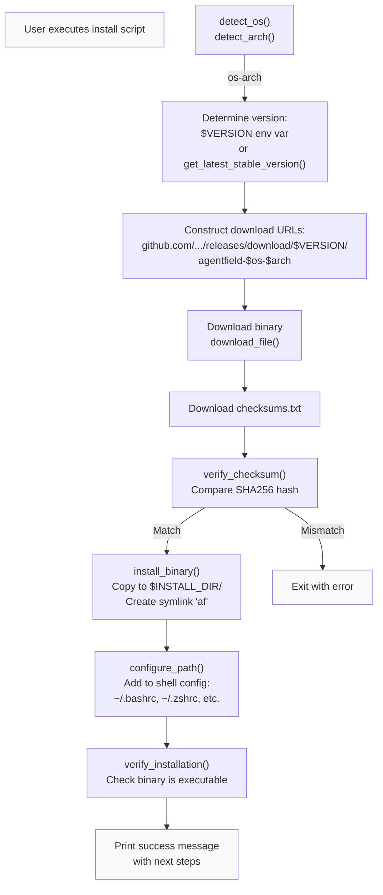
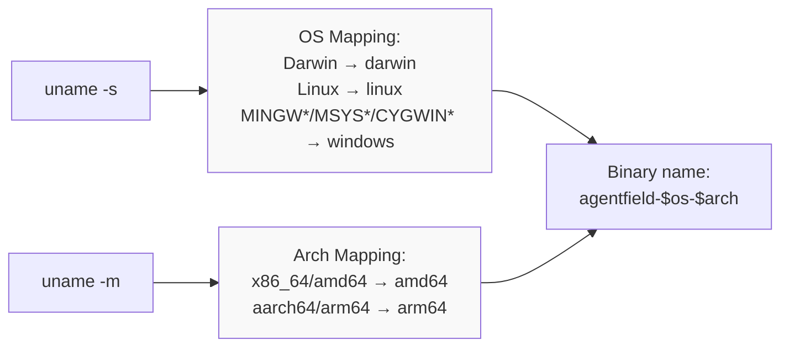
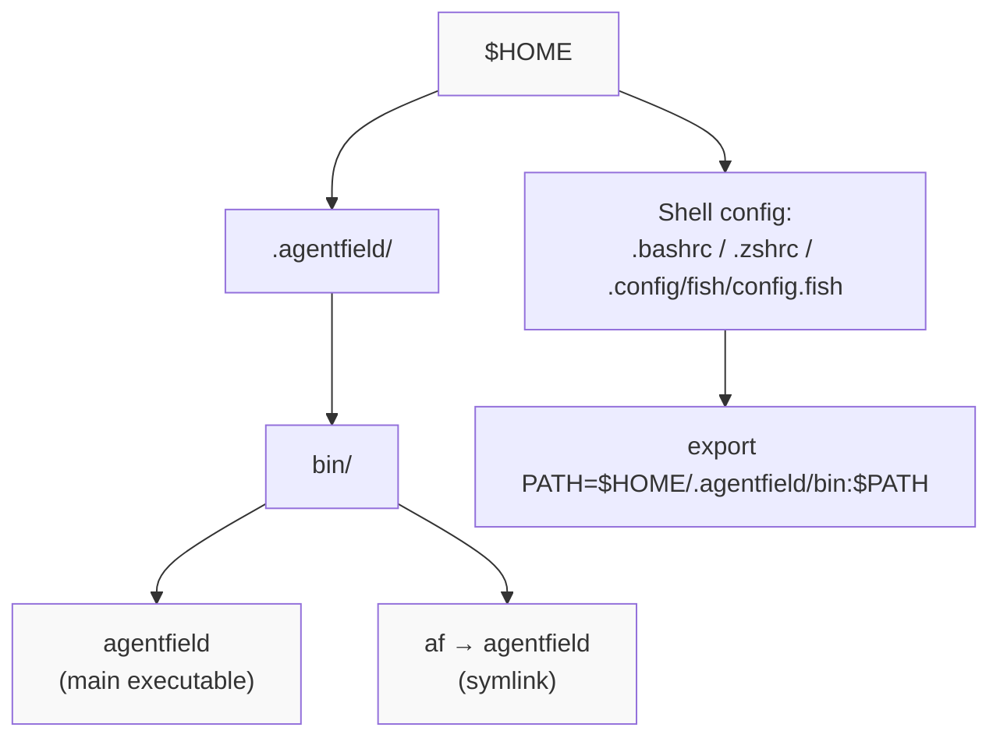
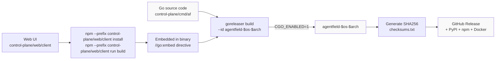

<!-- source: DeepWiki mcp.deepwiki.com · repo Agent-Field/agentfield · page 2.1 Installation · fetched 2026-10-26 -->

# Installation

<details>
<summary>Relevant source files</summary>

The following files were used as context for generating this wiki page:

- [.github/workflows/release.yml](.github/workflows/release.yml)
- [.goreleaser.yml](.goreleaser.yml)
- [control-plane/internal/templates/docker/docker-compose.yml.tmpl](control-plane/internal/templates/docker/docker-compose.yml.tmpl)
- [deployments/helm/agentfield/values.yaml](deployments/helm/agentfield/values.yaml)
- [deployments/kubernetes/base/control-plane-deployment.yaml](deployments/kubernetes/base/control-plane-deployment.yaml)
- [docs/RELEASE.md](docs/RELEASE.md)
- [examples/python_agent_nodes/rag_evaluation/docker-compose.yml](examples/python_agent_nodes/rag_evaluation/docker-compose.yml)
- [examples/triggers-demo/docker-compose.yml](examples/triggers-demo/docker-compose.yml)
- [scripts/bump_version.py](scripts/bump_version.py)
- [scripts/install.ps1](scripts/install.ps1)
- [scripts/install.sh](scripts/install.sh)
- [scripts/tests/__init__.py](scripts/tests/__init__.py)
- [scripts/tests/test_bump_version.py](scripts/tests/test_bump_version.py)
- [sdk/go/ai/openrouter_attribution.go](sdk/go/ai/openrouter_attribution.go)

</details>


This document covers the installation of the AgentField CLI tool (`af`) on your local system. The CLI tool provides commands to initialize agent projects, start the control plane server, and manage the AgentField development environment.

For guidance on creating your first agent after installation, see [Your First Agent](). For details on running the control plane server, see [Running the Control Plane]().

---

## Supported Platforms

AgentField provides pre-built binaries for the following platforms:

| Operating System | Architecture | Binary Name |
|-----------------|--------------|-------------|
| macOS | Intel (amd64) | `agentfield-darwin-amd64` |
| macOS | Apple Silicon (arm64) | `agentfield-darwin-arm64` |
| Linux | x86_64 (amd64) | `agentfield-linux-amd64` |
| Linux | ARM64 | `agentfield-linux-arm64` |
| Windows | x86_64 (amd64) | `agentfield-windows-amd64.exe` |

All binaries are statically compiled Go executables that include the embedded web UI and SQLite database support with FTS5 extensions.

Sources: [.goreleaser.yml:11-87](), [scripts/install.sh:144-193](), [scripts/install.ps1:66-83]()

---

## Quick Installation

### Unix/Linux/macOS

```bash
curl -fsSL https://agentfield.ai/install.sh | bash
```

This command downloads and executes the installation script, which:
- Detects your operating system and architecture
- Downloads the appropriate binary from GitHub Releases
- Verifies the SHA256 checksum
- Installs to `~/.agentfield/bin/`
- Creates a symlink `af` → `agentfield`
- Configures your shell's PATH

Sources: [scripts/install.sh:1-629]()

### Windows

```powershell
iwr -useb https://agentfield.ai/install.ps1 | iex
```

The PowerShell script performs similar operations:
- Detects architecture
- Downloads the Windows binary
- Verifies checksum
- Installs to `%USERPROFILE%\.agentfield\bin\`
- Creates `af.exe` hardlink or copy
- Updates user PATH environment variable

Sources: [scripts/install.ps1:1-399]()

---

## Installation Flow



**Diagram: Installation Process Flow**

The install script follows a strict verification path to ensure binary integrity before installation.

Sources: [scripts/install.sh:553-626](), [scripts/install.ps1:333-396]()

---

## Platform Detection

The installation scripts use system commands to detect the platform:



**Diagram: Platform Detection Logic**

Sources: [scripts/install.sh:143-193](), [scripts/install.ps1:66-83]()

---

## Version Management

### Production Installation (Default)

Installs the latest stable release:

```bash
curl -fsSL https://agentfield.ai/install.sh | bash
```

The script calls `get_latest_stable_version()` which queries the GitHub API:

```
GET https://api.github.com/repos/Agent-Field/agentfield/releases/latest
```

Sources: [scripts/install.sh:195-218]()

### Staging/Pre-release Installation

For testing pre-release versions:

```bash
curl -fsSL https://agentfield.ai/install.sh | bash -s -- --staging
```

This installs to a separate directory (`~/.agentfield-staging/bin`) and creates an `af-staging` symlink, allowing both production and staging versions to coexist.

The script calls `get_latest_prerelease_version()` to find the most recent pre-release from:

```
GET https://api.github.com/repos/Agent-Field/agentfield/releases
```

Sources: [scripts/install.sh:220-259](), [scripts/install.sh:34-82]()

### Version Pinning

To install a specific version:

```bash
VERSION=v0.1.21 curl -fsSL https://agentfield.ai/install.sh | bash
```

Sources: [docs/RELEASE.md:196-199]()

---

## Installation Artifacts

After successful installation, the following files exist on the filesystem:



**Diagram: Filesystem Layout After Installation**

### File Locations

| Component | Production Path | Staging Path |
|-----------|----------------|--------------|
| Install directory | `~/.agentfield/bin/` | `~/.agentfield-staging/bin/` |
| Main executable | `~/.agentfield/bin/agentfield` | `~/.agentfield-staging/bin/agentfield` |
| Symlink | `~/.agentfield/bin/af` | `~/.agentfield-staging/bin/af-staging` |
| PATH entry | Added to shell config | Added to shell config |

Sources: [scripts/install.sh:74-82](), [scripts/install.sh:347-384]()

---

## Checksum Verification

The installation script verifies binary integrity before installation:

1. Downloads `checksums.txt` from the release
2. Extracts the expected SHA256 hash for the platform-specific binary
3. Computes the actual SHA256 hash of the downloaded binary using `sha256sum` or `shasum -a 256`
4. Compares hashes and aborts installation if they don't match

Example `checksums.txt` format:

```
a1b2c3d4e5f6...  agentfield-darwin-amd64
f6e5d4c3b2a1...  agentfield-darwin-arm64
1a2b3c4d5e6f...  agentfield-linux-amd64
...
```

Sources: [scripts/install.sh:292-344](), [scripts/install.ps1:136-186]()

---

## PATH Configuration

The install script automatically configures your shell's PATH by detecting the shell type and modifying the appropriate configuration file:

| Shell | Config File |
|-------|-------------|
| bash | `~/.bashrc` (Linux) or `~/.bash_profile` (macOS) |
| zsh | `~/.zshrc` |
| fish | `~/.config/fish/config.fish` |

The script appends:

```bash
# AgentField CLI
export PATH="$HOME/.agentfield/bin:$PATH"
```

For staging installations, it uses the comment `# AgentField CLI (STAGING)`.

If the install directory is already in PATH, the script skips this step.

Sources: [scripts/install.sh:387-458]()

---

## Post-Installation

### Verification

After installation, reload your shell configuration:

```bash
source ~/.bashrc  # or ~/.zshrc, etc.
```

Verify the installation:

```bash
af --version
```

This should display version information from the `NewRootCommand()` function with embedded build metadata.

Sources: [scripts/install.sh:460-482]()

### Environment Variables

The installation process respects the following environment variables:

| Variable | Purpose | Default |
|----------|---------|---------|
| `VERSION` | Pin to specific version | `latest` |
| `STAGING` | Install staging release | `0` (false) |
| `AGENTFIELD_INSTALL_DIR` | Custom install directory | `~/.agentfield/bin` |
| `SKIP_PATH_CONFIG` | Skip PATH modification | `0` (false) |
| `VERBOSE` | Enable verbose output | `0` (false) |

Example:

```bash
VERBOSE=1 AGENTFIELD_INSTALL_DIR=/usr/local/bin curl -fsSL https://agentfield.ai/install.sh | bash
```

Sources: [scripts/install.sh:10-17](), [scripts/install.ps1:9-12]()

---

## Manual Installation

If you prefer not to use the automated installation script:

1. **Download the binary** from GitHub Releases. The release page provides installation instructions including manual download links. For example, to get `v0.1.21`:
   ```bash
   wget https://github.com/Agent-Field/agentfield/releases/download/v0.1.21/agentfield-linux-amd64
   ```

2. **Verify the checksum**:
   ```bash
   wget https://github.com/Agent-Field/agentfield/releases/download/v0.1.21/checksums.txt
   sha256sum -c checksums.txt --ignore-missing
   ```

3. **Make executable and move to PATH**:
   ```bash
   chmod +x agentfield-linux-amd64
   mv agentfield-linux-amd64 /usr/local/bin/agentfield
   ln -s /usr/local/bin/agentfield /usr/local/bin/af
   ```

Sources: [.goreleaser.yml:181-204](), [docs/RELEASE.md:190-192]()

---

## Binary Build Process

The AgentField CLI binary is built using GoReleaser in a multi-stage GitHub Actions workflow:



**Diagram: Binary Build Pipeline**

Key build details:

- **Build tags**: `embedded`, `sqlite_fts5` enable embedded UI and full-text search
- **CGO**: Required for SQLite (set to `1`)
- **Cross-compilation**: Uses `aarch64-linux-gnu-gcc` for ARM64 on Linux
- **Embed web UI**: Built via `npm run build` in `control-plane/web/client/`
- **ldflags**: Inject version info with `-X main.version={{ .Version }}`

Sources: [.goreleaser.yml:1-88](), [.github/workflows/release.yml:191-280]()

---

## Uninstallation

To remove AgentField:

1. **Remove the binary directory**:
   ```bash
   rm -rf ~/.agentfield
   ```

2. **Remove PATH entry** from your shell configuration file:
   ```bash
   # Edit ~/.bashrc, ~/.zshrc, etc. and remove the AgentField CLI lines
   ```

3. **Optionally, remove configuration**:
   ```bash
   rm -rf ~/.config/agentfield  # if it exists
   ```

Sources: [scripts/install.sh:387-458]()

---

## Troubleshooting

### Issue: Checksum Verification Failed

**Error message:**
```
[ERROR] Checksum verification failed!
Expected: a1b2c3d4...
Got:      f6e5d4c3...
```

**Cause:** Corrupted download or network interruption.

**Solution:** Run the install script again. The script downloads to a temporary directory and cleans up on failure.

Sources: [scripts/install.sh:292-344]()

### Issue: Command Not Found After Installation

**Error message:**
```
bash: af: command not found
```

**Cause:** PATH not updated in current shell session.

**Solution:**
```bash
source ~/.bashrc  # or ~/.zshrc
# OR restart your terminal
```

Sources: [scripts/install.sh:453-458]()

### Issue: Permission Denied on macOS

**Error message:**
```
"agentfield" cannot be opened because the developer cannot be verified
```

**Cause:** macOS Gatekeeper quarantine attribute.

**Solution:** The install script automatically removes this attribute using `xattr -d com.apple.quarantine`. If it persists, manually run:
```bash
xattr -d com.apple.quarantine ~/.agentfield/bin/agentfield
```

Sources: [scripts/install.sh:369-377]()

### Issue: No Pre-release Found

**Error message:**
```
[ERROR] No prerelease version found
```

**Cause:** Attempting to install staging release when none exists.

**Solution:** Install a specific staging version:
```bash
VERSION=v0.1.19-rc.1 curl -fsSL https://agentfield.ai/install.sh | bash -s -- --staging
```

Sources: [scripts/install.sh:247-256]()

---

## Configuration File

While the CLI itself does not require a configuration file for basic operation, the control plane server can use a configuration file specified via the `--config` flag:

```bash
af --config /path/to/agentfield.yaml server
```

The configuration file path is stored in the `cfgFile` variable and accessed via `GetConfigFilePath()`.

Sources: []()

---

## Next Steps

After successful installation:

1. **Initialize your first agent project**: See [Your First Agent]().
2. **Start the control plane**: See [Running the Control Plane]().
3. **Explore SDK options**: See [Python SDK](), [TypeScript SDK](), or [Go SDK]().

Sources: []()

---

