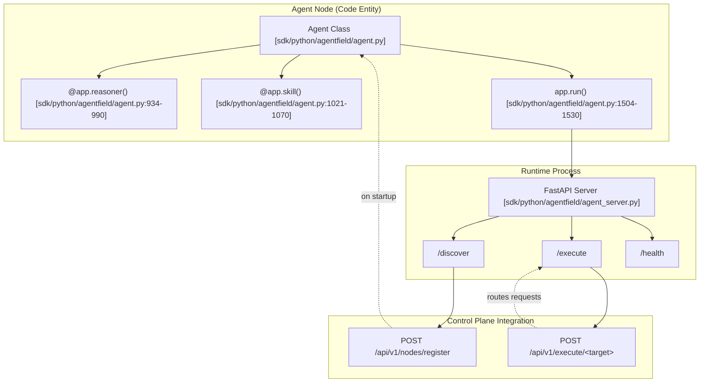
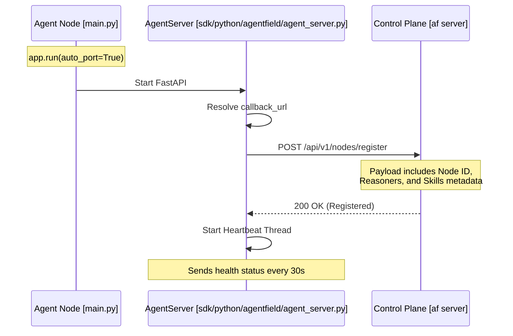

<!-- source: DeepWiki mcp.deepwiki.com · repo Agent-Field/agentfield · page 2.2 Your First Agent · fetched 2026-10-26 -->

# Your First Agent

<details>
<summary>Relevant source files</summary>

The following files were used as context for generating this wiki page:

- [control-plane/internal/cli/init.go](control-plane/internal/cli/init.go)
- [control-plane/internal/cli/init_test.go](control-plane/internal/cli/init_test.go)
- [control-plane/internal/templates/go/README.md.tmpl](control-plane/internal/templates/go/README.md.tmpl)
- [control-plane/internal/templates/python/README.md.tmpl](control-plane/internal/templates/python/README.md.tmpl)
- [control-plane/internal/templates/typescript/README.md.tmpl](control-plane/internal/templates/typescript/README.md.tmpl)
- [control-plane/tools/perf/nested_workflow_stress.py](control-plane/tools/perf/nested_workflow_stress.py)
- [deployments/README.md](deployments/README.md)
- [examples/README.md](examples/README.md)
- [examples/python_agent_nodes/hello_world/main.py](examples/python_agent_nodes/hello_world/main.py)
- [examples/python_agent_nodes/image_generation_hello_world/README.md](examples/python_agent_nodes/image_generation_hello_world/README.md)
- [examples/python_agent_nodes/rag_evaluation/README.md](examples/python_agent_nodes/rag_evaluation/README.md)
- [scripts/seed_workflows.py](scripts/seed_workflows.py)
- [sdk/python/agentfield/agent_cli.py](sdk/python/agentfield/agent_cli.py)

</details>


This page guides you through creating your first AgentField agent from scratch. You'll learn how to define reasoners (AI-powered functions) and skills (deterministic functions), start an agent server, and execute capabilities through the control plane.

**Prerequisites**: Complete [Installation](2.1) before proceeding. For information about starting and configuring the control plane, see [Running the Control Plane](2.3).

---

## Overview

An AgentField agent is a Python (FastAPI), TypeScript (Express), or Go HTTP server that:
1. Registers its capabilities (reasoners and skills) with the control plane on startup.
2. Exposes HTTP endpoints for execution.
3. Integrates with memory, identity, and workflow systems automatically.

This page demonstrates the minimal code required to create a working agent and execute its capabilities.

---

## Agent Anatomy

### Basic Structure

**Python Agent Structure:**



**Sources:** [sdk/python/agentfield/agent.py:311-559](), [sdk/python/agentfield/agent.py:934-990](), [sdk/python/agentfield/agent.py:1021-1070](), [sdk/python/agentfield/agent.py:1504-1530]()

---

## Step 1: Create the Agent Project

You can initialize a project manually or use the `af init` command, which provides an interactive setup flow.

```bash
af init my-first-agent
```

The `af init` command (implemented in `control-plane/internal/cli/init.go`) will prompt you for the language (Python, TypeScript, or Go), author name, and email [control-plane/internal/cli/init.go:169-201]().

For this tutorial, create a file called `main.py`:

```python
import os
from agentfield import Agent, AIConfig
from pydantic import BaseModel

# Initialize agent
app = Agent(
    node_id="hello-world",
    agentfield_server=os.getenv("AGENTFIELD_URL", "http://localhost:8080"),
    ai_config=AIConfig(
        model="openai/gpt-4o-mini", 
        temperature=0.7
    ),
)

# ============= SKILL (DETERMINISTIC) =============
@app.skill()
def get_greeting(name: str) -> dict:
    """Returns a greeting template (deterministic - no AI)"""
    return {"message": f"Hello, {name}! Welcome to Agentfield."}

# ============= REASONERS (AI-POWERED) =============
class EmojiResult(BaseModel):
    """Simple schema for emoji addition"""
    text: str
    emoji: str

@app.reasoner()
async def add_emoji(text: str) -> EmojiResult:
    """Uses AI to add an appropriate emoji to text"""
    return await app.ai(
        user=f"Add one appropriate emoji to this greeting: {text}", 
        schema=EmojiResult
    )

@app.reasoner()
async def say_hello(name: str) -> dict:
    """Main entry point - orchestrates skill and reasoner."""
    # Step 1: Get greeting from skill (deterministic)
    greeting = get_greeting(name)

    # Step 2: Add emoji using AI (reasoner)
    result = await add_emoji(greeting["message"])

    return {"greeting": result.text, "emoji": result.emoji, "name": name}

if __name__ == "__main__":
    app.run(auto_port=True)
```

**Sources:** [examples/python_agent_nodes/hello_world/main.py:1-79](), [control-plane/internal/cli/init.go:169-201]()

---

## Step 2: Understanding the Code

### Agent Initialization

The `Agent` constructor performs these key initializations:

| Component | Purpose | File Reference |
|-----------|---------|----------------|
| `node_id` | Unique identifier for this agent node (e.g., "hello-world") | [examples/python_agent_nodes/hello_world/main.py:17]() |
| `agentfield_server` | URL of the control plane (default: http://localhost:8080) | [examples/python_agent_nodes/hello_world/main.py:18]() |
| `ai_config` | LLM configuration, using `AIConfig` to specify model and parameters | [examples/python_agent_nodes/hello_world/main.py:19-21]() |

### Reasoners vs. Skills

AgentField distinguishes between AI-driven reasoning and deterministic logic:

*   **Skills (`@app.skill()`)**: Used for deterministic functions. They do not have direct access to `app.ai()` and are intended for tools, API calls, or simple data transformations [examples/python_agent_nodes/hello_world/main.py:27-30]().
*   **Reasoners (`@app.reasoner()`)**: AI-powered functions. They can use `await app.ai()` to interact with LLMs and can return structured data using Pydantic models like `EmojiResult` [examples/python_agent_nodes/hello_world/main.py:43-49]().

### The Call Graph

In the example above, `say_hello` acts as an orchestrator. It calls a local skill and another local reasoner. AgentField automatically tracks this call graph as a workflow [examples/python_agent_nodes/hello_world/main.py:52-67]().

---

## Step 3: Agent Registration Flow

When you call `app.run()`, the agent starts a heartbeat and registers its capabilities with the control plane.



**Sources:** [sdk/python/agentfield/agent.py:1504-1530](), [examples/python_agent_nodes/hello_world/main.py:78]()

---

## Step 4: Starting and Testing

### 1. Start Control Plane
In your first terminal:
```bash
af server
```

### 2. Start Your Agent
In your second terminal:
```bash
export OPENAI_API_KEY="sk-..."
python main.py
```

### 3. Execute via CLI
The Python SDK includes an `AgentCLI` handler that allows you to run functions directly from the terminal for testing [sdk/python/agentfield/agent_cli.py:18-28]().

```bash
python main.py say_hello --name "Alice"
```

### 4. Execute via Control Plane (REST)
You can trigger the agent through the control plane's execution gateway:

```bash
curl -X POST http://localhost:8080/api/v1/execute/hello-world.say_hello \
  -H "Content-Type: application/json" \
  -d '{"input": {"name": "Alice"}}'
```

**Sources:** [examples/python_agent_nodes/hello_world/main.py:72-78](), [sdk/python/agentfield/agent_cli.py:204-209](), [control-plane/internal/templates/python/README.md.tmpl:27-31]()

---

## Multi-Provider Support

AgentField allows you to switch between AI providers with zero code changes by modifying the `model` string in `AIConfig` or environment variables.

| Provider | Model Example | Prefix |
|----------|--------------|--------|
| **LiteLLM** | `gpt-4o`, `anthropic/claude-3-opus` | (Default or provider/) |
| **OpenRouter** | `openrouter/google/gemini-2.0-flash` | `openrouter/` |

**Example switching via Environment:**
```bash
# Use GPT-4o-mini (OpenAI)
export SMALL_MODEL="openai/gpt-4o-mini"

# Use Gemini (via OpenRouter)
export SMALL_MODEL="openrouter/google/gemini-2.0-flash"
```

**Sources:** [examples/python_agent_nodes/image_generation_hello_world/README.md:19-31](), [examples/python_agent_nodes/hello_world/main.py:20]()

---

## Next Steps

Now that you have created a basic agent, you can explore more advanced patterns:

1.  **Organizing with Routers**: Use `AgentRouter` to split capabilities across multiple files [control-plane/internal/templates/python/README.md.tmpl:50-52]().
2.  **Using Memory**: Access `app.memory` to store state across executions.
3.  **Image Generation**: Use `app.ai_with_vision()` for multimodal tasks [examples/python_agent_nodes/image_generation_hello_world/README.md:173-178]().
4.  **Verifiable Credentials**: Enable cryptographic proof of execution [examples/README.md:18]().

---

