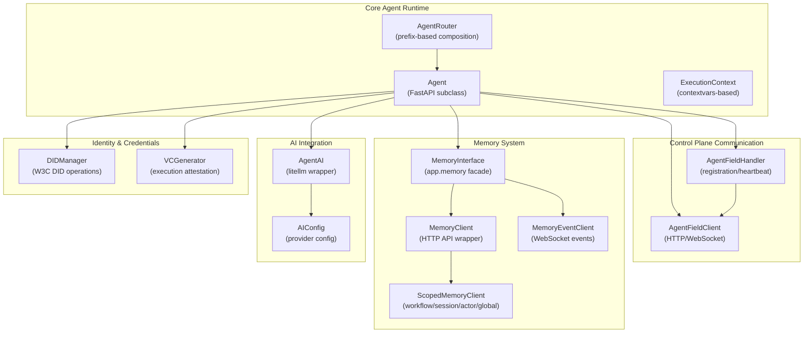
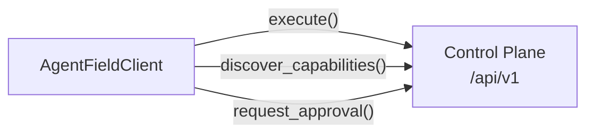
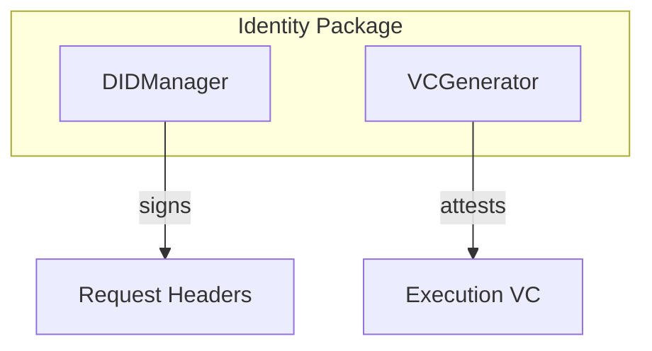

<!-- source: DeepWiki mcp.deepwiki.com · repo Agent-Field/agentfield · page 3 Python SDK · fetched 2026-10-26 -->

# Python SDK

<details>
<summary>Relevant source files</summary>

The following files were used as context for generating this wiki page:

- [CHANGELOG.md](CHANGELOG.md)
- [VERSION](VERSION)
- [control-plane/internal/handlers/execute_awaiter_status.go](control-plane/internal/handlers/execute_awaiter_status.go)
- [control-plane/internal/handlers/execute_awaiter_status_test.go](control-plane/internal/handlers/execute_awaiter_status_test.go)
- [control-plane/internal/templates/go/go.mod.tmpl](control-plane/internal/templates/go/go.mod.tmpl)
- [examples/python_agent_nodes/agentic_rag/requirements.txt](examples/python_agent_nodes/agentic_rag/requirements.txt)
- [examples/python_agent_nodes/documentation_chatbot/requirements.txt](examples/python_agent_nodes/documentation_chatbot/requirements.txt)
- [examples/python_agent_nodes/hello_world_rag/requirements.txt](examples/python_agent_nodes/hello_world_rag/requirements.txt)
- [sdk/python/CHANGELOG.md](sdk/python/CHANGELOG.md)
- [sdk/python/agentfield/__init__.py](sdk/python/agentfield/__init__.py)
- [sdk/python/agentfield/agent.py](sdk/python/agentfield/agent.py)
- [sdk/python/agentfield/async_execution_manager.py](sdk/python/agentfield/async_execution_manager.py)
- [sdk/python/agentfield/client.py](sdk/python/agentfield/client.py)
- [sdk/python/agentfield/exceptions.py](sdk/python/agentfield/exceptions.py)
- [sdk/python/agentfield/execution_state.py](sdk/python/agentfield/execution_state.py)
- [sdk/python/pyproject.toml](sdk/python/pyproject.toml)
- [sdk/python/tests/test_agent_call.py](sdk/python/tests/test_agent_call.py)
- [sdk/python/tests/test_agent_coverage_additions.py](sdk/python/tests/test_agent_coverage_additions.py)
- [sdk/python/tests/test_async_config.py](sdk/python/tests/test_async_config.py)
- [sdk/python/tests/test_async_execution.py](sdk/python/tests/test_async_execution.py)
- [sdk/python/tests/test_client_laser_push.py](sdk/python/tests/test_client_laser_push.py)
- [sdk/python/tests/test_execution_logger.py](sdk/python/tests/test_execution_logger.py)
- [sdk/python/tests/test_execution_state.py](sdk/python/tests/test_execution_state.py)
- [sdk/typescript/package.json](sdk/typescript/package.json)

</details>


The Python SDK (`agentfield`) provides a FastAPI-based framework for building AI agent nodes that integrate with the AgentField control plane. This SDK handles agent registration, reasoner/skill definitions, memory management, cross-agent communication, and optional identity/credential systems.

For TypeScript development, see [TypeScript SDK](#4). For Go development, see [Go SDK](#5). For control plane configuration, see [Control Plane](#6).

---

## Package Structure

The Python SDK is distributed via PyPI as `agentfield` and provides a FastAPI-based agent runtime with automatic registration, memory scoping, and multi-provider AI integration.



**Sources:** [sdk/python/agentfield/__init__.py:1-90](), [sdk/python/agentfield/agent.py:1-76]()

---

## Installation

Install via pip from PyPI:

```bash
pip install agentfield
```

For development or specific harness capabilities:

```bash
# Development tools
pip install agentfield[dev]

# Harness for autonomous coding (Claude)
pip install agentfield[harness-claude]
```

| Dependency | Purpose | Required |
|------------|---------|----------|
| `fastapi` | HTTP API server framework | Yes |
| `uvicorn` | ASGI server | Yes |
| `requests` | Synchronous HTTP client | Yes |
| `pydantic>=2.0` | Data validation | Yes |
| `litellm` | Multi-provider AI integration | Yes |
| `psutil` | System metrics | Yes |
| `PyYAML>=6.0` | Configuration parsing | Yes |
| `aiohttp>=3.8` | Async HTTP operations | Yes |
| `websockets` | Memory event subscriptions | Yes |
| `cryptography` | DID and crypto operations | Yes |

**Sources:** [sdk/python/pyproject.toml:27-40](), [sdk/python/pyproject.toml:53-85]()

---

## Agent Class

The `Agent` class is the primary entry point for building agent nodes. It inherits from `FastAPI` to provide HTTP endpoints and integrates with the control plane for distributed workflows.

For details, see [Agent Class](#3.1).

### Initialization

```python
from agentfield import Agent

app = Agent(
    node_id="my_agent",
    agentfield_server="http://localhost:8080",
    version="1.0.0",
    auto_register=True,
    vc_enabled=True
)
```

| Parameter | Type | Description |
|-----------|------|-------------|
| `node_id` | `str` | Unique identifier for routing |
| `agentfield_server` | `str` | Control plane URL |
| `version` | `str` | Agent version string |
| `auto_register` | `bool` | Auto-register in serverless mode |
| `vc_enabled` | `bool` | Enable verifiable credentials |

**Sources:** [sdk/python/agentfield/agent.py:311-441]()

---

## Defining Reasoners

Reasoners are AI-powered functions that can make decisions, analyze data, or generate content. They are registered via the `@app.reasoner()` decorator.

For details, see [Defining Reasoners](#3.2).

```python
@app.reasoner(
    name="analyze_sentiment",
    tags=["nlp", "sentiment"]
)
async def analyze_sentiment(text: str) -> dict:
    result = await app.ai(
        prompt=f"Analyze the sentiment of: {text}",
        response_model={"sentiment": "str", "confidence": "float"}
    )
    return result
```

**Sources:** [sdk/python/agentfield/agent.py:113-133](), [sdk/python/agentfield/__init__.py:81]()

---

## Defining Skills

Skills are deterministic, non-AI functions for data transformation, API calls, or system operations. They represent the "tools" an agent can use.

For details, see [Defining Skills](#3.3).

```python
@app.skill(name="fetch_url")
def fetch_url(url: str) -> str:
    import requests
    return requests.get(url).text
```

**Sources:** [sdk/python/agentfield/agent.py:135-144]()

---

## AgentRouter

`AgentRouter` enables modular agent composition by organizing capabilities under path prefixes, similar to FastAPI's APIRouter.

For details, see [AgentRouter](#3.4).

```python
from agentfield import AgentRouter
router = AgentRouter(prefix="tools")

@router.skill()
def calculator(a: int, b: int) -> int:
    return a + b

app.include_router(router)
```

**Sources:** [sdk/python/agentfield/router.py:1-200]()

---

## Client & Communication

`AgentFieldClient` handles communication with the control plane, including discovery and execution of other agents.

For details, see [Client & Communication](#3.5).



**Sources:** [sdk/python/agentfield/client.py:142-218]()

---

## Memory Interface

The memory system provides hierarchical key-value storage with multiple scopes: workflow, session, actor, and global.

For details, see [Memory Interface](#3.6).

```python
@app.reasoner()
async def remember_user(name: str):
    # Scoped automatically to current session
    await app.memory.set("user_name", name)
```

**Sources:** [sdk/python/agentfield/memory.py:1-700]()

---

## DID & Verifiable Credentials

AgentField uses W3C Decentralized Identifiers (DIDs) for cryptographic identity and Verifiable Credentials (VCs) for execution attestation.

For details, see [DID & Verifiable Credentials](#3.7).



**Sources:** [sdk/python/agentfield/did_manager.py:1-338](), [sdk/python/agentfield/vc_generator.py:1-400]()

---

## Serverless Mode

Agents can run in serverless environments (AWS Lambda, etc.) using `handle_serverless()` to wrap the agent's logic.

For details, see [Serverless Mode](#3.8).

```python
def lambda_handler(event, context):
    return app.handle_serverless(event)
```

**Sources:** [sdk/python/agentfield/agent.py:578-769]()

---

