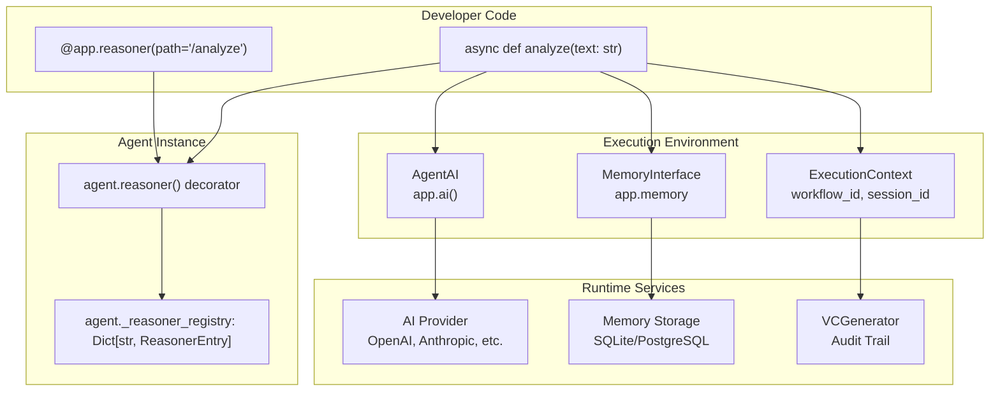
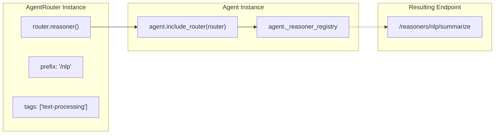

<!-- source: DeepWiki mcp.deepwiki.com · repo Agent-Field/agentfield · page 3.2 Defining Reasoners · fetched 2026-10-26 -->

# Defining Reasoners

<details>
<summary>Relevant source files</summary>

The following files were used as context for generating this wiki page:

- [control-plane/internal/handlers/execute_awaiter_status.go](control-plane/internal/handlers/execute_awaiter_status.go)
- [control-plane/internal/handlers/execute_awaiter_status_test.go](control-plane/internal/handlers/execute_awaiter_status_test.go)
- [sdk/python/agentfield/agent.py](sdk/python/agentfield/agent.py)
- [sdk/python/agentfield/async_execution_manager.py](sdk/python/agentfield/async_execution_manager.py)
- [sdk/python/agentfield/client.py](sdk/python/agentfield/client.py)
- [sdk/python/agentfield/decorator_metadata.py](sdk/python/agentfield/decorator_metadata.py)
- [sdk/python/agentfield/decorators.py](sdk/python/agentfield/decorators.py)
- [sdk/python/agentfield/exceptions.py](sdk/python/agentfield/exceptions.py)
- [sdk/python/agentfield/execution_state.py](sdk/python/agentfield/execution_state.py)
- [sdk/python/agentfield/router.py](sdk/python/agentfield/router.py)
- [sdk/python/tests/test_accepts_webhook.py](sdk/python/tests/test_accepts_webhook.py)
- [sdk/python/tests/test_agent_call.py](sdk/python/tests/test_agent_call.py)
- [sdk/python/tests/test_agent_coverage_additions.py](sdk/python/tests/test_agent_coverage_additions.py)
- [sdk/python/tests/test_async_config.py](sdk/python/tests/test_async_config.py)
- [sdk/python/tests/test_async_execution.py](sdk/python/tests/test_async_execution.py)
- [sdk/python/tests/test_client_laser_push.py](sdk/python/tests/test_client_laser_push.py)
- [sdk/python/tests/test_decorator_code_origin.py](sdk/python/tests/test_decorator_code_origin.py)
- [sdk/python/tests/test_execution_state.py](sdk/python/tests/test_execution_state.py)
- [sdk/python/tests/test_router.py](sdk/python/tests/test_router.py)
- [sdk/python/tests/test_trigger_param_binding.py](sdk/python/tests/test_trigger_param_binding.py)
- [sdk/python/tests/test_workflow_parent_child.py](sdk/python/tests/test_workflow_parent_child.py)

</details>


## Purpose and Scope

This document describes how to define **reasoners** in the Python SDK using the `@app.reasoner()` decorator. Reasoners are AI-powered functions that leverage large language models (LLMs) to perform intelligent reasoning tasks such as analysis, summarization, classification, and generation. They form the core cognitive capabilities of an AgentField agent.

For information about deterministic functions without AI capabilities, see [Defining Skills](3.3). For the underlying Agent class initialization and configuration, see [Agent Class](3.1). For accessing memory within reasoners, see [Memory Interface](3.6).

---

## What is a Reasoner?

A **reasoner** is a function decorated with `@app.reasoner()` that has access to AI models, memory, and execution context. Reasoners are registered with the AgentField control plane during agent startup and can be invoked via the execution gateway by other agents or external clients.

**Key Characteristics:**
- **AI-Powered**: Access to LLMs via `app.ai()` for intelligent reasoning.
- **Stateful**: Access to persistent memory via `app.memory`.
- **Context-Aware**: Access to execution metadata via `app.ctx`.
- **Schema-Validated**: Automatic input validation using Pydantic models [sdk/python/agentfield/agent.py:113-133]().
- **Triggerable**: Can be bound to external events or schedules [sdk/python/agentfield/decorators.py:88-123]().

**Diagram: Reasoner Architecture**


**Sources:** [sdk/python/agentfield/agent.py:113-133](), [sdk/python/agentfield/agent.py:1081-1239](), [sdk/python/agentfield/decorators.py:77-170]()

---

## Basic Reasoner Definition

### Minimal Example

The simplest reasoner requires only a function decorated with `@app.reasoner()`:

```python
from agentfield import Agent

app = Agent(node_id="analyst")

@app.reasoner()
async def summarize_document(text: str) -> str:
    """Summarize the given text into 3 key points."""
    result = await app.ai(
        prompt=f"Summarize this text into 3 key points:\n\n{text}"
    )
    return result
```

### Decorator Parameters

The `@app.reasoner()` decorator accepts several configuration parameters to control behavior and metadata:

| Parameter | Type | Default | Description |
|-----------|------|---------|-------------|
| `path` | `str` | `None` | Custom API endpoint path for the reasoner [sdk/python/agentfield/decorators.py:115](). |
| `tags` | `List[str]` | `[]` | Tags for grouping and authorization [sdk/python/agentfield/decorators.py:116](). |
| `description` | `str` | Docstring | Human-readable description [sdk/python/agentfield/decorators.py:117](). |
| `triggers` | `List[Trigger]` | `None` | Typed bindings for events/schedules [sdk/python/agentfield/decorators.py:111-114](). |
| `vc_enabled` | `bool` | `None` | Override agent-level VC generation [sdk/python/agentfield/agent.py:124](). |
| `accepts_webhook`| `bool \| str`| `"warn"` | Controls if UI-managed triggers can invoke this [sdk/python/agentfield/agent.py:130](). |

**Sources:** [sdk/python/agentfield/agent.py:113-133](), [sdk/python/agentfield/decorators.py:77-170]()

---

## Triggers and Webhooks

Reasoners can be automatically invoked by the control plane based on external events or cron schedules.

### Event and Schedule Triggers

You can define triggers directly in the decorator or using "sugar" decorators:

```python
from agentfield import on_event, on_schedule

@app.reasoner()
@on_schedule("0 9 * * *") # Every day at 9 AM
async def daily_report(trigger=None):
    # 'trigger' receives a TriggerContext object
    pass

@app.reasoner()
@on_event("github", types=["push"])
async def handle_push(event: dict, trigger=None):
    # 'event' is the payload, 'trigger' is the context
    pass
```

### Parameter Binding Contract
When a trigger fires, the runtime follows a specific binding contract:
1. **Payload**: Bound to the first parameter that is NOT `trigger`, `webhook`, or `execution_context` [sdk/python/tests/test_trigger_param_binding.py:22-25]().
2. **Context**: Bound to parameters named `trigger` or `webhook` [sdk/python/tests/test_trigger_param_binding.py:16-20]().

**Sources:** [sdk/python/agentfield/decorators.py:172-208](), [sdk/python/tests/test_trigger_param_binding.py:1-31]()

---

## Accessing Execution Context

The `app.ctx` property provides access to the current `ExecutionContext`. This is vital for multi-agent workflows where tracking parentage is required.

```python
@app.reasoner()
async def process_task(data: str):
    ctx = app.ctx
    print(f"Workflow: {ctx.workflow_id}")
    print(f"Execution: {ctx.execution_id}")
    
    # Check if this was called by another agent
    if ctx.parent_execution_id:
        print(f"Called by: {ctx.parent_workflow_id}")
```

**Sources:** [sdk/python/agentfield/execution_context.py:37-42](), [sdk/python/agentfield/agent.py:918-959]()

---

## Organizing with AgentRouter

For large agents, use `AgentRouter` to group reasoners by prefix and tags, similar to FastAPI's `APIRouter`.

```python
from agentfield import AgentRouter

router = AgentRouter(prefix="/nlp", tags=["text-processing"])

@router.reasoner(path="/summarize")
async def summarize(text: str):
    return "..."

app.include_router(router)
```

**Diagram: Router to Agent Mapping**


**Sources:** [sdk/python/agentfield/router.py:17-27](), [sdk/python/agentfield/router.py:30-86](), [sdk/python/agentfield/router.py:165-201]()

---

## Async Execution and Timeouts

By default, reasoners support asynchronous execution. If a reasoner takes a long time, the SDK can manage polling and status updates via the `AsyncExecutionManager` [sdk/python/agentfield/async_execution_manager.py:185-198]().

### Active vs. Wall-clock Timeouts
AgentField distinguishes between **active work** and **paused time** (e.g., waiting for human approval).
- **Active Timeout**: Bounded by `default_execution_timeout`. If the reasoner is doing CPU/IO work past this, it times out [sdk/python/tests/test_async_execution.py:195-198]().
- **Pause Clock**: When `app.pause()` is called, the timeout "clock" stops, so human response time doesn't consume the execution budget [sdk/python/tests/test_async_execution.py:96-104]().

### Reporting Failure
If a reasoner encounters a domain-level failure (e.g., "Budget Exhausted"), it should raise `ReasonerFailed`. This allows the agent to return a structured `result` even while marking the execution as `failed` [sdk/python/agentfield/exceptions.py:36-60]().

```python
from agentfield.exceptions import ReasonerFailed

@app.reasoner()
async def expensive_op():
    if budget < 0:
        raise ReasonerFailed("Out of credits", result={"partial": "data"})
```

**Sources:** [sdk/python/agentfield/async_execution_manager.py:185-198](), [sdk/python/agentfield/exceptions.py:36-60](), [sdk/python/tests/test_async_execution.py:96-111]()

---

## Verifiable Credentials (VCs)

Reasoners can generate VCs to provide a cryptographic audit trail of the reasoning process. This is controlled by the `vc_enabled` flag in the `ReasonerEntry` [sdk/python/agentfield/agent.py:124]().

- **Input Hashing**: The reasoner's input arguments are hashed.
- **Output Hashing**: The result is hashed.
- **Signature**: The agent signs the transition using its DID private key.

**Sources:** [sdk/python/agentfield/agent.py:113-133](), [sdk/python/agentfield/vc_generator.py]()

---

