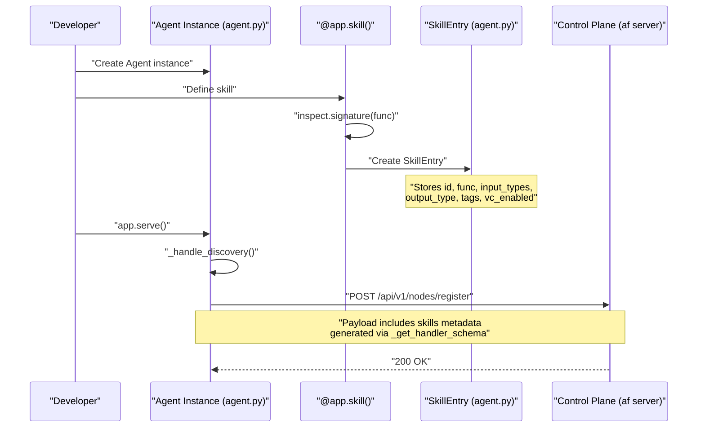
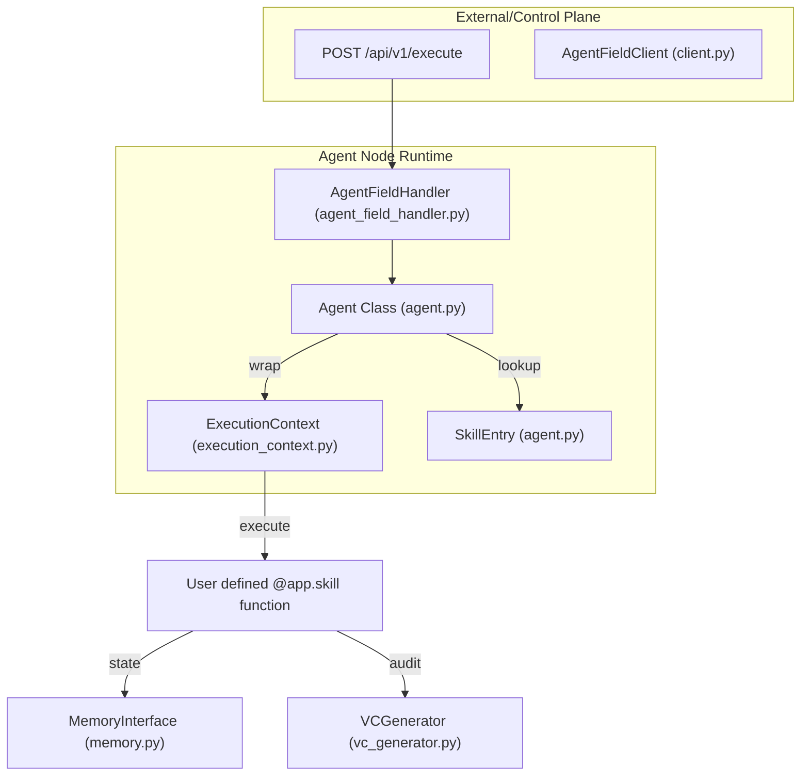

<!-- source: DeepWiki mcp.deepwiki.com · repo Agent-Field/agentfield · page 3.3 Defining Skills · fetched 2026-10-26 -->

# Defining Skills

<details>
<summary>Relevant source files</summary>

The following files were used as context for generating this wiki page:

- [control-plane/internal/handlers/execute_awaiter_status.go](control-plane/internal/handlers/execute_awaiter_status.go)
- [control-plane/internal/handlers/execute_awaiter_status_test.go](control-plane/internal/handlers/execute_awaiter_status_test.go)
- [sdk/python/agentfield/agent.py](sdk/python/agentfield/agent.py)
- [sdk/python/agentfield/async_execution_manager.py](sdk/python/agentfield/async_execution_manager.py)
- [sdk/python/agentfield/client.py](sdk/python/agentfield/client.py)
- [sdk/python/agentfield/decorator_metadata.py](sdk/python/agentfield/decorator_metadata.py)
- [sdk/python/agentfield/decorators.py](sdk/python/agentfield/decorators.py)
- [sdk/python/agentfield/exceptions.py](sdk/python/agentfield/exceptions.py)
- [sdk/python/agentfield/execution_state.py](sdk/python/agentfield/execution_state.py)
- [sdk/python/agentfield/router.py](sdk/python/agentfield/router.py)
- [sdk/python/tests/test_accepts_webhook.py](sdk/python/tests/test_accepts_webhook.py)
- [sdk/python/tests/test_agent_call.py](sdk/python/tests/test_agent_call.py)
- [sdk/python/tests/test_agent_coverage_additions.py](sdk/python/tests/test_agent_coverage_additions.py)
- [sdk/python/tests/test_async_config.py](sdk/python/tests/test_async_config.py)
- [sdk/python/tests/test_async_execution.py](sdk/python/tests/test_async_execution.py)
- [sdk/python/tests/test_client_laser_push.py](sdk/python/tests/test_client_laser_push.py)
- [sdk/python/tests/test_decorator_code_origin.py](sdk/python/tests/test_decorator_code_origin.py)
- [sdk/python/tests/test_execution_state.py](sdk/python/tests/test_execution_state.py)
- [sdk/python/tests/test_router.py](sdk/python/tests/test_router.py)
- [sdk/python/tests/test_trigger_param_binding.py](sdk/python/tests/test_trigger_param_binding.py)
- [sdk/python/tests/test_workflow_parent_child.py](sdk/python/tests/test_workflow_parent_child.py)

</details>


## Purpose and Scope

This page documents how to define and implement **skills** in the Python SDK. Skills are deterministic, non-AI-powered functions that perform specific operations like data fetching, formatting, calculations, or API calls. They complement reasoners (AI-powered functions) and provide reliable, predictable behavior.

For information about defining AI-powered functions, see [Defining Reasoners](#3.2). For organizing skills with routers, see [AgentRouter](#3.4). For accessing memory within skills, see [Memory Interface](#3.6).

---

## What are Skills?

Skills are **deterministic functions** that execute predictable operations without LLM inference. They provide:

- **Reliability**: No AI variability or token costs.
- **Speed**: No network calls to LLM providers.
- **Precision**: Exact computation and data manipulation.
- **Integration**: API calls, database queries, file operations.

**Key Distinction**: Skills execute logic directly, while reasoners delegate to LLMs for decision-making or generation. Internally, the SDK stores these in a `SkillEntry` dataclass which uses `__slots__` for memory efficiency.

| Aspect | Skills | Reasoners |
|--------|--------|-----------|
| **Execution** | Deterministic code | AI inference via LLM |
| **Cost** | No tokens | Consumes tokens |
| **Latency** | Milliseconds | Seconds (network + inference) |
| **Output** | Always predictable | Variable/creative |
| **Use Cases** | Data fetching, parsing, calculations | Analysis, generation, reasoning |

Sources: [sdk/python/agentfield/agent.py:135-144](), [sdk/python/agentfield/agent.py:312-354]()

---

## Basic Skill Definition

### The `@app.skill()` Decorator

Skills are defined using the `@app.skill()` decorator on regular Python functions. The decorator can be used with or without parentheses.

```python
from agentfield import Agent

app = Agent(node_id="my_agent")

@app.skill()
def format_currency(amount: float, currency: str = "USD") -> str:
    """Format a number as currency with proper symbols."""
    symbols = {"USD": "$", "EUR": "€", "GBP": "£"}
    symbol = symbols.get(currency, currency)
    return f"{symbol}{amount:,.2f}"

@app.skill()
async def fetch_weather(city: str) -> dict:
    """Fetch current weather data for a city."""
    import httpx
    
    async with httpx.AsyncClient() as client:
        response = await client.get(
            f"https://api.weather.com/current",
            params={"city": city}
        )
        return response.json()
```

**Both synchronous and asynchronous functions are supported**. The SDK automatically handles execution in the appropriate context during the `handle_execute` lifecycle.

Sources: [sdk/python/agentfield/agent.py:346-350](), [sdk/python/agentfield/agent.py:1456-1508]()

---

## Skill Lifecycle and Registration

### Skill Registration Flow

The following diagram illustrates how a skill moves from definition in code to being registered in the Control Plane.



Sources: [sdk/python/agentfield/agent.py:135-144](), [sdk/python/agentfield/agent.py:444-448](), [sdk/python/agentfield/agent.py:1010-1045](), [sdk/python/agentfield/agent_field_handler.py:119-132]()

---

## Skill Metadata and Configuration

### Decorator Parameters

The `@app.skill()` decorator accepts configuration parameters that override default agent settings:

```python
@app.skill(
    tags=["data", "external"],
    description="Custom description for documentation",
    vc_enabled=True  # Override agent-level VC setting
)
def fetch_user_data(user_id: str) -> dict:
    """Fetch user profile from external API."""
    pass
```

### Skill Metadata Structure

Each registered skill generates metadata. The `SkillEntry` class facilitates this storage:

| Field | Type | Description |
|-------|------|-------------|
| `id` | `str` | Function name (e.g., `"fetch_user_data"`) |
| `input_types` | `Dict[str, tuple]` | (type, default) tuples extracted via `inspect` |
| `output_type` | `type` | The return type hint of the function |
| `tags` | `list[str]` | Categorization labels |
| `vc_enabled` | `bool` | Whether VCs are generated for this skill |

The `input_schema` is generated on-demand during discovery or execution using Pydantic's schema generation logic.

Sources: [sdk/python/agentfield/agent.py:135-144](), [sdk/python/agentfield/agent.py:447-451](), [sdk/python/agentfield/pydantic_utils.py:1-20]()

---

## Execution Context in Skills

### Accessing Context Services

Skills have access to the same execution context as reasoners via the `Agent` instance methods.

```python
@app.skill()
def store_computation_result(key: str, value: any) -> dict:
    # Access memory interface
    app.memory.set(f"results.{key}", value)
    
    # Access execution context metadata via get_current_context()
    ctx = app.ctx
    
    return {
        "stored": True,
        "workflow_id": ctx.workflow_id,
        "execution_id": ctx.execution_id
    }
```

### Available Context Properties

| Property | Type | Description |
|----------|------|-------------|
| `app.memory` | `MemoryInterface` | Scoped memory access (KV and Vector) |
| `app.ctx` | `ExecutionContext` | Current execution metadata (run_id, workflow_id) |
| `app.call()` | `method` | Method to call other agents/reasoners |

Sources: [sdk/python/agentfield/agent.py:809-916](), [sdk/python/agentfield/agent.py:918-959](), [sdk/python/agentfield/execution_context.py:15-50]()

---

## Skill Execution Architecture

This diagram bridges the "Natural Language Space" (invoking a capability) to the "Code Entity Space" (the actual SDK classes and functions).



Sources: [sdk/python/agentfield/agent.py:1456-1508](), [sdk/python/agentfield/agent_field_handler.py:119-168](), [sdk/python/agentfield/client.py:142-171]()

---

## Input Validation and Pydantic Models

The SDK uses `convert_function_args` to transform incoming JSON payloads into the types specified in the skill's signature. If a `BaseModel` is used as an argument, it is automatically instantiated and validated.

```python
from pydantic import BaseModel

class ToolInput(BaseModel):
    query: str
    limit: int = 10

@app.skill()
def search_tool(params: ToolInput):
    # 'params' is a validated ToolInput instance here
    return {"results": []}
```

If validation fails, the SDK raises a `ValidationError` which is caught and returned as a 422 error by the `AgentFieldHandler`.

Sources: [sdk/python/agentfield/pydantic_utils.py:1-40](), [sdk/python/agentfield/agent.py:1510-1540]()

---

## Verifiable Credentials for Skills

Skills can participate in the VC system for cryptographic audit trails. When `vc_enabled` is true, the `Agent` uses the `VCGenerator` to sign the execution.

```python
@app.skill(vc_enabled=True)
def secure_operation(data: str):
    return {"status": "signed"}
```

The system generates an `ExecutionVC` containing:
1. **Subject**: The Agent's DID.
2. **Input Hash**: Deterministic hash of arguments.
3. **Output Hash**: Deterministic hash of the result.
4. **Context**: Workflow and Execution IDs.

Sources: [sdk/python/agentfield/vc_generator.py:82-161](), [sdk/python/agentfield/did_manager.py:87-145]()

---

## Skills in AgentRouter

`AgentRouter` allows for modular organization. Skills defined on a router are merged into the main `Agent` when `include_router()` is called.

```python
router = AgentRouter(prefix="tools", tags=["utility"])

@router.skill()
def echo(val: str):
    return val

app.include_router(router)
# Accessible externally as 'tools.echo'
```

The router automatically propagates tags and sanitizes prefixes to ensure consistent routing in the Control Plane.

Sources: [sdk/python/agentfield/router.py:88-116](), [sdk/python/agentfield/router.py:165-200]()

---

## Error Handling in Skills

When a skill raises an exception, the `Agent` catches it and wraps it in an `ExecuteError`.

- **Standard Exceptions**: (e.g., `ValueError`) are returned as failed executions.
- **`ReasonerFailed`**: Though primarily for reasoners, if raised in a skill, it allows preserving a partial `result` alongside the failure status.

Sources: [sdk/python/agentfield/agent.py:716-735](), [sdk/python/agentfield/exceptions.py:36-73]()

---

## Summary

Skills provide the deterministic backbone of an AgentField node.

- **Efficiency**: Uses `__slots__` and lazy schema generation.
- **Flexibility**: Supports sync/async, Pydantic models, and custom metadata.
- **Integration**: Deeply integrated with the `MemoryInterface` and `VCGenerator`.
- **Organization**: Can be namespaced using `AgentRouter`.

Sources: [sdk/python/agentfield/agent.py:135-144](), [sdk/python/agentfield/agent.py:444-451](), [sdk/python/agentfield/router.py:88-116]()

---

