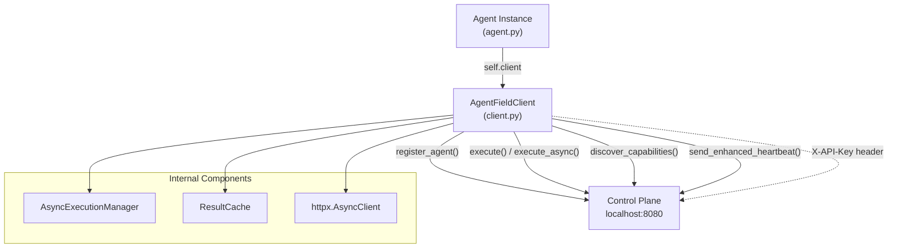
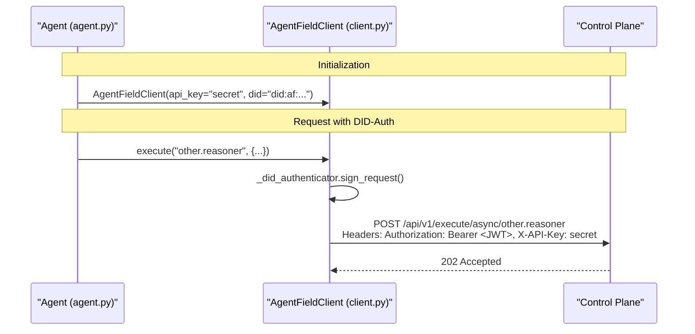
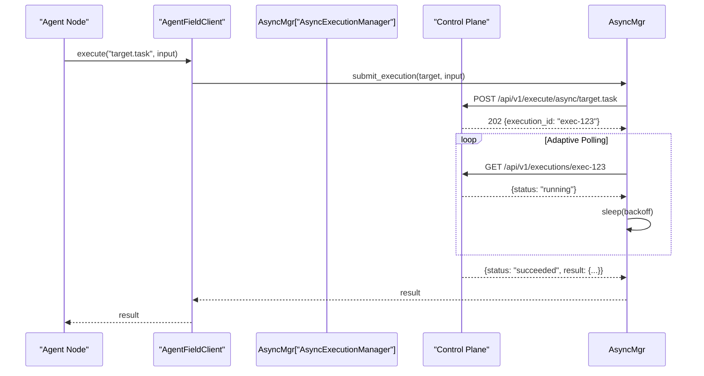
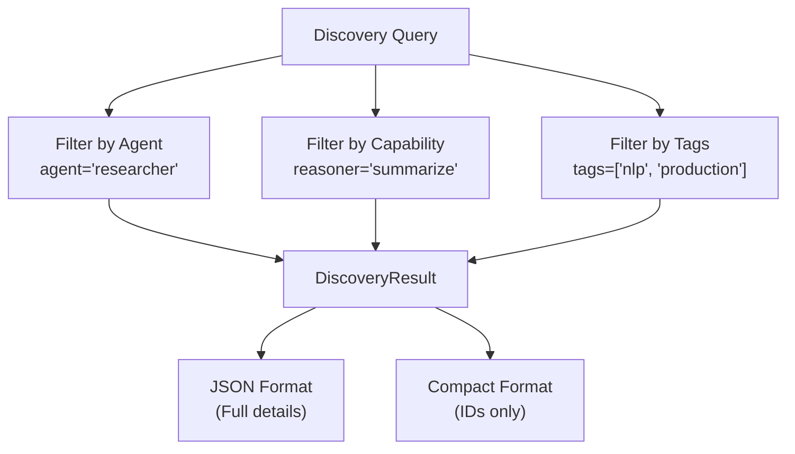

<!-- source: DeepWiki mcp.deepwiki.com · repo Agent-Field/agentfield · page 3.5 Client & Communication · fetched 2026-10-26 -->

# Client & Communication

<details>
<summary>Relevant source files</summary>

The following files were used as context for generating this wiki page:

- [control-plane/internal/handlers/execute_awaiter_status.go](control-plane/internal/handlers/execute_awaiter_status.go)
- [control-plane/internal/handlers/execute_awaiter_status_test.go](control-plane/internal/handlers/execute_awaiter_status_test.go)
- [sdk/python/agentfield/agent.py](sdk/python/agentfield/agent.py)
- [sdk/python/agentfield/agent_field_handler.py](sdk/python/agentfield/agent_field_handler.py)
- [sdk/python/agentfield/async_execution_manager.py](sdk/python/agentfield/async_execution_manager.py)
- [sdk/python/agentfield/client.py](sdk/python/agentfield/client.py)
- [sdk/python/agentfield/connection_manager.py](sdk/python/agentfield/connection_manager.py)
- [sdk/python/agentfield/did_manager.py](sdk/python/agentfield/did_manager.py)
- [sdk/python/agentfield/exceptions.py](sdk/python/agentfield/exceptions.py)
- [sdk/python/agentfield/execution_state.py](sdk/python/agentfield/execution_state.py)
- [sdk/python/agentfield/vc_generator.py](sdk/python/agentfield/vc_generator.py)
- [sdk/python/tests/helpers.py](sdk/python/tests/helpers.py)
- [sdk/python/tests/test_agent_call.py](sdk/python/tests/test_agent_call.py)
- [sdk/python/tests/test_agent_coverage_additions.py](sdk/python/tests/test_agent_coverage_additions.py)
- [sdk/python/tests/test_agent_networking.py](sdk/python/tests/test_agent_networking.py)
- [sdk/python/tests/test_async_config.py](sdk/python/tests/test_async_config.py)
- [sdk/python/tests/test_async_execution.py](sdk/python/tests/test_async_execution.py)
- [sdk/python/tests/test_client.py](sdk/python/tests/test_client.py)
- [sdk/python/tests/test_client_laser_push.py](sdk/python/tests/test_client_laser_push.py)
- [sdk/python/tests/test_client_lifecycle.py](sdk/python/tests/test_client_lifecycle.py)
- [sdk/python/tests/test_connection_manager.py](sdk/python/tests/test_connection_manager.py)
- [sdk/python/tests/test_execution_state.py](sdk/python/tests/test_execution_state.py)
- [sdk/python/tests/test_vc_generator.py](sdk/python/tests/test_vc_generator.py)

</details>


This page documents the `AgentFieldClient` class, which provides the communication layer between Python SDK agents and the AgentField control plane. The client handles HTTP/WebSocket communication, authentication, agent registration, execution coordination, and service discovery.

---

## Overview

The `AgentFieldClient` is initialized automatically when you create an `Agent` instance. It manages all communication with the control plane, including agent node registration, execution routing, and service discovery.

**Architecture Diagram:**



**Sources:** [sdk/python/agentfield/client.py:142-175](), [sdk/python/agentfield/agent.py:479-482]()

---

## Client Initialization

The `AgentFieldClient` is typically initialized through the `Agent` constructor but can be used standalone for control-plane interactions.

**Configuration Parameters:**

| Parameter | Type | Default | Description |
|-----------|------|---------|-------------|
| `base_url` | `str` | `"http://localhost:8080"` | Control plane URL |
| `api_key` | `Optional[str]` | `None` | Authentication key for `X-API-Key` header |
| `async_config` | `Optional[AsyncConfig]` | `None` | Async execution configuration (polling intervals, timeouts) |
| `did` | `Optional[str]` | `None` | Decentralized Identifier for DID-auth |
| `private_key_jwk` | `Optional[str]` | `None` | JWK for signing DID-auth requests |

**Sources:** [sdk/python/agentfield/client.py:147-154](), [sdk/python/agentfield/agent.py:479-482]()

---

## Authentication

The client supports two primary authentication modes:
1.  **API Key:** Uses the `X-API-Key` header for control plane access.
2.  **DID Auth:** Uses `DIDAuthenticator` to sign requests for agent-to-agent calls, ensuring cryptographic identity verification.

**Authentication Flow:**



**Sources:** [sdk/python/agentfield/client.py:159-161](), [sdk/python/agentfield/client.py:218-220]()

---

## Agent Registration

Registration establishes the agent's identity and capabilities (reasoners/skills) with the control plane.

### Registration Method

The `register_agent` method transmits metadata, capability schemas, and deployment info.

```python
async def register_agent(
    self,
    node_id: str,
    reasoners: List[dict],
    skills: List[dict],
    base_url: str,
    discovery: Optional[Dict[str, Any]] = None,
    vc_metadata: Optional[Dict[str, Any]] = None,
    version: str = "1.0.0",
    agent_metadata: Optional[Dict[str, Any]] = None,
    tags: Optional[List[str]] = None,
    instance_id: Optional[str] = None,
) -> Tuple[bool, Optional[Dict[str, Any]]]:
```

**Sources:** [sdk/python/agentfield/client.py:500-512](), [sdk/python/agentfield/agent_field_handler.py:125-136]()

---

## Execution Methods

AgentField supports both asynchronous (polling-based) and synchronous execution.

### Execution Architecture

The `AgentFieldClient` uses an `AsyncExecutionManager` to handle high-concurrency polling with adaptive backoff.



### Async Execution (execute)

The `execute` method submits a task and waits for the result using the `AsyncExecutionManager`. It intelligently handles timeouts and retries.

**Sources:** [sdk/python/agentfield/client.py:574-620](), [sdk/python/agentfield/async_execution_manager.py:185-207]()

### Execution Error Handling

Specific exceptions distinguish between transport failures and logic failures:
-   `ExecutionFailedError`: The remote reasoner ran and explicitly returned a failed status.
-   `ExecutionTimeoutError`: The wait deadline was hit.
-   `ExecutionCancelledError`: Explicit user intent to stop the work.

**Sources:** [sdk/python/agentfield/exceptions.py:17-33](), [sdk/python/agentfield/exceptions.py:80-96]()

---

## Service Discovery

Discovery allows agents to find other agents, reasoners, or skills by ID, tags, or health status.

### Discovery Patterns



**Sources:** [sdk/python/agentfield/client.py:201-220]()

---

## Heartbeat & Lifecycle

Agents maintain their "Online" status via heartbeats and notify the control plane during shutdown.

### Enhanced Heartbeat

The `AgentFieldHandler` collects MCP server health and agent status to send an "enhanced" heartbeat.

```python
async def send_enhanced_heartbeat(
    self, node_id: str, heartbeat: HeartbeatData
) -> bool:
```

### Connection Management

The `ConnectionManager` handles resilient connectivity, including:
-   **Automatic Reconnection:** Retries registration if the control plane is down.
-   **Degraded Mode:** Allows agents to run locally without a control plane if configured.
-   **Health Checks:** Monitors the link to the control plane.

**Sources:** [sdk/python/agentfield/connection_manager.py:36-62](), [sdk/python/agentfield/agent_field_handler.py:170-185]()

---

## Context Propagation

The client automatically propagates execution context through HTTP headers. This ensures that `run_id`, `workflow_id`, and `session_id` are preserved across multi-agent calls.

**Propagation Headers:**

| Header | Purpose |
|--------|---------|
| `X-Run-ID` | Tracks the entire chain of executions |
| `X-Execution-ID` | Unique ID for the current execution step |
| `X-Workflow-ID` | Associates executions with a specific workflow instance |
| `X-Session-ID` | Scopes memory and state to a user session |

**Sources:** [sdk/python/agentfield/client.py:182-199](), [sdk/python/agentfield/execution_context.py:37-47]()

---

## Human-in-the-loop (Pause & Resume)

The client facilitates human-in-the-loop patterns by allowing reasoners to `pause` and wait for external approval.

### Approval Flow

1.  **Pause:** The agent calls `agent.pause()`, which registers a pause with the `_pause_manager`.
2.  **Request:** The client sends an approval request to the control plane.
3.  **Wait:** The reasoner execution thread suspends (without consuming active timeout budget).
4.  **Resume:** When a human approves via the dashboard, the control plane sends a webhook to the agent's `/approvals/resolve` endpoint, resuming the execution.

**Sources:** [sdk/python/agentfield/agent.py:1550-1600](), [sdk/python/tests/test_async_execution.py:96-115]()

---

