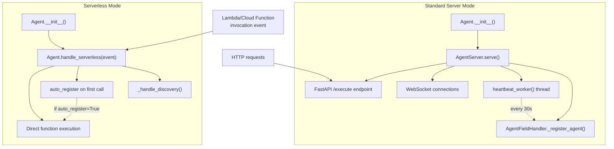
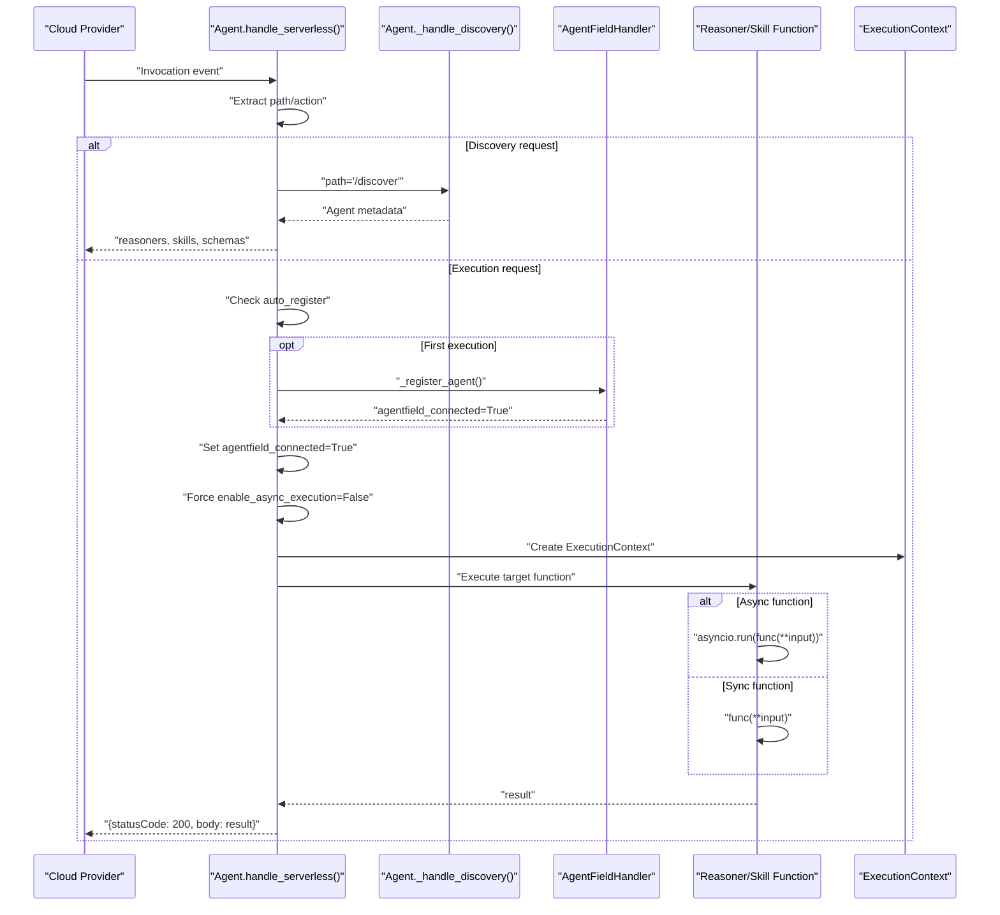
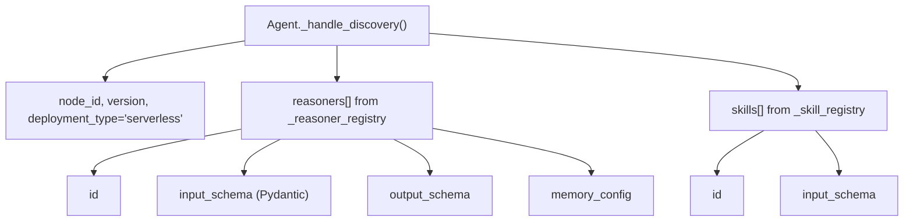

<!-- source: DeepWiki mcp.deepwiki.com · repo Agent-Field/agentfield · page 3.8 Serverless Mode · fetched 2026-10-26 -->

# Serverless Mode

<details>
<summary>Relevant source files</summary>

The following files were used as context for generating this wiki page:

- [control-plane/internal/handlers/execute_awaiter_status.go](control-plane/internal/handlers/execute_awaiter_status.go)
- [control-plane/internal/handlers/execute_awaiter_status_test.go](control-plane/internal/handlers/execute_awaiter_status_test.go)
- [sdk/python/agentfield/agent.py](sdk/python/agentfield/agent.py)
- [sdk/python/agentfield/agent_discovery.py](sdk/python/agentfield/agent_discovery.py)
- [sdk/python/agentfield/agent_pause.py](sdk/python/agentfield/agent_pause.py)
- [sdk/python/agentfield/agent_schema.py](sdk/python/agentfield/agent_schema.py)
- [sdk/python/agentfield/agent_serverless.py](sdk/python/agentfield/agent_serverless.py)
- [sdk/python/agentfield/agent_vc.py](sdk/python/agentfield/agent_vc.py)
- [sdk/python/agentfield/async_execution_manager.py](sdk/python/agentfield/async_execution_manager.py)
- [sdk/python/agentfield/client.py](sdk/python/agentfield/client.py)
- [sdk/python/agentfield/exceptions.py](sdk/python/agentfield/exceptions.py)
- [sdk/python/agentfield/execution_state.py](sdk/python/agentfield/execution_state.py)
- [sdk/python/tests/test_agent_call.py](sdk/python/tests/test_agent_call.py)
- [sdk/python/tests/test_agent_coverage_additions.py](sdk/python/tests/test_agent_coverage_additions.py)
- [sdk/python/tests/test_async_config.py](sdk/python/tests/test_async_config.py)
- [sdk/python/tests/test_async_execution.py](sdk/python/tests/test_async_execution.py)
- [sdk/python/tests/test_client_laser_push.py](sdk/python/tests/test_client_laser_push.py)
- [sdk/python/tests/test_execution_state.py](sdk/python/tests/test_execution_state.py)

</details>


## Purpose and Scope

This document describes serverless deployment mode for AgentField agents, which enables agents to run in Function-as-a-Service (FaaS) environments like AWS Lambda, Azure Functions, Google Cloud Functions, and Cloud Run without maintaining persistent server processes.

Serverless mode provides an event-driven execution model where agents respond to discrete invocation events rather than running as long-lived HTTP servers. This contrasts with standard server mode where agents call `serve()` to start a persistent uvicorn server with heartbeat threads and WebSocket connections.

For deploying agents to traditional cloud infrastructure with persistent containers, see [Docker Deployment](#13.1) and [Railway Deployment](#13.2). For serverless deployment patterns specifically for TypeScript agents, see [Serverless Handler](#4.7).

---

## Architecture Comparison

Serverless mode fundamentally changes the agent lifecycle from a persistent service to an ephemeral function. The following diagram illustrates the architectural differences:

**Diagram: Agent Lifecycle Comparison**



**Key Architectural Differences**:

| Aspect | Standard Mode | Serverless Mode |
|--------|--------------|-----------------|
| Lifecycle | Long-lived process | Ephemeral function |
| Registration | At startup via `_register_agent()` | On-demand via `auto_register` |
| Heartbeats | Background thread every 30s | None |
| WebSocket | Persistent connections | Not supported |
| Invocation | HTTP requests to uvicorn | Cloud provider events |
| Port Binding | Binds to port (e.g., 8000) | No port binding |

**Sources**: [sdk/python/agentfield/agent.py:461-465](), [sdk/python/agentfield/agent.py:578-736]()

---

## Event Processing Flow

The `handle_serverless()` method processes events from serverless platforms and routes them to either the discovery or execution path. It handles the normalization of various event formats and manages the `ExecutionContext` lifecycle.

**Diagram: handle_serverless() Logic Flow**



**Sources**: [sdk/python/agentfield/agent.py:578-736](), [sdk/python/agentfield/agent.py:649-651]()

---

## Discovery Endpoint

The discovery endpoint returns agent metadata that the control plane uses for registration. This enables the control plane to understand the agent's capabilities without the agent proactively registering.

### Discovery Request Detection

The handler recognizes discovery requests through multiple event formats:

```python
# Detection logic in handle_serverless
path = event.get("path") or event.get("rawPath") or ""
action = event.get("action", "")

if path == "/discover" or path.endswith("/discover") or action == "discover":
    return self._handle_discovery()
```

### Discovery Response Structure

The `_handle_discovery()` method returns a structured metadata payload derived from the agent's internal registries.

**Diagram: Metadata Extraction for Discovery**



**Sources**: [sdk/python/agentfield/agent.py:737-769](), [sdk/python/agentfield/agent.py:113-144]()

---

## Execution Request Processing

Execution requests trigger reasoner or skill invocation. The handler supports multiple event formats for compatibility with different serverless platforms.

### Event Format Parsing

The handler extracts execution parameters from various event structures, prioritizing fields like `reasoner`, `target`, or `skill`.

| Purpose | Field Priority (first found wins) |
|---------|-----------------------------------|
| Target function | `reasoner` → `target` → `skill` → parsed from `path` |
| Input data | `input` → `input_data` |
| Execution context | `execution_context` → `executionContext` |

**Sources**: [sdk/python/agentfield/agent.py:653-668]()

### Execution Context Construction

The handler constructs an `ExecutionContext` with proper ID generation. In serverless mode, if a `run_id` is not provided, it defaults to the `workflow_id` or a new timestamp-based ID.

```python
# Logic from handle_serverless
exec_id = execution_context_data.get("execution_id", f"exec_{int(time.time() * 1000)}")
run_id = execution_context_data.get("run_id") or execution_context_data.get("workflow_id")
if not run_id:
    run_id = f"wf_{int(time.time() * 1000)}"
```

**Sources**: [sdk/python/agentfield/agent.py:681-708]()

---

## Auto-Registration

Serverless agents use lazy registration triggered on first invocation instead of startup registration. This pattern accommodates ephemeral execution environments.

### Configuration

Auto-registration is controlled by the `auto_register` constructor parameter in the `Agent` class.

```python
app = Agent(
    node_id="my_agent",
    auto_register=True,  # Enable auto-registration (default)
    agentfield_server="https://your-control-plane.com"
)
```

### Registration Behavior

1. First execution checks `self.auto_register` and `not self.agentfield_connected`.
2. Attempts registration via `AgentFieldHandler._register_agent()`.
3. Sets `agentfield_connected=True` to prevent repeated registration attempts within the same invocation.

**Sources**: [sdk/python/agentfield/agent.py:461-462](), [sdk/python/agentfield/agent.py:637-644]()

---

## Serverless Mode Constraints

Several features are disabled or modified in serverless mode to accommodate the stateless execution model.

### Disabled Features

- **Heartbeats**: The background heartbeat thread is not started.
- **WebSocket**: Persistent connections for memory events or terminal streaming are not supported.
- **Async Polling**: The agent forces `enable_async_execution = False` in `self.async_config`. This ensures that if the agent calls another agent, it uses the synchronous execution path rather than returning an execution ID and polling.

### Pause and Resume

While `Agent.pause()` is supported, in serverless mode it relies on the `_PauseManager` to wait for a webhook resolution within the function's execution timeout. If the cloud provider's timeout is reached before approval, the function will terminate.

**Sources**: [sdk/python/agentfield/agent.py:649-651](), [sdk/python/agentfield/agent_pause.py:49-116]()

---

## Cloud Provider Adapters

The `handle_serverless()` method accepts an optional `adapter` function to normalize cloud provider event formats.

```python
def handle_serverless(
    self, 
    event: dict, 
    adapter: Optional[Callable] = None
) -> dict:
```

The adapter receives the raw cloud provider event and should return a dictionary containing keys like `path`, `input`, and `execution_context`.

**Sources**: [sdk/python/agentfield/agent.py:619-626]()

---

## Memory and State Considerations

Serverless agents have limited memory and state management capabilities compared to standard mode.

### Memory Client Behavior

Memory operations work through the `MemoryClient`, which communicates with the control plane's storage layer via HTTP. However, real-time memory events (subscriptions) are not supported because they require a persistent WebSocket connection.

**Sources**: [sdk/python/agentfield/agent.py:809-916](), [sdk/python/agentfield/memory_events.py:79-421]()

### Execution Context Lifecycle

The `ExecutionContext` is created per invocation and cleared after execution using a `finally` block to ensure no state leakage between recycled function containers.

```python
# handle_serverless context management
self._current_execution_context = execution_context
try:
    # ... execution logic ...
finally:
    self._current_execution_context = None
    reset_execution_context()
```

**Sources**: [sdk/python/agentfield/agent.py:710-735](), [sdk/python/agentfield/execution_context.py:37-42]()

---

## Sources Summary

- Agent class and serverless handler: [sdk/python/agentfield/agent.py:461-769]()
- Metadata and Registries: [sdk/python/agentfield/agent.py:113-144]()
- Execution Context: [sdk/python/agentfield/execution_context.py:37-42]()
- Pause Management: [sdk/python/agentfield/agent_pause.py:49-116]()
- Client Execution: [sdk/python/agentfield/client.py:142-218]()

---

