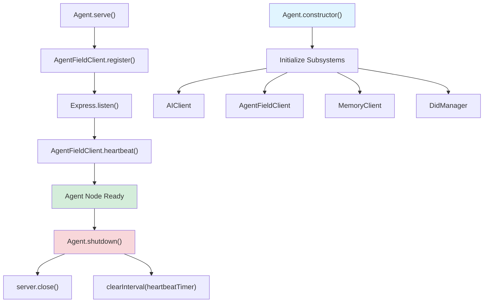
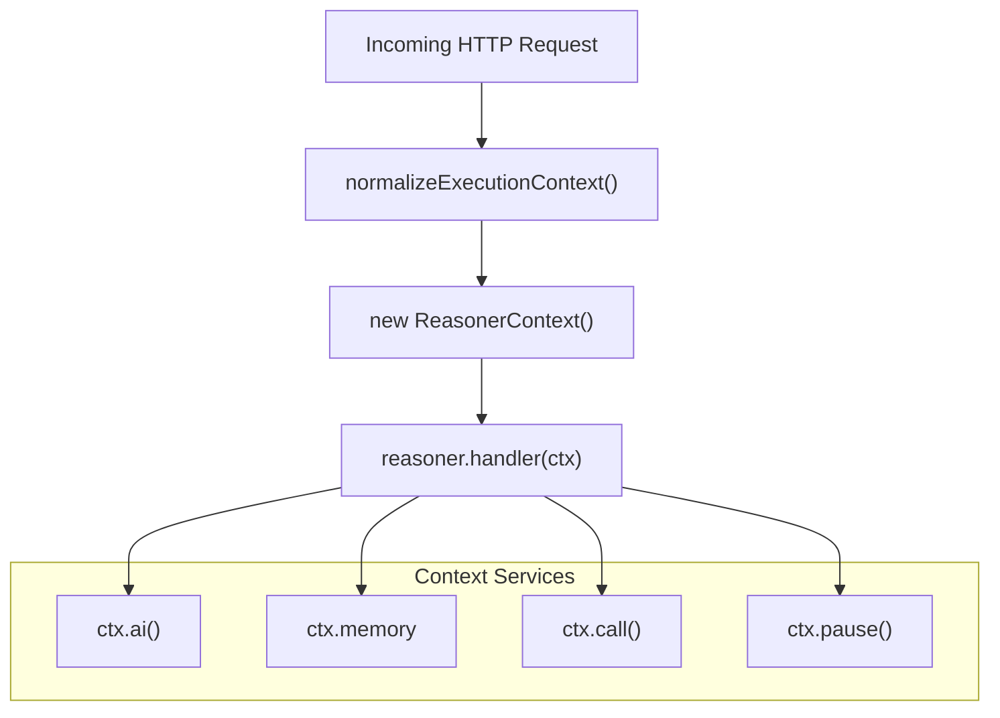

<!-- source: DeepWiki mcp.deepwiki.com · repo Agent-Field/agentfield · page 4 TypeScript SDK · fetched 2026-10-26 -->

# TypeScript SDK

<details>
<summary>Relevant source files</summary>

The following files were used as context for generating this wiki page:

- [control-plane/web/client/package-lock.json](control-plane/web/client/package-lock.json)
- [control-plane/web/client/package.json](control-plane/web/client/package.json)
- [control-plane/web/client/pnpm-lock.yaml](control-plane/web/client/pnpm-lock.yaml)
- [control-plane/web/client/src/components/ui/icon-bridge.tsx](control-plane/web/client/src/components/ui/icon-bridge.tsx)
- [control-plane/web/client/src/components/ui/icon.tsx](control-plane/web/client/src/components/ui/icon.tsx)
- [examples/benchmarks/100k-scale/mastra-bench/package-lock.json](examples/benchmarks/100k-scale/mastra-bench/package-lock.json)
- [examples/benchmarks/100k-scale/mastra-bench/package.json](examples/benchmarks/100k-scale/mastra-bench/package.json)
- [examples/python_agent_nodes/rag_evaluation/ui/package-lock.json](examples/python_agent_nodes/rag_evaluation/ui/package-lock.json)
- [examples/python_agent_nodes/rag_evaluation/ui/package.json](examples/python_agent_nodes/rag_evaluation/ui/package.json)
- [sdk/typescript/package-lock.json](sdk/typescript/package-lock.json)
- [sdk/typescript/src/agent/Agent.ts](sdk/typescript/src/agent/Agent.ts)
- [sdk/typescript/src/ai/AIClient.ts](sdk/typescript/src/ai/AIClient.ts)
- [sdk/typescript/src/client/AgentFieldClient.ts](sdk/typescript/src/client/AgentFieldClient.ts)
- [sdk/typescript/src/context/ReasonerContext.ts](sdk/typescript/src/context/ReasonerContext.ts)
- [sdk/typescript/src/index.ts](sdk/typescript/src/index.ts)
- [sdk/typescript/src/router/AgentRouter.ts](sdk/typescript/src/router/AgentRouter.ts)
- [sdk/typescript/src/triggers/factories.ts](sdk/typescript/src/triggers/factories.ts)
- [sdk/typescript/src/triggers/index.ts](sdk/typescript/src/triggers/index.ts)
- [sdk/typescript/src/triggers/types.ts](sdk/typescript/src/triggers/types.ts)
- [sdk/typescript/src/types/agent.ts](sdk/typescript/src/types/agent.ts)
- [sdk/typescript/src/types/reasoner.ts](sdk/typescript/src/types/reasoner.ts)
- [sdk/typescript/tests/agent.test.ts](sdk/typescript/tests/agent.test.ts)
- [sdk/typescript/tests/ai_client.test.ts](sdk/typescript/tests/ai_client.test.ts)
- [sdk/typescript/tests/triggers.test.ts](sdk/typescript/tests/triggers.test.ts)

</details>


The TypeScript SDK (`@agentfield/sdk`) provides a complete toolkit for building AI agents in Node.js environments. It handles agent registration, execution context management, AI provider integration, memory operations, and communication with the AgentField control plane.

This page covers the TypeScript-specific implementation. For the Python SDK, see [Python SDK](#3). For Go SDK, see [Go SDK](#5).

---

## Installation and Setup

The TypeScript SDK is published to npm as `@agentfield/sdk`. It requires Node.js 18.0.0 or higher.

```bash
npm install @agentfield/sdk
```

The package ships as an ES module with TypeScript type definitions included.

**Sources:** [sdk/typescript/package-lock.json:7-44](), [sdk/typescript/src/agent/Agent.ts:75-75]()

---

## Agent Class

The `Agent` class is the primary interface for creating and running agents. It manages reasoners, skills, HTTP server lifecycle, control plane registration, and execution contexts. For details, see [Agent Class](#4.1).

### Configuration

The `Agent` constructor accepts an `AgentConfig` object which defines its identity and connection parameters.

```typescript
interface AgentConfig {
  nodeId: string;                    // Unique identifier for this agent
  version?: string;                  // Agent version
  agentFieldUrl?: string;            // Control plane URL (default: http://localhost:8080)
  port?: number;                     // HTTP server port (default: 8001)
  host?: string;                     // Bind address (default: 0.0.0.0)
  aiConfig?: AIConfig;               // AI provider configuration
  memoryConfig?: MemoryConfig;       // Memory defaults
  didEnabled?: boolean;              // Enable DID system (default: true)
  deploymentType?: 'long_running' | 'serverless';
  asyncExecution?: boolean;          // Enable detached execution (default: true)
  executionBudgetMs?: number;        // Wall-clock budget for detached reasoners
}
```

**Sources:** [sdk/typescript/src/types/agent.ts:10-54](), [sdk/typescript/src/agent/Agent.ts:146-155]()

### Agent Lifecycle

The agent lifecycle involves initializing subsystems, registering with the control plane, and maintaining a heartbeat.



**Sources:** [sdk/typescript/src/agent/Agent.ts:146-258](), [sdk/typescript/src/client/AgentFieldClient.ts:170-196]()

---

## Reasoners and Skills

Agents expose capabilities through Reasoners and Skills. For details, see [Reasoners and Skills](#4.2).

### Reasoners
Reasoners are AI-powered functions defined with `agent.reasoner()`. They have access to the `AIClient` for LLM generation and can call other agents.

### Skills
Skills are deterministic functions defined with `agent.skill()`. They are used for tool execution and data processing without direct LLM access.

**Sources:** [sdk/typescript/src/agent/Agent.ts:113-114](), [sdk/typescript/src/types/reasoner.ts:1-20](), [sdk/typescript/src/types/skill.ts:1-12]()

---

## Execution Contexts

The SDK uses `ExecutionContext` to manage metadata and state for every invocation. For details, see [Execution Contexts](#4.3).

When an agent receives a request, it populates a `ReasonerContext` or `SkillContext` with execution metadata extracted from headers like `X-Execution-ID` and `X-Workflow-ID`.



**Sources:** [sdk/typescript/src/agent/Agent.ts:92-108](), [sdk/typescript/src/context/ReasonerContext.ts:13-90](), [sdk/typescript/src/context/SkillContext.ts:9-52]()

---

## AI Client

The `AIClient` provides a unified interface to multiple LLM providers using the Vercel AI SDK. For details, see [AI Client](#4.4).

It supports providers such as OpenAI, Anthropic, Google, and DeepSeek, offering methods for text generation, streaming, and embeddings.

**Sources:** [sdk/typescript/src/ai/AIClient.ts:1-331](), [sdk/typescript/src/types/agent.ts:56-84]()

---

## Memory Interface

The `MemoryInterface` manages state across different scopes: `workflow`, `session`, `actor`, and `global`. For details, see [Memory Interface](#4.5).

It supports standard key-value operations as well as vector operations for RAG (Retrieval-Augmented Generation) workflows.

**Sources:** [sdk/typescript/src/memory/MemoryInterface.ts:1-226](), [sdk/typescript/src/types/agent.ts:86-91]()

---

## AgentRouter

The `AgentRouter` allows developers to modularize agent capabilities. For details, see [AgentRouter](#4.6).

Routers can be used to group related reasoners and skills under a common prefix, which are then included in the main agent using `agent.includeRouter()`.

**Sources:** [sdk/typescript/src/router/AgentRouter.ts:1-44](), [sdk/typescript/src/agent/Agent.ts:25-25]()

---

## Serverless Handler

The SDK includes a built-in handler for serverless environments. For details, see [Serverless Handler](#4.7).

By using `agent.handler()`, agents can be deployed to AWS Lambda or similar platforms. The handler normalizes incoming events and routes them to the appropriate reasoner or skill.

**Sources:** [sdk/typescript/src/agent/Agent.ts:516-578](), [sdk/typescript/src/types/agent.ts:218-221]()

---

