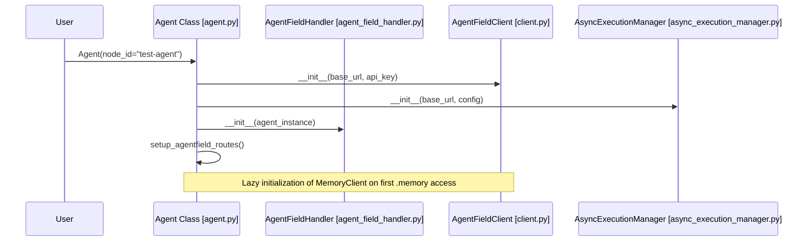
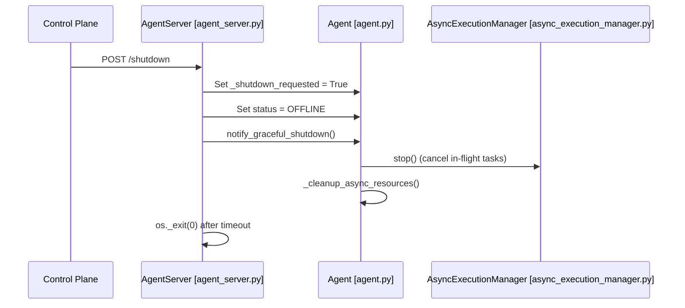

<!-- source: DeepWiki mcp.deepwiki.com · repo Agent-Field/agentfield · page 4.1 Agent Class · fetched 2026-10-26 -->

# Agent Class

<details>
<summary>Relevant source files</summary>

The following files were used as context for generating this wiki page:

- [control-plane/internal/handlers/execute_awaiter_status.go](control-plane/internal/handlers/execute_awaiter_status.go)
- [control-plane/internal/handlers/execute_awaiter_status_test.go](control-plane/internal/handlers/execute_awaiter_status_test.go)
- [control-plane/internal/infrastructure/process/port_manager.go](control-plane/internal/infrastructure/process/port_manager.go)
- [control-plane/internal/services/ui_service.go](control-plane/internal/services/ui_service.go)
- [control-plane/pkg/types/types.go](control-plane/pkg/types/types.go)
- [control-plane/web/client/src/pages/AgentsPage.tsx](control-plane/web/client/src/pages/AgentsPage.tsx)
- [sdk/python/agentfield/agent.py](sdk/python/agentfield/agent.py)
- [sdk/python/agentfield/agent_server.py](sdk/python/agentfield/agent_server.py)
- [sdk/python/agentfield/async_execution_manager.py](sdk/python/agentfield/async_execution_manager.py)
- [sdk/python/agentfield/client.py](sdk/python/agentfield/client.py)
- [sdk/python/agentfield/exceptions.py](sdk/python/agentfield/exceptions.py)
- [sdk/python/agentfield/execution_state.py](sdk/python/agentfield/execution_state.py)
- [sdk/python/tests/test_agent_call.py](sdk/python/tests/test_agent_call.py)
- [sdk/python/tests/test_agent_coverage_additions.py](sdk/python/tests/test_agent_coverage_additions.py)
- [sdk/python/tests/test_agent_graceful_shutdown.py](sdk/python/tests/test_agent_graceful_shutdown.py)
- [sdk/python/tests/test_async_config.py](sdk/python/tests/test_async_config.py)
- [sdk/python/tests/test_async_execution.py](sdk/python/tests/test_async_execution.py)
- [sdk/python/tests/test_client_laser_push.py](sdk/python/tests/test_client_laser_push.py)
- [sdk/python/tests/test_execution_state.py](sdk/python/tests/test_execution_state.py)

</details>


This page documents the `Agent` class in the Python SDK, which is the primary interface for building agent nodes. For information about defining reasoners and skills using decorators, see [Defining Reasoners](#3.2) and [Defining Skills](#3.3). For memory operations, see [Memory Interface](#3.6). For DID and VC functionality, see [DID & Verifiable Credentials](#3.7).

The `Agent` class is defined in [sdk/python/agentfield/agent.py:311-1585]() and serves as the foundation for all agent implementations. It extends FastAPI to provide HTTP endpoints while integrating with the AgentField control plane for distributed AI workflows.

**Sources:** [sdk/python/agentfield/agent.py:311-356](), [sdk/python/agentfield/agent.py:519-527]()

---

## Class Overview and Inheritance

The `Agent` class inherits from FastAPI, making it both a web server and an agent node. This design enables automatic HTTP endpoint generation, OpenAPI schema support, and seamless integration with the AgentField ecosystem.

### Agent Component Architecture
```mermaid
graph TB
    ["FastAPI (Web Framework)"] --> [AgentNode]
    
    subgraph "Core Agent Entity"
    [AgentNode] --> [Handlers]
    [AgentNode] --> [Managers]
    [AgentNode] --> [Clients]
    end
    
    subgraph "sdk/python/agentfield/"
    [Handlers] --> AgentAI["AgentAI (AI operations)"]
    [Handlers] --> AgentCLI["AgentCLI (CLI interactions)"]
    [Handlers] --> AgentFieldHandler["AgentFieldHandler (Control plane comm)"]
    [Handlers] --> AgentWorkflow["AgentWorkflow (Workflow tracking)"]
    [Handlers] --> AgentServer["AgentServer (HTTP endpoints)"]
    
    [Managers] --> DIDManager["DIDManager (Identity management)"]
    [Managers] --> VCGenerator["VCGenerator (Credential generation)"]
    [Managers] --> AsyncExecutionManager["AsyncExecutionManager (Async tasks)"]
    
    [Clients] --> AgentFieldClient["AgentFieldClient (Control plane API)"]
    [Clients] --> MemoryClient["MemoryClient (Memory operations)"]
    [Clients] --> MemoryEventClient["MemoryEventClient (WebSocket events)"]
    [Clients] --> ConnectionManager["ConnectionManager (Resilient connectivity)"]
    end
```

**Sources:** [sdk/python/agentfield/agent.py:311-442](), [sdk/python/agentfield/agent.py:519-527](), [sdk/python/agentfield/agent_server.py:19-29]()

---

## Constructor Parameters

The `Agent` constructor accepts parameters to configure its identity and behavior:

| Parameter | Type | Default | Description |
|-----------|------|---------|-------------|
| `node_id` | `str` | Required | Unique identifier for this agent node |
| `agentfield_server` | `str` | `"http://localhost:8080"` | Control plane URL |
| `version` | `str` | `"1.0.0"` | Agent version string |
| `ai_config` | `Optional[AIConfig]` | `None` | AI/LLM configuration |
| `memory_config` | `Optional[MemoryConfig]` | `None` | Memory behavior configuration |
| `dev_mode` | `bool` | `False` | Enable verbose logging and debugging |
| `async_config` | `Optional[AsyncConfig]` | `None` | Async execution configuration |
| `callback_url` | `Optional[str]` | `None` | Explicit callback URL for control plane |
| `auto_register` | `bool` | `True` | Auto-register on first invocation |
| `api_key` | `Optional[str]` | `None` | API key for control plane authentication |

**Sources:** [sdk/python/agentfield/agent.py:357-442]()

---

## Handler and Client Systems

The `Agent` class delegates specific logic to specialized handlers and manages communication through clients.

### Initialization Sequence


**Sources:** [sdk/python/agentfield/agent.py:357-577](), [sdk/python/agentfield/client.py:147-171](), [sdk/python/agentfield/async_execution_manager.py:199-218]()

### Core Attributes

- `self.node_id`: Unique identifier for the agent node [sdk/python/agentfield/agent.py:444]().
- `self.client`: Instance of `AgentFieldClient` for control plane interactions [sdk/python/agentfield/agent.py:479]().
- `self._async_execution_manager`: Manages polling and state for long-running tasks [sdk/python/agentfield/agent.py:483]().
- `self._current_status`: Current lifecycle state (`AgentStatus.READY`, `BUSY`, etc.) [sdk/python/agentfield/agent.py:489]().

---

## Lifecycle and Server Management

### Status States

The agent moves through several lifecycle states defined in `AgentStatus` [sdk/python/agentfield/agent.py:489]():
- `STARTING`: Initializing components.
- `READY`: Registered and listening for requests.
- `BUSY`: Currently executing a reasoner or skill.
- `OFFLINE`: Shutting down or disconnected.

### Graceful Shutdown

The agent implements a graceful shutdown process to notify the control plane and clean up resources.



**Sources:** [sdk/python/agentfield/agent_server.py:163-192](), [sdk/python/tests/test_agent_graceful_shutdown.py:28-63](), [sdk/python/agentfield/async_execution_manager.py:311-325]()

---

## Async Execution and Call Logic

The `Agent.call()` method is the primary way agents interact with each other. It supports both synchronous and asynchronous execution patterns.

### Execution Flow
1. **Local Call**: If the target is the agent itself, it executes locally.
2. **Remote Call**: If `async_config.enable_async_execution` is true, it uses `execute_async` [sdk/python/agentfield/agent.py:1100-1150]().
3. **Polling**: The `AsyncExecutionManager` polls the control plane for results using adaptive intervals [sdk/python/agentfield/async_execution_manager.py:185-197]().
4. **Fallback**: If async execution fails with a transport error, it may fallback to synchronous execution [sdk/python/tests/test_agent_call.py:115-132]().

### Exception Handling in Calls
The SDK distinguishes between different failure modes to prevent unnecessary retries:
- `ExecutionFailedError`: The remote reasoner ran and returned an explicit failure. The SDK skips sync fallback to save budget [sdk/python/agentfield/exceptions.py:17-33]().
- `ExecutionTimeoutError`: The wait deadline was hit. Retrying via sync is skipped as it might double invocation costs [sdk/python/agentfield/exceptions.py:74-77]().
- `ExecutionCancelledError`: Explicit user intent to stop work; never retried [sdk/python/agentfield/exceptions.py:80-96]().

**Sources:** [sdk/python/agentfield/agent.py:1100-1150](), [sdk/python/agentfield/exceptions.py:1-152](), [sdk/python/tests/test_agent_call.py:101-112]()

---

## Human-in-the-loop: Pause and Resume

The `Agent.pause()` method allows a reasoner to suspend execution while waiting for human approval.

```python
result = await app.pause(
    approval_request_id="req-123",
    expires_in_hours=24
)
if result.approved:
    # continue execution
```

**Internal Mechanics:**
- The agent registers a future in the `_pause_manager` [sdk/python/tests/test_agent_coverage_additions.py:75-92]().
- It enters a `wait_for` loop that does not consume the active execution timeout budget [sdk/python/tests/test_async_execution.py:96-104]().
- When the control plane sends a resume webhook, the `_pause_manager` resolves the future with an `ApprovalResult` [sdk/python/agentfield/client.py:70-78]().

**Sources:** [sdk/python/agentfield/agent.py:1250-1300](), [sdk/python/tests/test_async_execution.py:96-153](), [sdk/python/tests/test_agent_coverage_additions.py:75-107]()

---

## Serverless Mode

For deployments like AWS Lambda, the `handle_serverless()` method processes incoming events without a long-running server.

- **Discovery**: Returns the agent's metadata, reasoners, and skills [sdk/python/tests/test_agent_coverage_additions.py:51-60]().
- **Execution**: Maps the event to a reasoner/skill call, sets up the `ExecutionContext`, and returns the result as a standard HTTP response [sdk/python/agentfield/agent.py:578-770]().

**Sources:** [sdk/python/agentfield/agent.py:578-770](), [sdk/python/tests/test_agent_coverage_additions.py:51-60]()

---

