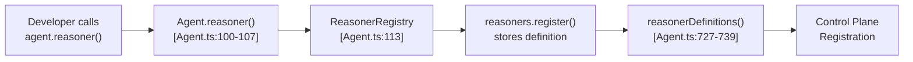
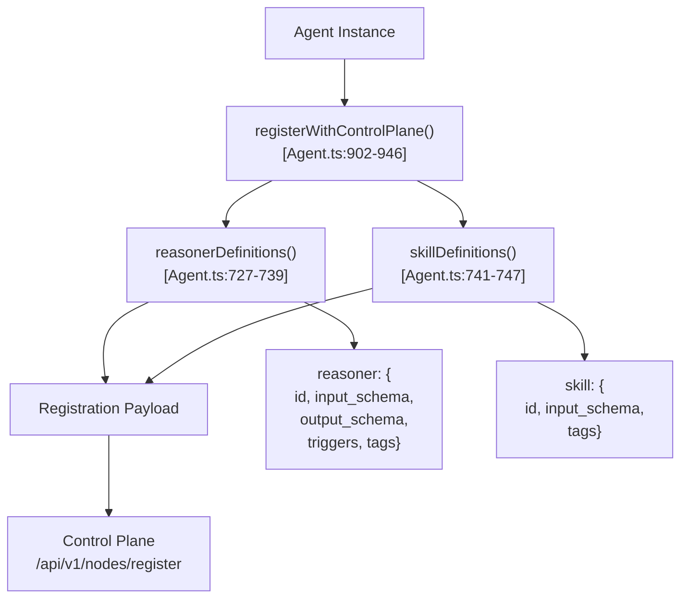
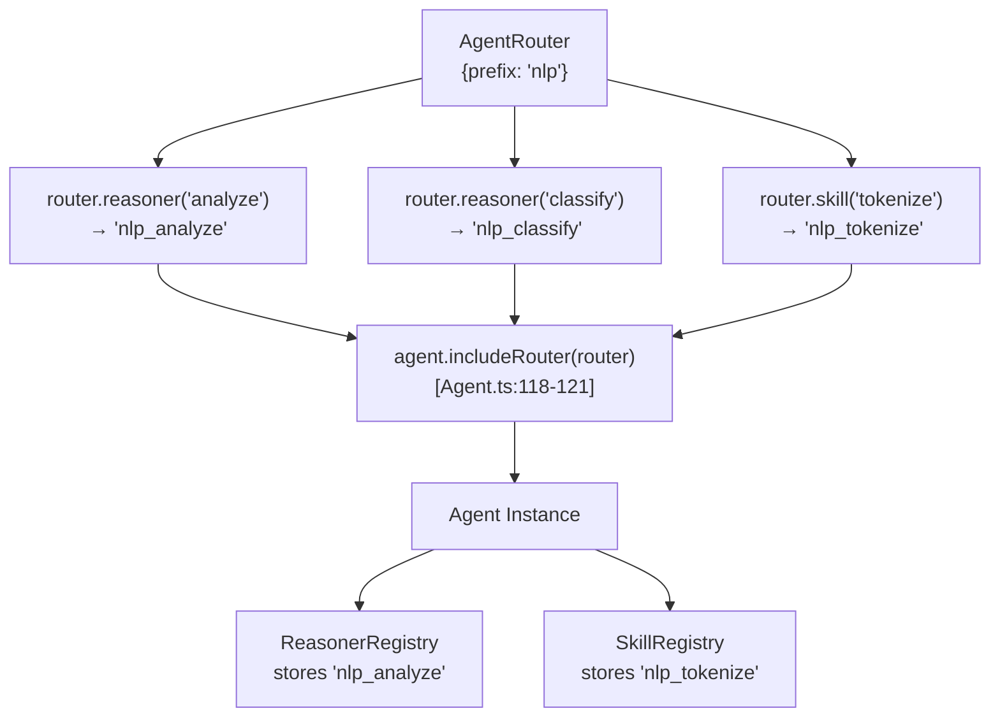
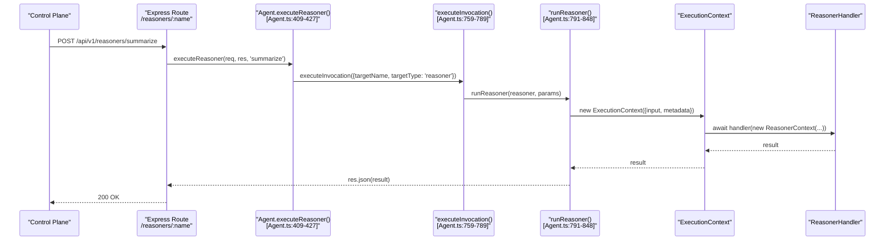

<!-- source: DeepWiki mcp.deepwiki.com · repo Agent-Field/agentfield · page 4.2 Reasoners and Skills · fetched 2026-10-26 -->

# Reasoners and Skills

<details>
<summary>Relevant source files</summary>

The following files were used as context for generating this wiki page:

- [sdk/typescript/src/agent/Agent.ts](sdk/typescript/src/agent/Agent.ts)
- [sdk/typescript/src/ai/AIClient.ts](sdk/typescript/src/ai/AIClient.ts)
- [sdk/typescript/src/client/AgentFieldClient.ts](sdk/typescript/src/client/AgentFieldClient.ts)
- [sdk/typescript/src/context/ReasonerContext.ts](sdk/typescript/src/context/ReasonerContext.ts)
- [sdk/typescript/src/index.ts](sdk/typescript/src/index.ts)
- [sdk/typescript/src/router/AgentRouter.ts](sdk/typescript/src/router/AgentRouter.ts)
- [sdk/typescript/src/triggers/factories.ts](sdk/typescript/src/triggers/factories.ts)
- [sdk/typescript/src/triggers/index.ts](sdk/typescript/src/triggers/index.ts)
- [sdk/typescript/src/triggers/types.ts](sdk/typescript/src/triggers/types.ts)
- [sdk/typescript/src/types/agent.ts](sdk/typescript/src/types/agent.ts)
- [sdk/typescript/src/types/reasoner.ts](sdk/typescript/src/types/reasoner.ts)
- [sdk/typescript/tests/agent.test.ts](sdk/typescript/tests/agent.test.ts)
- [sdk/typescript/tests/ai_client.test.ts](sdk/typescript/tests/ai_client.test.ts)
- [sdk/typescript/tests/triggers.test.ts](sdk/typescript/tests/triggers.test.ts)

</details>


This page covers the definition, registration, and configuration of reasoners and skills in the TypeScript SDK. For information about the Agent class initialization and lifecycle, see [Agent Class](). For details on the execution context objects passed to handlers, see [Execution Contexts](). For the Python SDK equivalents, see [Defining Reasoners]() and [Defining Skills]().

## Overview

Reasoners and skills are the two types of capabilities that agents expose:

- **Reasoners**: AI-powered functions that use LLMs to process input and generate output. They have access to the AI client, memory, and workflow tracking.
- **Skills**: Deterministic functions that perform concrete operations like API calls, data transformation, or file I/O. They do not directly access AI models.

Both are registered on an `Agent` instance and become discoverable through the control plane. When invoked, they receive a context object that provides access to execution metadata, memory, and other agent services.

## Defining Reasoners

Reasoners are defined using the `agent.reasoner()` method, which registers a handler function with the `ReasonerRegistry`.

### Basic Reasoner Definition

```typescript
agent.reasoner<TInput, TOutput>(
  name: string,
  handler: ReasonerHandler<TInput, TOutput>,
  options?: ReasonerOptions
)
```

**Registration Flow Diagram**



**Sources:** [sdk/typescript/src/agent/Agent.ts:100-107](), [sdk/typescript/src/agent/Agent.ts:113](), [sdk/typescript/src/agent/Agent.ts:727-739]()

### Handler Signature

The `ReasonerHandler` receives a `ReasonerContext` and returns the output value:

```typescript
type ReasonerHandler<TInput, TOutput> = (
  ctx: ReasonerContext<TInput>
) => Promise<TOutput> | TOutput
```

The `ReasonerContext` provides access to:

| Property | Type | Description |
|----------|------|-------------|
| `input` | `TInput` | The input data passed to the reasoner |
| `aiClient` | `AIClient` | AI client for LLM calls |
| `memory` | `MemoryInterface` | Scoped memory access |
| `workflow` | `WorkflowReporter` | Workflow event publishing |
| `did` | `DidInterface` | DID and VC operations |
| `agent` | `Agent` | Reference to the parent agent |
| `executionId` | `string` | Unique execution identifier |
| `runId` | `string?` | Run identifier for grouping |
| `workflowId` | `string?` | Workflow identifier |
| `sessionId` | `string?` | Optional session scope ID |
| `actorId` | `string?` | Optional actor scope ID |
| `signal` | `AbortSignal` | Signal to short-circuit work if cancelled |

**Sources:** [sdk/typescript/src/context/ReasonerContext.ts:13-179](), [sdk/typescript/src/types/reasoner.ts:10-12]()

### Reasoner Options

The `ReasonerOptions` interface controls how the reasoner is presented to the control plane and how it behaves during execution.

| Option | Type | Purpose |
|--------|------|---------|
| `inputSchema` | `any` | JSON Schema for input validation |
| `outputSchema` | `any` | JSON Schema for output validation |
| `tags` | `string[]` | Discovery tags for filtering |
| `triggers` | `TriggerBinding[]` | Inbound event/cron bindings |
| `acceptsWebhook` | `boolean \| 'warn'` | Opt-in/out for webhook invocation |
| `requireRealtimeValidation` | `boolean` | Force control-plane signature verification |

**Sources:** [sdk/typescript/src/types/reasoner.ts:14-45]()

### Triggers and Events

Reasoners can be bound to external events (like Stripe or GitHub webhooks) or schedules (cron) using the `triggers` option.

```typescript
import { eventTrigger, scheduleTrigger } from "@agentfield/sdk";

agent.reasoner("handle_payment", handler, {
  triggers: [
    eventTrigger({
      source: "stripe",
      types: ["payment_intent.succeeded"],
      secretEnv: "STRIPE_WEBHOOK_SECRET",
    }),
    scheduleTrigger({ cron: "0 * * * *" }),
  ],
});
```

**Sources:** [sdk/typescript/src/triggers/factories.ts:1-18](), [sdk/typescript/src/triggers/types.ts:109-122]()

## Defining Skills

Skills are defined using the `agent.skill()` method, which registers a handler with the `SkillRegistry`.

### Basic Skill Definition

```typescript
agent.skill<TInput, TOutput>(
  name: string,
  handler: SkillHandler<TInput, TOutput>,
  options?: SkillOptions
)
```

**Sources:** [sdk/typescript/src/agent/Agent.ts:109-116]()

### Handler Signature

The `SkillHandler` receives a `SkillContext` and returns the output value:

```typescript
type SkillHandler<TInput, TOutput> = (
  ctx: SkillContext<TInput>
) => Promise<TOutput> | TOutput
```

The `SkillContext` provides:

| Property | Type | Description |
|----------|------|-------------|
| `input` | `TInput` | The input data passed to the skill |
| `memory` | `MemoryInterface` | Scoped memory access |
| `workflow` | `WorkflowReporter` | Workflow event publishing |
| `did` | `DidInterface` | DID and VC operations |
| `agent` | `Agent` | Reference to the parent agent |
| `executionId` | `string` | Unique execution identifier |

Note that `SkillContext` does not include `aiClient` since skills are deterministic operations.

**Sources:** [sdk/typescript/src/context/SkillContext.ts:1-30]()

## Registration and Discovery

When an agent registers with the control plane, it sends definitions for all reasoners and skills. These definitions are constructed by the `reasonerDefinitions()` and `skillDefinitions()` private methods.

**Discovery Payload Structure**



**Sources:** [sdk/typescript/src/agent/Agent.ts:902-946](), [sdk/typescript/src/agent/Agent.ts:727-747]()

## Organizing with AgentRouter

The `AgentRouter` class allows you to organize related reasoners and skills under a common prefix, making large agents more maintainable.

### AgentRouter Structure



**Sources:** [sdk/typescript/src/router/AgentRouter.ts:1-44](), [sdk/typescript/src/agent/Agent.ts:118-121]()

## Execution Flow

When a reasoner or skill is invoked, the agent creates an `ExecutionContext` and dispatches to the appropriate handler.

**Invocation Flow Diagram**



**Sources:** [sdk/typescript/src/agent/Agent.ts:409-427](), [sdk/typescript/src/agent/Agent.ts:759-789](), [sdk/typescript/src/agent/Agent.ts:791-848]()

### Async Execution and Budget

If `asyncExecution` is enabled in `AgentConfig`, reasoners invoked with an `X-Execution-ID` are acknowledged with `202 Accepted` and run detached. The terminal result is delivered to the control plane via `POST /executions/{id}/status`. This allows for long-running operations and `ctx.pause()` calls.

**Sources:** [sdk/typescript/src/agent/Agent.ts:154-155](), [sdk/typescript/src/types/agent.ts:45-53]()

### Target Resolution

The `executeInvocation()` method resolves the target type:
1. If `targetType === 'skill'`, look up in `SkillRegistry`.
2. Otherwise, try `ReasonerRegistry` first.
3. If not found, fall back to `SkillRegistry`.
4. If still not found, throw `TargetNotFoundError`.

**Sources:** [sdk/typescript/src/agent/Agent.ts:759-789]()

## Type Safety

Both `reasoner()` and `skill()` methods accept generic type parameters for compile-time type checking:

```typescript
interface SummarizeInput {
  document: string;
}

interface SummarizeOutput {
  summary: string;
}

agent.reasoner<SummarizeInput, SummarizeOutput>(
  'summarize',
  async (ctx) => {
    // ctx.input is typed as SummarizeInput
    return { summary: '...' };
  }
);
```

**Sources:** [sdk/typescript/src/agent/Agent.ts:100-116](), [sdk/typescript/src/types/reasoner.ts:4-12](), [sdk/typescript/src/types/skill.ts:4-12]()

---

