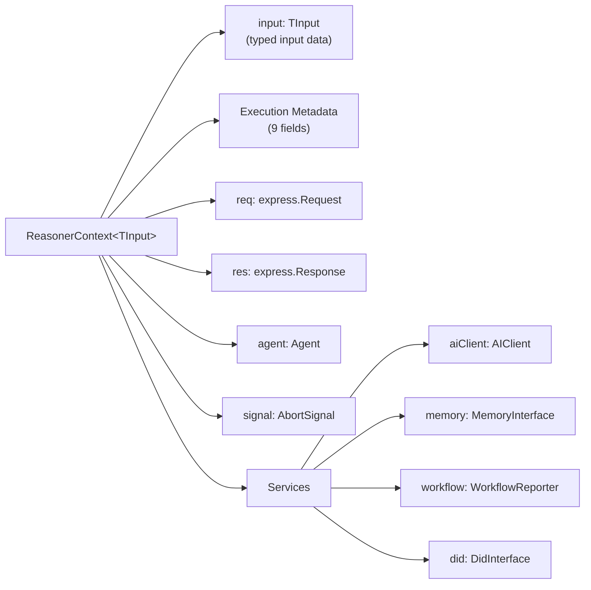
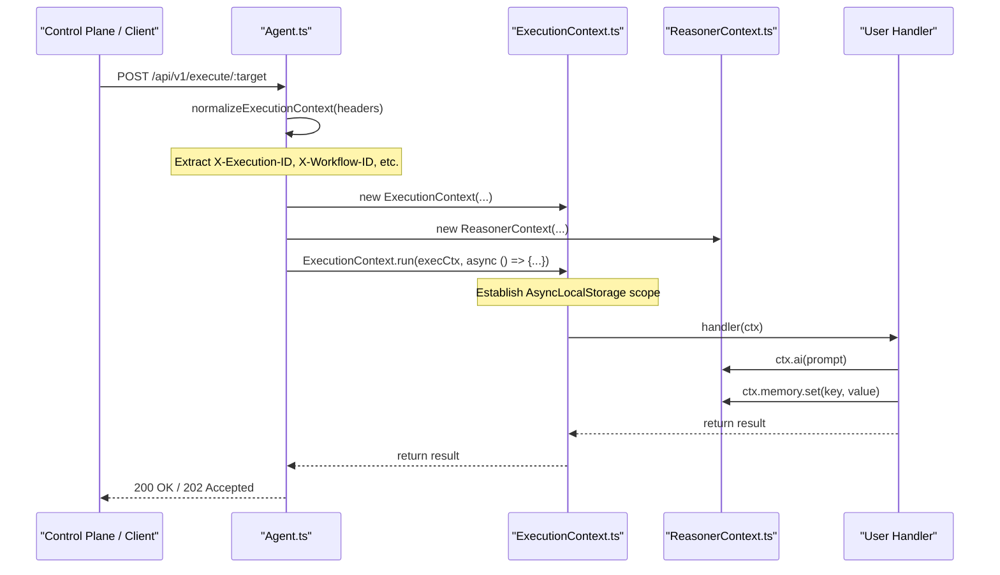

<!-- source: DeepWiki mcp.deepwiki.com · repo Agent-Field/agentfield · page 4.3 Execution Contexts · fetched 2026-10-26 -->

# Execution Contexts

<details>
<summary>Relevant source files</summary>

The following files were used as context for generating this wiki page:

- [sdk/typescript/src/agent/Agent.ts](sdk/typescript/src/agent/Agent.ts)
- [sdk/typescript/src/ai/AIClient.ts](sdk/typescript/src/ai/AIClient.ts)
- [sdk/typescript/src/client/AgentFieldClient.ts](sdk/typescript/src/client/AgentFieldClient.ts)
- [sdk/typescript/src/context/ReasonerContext.ts](sdk/typescript/src/context/ReasonerContext.ts)
- [sdk/typescript/src/index.ts](sdk/typescript/src/index.ts)
- [sdk/typescript/src/router/AgentRouter.ts](sdk/typescript/src/router/AgentRouter.ts)
- [sdk/typescript/src/triggers/factories.ts](sdk/typescript/src/triggers/factories.ts)
- [sdk/typescript/src/triggers/index.ts](sdk/typescript/src/triggers/index.ts)
- [sdk/typescript/src/triggers/types.ts](sdk/typescript/src/triggers/types.ts)
- [sdk/typescript/src/types/agent.ts](sdk/typescript/src/types/agent.ts)
- [sdk/typescript/src/types/reasoner.ts](sdk/typescript/src/types/reasoner.ts)
- [sdk/typescript/tests/agent.test.ts](sdk/typescript/tests/agent.test.ts)
- [sdk/typescript/tests/ai_client.test.ts](sdk/typescript/tests/ai_client.test.ts)
- [sdk/typescript/tests/triggers.test.ts](sdk/typescript/tests/triggers.test.ts)

</details>


This document describes the execution context system in the TypeScript SDK. Execution contexts provide handlers with access to execution metadata, service clients, and lifecycle information during reasoner and skill invocations.

For information about defining reasoners and skills, see [Reasoners and Skills](#4.2). For memory operations available through contexts, see [Memory Interface](#4.5). For AI client usage, see [AI Client](#4.4).

---

## Overview

The TypeScript SDK provides three context types that encapsulate execution state and service access:

| Context Type | Purpose | Available To |
|--------------|---------|--------------|
| `ExecutionContext` | Base execution tracking with AsyncLocalStorage | Internal use, propagation |
| `ReasonerContext` | Full service access for AI operations | Reasoner handlers |
| `SkillContext` | Subset of services for deterministic operations | Skill handlers |

Contexts serve as dependency injection containers, providing type-safe access to AI clients, memory interfaces, workflow reporters, and DID systems without requiring explicit parameter passing through nested calls.

**Sources:** [sdk/typescript/src/agent/Agent.ts:29-31](), [sdk/typescript/src/context/ReasonerContext.ts:13-29](), [sdk/typescript/src/context/SkillContext.ts:9-25]()

---

## Context Type Hierarchy

### Service Availability Diagram

```mermaid
graph TB
    ExecutionContext["ExecutionContext<br/>(Base Tracking)"]
    ReasonerContext["ReasonerContext&lt;TInput&gt;<br/>(AI + Services)"]
    SkillContext["SkillContext&lt;TInput&gt;<br/>(Deterministic Services)"]
    
    ExecutionContext --> ReasonerContext
    ExecutionContext --> SkillContext
    
    ReasonerContext --> ai["ai(prompt): Promise&lt;T&gt;"]
    ReasonerContext --> aiStream["aiStream(prompt): AIStream"]
    ReasonerContext --> call["call(target, input)"]
    ReasonerContext --> discover["discover(options)"]
    ReasonerContext --> memory["memory: MemoryInterface"]
    ReasonerContext --> workflow["workflow: WorkflowReporter"]
    ReasonerContext --> did["did: DidInterface"]
    ReasonerContext --> aiClient["aiClient: AIClient"]
    ReasonerContext --> signal["signal: AbortSignal"]
    
    SkillContext --> call2["discover(options)"]
    SkillContext --> memory2["memory: MemoryInterface"]
    SkillContext --> workflow2["workflow: WorkflowReporter"]
    SkillContext --> did2["did: DidInterface"]
```


**Sources:** [sdk/typescript/src/context/ReasonerContext.ts:13-42](), [sdk/typescript/src/context/SkillContext.ts:9-35]()

---

## ExecutionContext

`ExecutionContext` is the internal base context that tracks execution state using Node.js `AsyncLocalStorage`. It enables automatic context propagation through asynchronous call chains without explicit parameter threading.

### Structure

```typescript
class ExecutionContext {
  input: any
  metadata: ExecutionMetadata
  req: express.Request
  res: express.Response
  agent: Agent
  
  static run<T>(context: ExecutionContext, fn: () => Promise<T>): Promise<T>
  static getCurrent(): ExecutionContext | undefined
}
```

### Execution Metadata

The `ExecutionMetadata` interface contains execution tracking identifiers propagated via HTTP headers. The `Agent` class provides a normalization utility to map snake_case headers from the Control Plane to camelCase SDK fields.

| Field | Header | Description |
|-------|--------|-------------|
| `executionId` | `X-Execution-ID` | Unique ID for this invocation |
| `runId` | `X-Run-ID` | Parent run ID (defaults to executionId) |
| `workflowId` | `X-Workflow-ID` | Workflow-level ID (defaults to runId) |
| `sessionId` | `X-Session-ID` | Optional session scope |
| `actorId` | `X-Actor-ID` | Optional actor/user scope |
| `parentExecutionId` | `X-Parent-Execution-ID` | ID of calling execution |
| `callerDid` | `X-Caller-DID` | DID of caller component |
| `targetDid` | `X-Target-DID` | DID of target component |
| `agentNodeDid` | `X-Agent-Node-DID` | DID of agent node |

**Sources:** [sdk/typescript/src/agent/Agent.ts:92-108](), [sdk/typescript/src/context/ExecutionContext.ts:5-10](), [sdk/typescript/src/client/AgentFieldClient.ts:29-44]()

---

## ReasonerContext

`ReasonerContext<TInput>` is the primary context provided to reasoner handlers. It includes all services needed for AI-powered operations and execution lifecycle management.

### Properties



### Key Capabilities

| Property / Method | Type | Purpose |
|----------|------|---------|
| `ai()` | Method | Text generation or structured output with schema validation [sdk/typescript/src/context/ReasonerContext.ts:92-99]() |
| `aiWithTools()` | Method | Autonomous tool calling via discovery loop [sdk/typescript/src/context/ReasonerContext.ts:109-131]() |
| `pause()` | Method | Suspends execution for human-in-the-loop approval [sdk/typescript/src/context/ReasonerContext.ts:151-158]() |
| `signal` | `AbortSignal` | Short-circuits work if the Control Plane cancels the execution [sdk/typescript/src/context/ReasonerContext.ts:34-42]() |
| `memory` | `MemoryInterface` | Scoped KV and Vector storage [sdk/typescript/src/context/ReasonerContext.ts:31]() |

### Helper Methods

[sdk/typescript/src/context/ReasonerContext.ts:92-162]()

```typescript
// AI generation with automatic schema validation
ai<T>(prompt: string, options: AIRequestOptions & { schema: ZodSchema<T> }): Promise<T>

// Streaming AI responses
aiStream(prompt: string, options?: AIRequestOptions): Promise<AIStream>

// Cross-agent invocation
call(target: string, input: any): Promise<any>

// Capability discovery
discover(options?: DiscoveryOptions): Promise<DiscoveryResult>
```

**Sources:** [sdk/typescript/src/context/ReasonerContext.ts:13-179](), [sdk/typescript/src/agent/Agent.ts:133-144]()

---

## SkillContext

`SkillContext<TInput>` is provided to skill handlers. Skills are deterministic operations, so `SkillContext` excludes AI client access and complex workflow orchestration methods like `pause()`.

### Differences from ReasonerContext

| Feature | ReasonerContext | SkillContext |
|---------|----------------|--------------|
| `aiClient` property | ✅ Yes | ❌ No |
| `ai()` method | ✅ Yes | ❌ No |
| `aiWithTools()` | ✅ Yes | ❌ No |
| `pause()` method | ✅ Yes | ❌ No |
| `call()` method | ✅ Yes | ❌ No |
| `signal` (Abort) | ✅ Yes | ✅ Yes |
| `memory` property | ✅ Yes | ✅ Yes |
| `workflow` property | ✅ Yes | ✅ Yes |
| `did` property | ✅ Yes | ✅ Yes |

**Sources:** [sdk/typescript/src/context/SkillContext.ts:9-54]()

---

## Context Lifecycle

### Request Processing Flow



**Sources:** [sdk/typescript/src/agent/Agent.ts:92-108](), [sdk/typescript/src/context/ExecutionContext.ts:17-25]()

### Global Context Access

For code outside handler functions (e.g., utility modules), use `getCurrentContext()` to retrieve the active context from storage:

[sdk/typescript/src/context/ReasonerContext.ts:181-201]()

```typescript
import { getCurrentContext } from '@agentfield/sdk';

export async function logExecutionStep(msg: string) {
  const ctx = getCurrentContext();
  if (ctx) {
    ctx.logger.info(`[${ctx.executionId}] ${msg}`);
  }
}
```

---

## Serverless Context Handling

When deployed to serverless platforms, contexts are created from normalized event structures. The `Agent` provides adapters to convert platform-specific events (AWS Lambda, etc.) into `ServerlessEvent`.

### Metadata Merging

The SDK handles both `camelCase` and `snake_case` variants of execution metadata often found in cross-language (Python/TS) environments:

[sdk/typescript/src/agent/Agent.ts:92-108]()

```typescript
function normalizeExecutionContext(ctx: RawExecutionContext): Partial<ExecutionMetadata> {
  return {
    executionId: ctx.executionId ?? ctx.execution_id,
    runId: ctx.runId ?? ctx.run_id,
    workflowId: ctx.workflowId ?? ctx.workflow_id,
    // ... maps all 9 fields
  };
}
```

**Sources:** [sdk/typescript/src/types/agent.ts:192-208](), [sdk/typescript/src/agent/Agent.ts:92-108]()

---

## Summary of Metadata Headers

| SDK Field | HTTP Header | Internal Payload Key |
|-----------|-------------|----------------------|
| `executionId` | `X-Execution-ID` | `execution_id` |
| `runId` | `X-Run-ID` | `run_id` |
| `workflowId` | `X-Workflow-ID` | `workflow_id` |
| `sessionId` | `X-Session-ID` | `session_id` |
| `actorId` | `X-Actor-ID` | `actor_id` |
| `callerDid` | `X-Caller-DID` | `caller_did` |

**Sources:** [sdk/typescript/src/client/AgentFieldClient.ts:29-44](), [sdk/typescript/src/types/agent.ts:225-250]()

---

