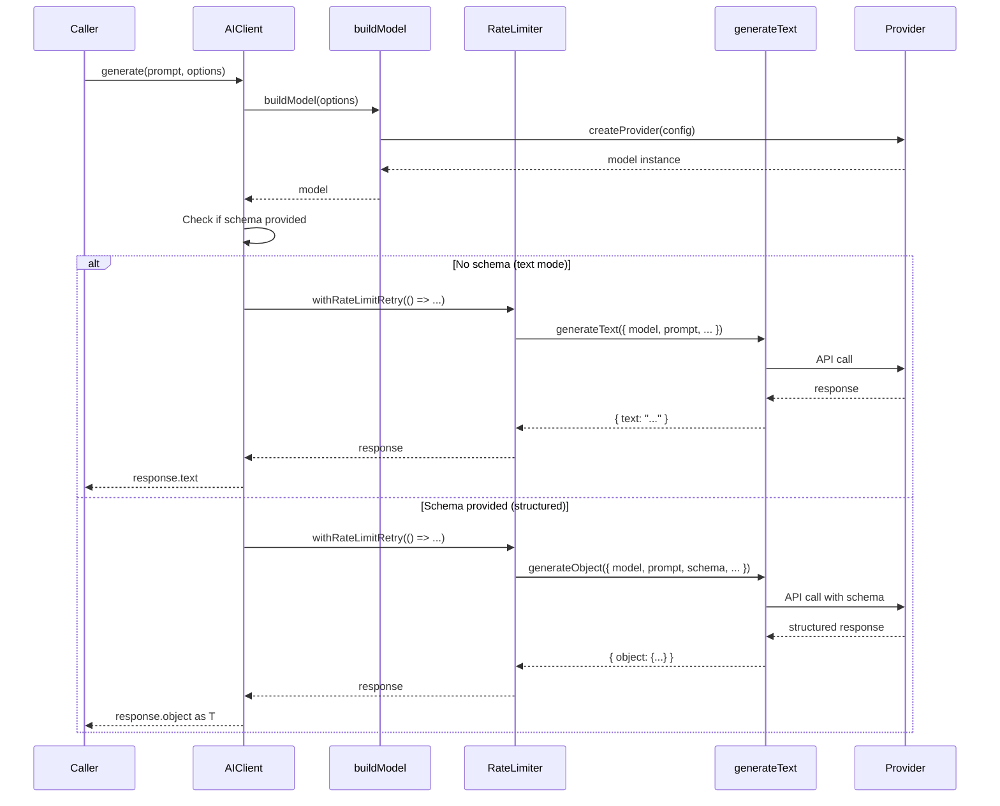
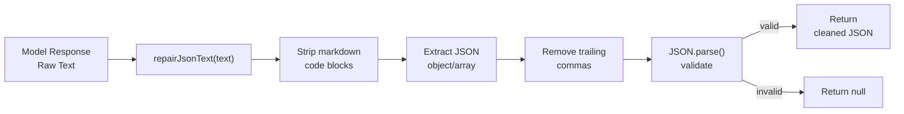
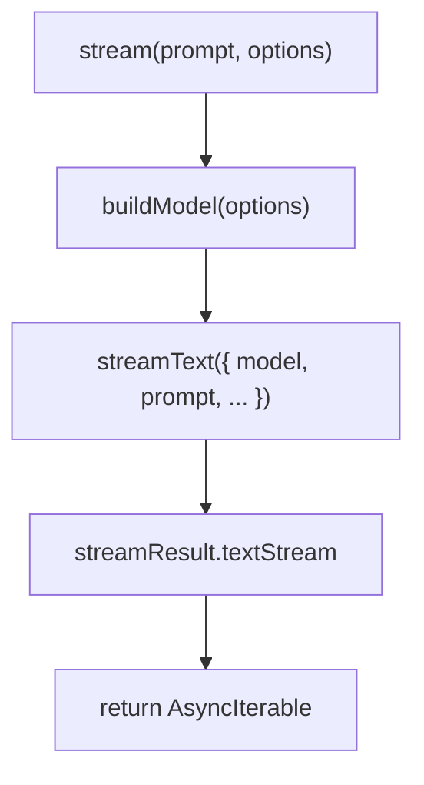
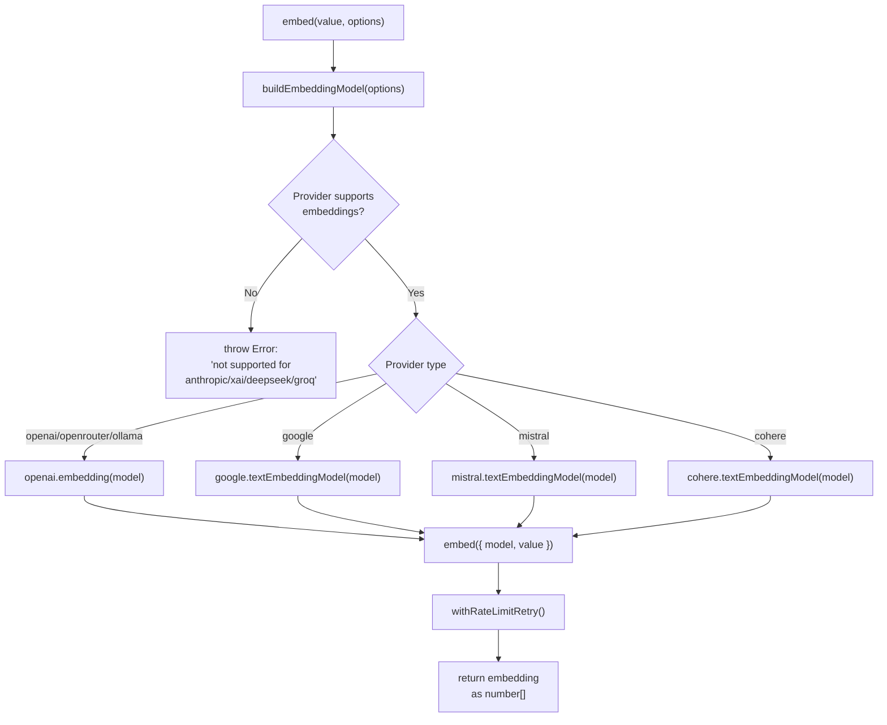
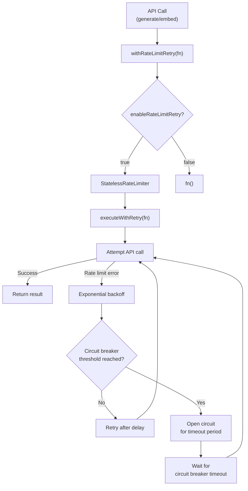
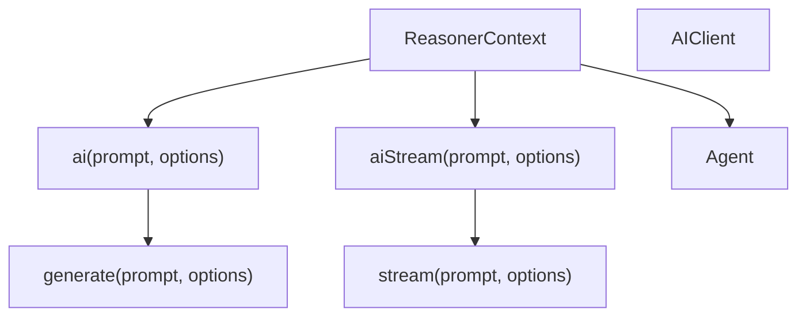

<!-- source: DeepWiki mcp.deepwiki.com · repo Agent-Field/agentfield · page 4.4 AI Client · fetched 2026-10-26 -->

# AI Client

<details>
<summary>Relevant source files</summary>

The following files were used as context for generating this wiki page:

- [control-plane/web/client/package-lock.json](control-plane/web/client/package-lock.json)
- [control-plane/web/client/package.json](control-plane/web/client/package.json)
- [control-plane/web/client/pnpm-lock.yaml](control-plane/web/client/pnpm-lock.yaml)
- [control-plane/web/client/src/components/ui/icon-bridge.tsx](control-plane/web/client/src/components/ui/icon-bridge.tsx)
- [control-plane/web/client/src/components/ui/icon.tsx](control-plane/web/client/src/components/ui/icon.tsx)
- [examples/benchmarks/100k-scale/mastra-bench/package-lock.json](examples/benchmarks/100k-scale/mastra-bench/package-lock.json)
- [examples/benchmarks/100k-scale/mastra-bench/package.json](examples/benchmarks/100k-scale/mastra-bench/package.json)
- [examples/python_agent_nodes/rag_evaluation/ui/package-lock.json](examples/python_agent_nodes/rag_evaluation/ui/package-lock.json)
- [examples/python_agent_nodes/rag_evaluation/ui/package.json](examples/python_agent_nodes/rag_evaluation/ui/package.json)
- [sdk/typescript/package-lock.json](sdk/typescript/package-lock.json)
- [sdk/typescript/src/agent/Agent.ts](sdk/typescript/src/agent/Agent.ts)
- [sdk/typescript/src/ai/AIClient.ts](sdk/typescript/src/ai/AIClient.ts)
- [sdk/typescript/src/client/AgentFieldClient.ts](sdk/typescript/src/client/AgentFieldClient.ts)
- [sdk/typescript/src/context/ReasonerContext.ts](sdk/typescript/src/context/ReasonerContext.ts)
- [sdk/typescript/src/index.ts](sdk/typescript/src/index.ts)
- [sdk/typescript/src/router/AgentRouter.ts](sdk/typescript/src/router/AgentRouter.ts)
- [sdk/typescript/src/triggers/factories.ts](sdk/typescript/src/triggers/factories.ts)
- [sdk/typescript/src/triggers/index.ts](sdk/typescript/src/triggers/index.ts)
- [sdk/typescript/src/triggers/types.ts](sdk/typescript/src/triggers/types.ts)
- [sdk/typescript/src/types/agent.ts](sdk/typescript/src/types/agent.ts)
- [sdk/typescript/src/types/reasoner.ts](sdk/typescript/src/types/reasoner.ts)
- [sdk/typescript/tests/agent.test.ts](sdk/typescript/tests/agent.test.ts)
- [sdk/typescript/tests/ai_client.test.ts](sdk/typescript/tests/ai_client.test.ts)
- [sdk/typescript/tests/triggers.test.ts](sdk/typescript/tests/triggers.test.ts)

</details>


The `AIClient` class in the TypeScript SDK provides a unified interface for interacting with Large Language Models (LLMs) from multiple providers. It handles text generation, structured output extraction, streaming responses, and embedding generation. The client abstracts provider-specific APIs behind a consistent interface and includes built-in rate limiting and retry logic.

For AI configuration at the agent level, see [AI Configuration](#10.2). For using AI within reasoners, see [Reasoners and Skills](#4.2).

---

## Overview

The `AIClient` class is located at [sdk/typescript/src/ai/AIClient.ts:76-332]() and serves as the primary interface for all AI operations in TypeScript agents. It is initialized within the `Agent` constructor at [sdk/typescript/src/agent/Agent.ts:160]() and exposed to execution contexts.

Key capabilities include:
- **Text generation**: Synchronous and streaming responses.
- **Structured output**: Type-safe extraction with Zod schemas and automatic JSON repair.
- **Embeddings**: Vector generation for RAG systems via `embed()` and `embedMany()`.
- **Multi-provider**: Unified API across OpenAI, Anthropic, Google, and others.
- **Resilience**: Automatic rate limit handling with exponential backoff and circuit breakers.

**Sources:** [sdk/typescript/src/ai/AIClient.ts:76-92](), [sdk/typescript/src/agent/Agent.ts:160-160]()

---

## Provider Architecture

### Supported Providers

The `AIClient` supports the following providers via dedicated AI SDK packages:

| Provider | Package | Models | Embeddings |
|----------|---------|--------|------------|
| `openai` | `@ai-sdk/openai` | GPT-4, GPT-3.5, etc. | ✓ |
| `anthropic` | `@ai-sdk/anthropic` | Claude 3.5, Claude 3 | ✗ |
| `google` | `@ai-sdk/google` | Gemini 2.0, Gemini 1.5 | ✓ |
| `mistral` | `@ai-sdk/mistral` | Mistral Large, etc. | ✓ |
| `groq` | `@ai-sdk/groq` | Llama 3.1, Mixtral | ✗ |
| `xai` | `@ai-sdk/xai` | Grok | ✗ |
| `deepseek` | `@ai-sdk/deepseek` | DeepSeek Chat | ✗ |
| `cohere` | `@ai-sdk/cohere` | Command R+ | ✓ |
| `openrouter` | `@ai-sdk/openai` (compatible) | 100+ models | ✓ |
| `ollama` | `@ai-sdk/openai` (compatible) | Local models | ✓ |

**Sources:** [sdk/typescript/src/ai/AIClient.ts:168-256](), [sdk/typescript/package-lock.json:12-20](), [sdk/typescript/tests/ai_client.test.ts:223-228]()

### Provider Factory Pattern

```mermaid
graph TB
    AIClient["AIClient"]
    buildModel["buildModel(options)"]
    buildEmbeddingModel["buildEmbeddingModel(options)"]
    
    AIClient --> buildModel
    AIClient --> buildEmbeddingModel
    
    buildModel --> providerSwitch{"provider type"}
    
    providerSwitch -->|"openai"| createOpenAI["createOpenAI()"]
    providerSwitch -->|"anthropic"| createAnthropic["createAnthropic()"]
    providerSwitch -->|"google"| createGoogle["createGoogleGenerativeAI()"]
    providerSwitch -->|"mistral"| createMistral["createMistral()"]
    providerSwitch -->|"groq"| createGroq["createGroq()"]
    providerSwitch -->|"xai"| createXai["createXai()"]
    providerSwitch -->|"deepseek"| createDeepSeek["createDeepSeek()"]
    providerSwitch -->|"cohere"| createCohere["createCohere()"]
    providerSwitch -->|"openrouter"| openrouterOpenAI["createOpenAI()<br/>baseURL: openrouter.ai"]
    providerSwitch -->|"ollama"| ollamaOpenAI["createOpenAI()<br/>baseURL: localhost:11434"]
    
    createOpenAI --> modelInstance["model(modelName)"]
    createAnthropic --> modelInstance
    createGoogle --> modelInstance
    createMistral --> modelInstance
    createGroq --> modelInstance
    createXai --> modelInstance
    createDeepSeek --> modelInstance
    createCohere --> modelInstance
    openrouterOpenAI --> modelInstance
    ollamaOpenAI --> modelInstance
    
    buildEmbeddingModel --> embeddingSwitch{"provider type"}
    embeddingSwitch -->|"openai/openrouter/ollama"| embeddingFn["openai.embedding(modelName)"]
    embeddingSwitch -->|"google"| textEmbeddingModel["google.textEmbeddingModel(modelName)"]
    embeddingSwitch -->|"mistral"| mistralEmbedding["mistral.textEmbeddingModel(modelName)"]
    embeddingSwitch -->|"cohere"| cohereEmbedding["cohere.textEmbeddingModel(modelName)"]
    embeddingSwitch -->|"anthropic/xai/deepseek/groq"| throwError["throw Error<br/>'not supported'"]
```



**Diagram: Provider Factory Pattern**

The `buildModel()` method at [sdk/typescript/src/ai/AIClient.ts:168-256]() creates provider-specific model instances. OpenRouter and Ollama use OpenAI-compatible endpoints. The `buildEmbeddingModel()` method at [sdk/typescript/src/ai/AIClient.ts:258-310]() handles embedding model creation, with four providers (Anthropic, xAI, DeepSeek, Groq) explicitly blocking embedding requests.

**Sources:** [sdk/typescript/src/ai/AIClient.ts:168-310](), [sdk/typescript/tests/ai_client.test.ts:101-220]()

---

## Text Generation

### Basic Generation

The `generate()` method provides synchronous text generation:

```typescript
async generate(prompt: string, options?: AIRequestOptions): Promise<string>
async generate<T>(prompt: string, options: AIRequestOptions & { schema: ZodSchema<T> }): Promise<T>
```

The method has two overloads: one for plain text responses and one for structured output with a Zod schema.

**Implementation Flow:**



**Diagram: Text Generation Flow**

The implementation at [sdk/typescript/src/ai/AIClient.ts:93-131]() uses the `ai` SDK's `generateText()` function for plain text and `generateObject()` for structured output.

**Sources:** [sdk/typescript/src/ai/AIClient.ts:93-131](), [sdk/typescript/src/context/ReasonerContext.ts:92-99]()

### Request Options

The `AIRequestOptions` interface at [sdk/typescript/src/ai/AIClient.ts:53-67]() defines available configuration:

```typescript
interface AIRequestOptions {
  system?: string;              // System prompt
  schema?: ZodSchema<any>;      // For structured output
  model?: string;               // Override model
  temperature?: number;         // Sampling temperature
  maxTokens?: number;           // Max output tokens
  provider?: AIConfig['provider']; // Override provider
  mode?: 'auto' | 'json' | 'tool'; // Structured output mode
}
```

The `mode` option controls how structured output is generated:
- `'auto'`: Provider chooses (default, uses tool calling).
- `'json'`: Forces JSON mode (better compatibility).
- `'tool'`: Explicitly uses tool/function calling.

The default mode is `'json'` for better cross-provider compatibility, as noted at [sdk/typescript/src/ai/AIClient.ts:100-102]().

**Sources:** [sdk/typescript/src/ai/AIClient.ts:53-67](), [sdk/typescript/src/ai/AIClient.ts:98-117]()

---

## Structured Output

### JSON Repair

The `AIClient` includes automatic JSON repair for malformed responses:



**Diagram: JSON Repair Pipeline**

The `repairJsonText()` function at [sdk/typescript/src/ai/AIClient.ts:26-51]() handles common issues:
- Strips markdown code blocks (````json ... ``` or ``` ... ````).
- Extracts JSON from surrounding text.
- Removes trailing commas before `}` or `]`.
- Validates with `JSON.parse()`.

This function is passed to `generateObject()` as `experimental_repairText` at [sdk/typescript/src/ai/AIClient.ts:113]().

**Sources:** [sdk/typescript/src/ai/AIClient.ts:26-51](), [sdk/typescript/src/ai/AIClient.ts:98-117]()

### Type Safety

Structured output uses Zod schemas for runtime validation and compile-time type inference. The `ZodSchema` type is defined at [sdk/typescript/src/ai/AIClient.ts:20]():

```typescript
export type ZodSchema<T> = z.Schema<T, z.ZodTypeDef, any>;
```

When a schema is provided, the `generate()` method returns the typed object directly, with the return type inferred from the schema.

**Sources:** [sdk/typescript/src/ai/AIClient.ts:20](), [sdk/typescript/src/ai/AIClient.ts:93-95]()

---

## Streaming

### Stream Interface

The `stream()` method provides token-by-token streaming:

```typescript
async stream(prompt: string, options?: AIRequestOptions): Promise<AIStream>

type AIStream = AsyncIterable<string>
```

The returned `AIStream` is an async iterable that yields text chunks as they arrive from the provider.

**Implementation:**



**Diagram: Streaming Flow**

The implementation at [sdk/typescript/src/ai/AIClient.ts:133-144]() uses the AI SDK's `streamText()` function and returns its `textStream` property.

**Usage in Context:**

The `ReasonerContext` exposes streaming via the `aiStream()` method at [sdk/typescript/src/context/ReasonerContext.ts:133-135]():

```typescript
aiStream(prompt: string, options?: AIRequestOptions): Promise<AIStream> {
  return this.aiClient.stream(prompt, options);
}
```

**Sources:** [sdk/typescript/src/ai/AIClient.ts:69](), [sdk/typescript/src/ai/AIClient.ts:133-144](), [sdk/typescript/src/context/ReasonerContext.ts:133-135]()

---

## Embeddings

### Embedding Methods

The `AIClient` provides two embedding methods at [sdk/typescript/src/ai/AIClient.ts:146-166]():

```typescript
async embed(value: string, options?: AIEmbeddingOptions): Promise<number[]>
async embedMany(values: string[], options?: AIEmbeddingOptions): Promise<number[][]>
```

Where `AIEmbeddingOptions` is defined at [sdk/typescript/src/ai/AIClient.ts:71-74]():

```typescript
interface AIEmbeddingOptions {
  model?: string;
  provider?: AIConfig['provider'];
}
```

### Provider Support



**Diagram: Embedding Generation Flow**

The embedding check at [sdk/typescript/src/ai/AIClient.ts:263-266]() explicitly blocks providers that do not support standard embedding APIs.

Default embedding models:
- **OpenAI/OpenRouter/Ollama**: `text-embedding-3-small` [sdk/typescript/src/ai/AIClient.ts:259-260]().
- **Google/Mistral/Cohere**: Uses the model specified in config or passed in options.

**Sources:** [sdk/typescript/src/ai/AIClient.ts:146-166](), [sdk/typescript/src/ai/AIClient.ts:258-310](), [sdk/typescript/tests/ai_client.test.ts:222-298]()

---

## Rate Limiting

### StatelessRateLimiter

The `AIClient` integrates with the `StatelessRateLimiter` class for automatic retry on rate limit errors.



**Diagram: Rate Limiting and Retry Flow**

The retry logic is implemented at [sdk/typescript/src/ai/AIClient.ts:326-331](). It uses the `executeWithRetry` method of the limiter.

### Configuration

Rate limiter configuration is set in the `AIConfig` at [sdk/typescript/src/types/agent.ts:77-83]():

| Option | Default | Description |
|--------|---------|-------------|
| `enableRateLimitRetry` | `true` | Enable automatic retry. |
| `rateLimitMaxRetries` | `20` | Maximum retry attempts. |
| `rateLimitBaseDelay` | `1.0` | Initial delay (seconds). |
| `rateLimitMaxDelay` | `300.0` | Maximum delay (seconds). |
| `rateLimitJitterFactor` | `0.25` | Random jitter (0-1). |
| `rateLimitCircuitBreakerThreshold` | `10` | Failures before circuit opens. |
| `rateLimitCircuitBreakerTimeout` | `300` | Circuit open duration (seconds). |

**Sources:** [sdk/typescript/src/ai/AIClient.ts:312-331](), [sdk/typescript/src/types/agent.ts:77-83]()

---

## Configuration

### AIConfig Interface

The `AIClient` is configured via the `AIConfig` interface defined at [sdk/typescript/src/types/agent.ts:56-84]().

### Default Values

The constructor at [sdk/typescript/src/ai/AIClient.ts:80-91]() applies defaults using the spread operator. Provider and model defaults are applied lazily at request time in `buildModel()` and `buildEmbeddingModel()`.

**Sources:** [sdk/typescript/src/ai/AIClient.ts:80-91](), [sdk/typescript/src/ai/AIClient.ts:169-170](), [sdk/typescript/src/ai/AIClient.ts:259-260]()

---

## Usage in Contexts

### ReasonerContext Integration

The `ReasonerContext` class provides convenient access to AI operations:



**Diagram: ReasonerContext-AIClient Connection**

The `ReasonerContext` at [sdk/typescript/src/context/ReasonerContext.ts:92-135]() exposes `ai()` and `aiStream()` which delegate to the `aiClient` property.

**Sources:** [sdk/typescript/src/context/ReasonerContext.ts:92-135](), [sdk/typescript/src/agent/Agent.ts:160-160]()

### Tool Calling Integration

The `ReasonerContext` also provides `aiWithTools()` at [sdk/typescript/src/context/ReasonerContext.ts:109-131](), which uses the `AIClient` to perform automated discovery and multi-turn tool execution.

**Sources:** [sdk/typescript/src/context/ReasonerContext.ts:109-131](), [sdk/typescript/src/ai/ToolCalling.ts:10-10]()

---

