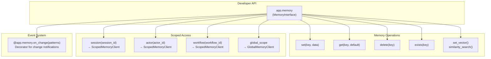
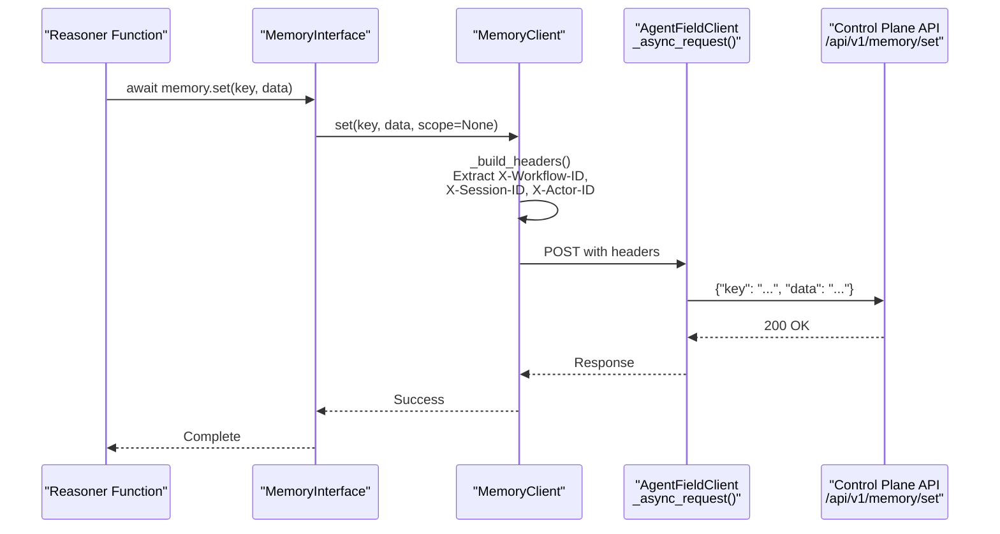
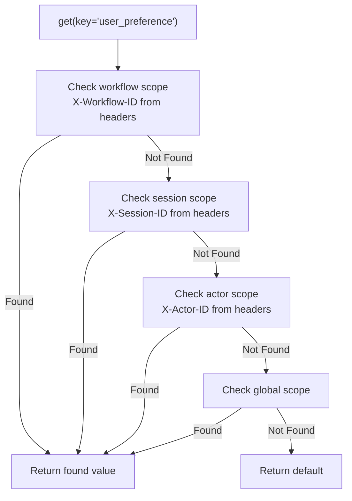
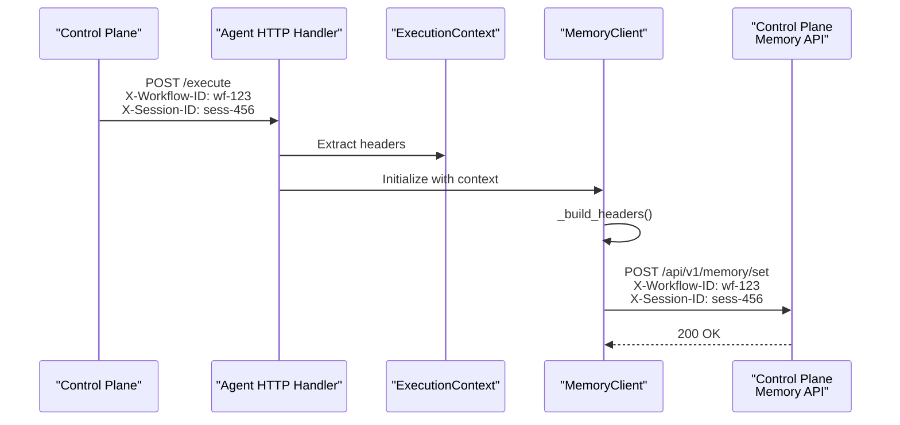

<!-- source: DeepWiki mcp.deepwiki.com · repo Agent-Field/agentfield · page 4.5 Memory Interface · fetched 2026-10-26 -->

# Memory Interface

<details>
<summary>Relevant source files</summary>

The following files were used as context for generating this wiki page:

- [sdk/python/agentfield/memory.py](sdk/python/agentfield/memory.py)
- [sdk/python/agentfield/memory_events.py](sdk/python/agentfield/memory_events.py)
- [sdk/python/tests/test_memory_scope_kwargs.py](sdk/python/tests/test_memory_scope_kwargs.py)
- [sdk/typescript/src/context/SkillContext.ts](sdk/typescript/src/context/SkillContext.ts)
- [sdk/typescript/src/memory/MemoryClient.ts](sdk/typescript/src/memory/MemoryClient.ts)
- [sdk/typescript/src/memory/MemoryEventClient.ts](sdk/typescript/src/memory/MemoryEventClient.ts)
- [sdk/typescript/src/memory/MemoryInterface.ts](sdk/typescript/src/memory/MemoryInterface.ts)
- [sdk/typescript/tests/memory_and_discovery.test.ts](sdk/typescript/tests/memory_and_discovery.test.ts)
- [sdk/typescript/tests/memory_event_client.test.ts](sdk/typescript/tests/memory_event_client.test.ts)
- [tests/functional/agents/memory_events_decorator_agent.py](tests/functional/agents/memory_events_decorator_agent.py)
- [tests/functional/tests/test_memory_events.py](tests/functional/tests/test_memory_events.py)

</details>


This page documents the Python SDK's memory interface, which provides persistent key-value storage with automatic scoping, hierarchical lookup, and real-time change notifications. The memory system enables agents to share state across distributed executions while maintaining isolation through four-tier scoping (workflow → session → actor → global).

For information about the TypeScript memory interface, see [4.5](). For the underlying control plane memory storage implementation, see [7](). For memory event subscriptions and WebSocket communication, see [7.4]().

---

## Core Concepts

The memory interface operates on a four-tier scoping hierarchy:

| Scope | Description | Typical Lifetime | Isolation Level |
|-------|-------------|------------------|-----------------|
| `workflow` | Single workflow execution | Minutes to hours | Highest - workflow-specific |
| `session` | User or conversation session | Hours to days | Session-specific |
| `actor` | Individual agent or user | Days to weeks | Actor-specific |
| `global` | Shared across all agents | Persistent | Lowest - system-wide |

**Hierarchical Lookup**: When retrieving data with `get()`, the system searches scopes in order (workflow → session → actor → global) and returns the first match found. This allows specific scopes to override more general ones. [sdk/python/agentfield/memory.py:47-56]()

**Automatic Scoping**: Memory operations automatically use the current execution context (workflow ID, session ID, actor ID) from HTTP headers propagated through the control plane. Explicit scope overrides are also supported. [sdk/python/agentfield/memory.py:150-171]()

Sources: [sdk/python/agentfield/memory.py:1-98]()

---

## Memory Interface Class

The primary developer-facing API is the `MemoryInterface` class, exposed as `app.memory` on agent instances.



**Memory Interface Methods**
The `MemoryInterface` acts as a facade over the `MemoryClient`, providing a cleaner API for common operations while managing the `MemoryEventClient` for reactive programming. [sdk/python/agentfield/memory.py:571-581]()

Sources: [sdk/python/agentfield/memory.py:571-724]()

---

## Key-Value Operations

### Setting Values

```python
# Automatic scoping based on execution context
await app.memory.set("user_preference", "dark_mode")

# Explicit scope override
await app.memory.set("theme", "solarized", scope="session", scope_id="session-123")
```

The `set()` method stores JSON-serializable data with automatic scope detection based on execution context headers (`X-Workflow-ID`, `X-Session-ID`, `X-Actor-ID`). [sdk/python/agentfield/memory.py:187-205]()

**Implementation Flow**:



Sources: [sdk/python/agentfield/memory.py:132-171](), [sdk/python/agentfield/memory.py:187-228]()

### Getting Values

```python
# Hierarchical lookup across all scopes
value = await app.memory.get("user_preference", default="light_mode")

# Scope-specific lookup via scoped client
value = await app.memory.session("session-123").get("theme")
```

The `get()` method performs hierarchical lookup when no explicit scope is provided. The control plane searches workflow → session → actor → global and returns the first match. [sdk/python/agentfield/memory.py:47-56]()

**Hierarchical Lookup Diagram**:



Sources: [sdk/python/agentfield/memory.py:230-279](), [sdk/python/agentfield/memory.py:607-621]()

### Other Operations

| Method | Purpose | Returns |
|--------|---------|---------|
| `exists(key)` | Check if key exists in any scope | `bool` |
| `delete(key)` | Remove key from current scope | `None` |
| `list_keys(scope)` | List all keys in a specific scope | `List[str]` |

The `exists()` method [sdk/python/agentfield/memory.py:281-298]() attempts to retrieve the value and returns `True` if found, `False` otherwise.

The `delete()` method [sdk/python/agentfield/memory.py:300-324]() removes the key from the scope determined by execution context headers.

Sources: [sdk/python/agentfield/memory.py:281-355](), [sdk/python/agentfield/memory.py:624-642]()

---

## Vector Storage

The memory interface supports storing vector embeddings for similarity search operations, enabling RAG (Retrieval-Augmented Generation) applications.

### Storing Vectors

```python
# Store an embedding with metadata
embedding = [0.1, 0.2, 0.3, ...] 
await app.memory.set_vector(
    key="doc:readme",
    embedding=embedding,
    metadata={"title": "README", "type": "documentation"}
)
```

The `set_vector()` method [sdk/python/agentfield/memory.py:357-385]() accepts:
- `key`: Unique identifier for the vector
- `embedding`: Sequence of floats (list, tuple, or numpy array)
- `metadata`: Optional dict with filterable attributes

**Vector Normalization**: The `_vector_to_list()` helper [sdk/python/agentfield/memory.py:123-130]() converts numpy arrays and other sequence types to plain Python lists.

### Similarity Search

```python
# Search for similar vectors
query_embedding = [0.15, 0.22, 0.31, ...]
results = await app.memory.similarity_search(
    query_embedding=query_embedding,
    top_k=5,
    filters={"type": "documentation"}
)
```

The `similarity_search()` method [sdk/python/agentfield/memory.py:410-441]() performs cosine similarity search against stored vectors, returning the top-k most similar entries with their metadata and similarity scores.

Sources: [sdk/python/agentfield/memory.py:357-441](), [sdk/python/agentfield/memory.py:596-661]()

---

## Memory Events

The memory interface provides reactive event subscriptions using the `@memory.on_change()` decorator, enabling agents to respond to memory changes in real-time.

### Pattern Matching

Subscriptions support wildcard patterns for granular event filtering. [sdk/python/agentfield/memory_events.py:18-42]()

**Pattern Matching Examples**:

- **Exact Match**: `preferences.theme`
- **Wildcard Match**: `preferences.*` [tests/functional/agents/memory_events_decorator_agent.py:144]()
- **Nested Wildcard**: `settings.*.primary` [tests/functional/agents/memory_events_decorator_agent.py:148]()
- **Multi-Wildcard**: `features.*.flag.*` [tests/functional/agents/memory_events_decorator_agent.py:152]()

Sources: [sdk/python/agentfield/memory_events.py:18-82](), [tests/functional/agents/memory_events_decorator_agent.py:140-166]()

### Event Object Structure

Memory events provide comprehensive change information via the `MemoryChangeEvent` type. [sdk/python/agentfield/types.py:11]() (Note: Reference to types.py inferred from usage in memory_events.py).

| Property | Description |
|----------|-------------|
| `key` | Memory key that changed |
| `data` | New value (for set operations) |
| `action` | Operation type (set/delete) |
| `scope` | Memory scope (workflow/session/actor/global) |
| `scope_id` | Scope identifier (workflow ID, session ID, etc.) |
| `timestamp` | ISO 8601 timestamp |

Sources: [sdk/python/agentfield/memory_events.py:44-82](), [tests/functional/tests/test_memory_events.py:50-56]()

---

## Scoped Memory Clients

Factory methods return specialized clients that pin operations to a specific scope.

### Scope Accessors

| Method | Client Type | Description |
|--------|-------------|-------------|
| `app.memory.session(id)` | `ScopedMemoryClient` | Scoped to a specific conversation session. [sdk/python/agentfield/memory.py:675-687]() |
| `app.memory.actor(id)` | `ScopedMemoryClient` | Scoped to a specific actor across sessions. [sdk/python/agentfield/memory.py:689-699]() |
| `app.memory.workflow(id)` | `ScopedMemoryClient` | Scoped to a single execution run. [sdk/python/agentfield/memory.py:701-713]() |
| `app.memory.global_scope` | `GlobalMemoryClient` | Shared across all agents and sessions. [sdk/python/agentfield/memory.py:715-724]() |

### Scoped Event Subscriptions

Scoped clients provide an `on_change()` decorator that automatically filters for the client's scope and ID. [sdk/python/agentfield/memory.py:450-463]()

```python
session_memory = app.memory.session("session-123")

@session_memory.on_change("preferences.*")
async def handle_session_preference(event):
    # Only receives events for session-123
    pass
```

Sources: [sdk/python/agentfield/memory.py:357-569](), [sdk/python/agentfield/memory.py:675-724]()

---

## Context Propagation

Memory operations automatically extract execution context from HTTP headers to determine scoping.



### Header Mapping

The `_build_headers()` method [sdk/python/agentfield/memory.py:150-171]() converts execution context to HTTP headers:

| Context Property | HTTP Header |
|------------------|-------------|
| `workflow_id` | `X-Workflow-ID` |
| `session_id` | `X-Session-ID` |
| `actor_id` | `X-Actor-ID` |
| `agent_node_id` | `X-Agent-Node-ID` |

Sources: [sdk/python/agentfield/memory.py:150-171](), [sdk/python/agentfield/memory.py:55-75]() (Note: logic exists in both MemoryClient and base classes).

---

