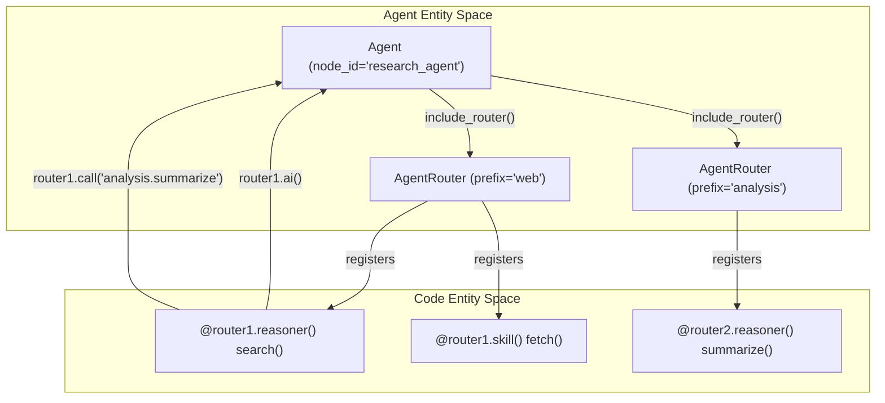
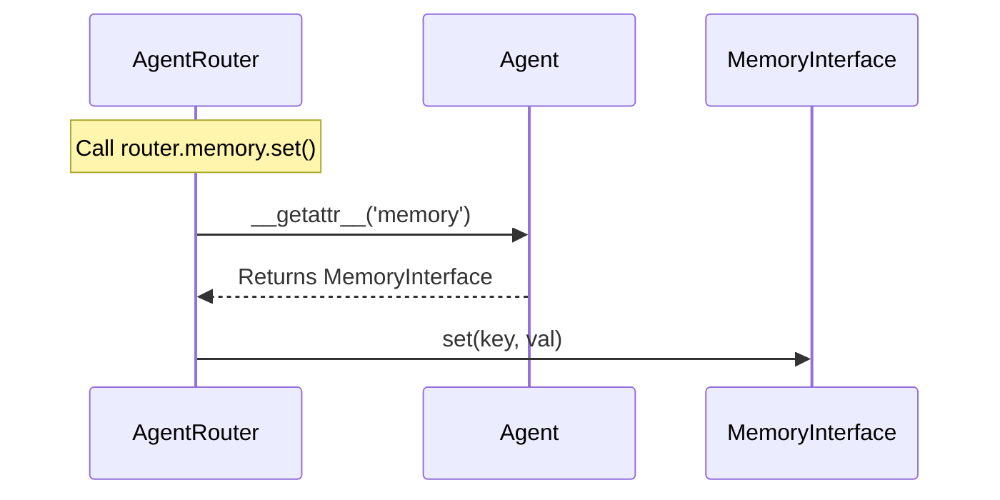

<!-- source: DeepWiki mcp.deepwiki.com · repo Agent-Field/agentfield · page 4.6 AgentRouter · fetched 2026-10-26 -->

# AgentRouter

<details>
<summary>Relevant source files</summary>

The following files were used as context for generating this wiki page:

- [sdk/python/agentfield/decorator_metadata.py](sdk/python/agentfield/decorator_metadata.py)
- [sdk/python/agentfield/decorators.py](sdk/python/agentfield/decorators.py)
- [sdk/python/agentfield/router.py](sdk/python/agentfield/router.py)
- [sdk/python/tests/test_accepts_webhook.py](sdk/python/tests/test_accepts_webhook.py)
- [sdk/python/tests/test_decorator_code_origin.py](sdk/python/tests/test_decorator_code_origin.py)
- [sdk/python/tests/test_router.py](sdk/python/tests/test_router.py)
- [sdk/python/tests/test_trigger_param_binding.py](sdk/python/tests/test_trigger_param_binding.py)
- [sdk/python/tests/test_workflow_parent_child.py](sdk/python/tests/test_workflow_parent_child.py)

</details>


## Purpose and Scope

The `AgentRouter` class provides a modular approach to organizing agent capabilities (reasoners and skills) by grouping them under common prefixes. It enables code organization through separation of concerns, allowing developers to split large agent implementations into logical submodules while maintaining a unified agent interface.

For information about defining reasoners, see [3.2 Defining Reasoners](). For information about defining skills, see [3.3 Defining Skills](). For the TypeScript equivalent, see [4.6 AgentRouter (TypeScript)]().

---

## Core Concepts

### Router as Capability Organizer

An `AgentRouter` functions similarly to FastAPI's `APIRouter` but is specifically designed for organizing agent capabilities:

- **Prefix Scoping**: All reasoners and skills registered on a router inherit a common prefix [sdk/python/agentfield/router.py:21]().
- **Modular Organization**: Split agent logic into focused routers (e.g., `data_router`, `analysis_router`).
- **Automatic Delegation**: Routers transparently proxy all `Agent` methods (like `ai()`, `call()`, `memory`, `note()`, `discover()`) to the attached agent instance [sdk/python/agentfield/router.py:119-151]().
- **Tag Propagation**: Tags applied to routers propagate and merge with tags on individual reasoners and skills [sdk/python/agentfield/router.py:51](), [sdk/python/agentfield/router.py:100]().
- **Workflow Tracking**: Router reasoners are wrapped to ensure that direct internal calls between reasoners are properly instrumented for workflow tracking [sdk/python/agentfield/router.py:54-60]().

**Sources:** [sdk/python/agentfield/router.py:17-27](), [sdk/python/agentfield/router.py:119-151]()

---

## Architecture Overview

### Router-Agent Relationship

The diagram below shows how an `Agent` acts as the root container while `AgentRouter` instances provide namespace isolation for logic.



**Sources:** [sdk/python/agentfield/router.py:17-27](), [sdk/python/agentfield/router.py:119-151]()

---

## Creating and Attaching Routers

### Basic Router Creation

```python
from agentfield import Agent, AgentRouter

app = Agent(node_id="research_agent")

# Create routers for different capability domains
web_router = AgentRouter(prefix="web", tags=["v1"])
analysis_router = AgentRouter(prefix="analysis")

# Attach routers to the agent
app.include_router(web_router)
app.include_router(analysis_router)
```

### Prefix and Path Resolution

The router normalizes paths by combining the router's `prefix` with the capability's `path`. If a capability path starts with `/`, it is treated as an absolute path and overrides the router prefix [sdk/python/agentfield/router.py:173-174]().

| Router Prefix | Capability Path | Resulting API Path |
|--------------|-----------------|--------------------|
| `"web"`      | `"search"`      | `/web/search`      |
| `"/web"`     | `None`          | `/web`             |
| `"group"`    | `"/reasoners/f"`| `/reasoners/f`     |
| `"group"`    | `"reasoners/f"` | `/reasoners/group/f`|

**Sources:** [sdk/python/agentfield/router.py:165-201](), [sdk/python/tests/test_router.py:95-108]()

---

## Defining Capabilities on Routers

### Reasoners on Routers

Reasoners on a router benefit from automatic workflow instrumentation. When one router reasoner calls another, the call is intercepted and routed through the agent's workflow handler [sdk/python/agentfield/router.py:57-60]().

```python
web_router = AgentRouter(prefix="web")

@web_router.reasoner(path="search")
async def search_webpage(query: str) -> dict:
    # Delegates to app.ai() via __getattr__
    result = await web_router.ai(prompt=f"Search: {query}")
    return {"result": result}

app.include_router(web_router)
```

### Skills on Routers

Skills are registered similarly but do not include the workflow wrapper, as they are intended to be deterministic atomic operations [sdk/python/agentfield/router.py:87-115]().

```python
@web_router.skill(tags=["network"])
def fetch_html(url: str) -> str:
    import requests
    return requests.get(url).text
```

**Sources:** [sdk/python/agentfield/router.py:30-85](), [sdk/python/agentfield/router.py:87-115]()

---

## Delegation to Parent Agent

### Method Proxying via `__getattr__`

The `AgentRouter` uses Python's `__getattr__` to proxy calls to the underlying `Agent` instance. This allows code inside a router to access all agent features without needing a direct reference to the `app` object [sdk/python/agentfield/router.py:119-151]().



| Router Proxy Call | Resulting Agent Operation |
|-------------------|---------------------------|
| `router.ai(...)`  | `agent.ai(...)`           |
| `router.call(...)`| `agent.call(...)`          |
| `router.memory`   | `agent.memory`            |
| `router.note(...)`| `agent.note(...)`          |

### Attachment Requirements

Accessing any delegated property before the router is attached to an agent via `app.include_router(router)` will raise an `AgentFieldClientError` [sdk/python/agentfield/router.py:141-144]().

**Sources:** [sdk/python/agentfield/router.py:119-151](), [sdk/python/tests/test_router.py:33-50]()

---

## Tag Propagation

Tags defined at the router level are prepended to tags defined at the function level.

```python
router = AgentRouter(tags=["base"])

@router.skill(tags=["extra"])
def my_skill():
    pass

# Resulting tags: ["base", "extra"]
```

**Sources:** [sdk/python/agentfield/router.py:51](), [sdk/python/agentfield/router.py:100](), [sdk/python/tests/test_router.py:52-74]()

---

## Workflow Tracking and Direct Calls

One of the primary technical advantages of `AgentRouter` is how it handles direct function calls. When a reasoner is defined on a router, the decorator returns a `wrapper`. This wrapper checks if the router has been attached to an agent and if the function is "tracked" [sdk/python/agentfield/router.py:54-60]().

If `router_a.reasoner_1` calls `router_a.reasoner_2()` directly:
1. The call hits the wrapper of `reasoner_2`.
2. The wrapper looks up the "tracked" version of the function in `_tracked_functions`.
3. It executes the tracked version, which ensures the call appears as a child node in the Control Plane workflow DAG [sdk/python/tests/test_workflow_parent_child.py:58-80]().

**Sources:** [sdk/python/agentfield/router.py:54-64](), [sdk/python/tests/test_workflow_parent_child.py:58-80]()

---

## Sources:
- [sdk/python/agentfield/router.py:1-201]()
- [sdk/python/tests/test_router.py:1-150]()
- [sdk/python/agentfield/decorators.py:125-170]()
- [sdk/python/tests/test_workflow_parent_child.py:58-109]()

---

