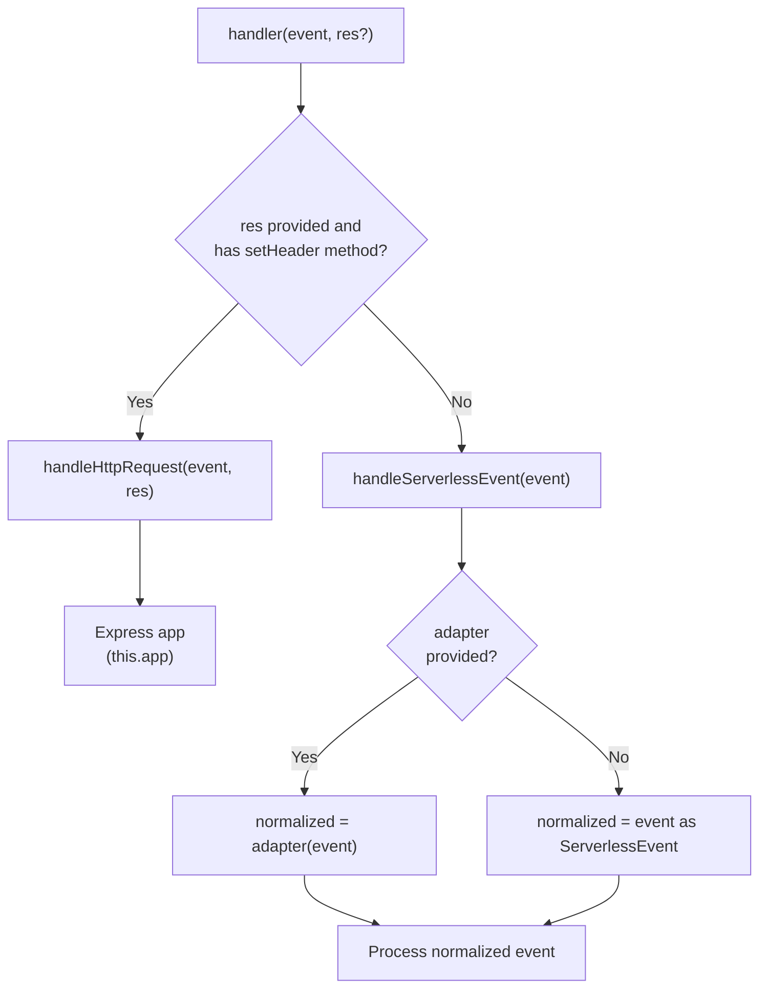
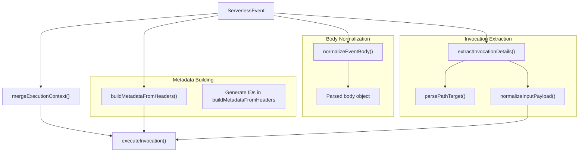

<!-- source: DeepWiki mcp.deepwiki.com · repo Agent-Field/agentfield · page 4.7 Serverless Handler · fetched 2026-10-26 -->

# Serverless Handler

<details>
<summary>Relevant source files</summary>

The following files were used as context for generating this wiki page:

- [examples/ts-node-examples/waiting-state/main.ts](examples/ts-node-examples/waiting-state/main.ts)
- [sdk/typescript/src/agent/Agent.ts](sdk/typescript/src/agent/Agent.ts)
- [sdk/typescript/src/agent/cancel.ts](sdk/typescript/src/agent/cancel.ts)
- [sdk/typescript/src/agent/pause.ts](sdk/typescript/src/agent/pause.ts)
- [sdk/typescript/src/ai/AIClient.ts](sdk/typescript/src/ai/AIClient.ts)
- [sdk/typescript/src/client/AgentFieldClient.ts](sdk/typescript/src/client/AgentFieldClient.ts)
- [sdk/typescript/src/context/ReasonerContext.ts](sdk/typescript/src/context/ReasonerContext.ts)
- [sdk/typescript/src/index.ts](sdk/typescript/src/index.ts)
- [sdk/typescript/src/router/AgentRouter.ts](sdk/typescript/src/router/AgentRouter.ts)
- [sdk/typescript/src/triggers/factories.ts](sdk/typescript/src/triggers/factories.ts)
- [sdk/typescript/src/triggers/index.ts](sdk/typescript/src/triggers/index.ts)
- [sdk/typescript/src/triggers/types.ts](sdk/typescript/src/triggers/types.ts)
- [sdk/typescript/src/types/agent.ts](sdk/typescript/src/types/agent.ts)
- [sdk/typescript/src/types/reasoner.ts](sdk/typescript/src/types/reasoner.ts)
- [sdk/typescript/tests/agent.test.ts](sdk/typescript/tests/agent.test.ts)
- [sdk/typescript/tests/agent_async_execution.test.ts](sdk/typescript/tests/agent_async_execution.test.ts)
- [sdk/typescript/tests/agent_pause.test.ts](sdk/typescript/tests/agent_pause.test.ts)
- [sdk/typescript/tests/agent_runtime_paths.test.ts](sdk/typescript/tests/agent_runtime_paths.test.ts)
- [sdk/typescript/tests/ai_client.test.ts](sdk/typescript/tests/ai_client.test.ts)
- [sdk/typescript/tests/triggers.test.ts](sdk/typescript/tests/triggers.test.ts)

</details>


The serverless handler provides a unified interface for deploying AgentField agents to serverless platforms like AWS Lambda, Azure Functions, Google Cloud Functions, Vercel, and Netlify. It handles event normalization, execution context propagation, and capability discovery for serverless environments where agents cannot run long-lived HTTP servers.

For long-running agent deployments using `agent.serve()`, see [TypeScript SDK Agent Class](). For general serverless deployment guidance, see [Serverless Deployment](). For the Python equivalent, see [Serverless Mode]().

---

## Handler Method

The `agent.handler()` method returns an `AgentHandler` function that can be exported as the entry point for serverless functions. It accepts an optional adapter function to transform platform-specific event formats into the normalized `ServerlessEvent` contract.

**Method Signature:**
`handler(adapter?: (event: any, context?: any) => ServerlessEvent): AgentHandler` [[sdk/typescript/src/agent/Agent.ts:123-134]()]

The returned `AgentHandler` has the signature:
[[sdk/typescript/src/types/agent.ts:218-221]()]

```typescript
type AgentHandler = (
  event: ServerlessEvent | http.IncomingMessage,
  res?: http.ServerResponse
) => Promise<ServerlessResponse | void> | ServerlessResponse | void
```

**Sources:** [sdk/typescript/src/agent/Agent.ts:123-134](), [sdk/typescript/src/types/agent.ts:192-208](), [sdk/typescript/src/types/agent.ts:218-221]()

---

## Handler Decision Flow

The handler automatically detects whether it's processing an HTTP request (Vercel/Netlify) or a generic serverless event (AWS Lambda/Cloud Functions) based on the presence of a response object with a `setHeader` method [[sdk/typescript/src/agent/Agent.ts:516-519]()].

**Handler Routing Logic**



**Sources:** [sdk/typescript/src/agent/Agent.ts:123-134](), [sdk/typescript/src/agent/Agent.ts:516-519](), [sdk/typescript/src/agent/Agent.ts:521-578]()

---

## ServerlessEvent Contract

The `ServerlessEvent` type defines a normalized event structure that abstracts differences between serverless platforms [[sdk/typescript/src/types/agent.ts:192-208]()].

| Field | Type | Description |
|-------|------|-------------|
| `path` | `string` | Request path (e.g., `/execute/summarize`) |
| `httpMethod` | `string` | HTTP method (POST, GET, etc.) |
| `headers` | `Record<string, string>` | HTTP headers for context propagation |
| `target` | `string` | Target reasoner/skill name |
| `reasoner` | `string` | Explicit reasoner name |
| `skill` | `string` | Explicit skill name |
| `type` | `'reasoner' \| 'skill'` | Target type |
| `body` | `any` | Request body (may be string or parsed object) |
| `input` | `any` | Direct input data |
| `executionContext` | `RawExecutionContext` | Execution metadata (camelCase) |

**Sources:** [sdk/typescript/src/types/agent.ts:192-208](), [sdk/typescript/src/types/agent.ts:225-249]()

---

## Adapter Pattern

Adapters transform platform-specific event formats into the `ServerlessEvent` contract [[sdk/typescript/src/types/agent.ts:216-216]()].

**Adapter Function Type:**
`type ServerlessAdapter = (event: any, context?: any) => ServerlessEvent`

**Example AWS Lambda Adapter:**
```typescript
function lambdaAdapter(event: any): ServerlessEvent {
  return {
    path: event.rawPath ?? event.path,
    httpMethod: event.requestContext?.http?.method ?? event.httpMethod,
    headers: event.headers ?? {},
    body: event.body,
    executionContext: {
      executionId: event.headers?.['x-execution-id']
    }
  };
}

export const handler = agent.handler(lambdaAdapter);
```

**Sources:** [sdk/typescript/src/types/agent.ts:216-216](), [sdk/typescript/src/agent/Agent.ts:123-134]()

---

## Event Normalization Pipeline

The handler normalizes incoming events through multiple stages to extract the target reasoner/skill name, input data, and execution metadata [[sdk/typescript/src/agent/Agent.ts:521-578]()].

**Event Processing Pipeline**



**Sources:** [sdk/typescript/src/agent/Agent.ts:580-589](), [sdk/typescript/src/agent/Agent.ts:621-659](), [sdk/typescript/src/agent/Agent.ts:489-514](), [sdk/typescript/src/agent/Agent.ts:591-619]()

---

## Body Normalization

The `normalizeEventBody()` method handles various body formats and ensures the `input` field is properly extracted [[sdk/typescript/src/agent/Agent.ts:580-589]()].

**Normalization Logic:**
1. Parse string body to JSON if needed [[sdk/typescript/src/agent/Agent.ts:582-582]()].
2. If `event.input` is defined but parsed body doesn't have `input`, merge them [[sdk/typescript/src/agent/Agent.ts:585-585]()].
3. Return parsed body object.

**Sources:** [sdk/typescript/src/agent/Agent.ts:580-589]()

---

## Invocation Target Extraction

The `extractInvocationDetails()` method determines which reasoner or skill to invoke by checking multiple sources in priority order [[sdk/typescript/src/agent/Agent.ts:621-659]()].

**Priority Order for Target Name:**
1. Explicit `target` parameter [[sdk/typescript/src/agent/Agent.ts:622-622]()].
2. `parsePathTarget()` from the URL path [[sdk/typescript/src/agent/Agent.ts:627-627]()].
3. Query string parameters (`target`, `reasoner`, `skill`) [[sdk/typescript/src/agent/Agent.ts:631-633]()].
4. Event fields [[sdk/typescript/src/agent/Agent.ts:634-636]()].
5. Body fields [[sdk/typescript/src/agent/Agent.ts:637-639]()].

**Path Parsing:**
The `parsePathTarget()` method extracts targets from URL paths [[sdk/typescript/src/agent/Agent.ts:661-683]()]:
- `/reasoners/{name}` -> `reasoner` [[sdk/typescript/src/agent/Agent.ts:663-663]()]
- `/skills/{name}` -> `skill` [[sdk/typescript/src/agent/Agent.ts:668-668]()]
- `/execute/{name}` -> target name [[sdk/typescript/src/agent/Agent.ts:673-673]()]

**Sources:** [sdk/typescript/src/agent/Agent.ts:621-659](), [sdk/typescript/src/agent/Agent.ts:661-683]()

---

## Execution Context Propagation

Execution metadata flows through serverless invocations via HTTP headers and the `executionContext` field. The handler merges these sources [[sdk/typescript/src/agent/Agent.ts:591-619]()].

**Metadata Mapping:**
The `normalizeExecutionContext()` function maps both camelCase and snake_case fields to the standard `ExecutionMetadata` [[sdk/typescript/src/agent/Agent.ts:92-108]()].

| Header | Metadata Field |
|--------|----------------|
| `X-Execution-ID` | `executionId` |
| `X-Run-ID` | `runId` |
| `X-Workflow-ID` | `workflowId` |
| `X-Caller-DID` | `callerDid` |

**Sources:** [sdk/typescript/src/agent/Agent.ts:92-108](), [sdk/typescript/src/agent/Agent.ts:489-514](), [sdk/typescript/src/agent/Agent.ts:591-619]()

---

## Discovery Endpoint

Serverless agents must expose a `/discover` endpoint. The handler responds to `path === '/discover'` or `action === 'discover'` with the discovery payload [[sdk/typescript/src/agent/Agent.ts:525-530]()].

**Discovery Response Structure:**
The `discoveryPayload()` method generates the JSON response containing registered reasoners and skills [[sdk/typescript/src/agent/Agent.ts:749-757]()].

**Sources:** [sdk/typescript/src/agent/Agent.ts:525-530](), [sdk/typescript/src/agent/Agent.ts:749-757]()

---

## Deployment Types

The `deploymentType` configuration controls how the agent behaves.
- `long_running`: Uses heartbeats and auto-registration [[sdk/typescript/src/agent/Agent.ts:153-153]()].
- `serverless`: Designed for on-demand invocation [[sdk/typescript/src/types/agent.ts:8-8]()].

**Sources:** [sdk/typescript/src/agent/Agent.ts:153-153](), [sdk/typescript/src/types/agent.ts:8-8](), [sdk/typescript/src/types/agent.ts:28-28]()

---

## ServerlessResponse Contract

The handler returns a `ServerlessResponse` object for serverless invocations [[sdk/typescript/src/types/agent.ts:210-214]()].

**Response Structure:**
```typescript
interface ServerlessResponse {
  statusCode: number;
  headers?: Record<string, string>;
  body: any;
}
```

**Sources:** [sdk/typescript/src/types/agent.ts:210-214](), [sdk/typescript/src/agent/Agent.ts:565-577]()

---

