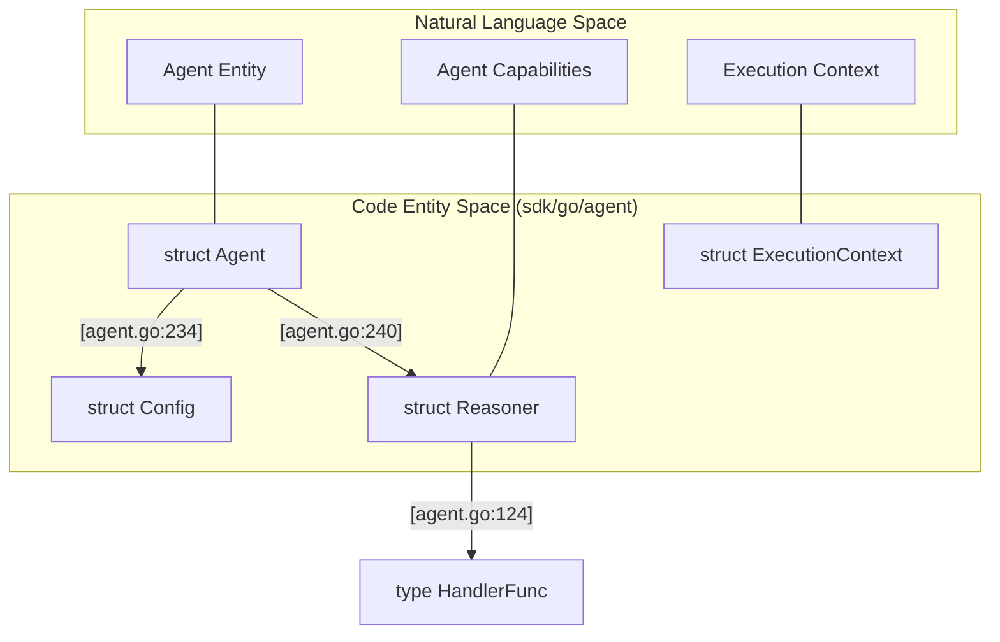
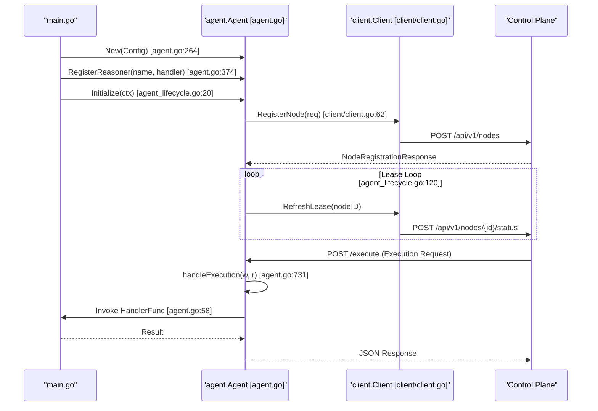

<!-- source: DeepWiki mcp.deepwiki.com · repo Agent-Field/agentfield · page 5 Go SDK · fetched 2026-10-26 -->

# Go SDK

<details>
<summary>Relevant source files</summary>

The following files were used as context for generating this wiki page:

- [examples/go_agent_nodes/go.mod](examples/go_agent_nodes/go.mod)
- [examples/go_agent_nodes/go.sum](examples/go_agent_nodes/go.sum)
- [sdk/go/agent/agent.go](sdk/go/agent/agent.go)
- [sdk/go/agent/agent_lifecycle.go](sdk/go/agent/agent_lifecycle.go)
- [sdk/go/agent/agent_test.go](sdk/go/agent/agent_test.go)
- [sdk/go/agent/cli.go](sdk/go/agent/cli.go)
- [sdk/go/agent/cli_test.go](sdk/go/agent/cli_test.go)
- [sdk/go/agent/pause.go](sdk/go/agent/pause.go)
- [sdk/go/agent/pause_test.go](sdk/go/agent/pause_test.go)
- [sdk/go/agent/version.go](sdk/go/agent/version.go)
- [sdk/go/ai/tool_calling.go](sdk/go/ai/tool_calling.go)
- [sdk/go/ai/tool_calling_test.go](sdk/go/ai/tool_calling_test.go)
- [sdk/go/go.mod](sdk/go/go.mod)
- [sdk/go/go.sum](sdk/go/go.sum)
- [sdk/go/harness/claudecode.go](sdk/go/harness/claudecode.go)
- [sdk/go/harness/coverage_branches_test.go](sdk/go/harness/coverage_branches_test.go)
- [sdk/go/harness/coverage_helpers_test.go](sdk/go/harness/coverage_helpers_test.go)
- [sdk/go/harness/parity_test.go](sdk/go/harness/parity_test.go)
- [sdk/go/harness/provider.go](sdk/go/harness/provider.go)
- [sdk/go/harness/result.go](sdk/go/harness/result.go)
- [sdk/go/harness/runner.go](sdk/go/harness/runner.go)
- [sdk/go/harness/runner_test.go](sdk/go/harness/runner_test.go)
- [sdk/go/harness/schema.go](sdk/go/harness/schema.go)

</details>


## Purpose and Scope

The Go SDK provides a robust, high-performance interface for building AgentField agents in Go. Unlike the Python and TypeScript SDKs which often focus on high-level AI abstractions, the Go SDK provides a comprehensive set of tools for building full-featured agents, including **Reasoners**, **Skills**, and advanced **Harness** orchestration for autonomous coding tasks.

**Related pages:**
- For detailed information on initializing agents, see [Agent Initialization](#5.1)
- For skill and reasoner registration patterns, see [Registering Skills](#5.2)

---

## Architecture Overview

The Go SDK implements the AgentField agent-as-service model. An `Agent` instance manages its own HTTP server to receive execution requests and a background client to maintain connectivity with the Control Plane.

### Bridge: Natural Language to Code Entity Space

The following diagram maps the logical concepts of an agent to the specific Go types and fields used in the SDK.


**Sources:** [sdk/go/agent/agent.go:121-153](), [sdk/go/agent/agent.go:233-260](), [sdk/go/agent/agent.go:33-51]()

### System Interaction Diagram

This diagram illustrates how the `Agent` struct interacts with the `Control Plane` via the `client.Client`.


**Sources:** [sdk/go/agent/agent.go:264-340](), [sdk/go/agent/agent.go:731-800](), [sdk/go/agent/agent_lifecycle.go:20-100]()

---

## Core Components

### The Agent Instance
The `Agent` struct is the central coordinator. It is created using `agent.New(cfg)` and handles the lifecycle of the agent node, including registration, heartbeats (leases), and request routing.
**Sources:** [sdk/go/agent/agent.go:233-260]()

### Reasoners and Skills
In the Go SDK, capabilities are registered as **Reasoners**. A Reasoner is a named handler that can be invoked by the Control Plane. 
- **HandlerFunc**: The core logic of a capability, defined as `func(ctx context.Context, input map[string]any) (any, error)`.
- **Triggers**: Reasoners can be bound to external events (e.g., GitHub webhooks) or schedules (cron) using `WithTriggers`.
**Sources:** [sdk/go/agent/agent.go:58-58](), [sdk/go/agent/agent.go:122-153](), [sdk/go/agent/agent.go:188-202]()

### Harness Orchestration
The Go SDK includes a sophisticated `harness.Runner` for delegating tasks to autonomous coding agents like Claude Code or OpenCode. It supports:
- **Schema Validation**: Forcing the coding agent to return structured JSON.
- **Incremental Mode**: Building complex JSON objects field-by-field for higher reliability.
- **Provider Abstraction**: A unified interface for `opencode`, `claude-code`, `codex`, and `gemini`.
**Sources:** [sdk/go/harness/runner.go:21-33](), [sdk/go/harness/runner.go:53-158](), [sdk/go/harness/provider.go:5-14]()

---

## Feature Comparison

| Feature | Go SDK Implementation | Reference |
| :--- | :--- | :--- |
| **Identity** | W3C DIDs and Key Management | `sdk/go/did/` |
| **AI Integration** | `ai.Client` with multi-provider support | `sdk/go/ai/ai.go` |
| **Tool Calling** | Automated mapping of Reasoners to LLM tools | `sdk/go/ai/tool_calling.go` |
| **Harness** | Native CLI-based coding agent orchestration | `sdk/go/harness/runner.go` |
| **CLI Mode** | Built-in support for running reasoners via CLI | `sdk/go/agent/cli.go` |

---

## Quick Start Example

```go
package main

import (
	"context"
	"github.com/Agent-Field/agentfield/sdk/go/agent"
)

func main() {
	// 1. Initialize the Agent
	cfg := agent.Config{
		NodeID:        "my-go-agent",
		Version:       "1.0.0",
		AgentFieldURL: "http://localhost:8080",
	}
	a, _ := agent.New(cfg)

	// 2. Register a capability (Reasoner)
	a.RegisterReasoner("hello", func(ctx context.Context, input map[string]any) (any, error) {
		name, _ := input["name"].(string)
		return map[string]any{"message": "Hello " + name}, nil
	})

	// 3. Start the Agent
	a.Initialize(context.Background())
	a.Run()
}
```
**Sources:** [sdk/go/agent/agent.go:264-340](), [sdk/go/agent/agent.go:374-385]()

---

## Project Template

When using the `af` CLI to initialize a Go agent, the following structure is generated:

```text
my-agent/
├── go.mod              # Module definition [sdk/go/go.mod]
├── main.go             # Agent entry point using agent.New()
└── internal/           # Optional internal logic
```
**Sources:** [sdk/go/go.mod:1-9]()

---

## Installation

Add the Go SDK to your project using `go get`:

```bash
go get github.com/Agent-Field/agentfield/sdk/go
```
**Sources:** [sdk/go/go.mod:1-5]()

---

