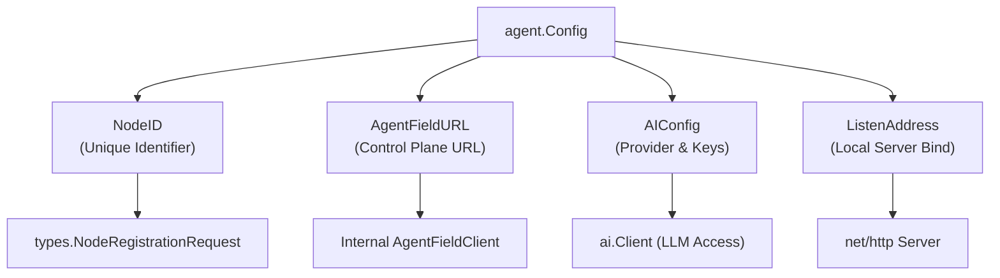
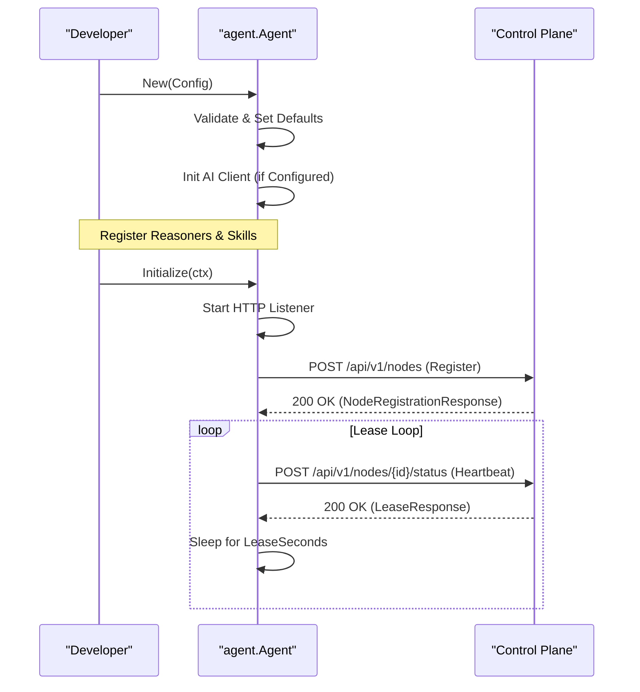

<!-- source: DeepWiki mcp.deepwiki.com · repo Agent-Field/agentfield · page 5.1 Agent Initialization · fetched 2026-10-26 -->

# Agent Initialization

<details>
<summary>Relevant source files</summary>

The following files were used as context for generating this wiki page:

- [examples/go_agent_nodes/go.mod](examples/go_agent_nodes/go.mod)
- [examples/go_agent_nodes/go.sum](examples/go_agent_nodes/go.sum)
- [sdk/go/agent/agent.go](sdk/go/agent/agent.go)
- [sdk/go/agent/agent_lifecycle.go](sdk/go/agent/agent_lifecycle.go)
- [sdk/go/agent/agent_test.go](sdk/go/agent/agent_test.go)
- [sdk/go/agent/cli.go](sdk/go/agent/cli.go)
- [sdk/go/agent/cli_test.go](sdk/go/agent/cli_test.go)
- [sdk/go/agent/pause.go](sdk/go/agent/pause.go)
- [sdk/go/agent/pause_test.go](sdk/go/agent/pause_test.go)
- [sdk/go/agent/version.go](sdk/go/agent/version.go)
- [sdk/go/ai/tool_calling.go](sdk/go/ai/tool_calling.go)
- [sdk/go/ai/tool_calling_test.go](sdk/go/ai/tool_calling_test.go)
- [sdk/go/go.mod](sdk/go/go.mod)
- [sdk/go/go.sum](sdk/go/go.sum)
- [sdk/go/harness/claudecode.go](sdk/go/harness/claudecode.go)
- [sdk/go/harness/coverage_branches_test.go](sdk/go/harness/coverage_branches_test.go)
- [sdk/go/harness/coverage_helpers_test.go](sdk/go/harness/coverage_helpers_test.go)
- [sdk/go/harness/parity_test.go](sdk/go/harness/parity_test.go)
- [sdk/go/harness/provider.go](sdk/go/harness/provider.go)
- [sdk/go/harness/result.go](sdk/go/harness/result.go)
- [sdk/go/harness/runner.go](sdk/go/harness/runner.go)
- [sdk/go/harness/runner_test.go](sdk/go/harness/runner_test.go)
- [sdk/go/harness/schema.go](sdk/go/harness/schema.go)

</details>


## Purpose and Scope

This page documents how to create and initialize agent nodes using the Go SDK. It covers the `agent.New()` constructor, configuration options, AI client setup, and the agent registration lifecycle with the control plane.

For information about registering skills and reasoners after initialization, see [Registering Skills](5.2). For Python SDK agent initialization, see [Agent Class](3.1). For TypeScript SDK initialization, see [Agent Class](4.1).

---

## Overview

The Go SDK provides the `agent` package for creating agent nodes that register with the AgentField control plane. Agent initialization is a two-step process:

1.  **Create the agent** with `agent.New()` and a `Config` struct.
2.  **Initialize and Run** the agent to register capabilities and begin serving requests.

```go
cfg := agent.Config{
    NodeID:        "go-researcher",
    Version:       "1.0.0",
    AgentFieldURL: "http://localhost:8001",
}

app, err := agent.New(cfg)
if err != nil {
    log.Fatal(err)
}

// Register reasoners/skills here...

if err := app.Initialize(context.Background()); err != nil {
    log.Fatal(err)
}
```

**Sources:** [sdk/go/agent/agent.go:273-280](), [sdk/go/agent/agent_test.go:25-45]()

---

## Agent Constructor

### The `New()` Function

The `agent.New()` function creates a new agent instance with the specified configuration [sdk/go/agent/agent.go:273]().

The constructor:
*   Validates the configuration (NodeID and Version are strictly required) [sdk/go/agent/agent_test.go:46-61]().
*   Applies default values for `TeamID` ("default"), `ListenAddress` (":8001"), and `LeaseRefreshInterval` (2 minutes) [sdk/go/agent/agent_test.go:101-114]().
*   Initializes the internal `httpClient` with a default `CallTimeout` of 15 seconds [sdk/go/agent/agent_test.go:73-85]().
*   Sets up the AI client if `AIConfig` is provided [sdk/go/agent/agent_test.go:116-131]().

**Sources:** [sdk/go/agent/agent.go:273-350](), [sdk/go/agent/agent_test.go:25-144]()

---

## Configuration Structure

### Config Fields

The `Config` struct defines the agent's identity, connection parameters, and AI settings:

| Field | Type | Required | Description |
| :--- | :--- | :--- | :--- |
| `NodeID` | `string` | **Yes** | Unique identifier for this agent node. |
| `Version` | `string` | **Yes** | Semantic version of the agent code. |
| `AgentFieldURL` | `string` | Yes | Control plane base URL (e.g., `http://localhost:8001`). |
| `TeamID` | `string` | No | Team ownership (defaults to "default"). |
| `ListenAddress` | `string` | No | Network address to bind (defaults to ":8001"). |
| `AIConfig` | `*ai.Config` | No | Configuration for LLM providers (OpenAI, Anthropic, etc.). |
| `CallTimeout` | `time.Duration`| No | Timeout for outgoing calls (defaults to 15s). |

**Sources:** [sdk/go/agent/agent.go:237-271](), [sdk/go/agent/agent_test.go:32-114]()

### Configuration Data Flow



**Sources:** [sdk/go/agent/agent.go:237-271](), [sdk/go/agent/agent_test.go:231-252]()

---

## AI Client Setup

If the agent needs to use LLMs directly (e.g., within a Reasoner), the `AIConfig` must be populated during initialization. The Go SDK supports multiple providers through the `ai` package.

```go
cfg := agent.Config{
    // ... other config ...
    AIConfig: &ai.Config{
        Provider: "openai",
        Model:    "gpt-4o",
        APIKey:   "sk-...",
    },
}
```

When `AIConfig` is present, `agent.New()` initializes an `aiClient` that is accessible to handlers via the execution context.

**Sources:** [sdk/go/agent/agent.go:323-333](), [sdk/go/agent/agent_test.go:116-131]()

---

## Initialization Lifecycle

### Sequence Diagram: Agent Startup



**Sources:** [sdk/go/agent/agent_test.go:231-274](), [sdk/go/agent/agent.go:420-460]()

---

## Registration with Control Plane

### Node Registration

When `Initialize()` is called, the agent sends a `NodeRegistrationRequest` to the control plane. This includes the agent's ID, version, team, and its entire capability manifest (Reasoners and Skills).

**Key Code Entity:** `types.NodeRegistrationRequest`

The registration process:
1.  Calculates the `CallbackURL` if not explicitly provided [sdk/go/agent/agent.go:440]().
2.  Marshals all registered `reasoners` and `skills` into the request [sdk/go/agent/agent.go:445]().
3.  Sends the payload to the `/api/v1/nodes` endpoint [sdk/go/agent/agent_test.go:232-244]().

**Sources:** [sdk/go/agent/agent.go:420-460](), [sdk/go/agent/agent_test.go:231-274]()

### Lease and Heartbeat

After successful registration, the agent enters a "Lease Loop". It periodically sends heartbeats to the control plane to maintain its "Active" status. The interval is governed by `LeaseRefreshInterval` in the config or the `LeaseSeconds` returned by the server.

**Sources:** [sdk/go/agent/agent.go:462-500](), [sdk/go/agent/agent_test.go:245-251]()

---

## Execution Context

Every invocation of an agent's reasoner or skill is accompanied by an `ExecutionContext`. This context contains metadata about the current workflow, including:

*   **IDs**: `RunID`, `ExecutionID`, `WorkflowID` [sdk/go/agent/agent.go:34-41]().
*   **Identity**: `ActorID`, `CallerDID`, `TargetDID` [sdk/go/agent/agent.go:38-49]().
*   **Trace**: `Depth`, `ParentExecutionID` [sdk/go/agent/agent.go:36-42]().

This context is injected into the Go `context.Context` and can be retrieved within handlers to track state or perform cross-agent calls.

**Sources:** [sdk/go/agent/agent.go:33-51]()

---

## Environment Variables

The Go SDK respects several environment variables for configuration, particularly useful in containerized environments:

| Variable | Config Equivalent |
| :--- | :--- |
| `AGENTFIELD_URL` | `AgentFieldURL` |
| `AGENT_NODE_ID` | `NodeID` |
| `AGENT_TEAM_ID` | `TeamID` |
| `PORT` | Influences `ListenAddress` |

**Sources:** [sdk/go/agent/agent.go:15-21]() (Usage of `os` package), [sdk/go/agent/agent_test.go:12-16]()

---

